# Sparkles ✨

Sparkles is a fast RDF, SPARQL and OWL database written in Rust. It reimplements
[Apache Jena](https://jena.apache.org/) and Fuseki, with their protocols, semantics and
operational model, on the index and execution architecture of
[QLever](https://github.com/ad-freiburg/qlever). It ships as an embeddable library with
Rust, Python, JVM and JavaScript APIs, a Fuseki-compatible server and CLI, and a web UI.
The JVM binding implements Jena's `DatasetGraph`, letting Java and Kotlin applications
use Sparkles through Jena's existing query, model and transaction APIs.

> [!WARNING]
> Sparkles is experimental. There are no releases, and the on-disk format, HTTP API, CLI
> and library APIs can change in any commit without a migration path. Don't use it for
> data you can't regenerate.
>
> Much of the code, tests and documentation was written with AI models, directed and
> reviewed by the maintainer. The W3C conformance suites and differential tests are the
> main safeguard, but expect bugs. Issues and bug reports are welcome.

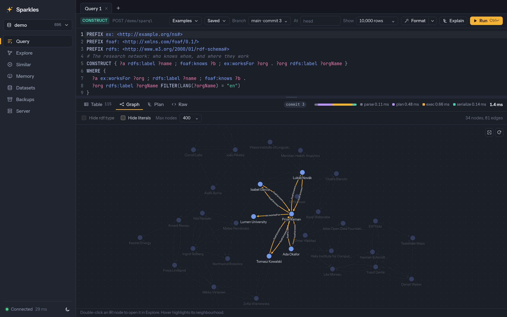

## Why Sparkles

Jena and Fuseki have the protocols, tools and operational model that RDF applications
depend on, and QLever has an index and executor built for speed. Sparkles puts the first
on top of the second:

1. **Jena-compatible where users can see it.** Anything that talks to Fuseki keeps
   working. Sparkles implements the SPARQL 1.1 Query, Update and Graph Store protocols,
   Fuseki's endpoints and `/$/` admin API, Jena's formats and dataset semantics, and
   TDB2's model of bulk loads, transactions, compaction and backups. The JVM binding
   brings that compatibility into the application: open a Sparkles dataset and keep
   using Jena's `Model`, RIOT, `Txn` and `QueryExecution` APIs.
2. **QLever-style internals where performance matters.** Terms are 64-bit ids with
   numbers and dates stored inline, indexes are sorted and compressed permutations, and
   a cost-based planner drives column-at-a-time execution. Sparkles adds MVCC
   transactions, durable commits, online compaction and a history that can be read,
   diffed and branched.
3. **Library first.** The engine is a library with no HTTP server. The server, the CLI
   and the Python, JVM and Node.js bindings are built on its public API, so an embedded
   program gets the same features as the server. The term model, parsers and SPARQL
   algebra come from the Oxigraph project's crates.

## Getting started

Build from source, run it with Nix, or use Docker. Building the UI first embeds it in
the binary.

```sh
pnpm -C ui install && pnpm -C ui build        # the web UI, optional
cargo install --path crates/sparkles-server   # installs the `sparkles` binary
nix run github:kclejeune/sparkles -- serve --data ./data
docker compose up --build -d                  # UI and server on 127.0.0.1:3030
```

Load a file and serve it, or create a dataset on a running server:

```sh
sparkles load --loc ./books books.ttl
sparkles serve --data ./data --loc books=./books

curl -X POST 'localhost:3030/$/datasets' -d 'dbName=films&dbType=persistent'
curl -X POST 'localhost:3030/films/data?default' -H 'Content-Type: text/turtle' --data-binary @films.ttl
```

Query it over HTTP or from the command line:

```sh
curl localhost:3030/books/sparql -H 'Accept: text/csv' \
  --data-urlencode 'query=SELECT ?s ?p ?o WHERE { ?s ?p ?o } LIMIT 10'
sparkles query --loc ./books 'SELECT (COUNT(*) AS ?n) { ?s ?p ?o }'
sparkles query --data books.ttl --query q.rq   # files in memory, no database
```

The web UI is at <http://localhost:3030/ui/>. [docs/USAGE.md](docs/USAGE.md) covers
running and operating the server, and `sparkles help COMMAND` describes each command.

### Libraries and bindings

**Use Sparkles through Apache Jena.** The JVM library provides Jena's `DatasetGraph`:
change the line that opens a TDB2 dataset and keep using Jena's query, model, RDF I/O
and transaction APIs.

```java
try (DatasetGraphSparkles dsg = SparklesDatasets.open(Path.of("mydb"))) {
    Dataset ds = DatasetFactory.wrap(dsg);
    Txn.executeRead(ds, () -> { /* QueryExecution, Model and RIOT as usual */ });
}
```

[The JVM/Jena guide](docs/USAGE.md#jvm-apache-jena) covers building the binding,
queries, updates, transactions, importing TDB2 data and compatibility differences.

The `sparkles` Rust crate embeds the engine with no HTTP server or async runtime by
default:

```rust
use sparkles::Dataset;

let ds = Dataset::open("mydb")?;                 // or Dataset::memory()
ds.load_file("data.ttl.gz")?;
for row in &ds.select("SELECT ?s ?name { ?s <http://xmlns.com/foaf/0.1/name> ?name }")? {
    println!("{} {}", row.get("s").unwrap(), row.get("name").unwrap());
}
```

| API | Integration and examples |
|---|---|
| [Rust](docs/USAGE.md#embedding-the-library) | `Dataset`, query builders, extension functions and administration handles. |
| [Python](docs/USAGE.md#python) | A pyoxigraph-style API and an rdflib store plugin. |
| [Node.js / TypeScript](docs/USAGE.md#javascript-and-typescript) | RDF/JS terms and asynchronous results from the embedded engine. |

The binding packages are not published to a registry. Build them with
`mise run jvm:build`, `mise run py:build` or `mise run node:build`.

### Agents

`sparkles mcp` serves a database to an MCP host such as Claude Code or Claude Desktop.
A running server also serves MCP over HTTP at `/$/mcp`, with the caller's grants.

```sh
claude mcp add sparkles -- sparkles mcp --loc ./books
```

Agents get tools to explore the schema, check and run queries, recall and record facts,
and hand a query to the web UI for a person to review
([usage](docs/USAGE.md#mcp-server-llm-agents)). With a model configured, the server's
Ask bar answers questions in plain language ([usage](docs/USAGE.md#asking-questions-with-a-model)).

## Architecture

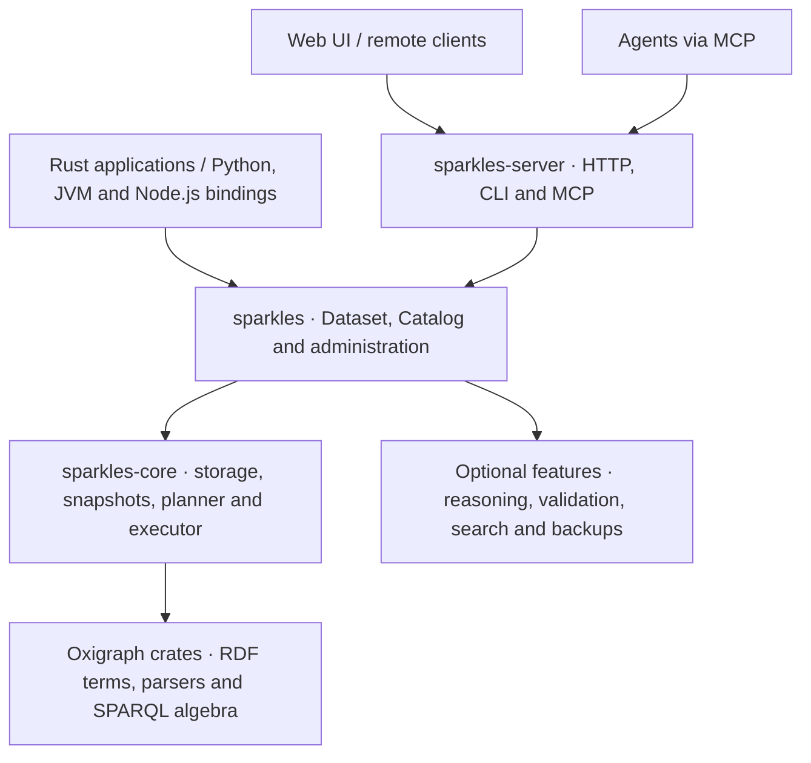

Embedded programs and the server share the same library and engine. Jena and Fuseki
guide compatibility. QLever inspires the sorted indexes and columnar execution.
Sparkles adds durable transactions, online compaction, history and branches in the
shared Rust engine. [docs/ARCHITECTURE.md](docs/ARCHITECTURE.md) explains the boundaries,
optimization mechanisms and implemented decisions across the design specs.

## Features

* **Storage and history.** MVCC snapshots, durable commits, parallel bulk loads,
  online compaction, historical reads, diffs, branches and merges.
* **Query.** Passes the SPARQL 1.1 and 1.2 W3C suites, with Jena ARQ extensions,
  federated `SERVICE`, query plans and execution budgets.
* **Search.** Jena-compatible full-text search, HNSW vector similarity, embeddings
  computed on write by a provider or a local model, path search, graph algorithms and
  indexed GeoSPARQL 1.1.
* **Reasoning and validation.** Incremental RDFS, OWL 2 RL and Jena rules, SHACL and
  ShEx validation, and schema reports.
* **Server.** Fuseki endpoints and administration, authentication and access control,
  stored queries, GraphQL, metrics, deployment with Docker, Helm and NixOS, and a Home
  Manager module for the client.
* **Agents.** MCP tools, questions answered with checked queries, document ingestion
  and agent memory with sources and branch review.
* **Tooling.** Jena-style CLI commands, SPARQL and RDF formatting and linting, and an
  editor language server.

[docs/FEATURES.md](docs/FEATURES.md) lists every feature and the known gaps.

## Performance

These figures come from one Intel Core i5-13500 with 16 GiB of RAM, with result caches
off and every engine's answers checked before timing.

| 10.5M triples | Sparkles | Best of the others |
|---|---|---|
| Bulk load | **3.7 s** | QLever 9.3 s |
| 28 benchmark queries | **Fastest on 28 of 28**, a median 3.8× faster than QLever | Fluree on `distinct-obj` and Oxigraph on `path-plus` and `values-star` are within 10% |
| WatDiv, 20 templates | **4.63 ms** geometric mean | Fluree 6.97 ms |
| Throughput, 16 clients | **239 q/s** | QLever 90 q/s |
| Durable commit of one new literal | 1.28 ms | **Oxigraph 0.93 ms**, without synchronizing |
| Server memory after the run | **780 MiB**, 379 MiB of it block cache | QLever 795 MiB |
| Peak memory under 16 clients | 1,339 MiB | **QLever 939 MiB** |

On English DBpedia, 1.24 billion triples, Sparkles loads in 480 s against QLever's
1,674 s and Fluree's 2,919 s. It is faster than QLever on all 29 warm queries both
answer and on 29 of 31 cold ones, and faster than Fluree on every cold query. The bindings are faster than TDB2, pyoxigraph and Oxigraph's JavaScript
package on most of the same queries, and slower on some small lookups.

Sparkles uses more memory than QLever at its peaks in exchange for this speed, mostly for
a 1 GiB decoded-block cache for the server that can be made smaller. It is fastest on 13 of
17 SP²Bench queries and 13 of 14 LUBM queries, loses `q12a` to Jena by 12× and LUBM `q2`
to QLever by 3.7×, and its default memory budget refuses two SP²Bench queries.
[docs/BENCHMARKS.md](docs/BENCHMARKS.md) has every measurement, the cost of each memory
tradeoff and every case where Sparkles loses.

## Comparison

| Engine | Where Sparkles stands |
|---|---|
| [Apache Jena / Fuseki](https://jena.apache.org/) | The same protocols, endpoints, admin API, CLI model and ARQ extensions, on sorted columnar indexes. Reasoning is materialized, apart from RDFS on read, and there is no ontology API or JavaScript functions. |
| [QLever](https://github.com/ad-freiburg/qlever) | The same index and execution architecture, plus exact term identity, MVCC updates, the Graph Store Protocol, history, reasoning and validation. QLever is built for larger data and uses less memory. |
| [Fluree](https://github.com/fluree/db) | Both keep history and branches. Sparkles adds full W3C SPARQL conformance and Fuseki compatibility, and has no policies stored in the data or clustering. |
| [Oxigraph](https://github.com/oxigraph/oxigraph) | Sparkles uses Oxigraph's parsers and SPARQL parser with its own storage and planner. Sparkles synchronizes each commit, which makes single writes slower than Oxigraph's defaults. There is no WebAssembly build. |

[docs/COMPARISON.md](docs/COMPARISON.md) lists the gaps per engine and where Sparkles
departs from Jena and QLever on purpose.

## Roadmap

The goal of the current work is the best graph database on the published benchmarks
and in practical use, with the real feature gaps filled. The first release, its packages
and its stability contract come after that work. [docs/ROADMAP.md](docs/ROADMAP.md)
orders every item by difficulty and impact and links each to its design spec.

* **Now.**
  * Benchmarks: BSBM, SP²Bench, LUBM, LDBC and Wikidata query logs, with every
    comparison refreshed at the current head.
  * Writes: group commit as the default.
  * Reads: faster cold sparse lookups.
* **Next.**
  * Execution: hash-join spill and encrypted spill, and QLever's predicate patterns and
    FSST vocabulary compression.
  * Graph algorithms: the Graphalytics benchmark and the UI for the shipped library.
  * Reasoning: materialization fast enough to leave on, with `owl:sameAs` handled by
    representatives and rules evaluated over the compressed indexes.
  * Data model: SHACL 1.2 and ShEx 2.2.
  * UI: a time slider over history.
* **Later.**
  * An incremental computation core for materialized views, live queries and
    provenance per fact. It also drives explanations and query-time reasoning.
  * openCypher.
  * Editing forms generated from shapes.
  * RML mappings and virtual graphs.
  * A local-first WebAssembly engine.
* **Lower tiers.** Smaller backlog items, the release work (packages, server binaries,
  images, format stability, replication) and leftover Jena compatibility features.

## Web UI

The web UI is embedded in the server. It has a query editor with results as tables,
graphs and maps, a resource explorer, schema and validation views, branch history and
merges, a time slider over past commits, the Ask bar, and agent memory. The first screenshots show an answered question,
agent memory, the map view and a merge preview.

<table>
  <tr>
    <td>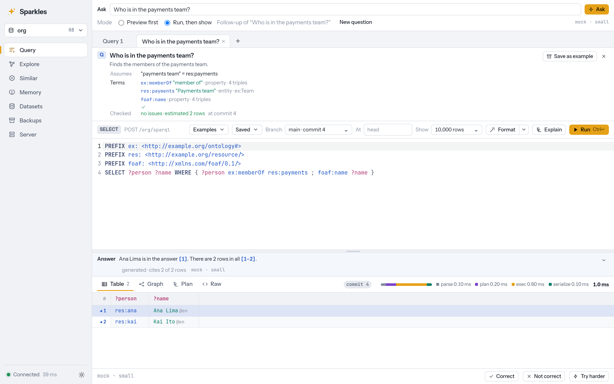</td>
    <td>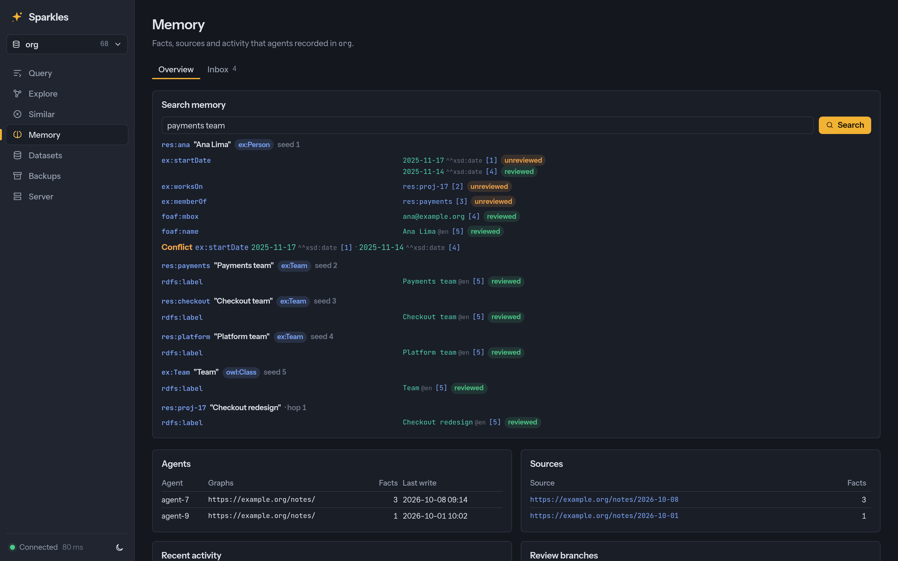</td>
  </tr>
  <tr>
    <td>A question answered with a checked query and a cited summary</td>
    <td>What agent memory holds, with sources and review status</td>
  </tr>
  <tr>
    <td>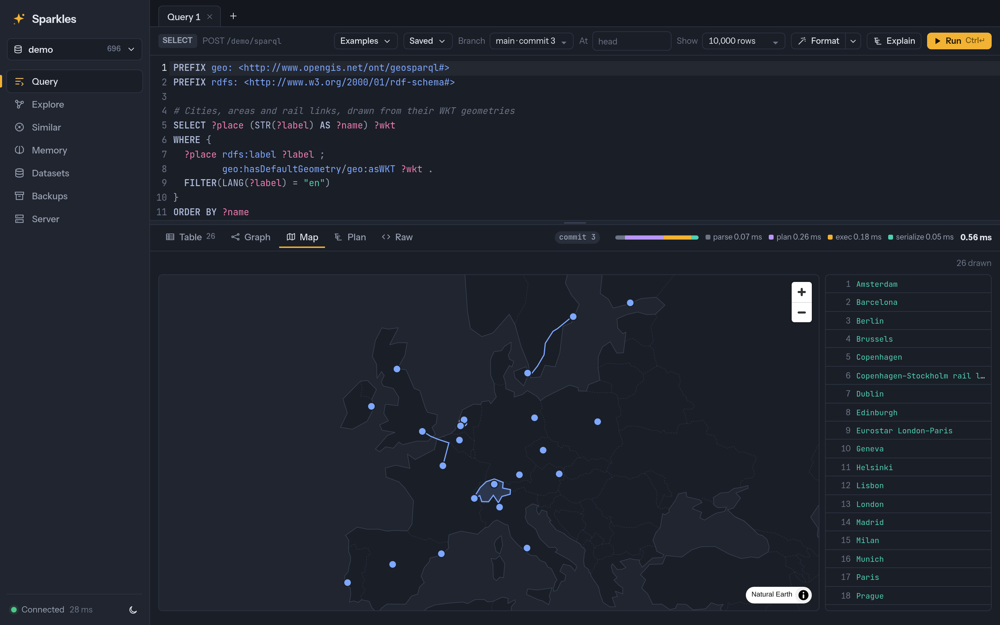</td>
    <td>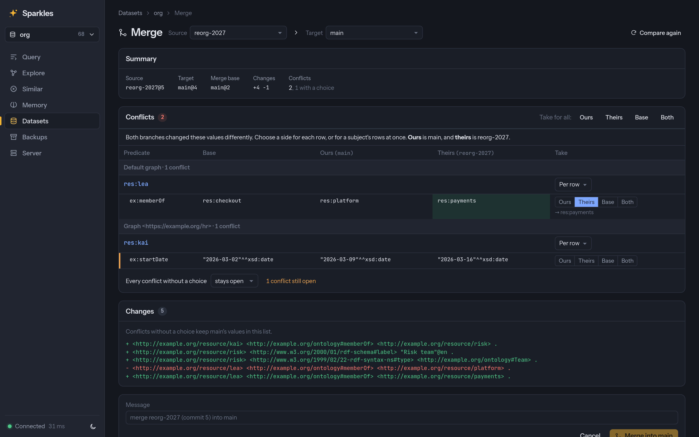</td>
  </tr>
  <tr>
    <td>GeoSPARQL results on a map</td>
    <td>A merge preview with conflicts to resolve</td>
  </tr>
</table>

<details>
<summary>More screenshots and UI workflows</summary>

<table>
  <tr>
    <td>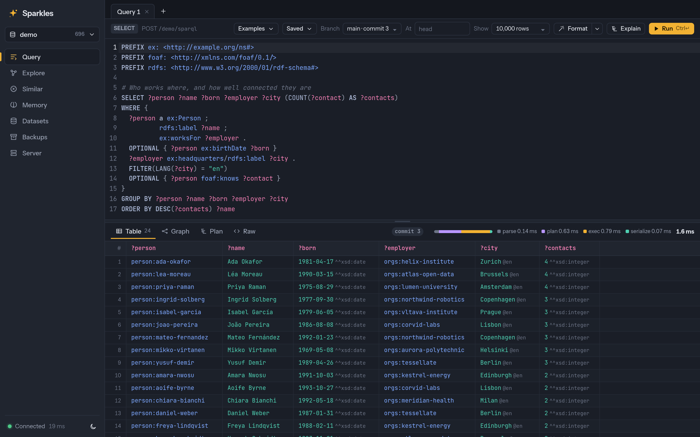</td>
    <td>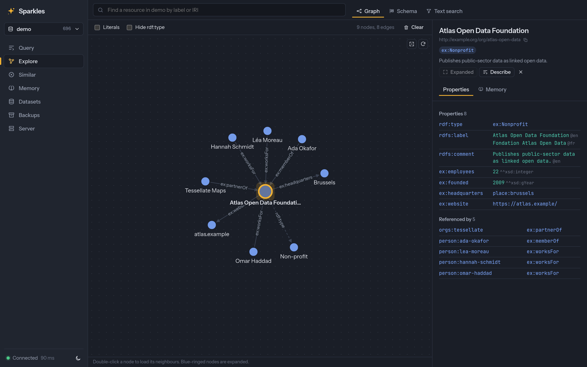</td>
  </tr>
  <tr>
    <td>The query editor and its results</td>
    <td>The resource explorer</td>
  </tr>
  <tr>
    <td>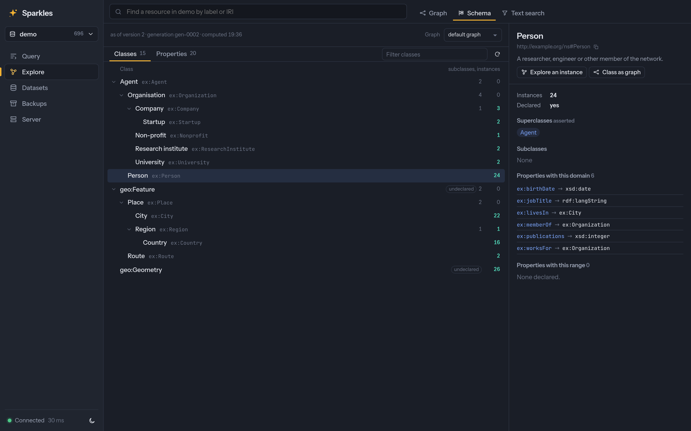</td>
    <td>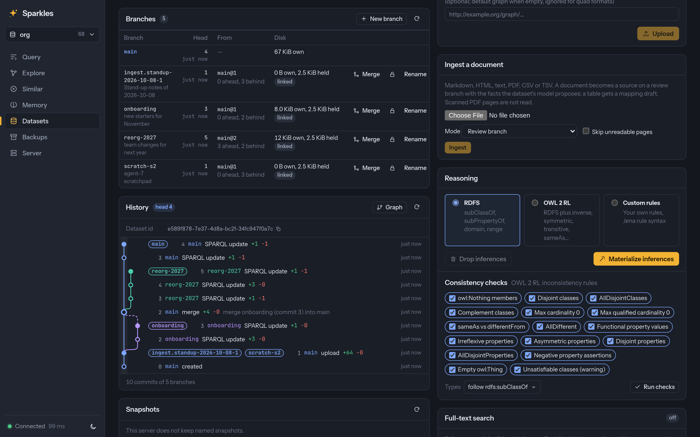</td>
  </tr>
  <tr>
    <td>The schema browser</td>
    <td>Branches and their history</td>
  </tr>
  <tr>
    <td>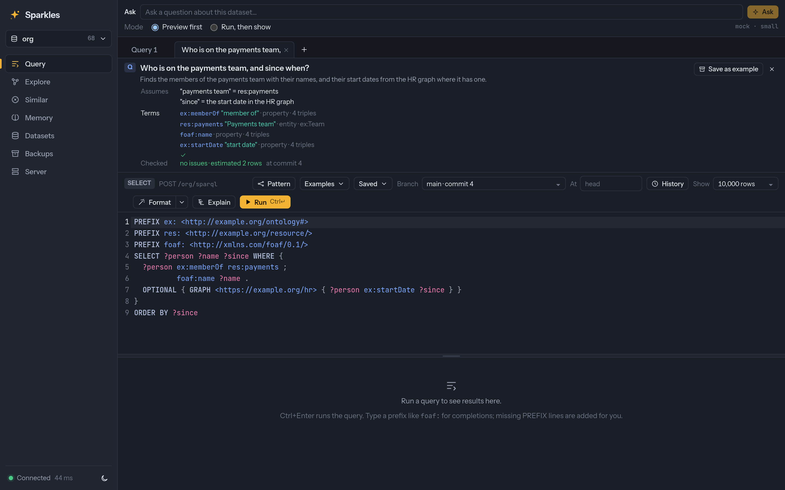</td>
    <td>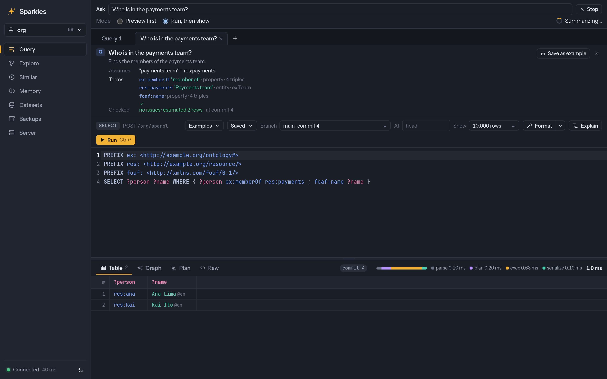</td>
  </tr>
  <tr>
    <td>A query an agent handed over for review</td>
    <td>An answer in progress, at the summary step</td>
  </tr>
  <tr>
    <td>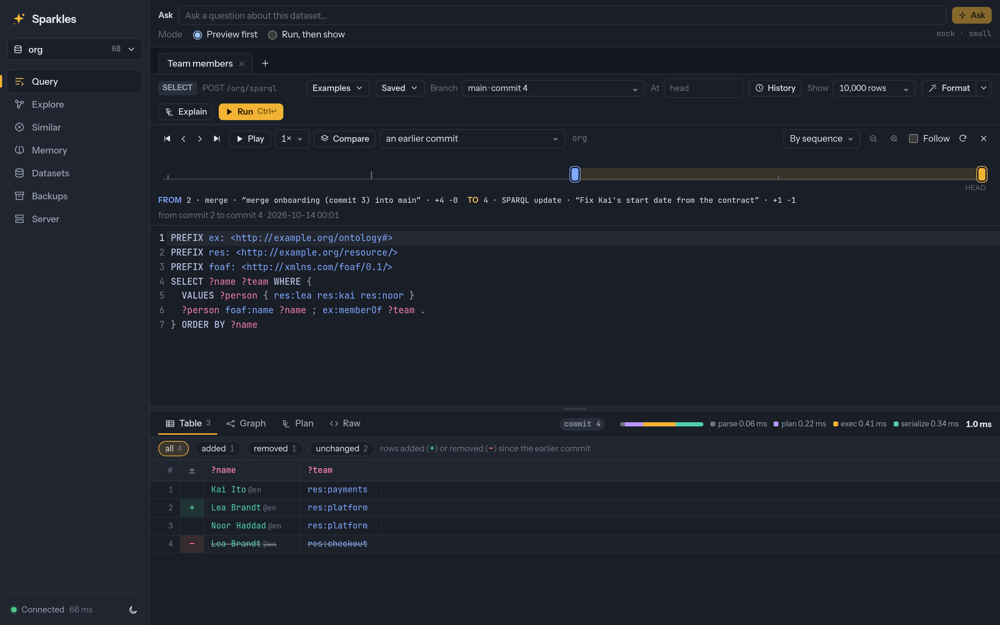</td>
    <td>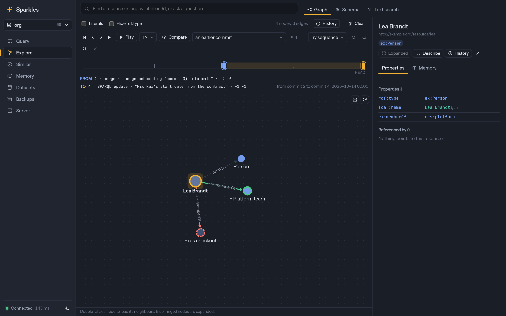</td>
  </tr>
  <tr>
    <td>A query compared between two commits</td>
    <td>A graph compared between two commits</td>
  </tr>
</table>

</details>

## Documentation

[The documentation index](docs/README.md) groups all guides and references by task,
including benchmarks, editor setup, design specs and UI development.

| Document | Contents |
|---|---|
| [Usage](docs/USAGE.md) | Server and CLI workflows, libraries and bindings, MCP, backups, and deployment with Docker, Kubernetes and NixOS. |
| [Architecture](docs/ARCHITECTURE.md) | Library boundaries, storage, execution, optimizations and implemented design decisions. |
| [Features](docs/FEATURES.md) | The capability inventory and known gaps. |
| [Roadmap](docs/ROADMAP.md) | Planned work in priority order, linked to the design specs. |
| [HTTP API](docs/API.md) | Fuseki endpoints and Sparkles administration extensions. |
| [Development](docs/DEVELOPMENT.md) | Project layout, builds, tests, mise tasks, Nix and third-party licenses. |

## Project layout

* `crates/sparkles-core` — storage, snapshots, query planning and execution.
* `crates/sparkles` — the public library API and optional feature integrations.
* `crates/sparkles-server` — the HTTP server, CLI and MCP endpoints.

[The development guide](docs/DEVELOPMENT.md#project-layout) maps the remaining crates,
bindings and UI to their roles and Jena counterparts.

## Development

`mise run ci` runs the full checks. `mise run ci:fast` runs the smaller set for
iteration. [The development guide](docs/DEVELOPMENT.md) covers setup, individual tasks
and the W3C and Jena compatibility suites.

## License

Sparkles is licensed under the [Apache License 2.0](LICENSE). The vendored `spargebra`
keeps its MIT OR Apache-2.0 license. The licenses of the crates and npm packages that
ship in the binary are in [THIRD_PARTY_LICENSES.md](THIRD_PARTY_LICENSES.md) and
[THIRD_PARTY_LICENSES-UI.md](THIRD_PARTY_LICENSES-UI.md).
