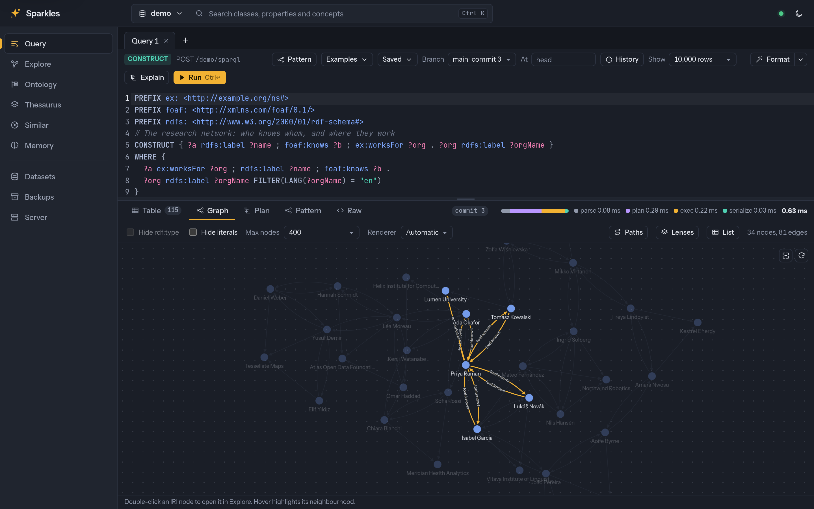
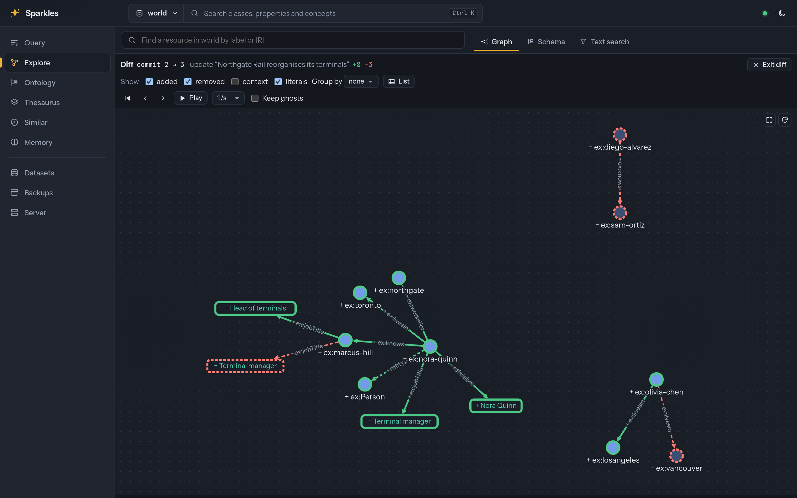
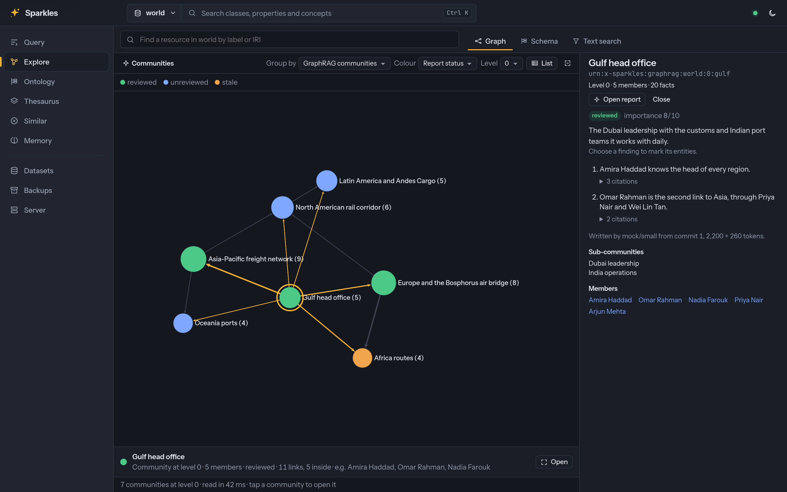
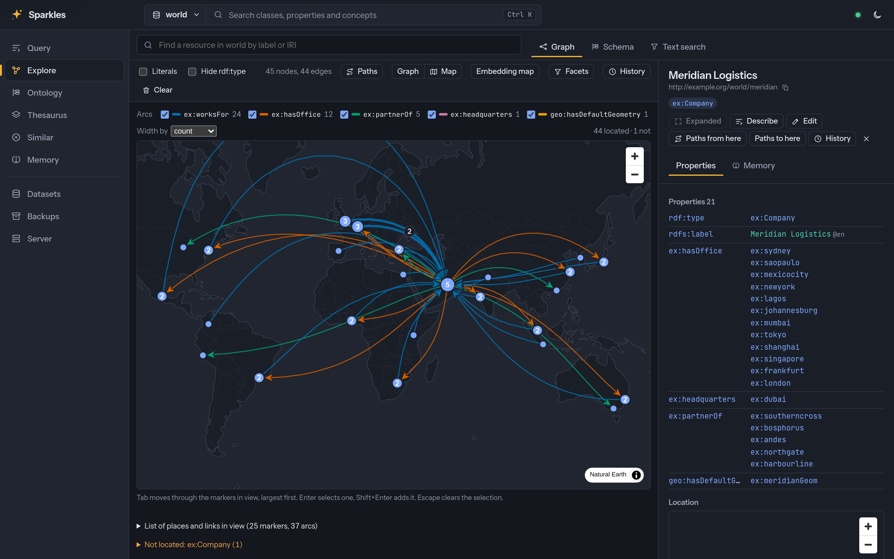
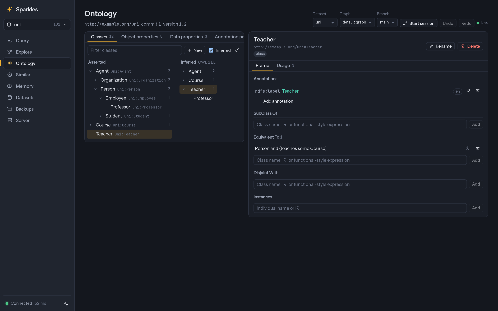

# Sparkles ✨

Sparkles is a Rust RDF database that pairs [Apache Jena](https://jena.apache.org/) and
Fuseki protocols with [QLever](https://github.com/ad-freiburg/qlever)-style compressed
columnar indexes and query execution. It runs as a Fuseki-compatible HTTP server and CLI
with an embedded web UI, or embeds directly into Rust, Python, Node.js, and JVM
applications. The JVM binding implements Jena's `DatasetGraph`, so Java and Kotlin
applications can use Sparkles through Jena's existing `Model`, RIOT, `Txn`, and
`QueryExecution` APIs.

> [!WARNING]
> Sparkles is experimental and has no releases. The on-disk format, HTTP API, CLI, and
> library APIs can change in any commit without a migration path, so do not use it for data
> you cannot regenerate.
>
> Much of the code, tests, and documentation was written with AI models under the
> maintainer's direction and review. W3C conformance suites and differential tests guard
> behavior, but expect bugs. Issues and bug reports are welcome.



See the [Web UI highlights](#web-ui) below or browse every workflow in the
[Web UI tour](docs/visualization/README.md#web-ui-tour).

## Philosophy

Sparkles is built around four engineering goals:

1. **Standards first, pragmatic interoperability.** Full W3C conformance across RDF 1.2,
   SPARQL 1.0–1.2, SHACL, ShEx, and GeoSPARQL 1.1 pairs with Apache Jena and Fuseki
   protocol and API compatibility. Existing Fuseki clients keep their request format, and
   JVM applications keep using Jena's `Model`, RIOT, `Txn`, and `QueryExecution` APIs in
   process without HTTP.
2. **Predictable speed without sacrificing correctness.** QLever-style sorted, compressed
   columnar permutations, 64-bit inline term IDs, cost-based planning, and disk-spilling
   streaming execution deliver high throughput while preserving exact RDF term identity (no
   lossy literal folding), durable MVCC commits, and explicit memory and work budgets.
3. **One engine, every deployment shape.** The core engine is a synchronous library with
   no HTTP server dependency. The Fuseki-compatible server, CLI, embedded web UI, and Rust,
   Python, JVM, and Node.js bindings all run on the same public API and query semantics.
4. **Versioned, explainable knowledge graphs.** Commit history, time travel, branches,
   conflict-checked merges, write-time shape validation, reasoning with derivations, and
   grant-checked AI/agent workflows live inside the database rather than in separate
   layers.

## Highlights

* **Querying and standards.** Sparkles passes the W3C SPARQL 1.0, 1.1 Query, 1.1 Update,
  and 1.2 conformance suites, supports RDF 1.2, Jena ARQ extensions, federated `SERVICE`,
  automatic streaming with disk spill, and incremental views, and ships a SPARQL/RDF
  formatter, linter, and language server. See the
  [querying guide](docs/querying/README.md#sparql-queries-and-updates) and
  [editor integration](docs/editors.md).
* **Storage, versioning, and branches.** Sorted, compressed quad permutations pair with an
  MVCC write-ahead log, durable group commit, and online compaction. Every write produces a
  retained commit supporting point-in-time reads, RDF Patch and graph diffs, change feeds,
  named snapshots, and conflict-checked branch merges. See
  [storage and history](docs/storage/README.md#versioning-and-history).
* **Search, spatial, and graph analytics.** BM25 full-text search (`text:query`), HNSW
  vector indexes with embeddings computed on write, hybrid ranking, GeoSPARQL 1.1 spatial
  indexes and joins, weighted shortest-path search, and graph algorithms (PageRank, Leiden
  communities, centrality) run directly inside SPARQL. See the
  [search guide](docs/search/README.md#search).
* **Reasoning, ontologies, and validation.** Incremental materialization and query-time
  derivation cover RDFS, OWL 2 RL, OWL 2 QL, Jena rules, Datalog, and SHACL-AF rules
  alongside a concurrent OWL 2 EL/Horn/ALCHI classifier, an OWL 2 axiom API, SHACL 1.2 and
  ShEx 2.2 write-time guards, and schema drafting. See
  [reasoning and validation](docs/reasoning/README.md#reasoning-validation-and-schema).
* **AI, GraphRAG, and agent memory.** Grant-checked MCP tools, natural-language question
  answering over verified SPARQL, provenance-tracked agent memory with branch review,
  document ingestion (Markdown, HTML, PDF, and Office formats), and GraphRAG Leiden
  community reports integrate directly with datasets. See
  [AI and agents](docs/ai/README.md#ai-and-agents).
* **Fuseki server, GraphQL, and access control.** The HTTP server implements Fuseki
  protocols and the `/$/` admin API alongside read-only GraphQL, versioned stored queries,
  a DCAT 3 resource catalog, Fuseki configuration import, dataset/graph/triple/endpoint
  grants, rate limits, and query memory budgets. See the
  [server guide](docs/server/README.md#server-and-protocols).
* **Embeddable libraries and clients.** Rust, Python, JVM (Jena `DatasetGraph`), and
  Node.js/TypeScript libraries embed the engine in process, paired with native Rust and
  TypeScript HTTP clients. See
  [libraries and bindings](docs/integrations/README.md#libraries-and-bindings).
* **Web UI and workbench.** The embedded SvelteKit UI provides a SPARQL editor, visual
  query builder, interactive graph/map/facet/embedding views, time-travel and merge tools,
  SHACL-generated forms, and ontology, SKOS thesaurus, and SHACL shape editors. See the
  [Web UI guide](docs/visualization/README.md#web-ui).
* **Operations and backups.** Sparkles runs as a single binary packaged for Docker, NixOS,
  and Kubernetes (Helm), with Prometheus metrics, OpenTelemetry tracing, shared memory
  pools, and incremental, deduplicated, optionally encrypted filesystem or S3 backups. See
  the [operations guide](docs/operations/README.md).

See [docs/FEATURES.md](docs/FEATURES.md) for the complete capability matrix and
[known gaps](docs/FEATURES.md#known-gaps), including compatibility differences from Jena.

## Performance

Reference comparisons run on an Intel Core i5-13500 with 16 GiB of RAM, with each engine
running alone, result caches disabled, and answer checks qualifying the reported numbers.

| Workload | Sparkles | Reference engines | Report |
|---|---:|---|---|
| Bulk load, 10.5M synthetic triples | **3.67 s** | QLever 9.35 s, Fluree 10.20 s, Oxigraph 18.22 s, TDB2 45.70 s | [Loading](docs/benchmarks/loading/RESULTS.md) |
| Synthetic queries, 10.5M triples (28 queries) | **Lowest mean on 27 of 28** | Median 3.8× faster than QLever; ties Fluree within 10% on `count-all` | [Synthetic](docs/benchmarks/synthetic/RESULTS.md) |
| Throughput, 16 clients (`star-join`, 10.5M) | **239 queries/s** | QLever 90, Fluree 22, Fuseki 12, Oxigraph 1.7 | [Synthetic](docs/benchmarks/synthetic/RESULTS.md) |
| WatDiv v0.6, 10.97M triples (20 templates) | **4.63 ms geomean** | Fluree 6.97 ms, Fuseki 13.6 ms, Oxigraph 16.2 ms, QLever 17.9 ms | [WatDiv](docs/benchmarks/watdiv/RESULTS.md) |
| English DBpedia load, 1.24B input triples | **480 s** (6,059 MiB peak RSS) | QLever 1,674 s (11,401 MiB), Fluree 2,919 s (12,366 MiB) | [DBpedia](docs/benchmarks/dbpedia/RESULTS.md) |

* **Large-scale queries and reasoning.** On 1.24B-triple English DBpedia, Sparkles beats
  QLever on 29 qualified warm queries and 29 of 31 cold queries. On OWL 2 EL
  classification with eight threads, Sparkles classifies GO in 77 ms and ChEBI lite in
  393 ms against ELK 0.6.0's 579 ms and 2,591 ms ([EL classification](docs/benchmarks/el-classification/RESULTS.md#against-elk)).
* **Comparison limits.** In the 10.5M synthetic suite, Fluree uses a different TSV
  encoding and exceeds the 12 GiB memory limit on `optional-chain`. The
  [synthetic report](docs/benchmarks/synthetic/RESULTS.md) records the qualification rules
  and raw samples.
* **Memory tradeoffs.** Sparkles trades memory for speed with a configurable decoded-block
  cache (default 1 GiB per dataset) and memory-mapped index files. The
  [memory report](docs/benchmarks/memory/RESULTS.md) breaks down cache, execution, and
  index costs.
* **Measured losses.** Other engines lead on unsynchronized serial writes, writes under
  mixed load, peak RSS under 16 readers, selected cold queries, and small FFI lookups in
  the JVM, Python, and Node.js bindings. See
  [where Sparkles loses](docs/BENCHMARKS.md#where-sparkles-loses) and the
  [benchmark summary](docs/BENCHMARKS.md).

## How Sparkles compares

* **vs. Apache Jena / Fuseki.** Replaces JVM/TDB2 B+trees with native Rust columnar
  permutations and adds built-in versioning, branching, vector search, and an ontology
  workbench; trades away Java plugin registries and TDB2 on-disk compatibility.
* **vs. QLever.** Adds exact RDF term identity (no lossy double inlining), durable MVCC
  writes, Graph Store and Fuseki endpoints, reasoning, SHACL/ShEx validation, and
  embeddable bindings; QLever scales further on multi-billion-triple static loads and
  streams every operator lazily.
* **vs. Fluree.** Adds full W3C SPARQL 1.0–1.2 and SHACL/ShEx conformance, Fuseki
  compatibility, GeoSPARQL 1.1 spatial joins, and multi-language in-process bindings;
  Fluree provides JWS-signed commits, Raft clustering, and openCypher/JSON-LD query
  frontends.
* **vs. Oxigraph.** Builds on Oxigraph's RDF/SPARQL parser and term crates while replacing
  RocksDB with compressed columnar permutations and adding reasoning, validation,
  full-text/vector/spatial indexes, versioning, access control, and a web UI; Oxigraph is
  lighter to embed and supports WebAssembly.

See [docs/COMPARISON.md](docs/COMPARISON.md) for the full feature-by-feature breakdown and
intentional divergences from Jena and QLever.

## Web UI

The server embeds a SvelteKit web UI at `/ui/`. The six views below highlight commit diff
graphs, visual query editing, GraphRAG communities, GeoSPARQL maps, shape-driven forms, and
OWL classification.

|  |  |
|---|---|
| Inspect a commit's added and removed triples directly as a graph diff. | Inspect and edit SPARQL graph patterns visually beside the query text. |
|  |  |
| Explore GraphRAG communities sized by members alongside their reports. | Plot geographic entities and predicate relations as arcs on a world map. |
|  |  |
| Edit resources with SHACL-generated forms checked in the browser and on the server. | Compare asserted and EL-inferred OWL class hierarchies side by side. |

See the full [Web UI tour](docs/visualization/README.md#web-ui-tour) for the time slider,
branch merges, cited plain-language answers, agent memory, facets, embedding projections,
the ontology browser, and the thesaurus and SHACL shape editors.

## Getting started

Install the Rust toolchain listed in `rust-toolchain.toml`. Linux servers also need system
CA certificates. To include the embedded web UI, build it first with Node.js and pnpm.

```sh
pnpm -C ui install && pnpm -C ui build  # optional web UI
cargo build --release -p sparkles-server
export PATH="$PWD/target/release:$PATH"
```

The build produces `target/release/sparkles`. Create a small dataset and run a local
query before starting the server.

```sh
cat > books.ttl <<'EOF'
<https://example.org/book> <https://example.org/title> "A book" .
EOF
sparkles load --loc ./books books.ttl
sparkles query --loc ./books --results csv 'SELECT (COUNT(*) AS ?n) { ?s ?p ?o }'
```

The query prints the CSV header `n` and one row with `1`. Start the server in one
terminal.

```sh
sparkles serve --data ./data --loc books=./books
```

In another terminal, query the server over HTTP. The response prints the CSV header `n`
and a row with `1`.

```sh
curl -fsS localhost:3030/books/sparql -H 'Accept: text/csv' \
  --data-urlencode 'query=SELECT (COUNT(*) AS ?n) { ?s ?p ?o }'
```

Datasets open asynchronously after the server binds its socket, so retry if a dataset is
still opening. While running, the server holds the database lock; query it over HTTP or
stop it before running local `--loc` commands. When built, the web UI is served at
<http://localhost:3030/ui/>. Run `sparkles help COMMAND` for subcommand options.

Nix and Docker provide alternative ways to run the server.

```sh
nix run github:kclejeune/sparkles -- serve --data ./data
docker compose up --build -d
```

Read [getting started and operations](docs/GETTING-STARTED.md) for deployment, security,
and backup guidance, and [libraries and clients](docs/README.md#libraries-and-clients) for
the Rust, Python, JVM, and Node.js bindings. Binding packages are built from source and
are not published to package registries.

## Documentation

| Document | Contents |
|---|---|
| [Getting started and operations](docs/GETTING-STARTED.md) | Installation, compatibility checks, securing a server, and planning backups. |
| [Features](docs/FEATURES.md) | Capability matrix, category guides, and known gaps. |
| [Benchmarks](docs/benchmarks/README.md) | Methodology, published results, charts, raw run catalogs, and measured losses. |
| [Comparison](docs/COMPARISON.md) | Feature gaps and design tradeoffs against Jena, QLever, Fluree, and Oxigraph. |
| [Architecture](docs/ARCHITECTURE.md) | Crate boundaries, storage layout, execution engine, and design decisions. |
| [Usage](docs/USAGE.md) | Server operations, CLI tools, bindings, MCP, backups, Docker, and NixOS. |
| [HTTP API](docs/API.md) | Fuseki endpoints, Sparkles extensions, status codes, and formats. |
| [Development](docs/DEVELOPMENT.md) | Repository layout, builds, test suites, and mise tasks. |
| [Roadmap](docs/ROADMAP.md) | Planned work in priority order with design spec links. |
| [Design specs](docs/specs/README.md) | Design rationale, scope, and outcome of each major feature. |

Browse [the documentation index](docs/README.md) for every guide and reference.

## Acknowledgments and dependencies

Sparkles builds directly on open-source projects and published database and reasoning
research:

* **[Oxigraph](https://github.com/oxigraph/oxigraph) ecosystem.** `oxrdf`, `oxttl`,
  `oxrdfio`, `oxjsonld`, `oxiri`, `oxsdatatypes`, `oxilangtag`, `sparesults`, and vendored
  `spargebra` provide the RDF 1.2 term model, parsers, serializers, datatypes, and SPARQL
  algebra.
* **[Apache Jena](https://jena.apache.org/) and Fuseki.** Defines the SPARQL, Graph
  Store, and `/$/` administration protocols, ARQ extensions, `jena-text` conventions, and
  the `DatasetGraph` and `jena-ontapi` interfaces targeted by the JVM binding.
* **[QLever](https://github.com/ad-freiburg/qlever).** Inspired Sparkles' sorted
  compressed quad permutations, 64-bit inline term encoding, predicate-pattern
  optimization, and columnar execution model.
* **Reasoning and ontology research.** Consequence-based and ordered-resolution OWL
  classification draws on [ELK](https://github.com/liveontologies/elk-reasoner),
  Sequoia, and [ROBOT](https://robot.obolibrary.org/) conventions, with
  [HermiT](http://www.hermit-reasoner.com/) and [Nemo](https://github.com/knowsys/nemo)
  serving as differential and benchmark references.
* **[Fluree](https://github.com/fluree/db).** Public documentation inspired Sparkles'
  clean-room commit history, branching, and versioned graph workflows.
* **Core Rust and UI crates.** [Tantivy](https://github.com/quickwit-oss/tantivy) powers
  BM25 full-text search, [GeoRust](https://georust.org/) (`geo`, `geo-index`,
  `geographiclib-rs`, `proj4rs`) powers GeoSPARQL, `object_store` backs incremental S3 and
  filesystem backups, `tokio`, `axum`, and `rayon` drive server and parallel execution,
  `lsp-server` from rust-analyzer powers the language server, and SvelteKit powers the
  embedded web UI.

See [docs/specs/PROVENANCE.md](docs/specs/PROVENANCE.md) for per-feature design provenance
and [THIRD_PARTY_LICENSES.md](THIRD_PARTY_LICENSES.md) for full dependency licenses.

## Status and license

Sparkles has no release. The [feature matrix](docs/FEATURES.md#capability-status)
records the current status and remaining scope of each capability, and the
[roadmap](docs/ROADMAP.md) tracks the remaining correctness, performance, recovery, and
packaging work.

* RDF and SPARQL support passes the documented W3C conformance suites.
* Reasoning, incremental views, GeoSPARQL, GraphRAG, language bindings, and the web UI
  are available, with further phases planned.
* Evidence and valid-time vocabularies, shapes, query resources, authenticated evidence
  proposals, reference resolution, review decisions with accepted projections, reversible
  identity maps, and `quads` durable jobs are available.
* Maintained analysis, transactional delivery outboxes and recurring job definitions,
  temporal runtime helpers, and additional model integrations remain planned.

Sparkles is licensed under the [Apache License 2.0](LICENSE). The vendored `spargebra`
crate retains its MIT OR Apache-2.0 license. Third-party crate and npm package licenses
bundled in the binary are listed in [THIRD_PARTY_LICENSES.md](THIRD_PARTY_LICENSES.md)
and [THIRD_PARTY_LICENSES-UI.md](THIRD_PARTY_LICENSES-UI.md).
