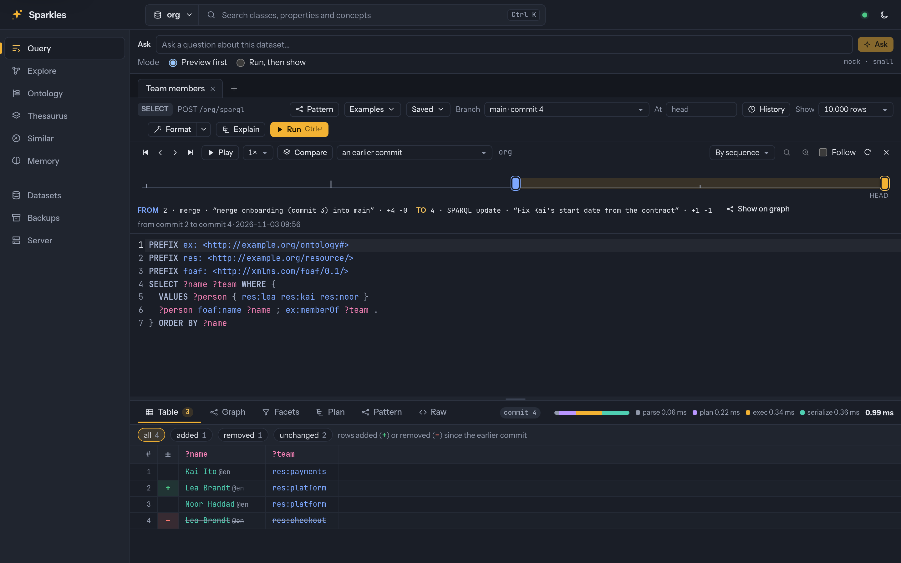
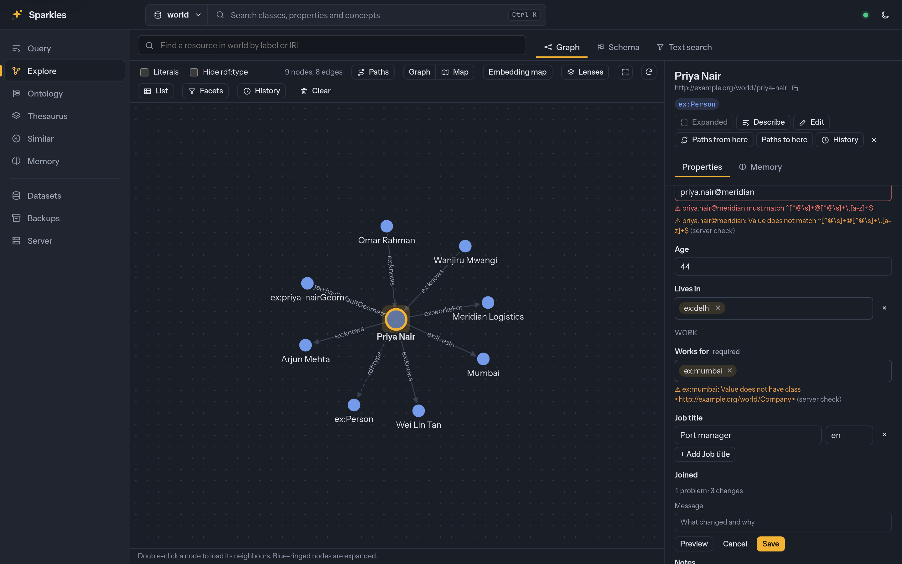

# Sparkles ✨

Sparkles is a Rust RDF database that pairs [Apache Jena](https://jena.apache.org/) and
Fuseki protocols with [QLever](https://github.com/ad-freiburg/qlever)-style compressed
columnar indexes and query execution. It runs as a Fuseki-compatible HTTP server and CLI
with an embedded web UI, or embeds directly into Rust, Python, Node.js, and JVM
applications. The JVM binding implements Jena's `DatasetGraph`, so Java and Kotlin
applications can use Sparkles through Jena's existing `Model`, RIOT, `Txn`, and
`QueryExecution` APIs.

> [!WARNING]
> Sparkles is experimental and has no releases. The on-disk format, HTTP API, CLI, and
> library APIs can change in any commit without a migration path, so do not use it for data
> you cannot regenerate.
>
> Much of the code, tests, and documentation was written with AI models under the
> maintainer's direction and review. W3C conformance suites and differential tests guard
> behavior, but expect bugs. Issues and bug reports are welcome.


See the [Web UI highlights](#web-ui) below or browse every workflow in the
[Web UI tour](docs/visualization/README.md#web-ui-tour).

## Why Sparkles

Jena and Fuseki define the protocols, formats, and operational model that RDF applications
depend on, while QLever provides a columnar storage and execution design built for high
query throughput. Sparkles combines those two foundations inside an embeddable library.

1. **Jena and Fuseki compatibility.** Existing Fuseki clients keep their request format.
   Sparkles implements the SPARQL 1.1 Query, Update, and Graph Store protocols, Fuseki's
   `/$/` administration endpoints, Jena's RDF formats and dataset semantics, and Fuseki
   configuration conversion. On the JVM, opening a Sparkles dataset lets existing Jena
   code run in process without HTTP.
2. **Columnar storage with transactions and history.** Terms use 64-bit IDs with inline
   numbers and dates, indexes store sorted and compressed permutations, and a cost-based
   planner drives column-at-a-time execution. Sparkles adds MVCC transactions, durable
   commits, online compaction, and a commit history that supports point-in-time reads,
   diffs, and branching.
3. **Library first.** The core engine has no HTTP server dependency. The server, CLI, and
   Rust, Python, JVM, and Node.js bindings all share its public API and query semantics,
   using Oxigraph's crates for the term model, parsers, and SPARQL algebra. See
   [libraries and bindings](docs/integrations/README.md#libraries-and-bindings) for the
   surfaces each binding exposes.

## Core capabilities

* **Querying and standards.** Sparkles passes the W3C SPARQL 1.0, 1.1 Query, 1.1 Update,
  and 1.2 conformance suites, and supports RDF 1.2, Jena ARQ extensions, federated
  `SERVICE`, incremental views, and GeoSPARQL 1.1. See the
  [querying guide](docs/querying/README.md#sparql-queries-and-updates).
* **Versioning and branches.** Every write creates a retained commit that supports
  point-in-time queries, RDF Patch and graph diffs, named snapshots, and persistent or
  memory branches with conflict-checked merges. See
  [storage and history](docs/storage/README.md#versioning-and-history).
* **Search and graph analytics.** BM25 full-text search (`text:query`), HNSW vector
  indexes with embeddings computed on write, hybrid ranking, shortest-path search, and
  graph algorithms run directly inside SPARQL. See the
  [search guide](docs/search/README.md#search).
* **Reasoning and validation.** Incremental materialization and query-time derivation
  cover RDFS, OWL 2 RL, and Jena rules alongside OWL 2 EL classification, SHACL Core,
  SHACL-SPARQL, and ShEx 2.2 write-time guards. See
  [reasoning and validation](docs/reasoning/README.md#reasoning-validation-and-schema).
* **AI and agent workflows.** Grant-checked MCP tools, cited question answering over
  checked queries, provenance-tracked agent memory with branch review, and GraphRAG
  Leiden community reports integrate directly with datasets. See
  [AI and agents](docs/ai/README.md#ai-and-agents).
* **Server, security, and bindings.** The server exposes Fuseki-compatible endpoints and
  the `/$/` admin API with dataset, graph, triple, and endpoint grants, query budgets,
  rate limits, and Rust, Python, JVM, and Node.js bindings. See the
  [server](docs/server/README.md#server-and-protocols) and
  [bindings](docs/integrations/README.md#libraries-and-bindings) guides.

See [docs/FEATURES.md](docs/FEATURES.md) for the complete capability matrix and
[known gaps](docs/FEATURES.md#known-gaps), including compatibility differences from Jena.

## Performance

Reference comparisons run on an Intel Core i5-13500 with 16 GiB of RAM, with each engine
running alone, result caches disabled, and answer checks qualifying the reported numbers.

| Workload | Sparkles | Reference engines | Report |
|---|---:|---|---|
| Bulk load, 10.5M synthetic triples | **3.67 s** | QLever 9.35 s, Fluree 10.20 s, Oxigraph 18.22 s, TDB2 45.70 s | [Loading](docs/benchmarks/loading/RESULTS.md) |
| Synthetic queries, 10.5M triples (28 queries) | **Lowest mean on 27 of 28** | Median 3.8× faster than QLever; ties Fluree within 10% on `count-all` | [Synthetic](docs/benchmarks/synthetic/RESULTS.md) |
| Throughput, 16 clients (`star-join`, 10.5M) | **239 queries/s** | QLever 90, Fluree 22, Fuseki 12, Oxigraph 1.7 | [Synthetic](docs/benchmarks/synthetic/RESULTS.md) |
| WatDiv v0.6, 10.97M triples (20 templates) | **4.63 ms geomean** | Fluree 6.97 ms, Fuseki 13.6 ms, Oxigraph 16.2 ms, QLever 17.9 ms | [WatDiv](docs/benchmarks/watdiv/RESULTS.md) |
| English DBpedia load, 1.24B input triples | **480 s** (6,059 MiB peak RSS) | QLever 1,674 s (11,401 MiB), Fluree 2,919 s (12,366 MiB) | [DBpedia](docs/benchmarks/dbpedia/RESULTS.md) |

* **Large-scale queries and reasoning.** On 1.24B-triple English DBpedia, Sparkles beats
  QLever on 29 qualified warm queries and 29 of 31 cold queries. On OWL 2 EL
  classification with eight threads, Sparkles classifies GO in 77 ms and ChEBI lite in
  393 ms against ELK 0.6.0's 579 ms and 2,591 ms ([EL classification](docs/benchmarks/el-classification/RESULTS.md#against-elk)).
* **Comparison limits.** In the 10.5M synthetic suite, Fluree uses a different TSV
  encoding and exceeds the 12 GiB memory limit on `optional-chain`. The
  [synthetic report](docs/benchmarks/synthetic/RESULTS.md) records the qualification rules
  and raw samples.
* **Memory tradeoffs.** Sparkles trades memory for speed with a configurable decoded-block
  cache (default 1 GiB per dataset) and memory-mapped index files. The
  [memory report](docs/benchmarks/memory/RESULTS.md) breaks down cache, execution, and
  index costs.
* **Measured losses.** Other engines lead on unsynchronized serial writes, writes under
  mixed load, peak RSS under 16 readers, selected cold queries, and small FFI lookups in
  the JVM, Python, and Node.js bindings. See
  [where Sparkles loses](docs/BENCHMARKS.md#where-sparkles-loses) and the
  [benchmark summary](docs/BENCHMARKS.md).

## Web UI

The server embeds a SvelteKit web UI at `/ui/`. The six views below highlight time travel,
visual query editing, GraphRAG exploration, cited answers, shape-driven forms, and OWL
classification.

|  |  |
|---|---|
| Compare query results between two commits with the time slider. | Inspect and edit SPARQL graph patterns visually beside the query text. |
|  |  |
| Explore GraphRAG communities sized by members alongside their reports. | Answer plain-language questions with checked queries and cited rows. |
|  |  |
| Edit resources with SHACL-generated forms checked in the browser and on the server. | Compare asserted and EL-inferred OWL class hierarchies side by side. |

See the full [Web UI tour](docs/visualization/README.md#web-ui-tour) for commit diff
graphs, branch merges, agent memory, maps, facets, embedding projections, the ontology
browser, and the thesaurus and SHACL shape editors.

## Getting started

Install the Rust toolchain listed in `rust-toolchain.toml`. Linux servers also need system
CA certificates. To include the embedded web UI, build it first with Node.js and pnpm.

```sh
pnpm -C ui install && pnpm -C ui build  # optional web UI
cargo build --release -p sparkles-server
export PATH="$PWD/target/release:$PATH"
```

The build produces `target/release/sparkles`. Create a small dataset and run a local
query before starting the server.

```sh
cat > books.ttl <<'EOF'
<https://example.org/book> <https://example.org/title> "A book" .
EOF
sparkles load --loc ./books books.ttl
sparkles query --loc ./books --results csv 'SELECT (COUNT(*) AS ?n) { ?s ?p ?o }'
```

The query prints the CSV header `n` and one row with `1`. Start the server in one
terminal.

```sh
sparkles serve --data ./data --loc books=./books
```

In another terminal, query the server over HTTP. The response prints the CSV header `n`
and a row with `1`.

```sh
curl -fsS localhost:3030/books/sparql -H 'Accept: text/csv' \
  --data-urlencode 'query=SELECT (COUNT(*) AS ?n) { ?s ?p ?o }'
```

Datasets open asynchronously after the server binds its socket, so retry if a dataset is
still opening. While running, the server holds the database lock; query it over HTTP or
stop it before running local `--loc` commands. When built, the web UI is served at
<http://localhost:3030/ui/>. Run `sparkles help COMMAND` for subcommand options.

Nix and Docker provide alternative ways to run the server.

```sh
nix run github:kclejeune/sparkles -- serve --data ./data
docker compose up --build -d
```

Read [getting started and operations](docs/GETTING-STARTED.md) for deployment, security,
and backup guidance, and [libraries and clients](docs/README.md#libraries-and-clients) for
the Rust, Python, JVM, and Node.js bindings. Binding packages are built from source and
are not published to package registries.

## Documentation

| Document | Contents |
|---|---|
| [Getting started and operations](docs/GETTING-STARTED.md) | Installation, compatibility checks, securing a server, and planning backups. |
| [Features](docs/FEATURES.md) | Capability matrix, category guides, and known gaps. |
| [Benchmarks](docs/benchmarks/README.md) | Methodology, published results, charts, raw run catalogs, and measured losses. |
| [Comparison](docs/COMPARISON.md) | Feature gaps and design tradeoffs against Jena, QLever, Fluree, and Oxigraph. |
| [Architecture](docs/ARCHITECTURE.md) | Crate boundaries, storage layout, execution engine, and design decisions. |
| [Usage](docs/USAGE.md) | Server operations, CLI tools, bindings, MCP, backups, Docker, and NixOS. |
| [HTTP API](docs/API.md) | Fuseki endpoints, Sparkles extensions, status codes, and formats. |
| [Development](docs/DEVELOPMENT.md) | Repository layout, builds, test suites, and mise tasks. |
| [Roadmap](docs/ROADMAP.md) | Planned work in priority order with design spec links. |
| [Design specs](docs/specs/README.md) | Design rationale, scope, and outcome of each major feature. |

Browse [the documentation index](docs/README.md) for every guide and reference.

## Status and license

Sparkles has no release. The [feature matrix](docs/FEATURES.md#capability-status)
records the current status and remaining scope of each capability, and the
[roadmap](docs/ROADMAP.md) tracks the remaining correctness, performance, recovery, and
packaging work.

* RDF and SPARQL support passes the documented W3C conformance suites.
* Reasoning, incremental views, GeoSPARQL, GraphRAG, language bindings, and the web UI
  are available, with further phases planned.
* Evidence and valid-time vocabularies, shapes, query resources, authenticated evidence
  proposals, reference resolution, review decisions with accepted projections, reversible
  identity maps, and `quads` durable jobs are available.
* Maintained analysis, transactional delivery outboxes and recurring job definitions,
  temporal runtime helpers, and additional model integrations remain planned.

Sparkles is licensed under the [Apache License 2.0](LICENSE). The vendored `spargebra`
crate retains its MIT OR Apache-2.0 license. Third-party crate and npm package licenses
bundled in the binary are listed in [THIRD_PARTY_LICENSES.md](THIRD_PARTY_LICENSES.md)
and [THIRD_PARTY_LICENSES-UI.md](THIRD_PARTY_LICENSES-UI.md).
