# Features

Sparkles provides an RDF store, query engine, server and embedded libraries. The
category guides below describe current capabilities, configuration, usage and limits.
The standard server includes local embeddings, OCR support and encrypted repositories.
Models, OCR libraries and encrypted repository keys require runtime configuration.
The [capability matrix](#capability-status) distinguishes complete, partially complete
and planned work. The [roadmap](ROADMAP.md) gives the path to completing the remaining
phases, and the [design specs](specs/README.md) explain their contracts and decisions.

* [Querying](#querying)
* [Storage and history](#storage-and-history)
* [Search and graph analysis](#search-and-graph-analysis)
* [Reasoning and validation](#reasoning-validation-and-schema)
* [Server and security](#server-and-security)
* [AI and agents](#ai-and-agents)
* [Visualization and editing](#visualization-and-editing)
* [Libraries and integrations](#libraries-and-integrations)
* [Deployment and operations](#deployment-and-operations)
* [Capability status](#capability-status)
* [Compatibility boundaries](#compatibility-boundaries)
* [Known gaps](#known-gaps)

## Feature categories

### Querying

Use [SPARQL Query and Update](querying/README.md#sparql-queries-and-updates),
including supported ARQ extensions, federation, query plans and incremental views.
The guide also covers [standards conformance](querying/README.md#standards-conformance),
the [command line](querying/README.md#command-line) and
[formatting and editor support](querying/README.md#formatter-and-editor-support).

### Storage and history

Load RDF into [compressed indexes](storage/README.md#storage-and-indexes) with
durable transactions, compaction, clones and integrity checks.
[History and branches](storage/README.md#versioning-and-history) provide retained
commits, time travel, diffs, change feeds, RDF Patch and merge review. HTTP history
and diff filters accept nested triple terms with numeric objects. Rust branch deletion,
renames and note changes refuse with a conflict when the calling thread holds a write
transaction that the operation needs, leaving the transaction usable.

### Search and graph analysis

Combine [full-text, vector and hybrid search](search/README.md#search) with SPARQL
patterns, path search and graph algorithms. [GeoSPARQL](search/README.md#geosparql)
adds geometry functions, spatial indexes, joins and nearest-neighbour ordering within
the documented geometry and query limits.

### Reasoning, validation and schema

Derive facts with [RDFS, OWL 2 RL and Jena rules](reasoning/README.md#reasoning),
and inspect explanations. Validate data with [SHACL](reasoning/README.md#shacl),
[ShEx](reasoning/README.md#shex) and write guards, or
[discover schema and draft shapes](reasoning/README.md#schema-discovery-and-drafted-shapes)
from existing data. ShEx write guards verify copied schemas before installation or
reuse. Legacy configurations without a copy digest validate the head in full at install.

### Server and security

Serve [SPARQL and Graph Store protocols](server/README.md#server-and-protocols),
GraphQL and stored queries, with supported Fuseki administration and configuration.
[Access controls](server/README.md#access-control-and-security) cover datasets,
graphs and triples, with OIDC and API-token authentication.

### AI and agents

Connect agents through [MCP](ai/README.md#mcp-server), turn
[questions into checked queries](ai/README.md#questions-in-plain-language), and keep
[cited memory](ai/README.md#agent-memory). Review
[document ingestion](ai/README.md#document-ingestion) and build
[GraphRAG community reports](ai/README.md#community-reports-graphrag).
MCP entity linking exposes bounded, versioned candidate evidence and can order label
matches by use. Ask uses it for full choice identities and conservative ordering while
retaining required clarification. Ask also grounds each question with the predicates
that its entities and best-matching classes use in the data. GPT-6 Luna, the `openai`
preset's model, answers 101 of 150 held-out QALD-9-plus questions at $0.0019 each,
within the noise of GPT-6.1 Sol, while Opus 5.5 answers 114.

[Ask stage diagnostics](ai/README.md#ask-stage-diagnostics) separate grounding, tool
and execution timings while the remaining accuracy and latency work stays open.
Anthropic providers use [prompt caching](ai/README.md#questions-in-plain-language) for
the stable start of each prompt, and budgets price cache writes and reads apart.

The web UI asks through an [Ask thread](ai/README.md#the-ask-thread), shown as a page at
`/ui/ask` and as a drawer beside any page. `Shift+A` or the palette's Ask row opens the
drawer with the page's resource or query as context. Each answer folds its query, rows,
sources and steps, follow-ups continue the thread, and the history reopens a thread from
the answers the server keeps.

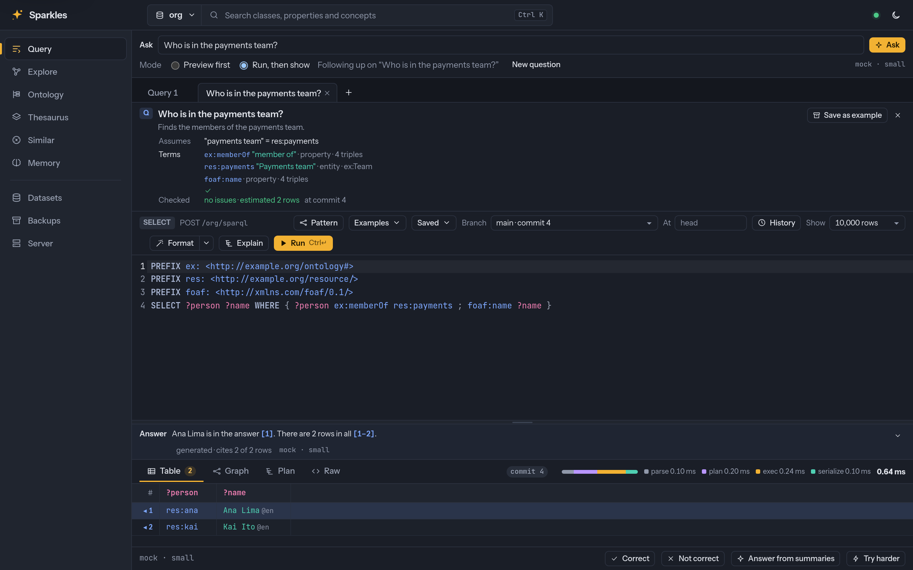

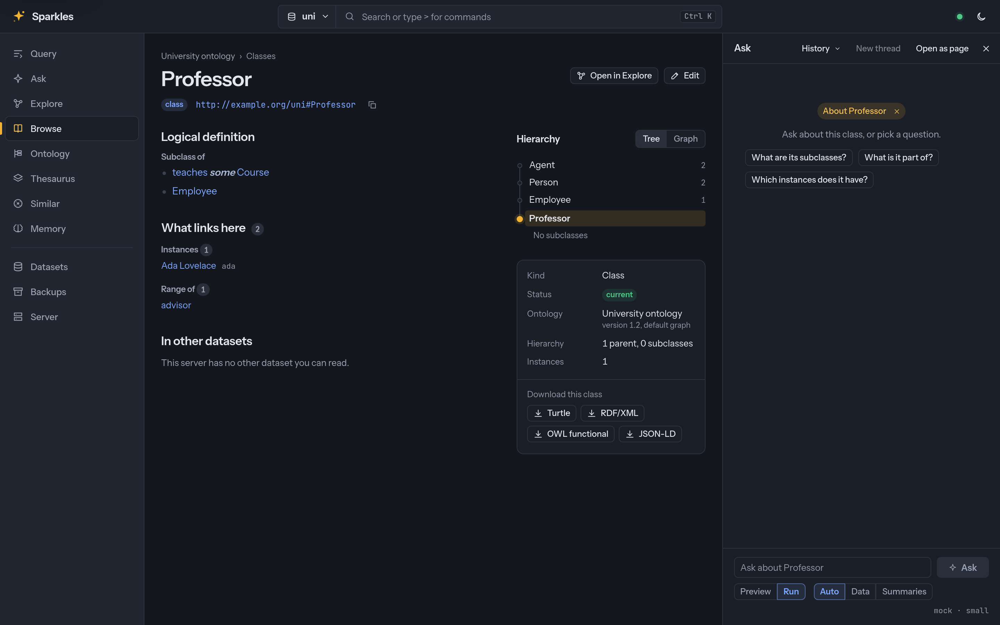

### Visualization and editing

Use the [web UI](visualization/README.md#web-ui) to edit queries and inspect result
tables, graphs and plans. [Explore](visualization/README.md#explore),
[maps](visualization/README.md#maps), history views and validation tools support
connected graph inspection and editing. The
[ontology editor](visualization/README.md#ontology-editor) edits OWL classes, properties,
individuals and annotations as previewed commits beside asserted trees, kept inferred
class groups and strict materialization-backed property and individual views, and its DL Query tab answers Manchester class expressions with the reasoning used.
The [thesaurus editor](visualization/README.md#thesaurus-editor) edits SKOS concept
schemes, concepts, collections and SKOS-XL labels in a concept tree, and checks them
against the integrity conditions of the SKOS Reference. The
[ontology browser](visualization/README.md#ontology-browser) gives every entity of an
ontology or thesaurus a page with its definitions and notes, synonyms, axioms as linked
Manchester prose, hierarchy and what links here, and the top bar's search opens it. A caller who can write
switches a page into edit mode and changes its definition, synonyms, annotations,
parents and axioms in place as previewed commits.

Every page shares one [app shell](visualization/README.md#app-shell), with a top bar
whose search is a command palette, a rail of pages that narrows to icons at medium width
and becomes a drawer on a phone, and one set of light and dark design tokens that meet
WCAG AA contrast. `Ctrl+K` or `Cmd+K` opens the palette from anywhere. It lists recent
picks and the open page's commands, searches the open dataset's entities, the datasets,
saved queries, branches and pages, and runs commands such as running or formatting a
query, starting a session, creating an entity, switching the dataset or branch and
setting the theme. The prefixes `>`, `@`, `#` and `?` show commands, entities,
datasets and saved queries alone.

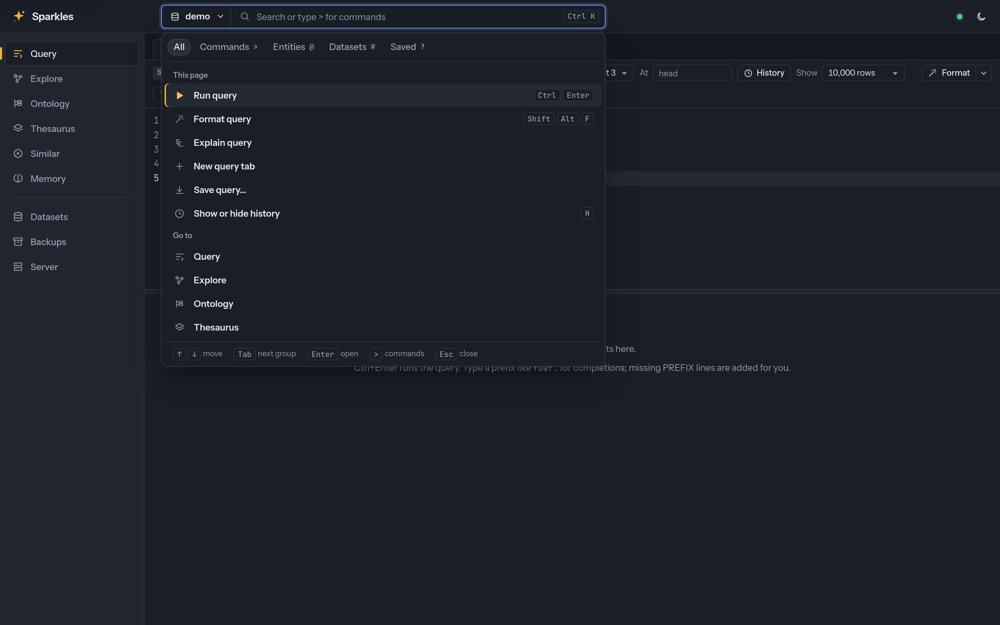

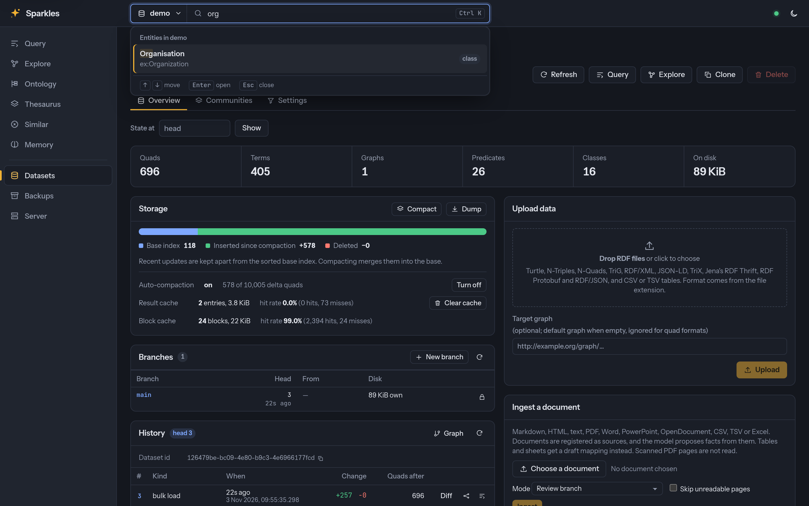

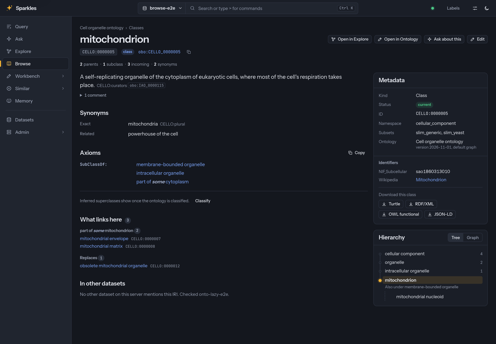

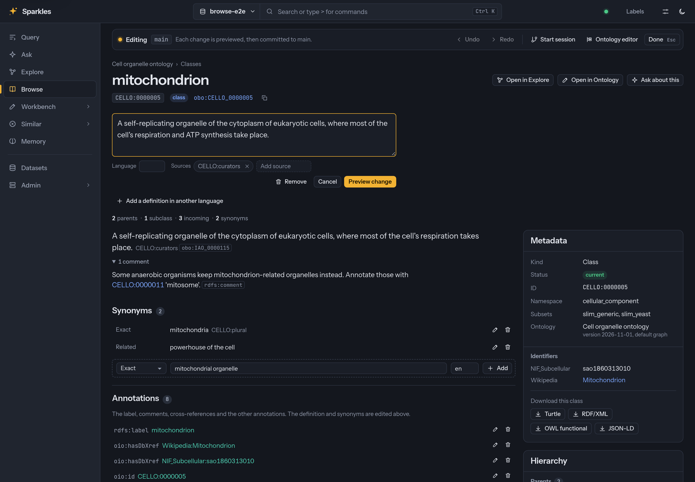

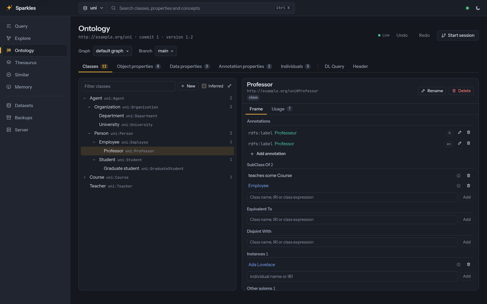

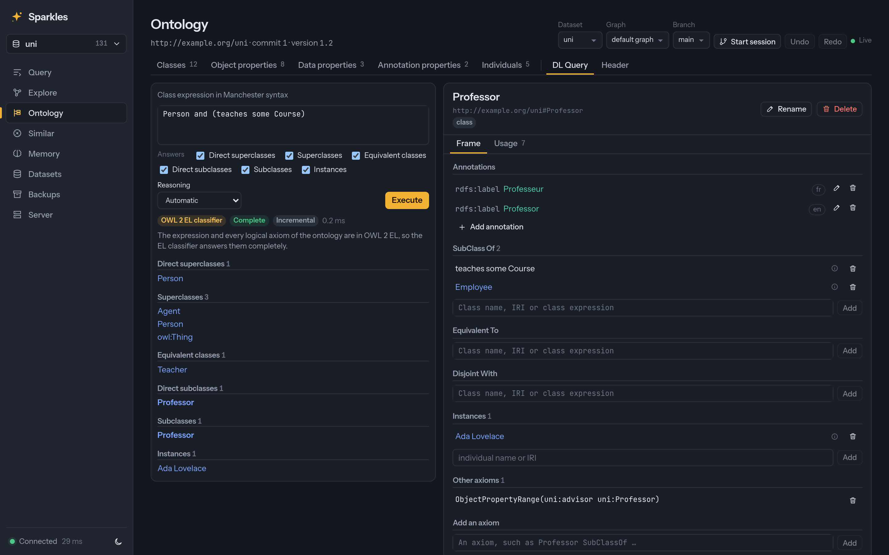

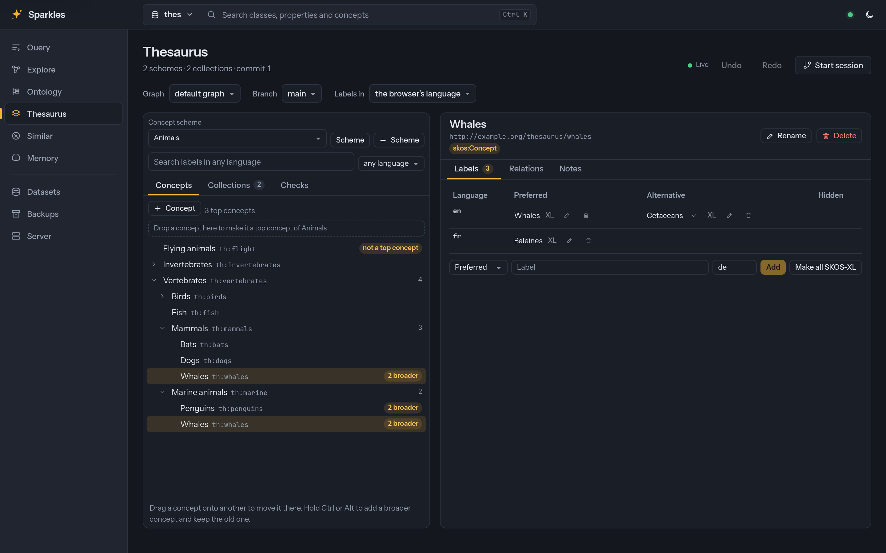

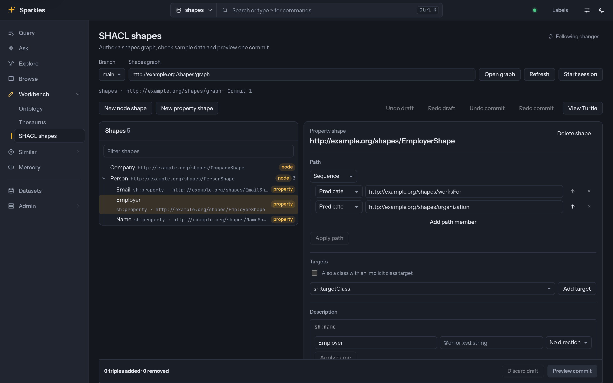

[Editing forms](visualization/README.md#nested-form-read-models) generated from SHACL
shapes edit a resource with its nested blank-node children, ordered lists and value
alternatives, and save each form as one previewed commit.

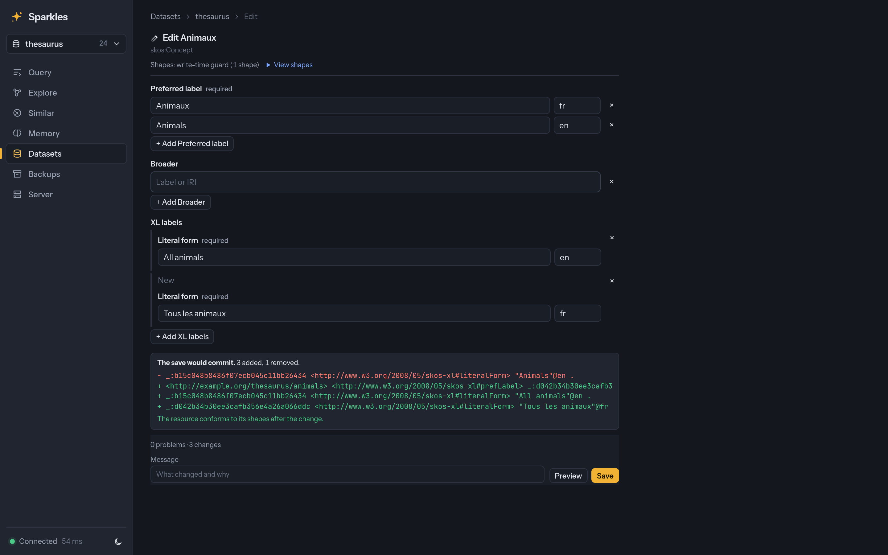

### Libraries and integrations

Embed the same engine through [Rust, Python, JVM and Node.js APIs](integrations/README.md#libraries-and-bindings),
or connect through the Rust HTTP client. The guide describes Jena integration and the
administration, callback and platform coverage that differs between bindings.

### Deployment and operations

Deploy through [NixOS, Docker or the server binary](operations/README.md#deployment).
Manage settings, resource limits, notifications and observability, and use
[backups](operations/README.md#backups), integrity checks and format migration to
operate datasets. The server listens before its datasets open, reports each dataset as
opening, open or failed in its readiness check, and serves the others when one fails to
open.

## Capability status

Status describes the scope named in each row. **Complete** means that documented scope
is available. **Partially complete** means usable functionality is available while the
listed phases or extensions remain. **In progress** identifies active implementation
that has not shipped. **Planned** means the design exists without an implementation.
Writing a spec or running validation does not make a planned capability available.
The [spec index](specs/README.md) records the phase boundaries, and the
[roadmap](ROADMAP.md) describes the remaining work. Benchmark coverage is separate from
implementation status.

Benchmark results qualify the recorded host and executable. A pinned
[instruction-count diagnostic](benchmarks/synthetic/RESULTS.md#query-layout-after-the-classification-batch)
records query timing differences between executables with unchanged plans,
answers and instruction counts, and the limits of attributing them to layout.

### Querying and storage

| Capability | Status | Current scope and remaining work |
|---|---|---|
| [SPARQL Query, Update and Graph Store protocols](querying/README.md#standards-conformance) | Complete within the documented conformance scope. | The listed SPARQL suites pass. This does not promise every Jena extension or plugin interface. |
| [Durable commits and dataset identity](storage/README.md#storage-and-indexes) | Complete within the documented commit contract. | Transactions have receipts and synchronized acknowledgements. |
| [Storage, loading and compaction](storage/README.md#storage-and-indexes) | Partially complete. | Compressed indexes, bulk imports, online compaction, optional FSST, a warm-up of the query path before a server reports ready and an optional prewarm after a restart are available. Finer compaction controls and larger-scale measurements remain. |
| [History, snapshots and branches](storage/README.md#versioning-and-history) | Partially complete. | Retained commits, diffs, branches and merge review are available. Capped Store snapshots and trusted Dataset history handles preserve retained origins. Historical full-text search and further branch administration remain. |
| [Join estimation](internals/OPTIMIZATIONS.md#further-scan-and-filter-optimizations) | Partially complete. | Stars, object joins, chains and joins on several keys are estimated from characteristic sets with a remainder and from key probes. Characteristic pairs, sampling of large inputs and the other X15 phases remain under item 454. |
| [Streaming execution and disk spill](querying/README.md#sparql-queries-and-updates) | Partially complete. | Eligible plans stream automatically, with explicit cursors and disk spill on by default. Native SELECT and small eager solution output check complete rows against the query memory budget, and finite HTTP bodies have independent idle and optional total transfer deadlines. Eager fallbacks and some ordered spill costs remain. |
| [Incremental views and live queries](querying/README.md#sparql-queries-and-updates) | Partially complete. | Table views and live query updates are available, including maintained property paths. Graph views, commit-time maintenance, branch views and provenance on views remain planned. |

### Search and graph analysis

| Capability | Status | Current scope and remaining work |
|---|---|---|
| [Full-text and vector search](search/README.md#search) | Partially complete. | BM25, HNSW, hybrid ranking and embeddings on write are available. Historical search, multi-field documents and quantization remain planned. |
| [Paths and graph algorithms](search/README.md#search) | Partially complete. | Shortest paths, communities, centrality and graph embeddings are available. Further kernels, API surfaces and reference comparisons remain under items 8, 275 and 276. |
| [GeoSPARQL](search/README.md#geosparql) | Partially complete. | Spatial filters, joins and constant-geometry nearest-neighbour ordering are available. Further spatial queries and coordinate reference systems remain under item 24. |

### Reasoning and validation

| Capability | Status | Current scope and remaining work |
|---|---|---|
| [Reasoning](reasoning/README.md#reasoning) | Partially complete. | RDFS, a documented OWL 2 RL subset and Jena rules are available with incremental materialization and demand derivation. Demand tables have a configurable process-wide cache budget and operator statistics. Automatic cost selection, a separate derived layer and canonical equality remain planned. |
| [Explanations](reasoning/README.md#reasoning-validation-and-schema) | Partially complete. | Why, bounded why-not, entailment diffs and minimal supports are available. The reasoner can keep bounded witnesses per fact. Inferred visibility and review protections that read them remain planned. |
| [Validation and forms](reasoning/README.md#reasoning-validation-and-schema) | Partially complete. | SHACL, ShEx, write guards and generated forms are available, and forms edit nested children, lists and value alternatives in one commit. Form checks refuse incomplete discovery. Node-level alternatives, complex nested paths and some target producers remain. |
| [Schema discovery](reasoning/README.md#reasoning-validation-and-schema) | Complete within the documented discovery scope. | Class and predicate profiles, schema diffs and constrained shape drafts are available. Drafts retain the limits in the compatibility boundaries. |
| [OWL 2 ontology API](reasoning/README.md#owl-2-ontologies) | Partially complete. | The axiom model, RDF mappings, profile checks and axiom diffs are available in Rust, Python, Node.js, the JVM through `jena-ontapi`, HTTP, MCP and the CLI. Reads with inferences and the Manchester reader are available in all of them except MCP and the CLI. Entity accessors, typed axiom constructors and literal checks include XML namespace conformance, with full XML canonical lexical and value semantics remaining in item 663. A read budget, fetched imports, and inferred reads and entity reports over MCP and the CLI remain in items 539, 559, 565 and 578. |
| [OWL 2 EL classification](reasoning/README.md#owl-2-ontologies) | Partially complete. | An incremental, concurrent EL classifier computes the inferred class hierarchy and the unsatisfiable classes in Rust, Python, Node.js, the JVM, HTTP and the CLI, which reads a file without a store, and can write the taxonomy to a graph with provenance. It covers OWL 2 EL with individuals, datatypes, keys and negative assertions, and uses only literals it cannot compare and chains through the top property in part, item 663. Horn ontologies without individuals, with inverse properties, universal and at-most restrictions, are classified completely, and Horn reasoning with individuals is item 692. ALCHI ontologies without individuals or data properties, with unions, complements, transitive properties and chains, are classified completely by consequence-based case analysis, and number restrictions take part when `Limits::counting` asks for them, which is off by default until item 728 makes it finish on real ontologies, and a run under a deadline can return the subsumptions it proved with the classes it left open and the consistency it knows, in every language, over HTTP and on the CLI. Its taxonomies equal ELK's and Konclude's on ChEBI lite and the ORE 2015 EL sample and Konclude's on GO, where `--reasoner elk` and the ELK mode of the library give ELK's, and it classifies them 3.1 to 20 times as fast as ELK on one and eight threads and faster than Konclude on the benchmark host. DL queries reuse the kept classification incrementally in the same languages over HTTP and the bindings, and over MCP and the CLI in item 661. `sparkles ontology reason`, `reduce`, `relax` and `materialize` take ROBOT's options, chain in one process and equal ROBOT's outputs with ELK on GO and ChEBI lite under `--reasoner elk`. An MCP tool, general entity/axiom reads with the classification, durable runs and the remaining ROBOT inputs and outputs remain in items 586, 588 to 590 and 685 to 687. |
| [Ontology editor](visualization/README.md#ontology-editor) | Partially complete. | Ontology editing, paged class and property trees, individuals paged by asserted type, DL Query, history, session branches and undo are available alongside shared rendering preferences. On-demand metrics show scoped axiom and signature counts, a conservative DL bound and OWL 2 profile reports including assertions. The feature guide describes the remaining diagram, tree, IRI policy, grant and read-cost work. |
| [Thesaurus editor](visualization/README.md#thesaurus-editor) | Complete. | The Workbench's Thesaurus editor edits SKOS concept schemes, concepts, collections, multilingual and SKOS-XL labels, hierarchy and mapping links as previewed commits, with drag to re-parent. Built-in SKOS shapes check the SKOS Reference's integrity conditions and can guard writes. Larger trees and search, foreign mapping labels, label relations, combined guards and graph-scoped forms are items 638 to 642. |
| [Visual SHACL shape editor](visualization/README.md#visual-shacl-shape-editor) | Complete. | Trees and forms author node and property shapes, Core targets and constraints, nested paths and severities as previewed graph commits. Sample validation retains source identity, and unrecognized RDF is preserved beside the existing Turtle and SHACLC text validator. A shapes graph opens for editing up to 5,000 triples. |
| [Kept classification reads](reasoning/README.md#owl-2-ontologies) | Partially complete. | Rust, Python, Node.js, the JVM and HTTP expose bounded named-class hierarchy, equivalence, unsatisfiability and source pages pinned to exact kept results, with explicit scoped projection for restricted views. Fresh RDFS or OWL RL materializations separately supply pinned property hierarchies, individual named types and derived frames. General classifier-backed entity/axiom reads, complete property/individual entailments and classification justifications remain in items 588, 622, 609 and F24. |
| [Ontology browser](visualization/README.md#ontology-browser) | Partially complete. | Browse gives entities and ontologies pages with linked Manchester axioms, definition disclosures, metadata and identifier/download cards, tree/graph hierarchies, related terms from the vector index and previewed editing, and its typo-tolerant [entity search](search/README.md#entity-search) answers typeahead on ChEBI lite within 8.3 ms at the 99th percentile. Named-class views read bounded kept clauses at the displayed commit with explicit scoped classification and visible outcomes, and property and individual views read fresh RDFS or OWL RL materializations with exact source/revision pins and inferred-graph provenance. General classifier-backed entailments and explanation links remain in items 588, 622, 609 and F24. |

### Server and security

| Capability | Status | Current scope and remaining work |
|---|---|---|
| [Server and Fuseki integration](server/README.md#server-and-protocols) | Partially complete. | Supported Fuseki protocols, configuration conversion and administration are available. On Linux, request work keeps to the performance cores of Intel hybrid processors while they can hold it. Further integration and ARQ extensions remain. |
| [Access control and authentication](server/README.md#access-control-and-security) | Partially complete. | Dataset, graph and triple protections, OIDC and API tokens are available. Derived visibility, guarded caller adoption and authentication extensions remain planned. |
| [Settings and declared prefixes](server/README.md#server-and-protocols) | Complete within the documented settings scope. | Layered settings, operator locks, runtime administration and prefix completion are available. |
| [Resource catalog](server/README.md#resource-catalog) | Partially complete. | Versioned resources, SPDX licence classes with propagated obligations and a NOTICE, and vocabulary namespaces are available in DCAT 3. The licence gate reports a verdict that warns by default. Fetching, loading, mirrors and gates on export routes remain under items 458, 525 and 526. |

### Agents and interfaces

| Capability | Status | Current scope and remaining work |
|---|---|---|
| [Ask, ingestion and agent memory](ai/README.md#ai-and-agents) | Partially complete. | Checked queries, ingestion review and cited memory shown as fact cards with their sources, confidence and a timeline of superseded facts are available. Accuracy, contextual linking, additional ingest formats and scratch-branch controls remain open. |
| [GraphRAG reports](ai/README.md#ai-and-agents) | Partially complete. | Community reports, which a dataset's page lists as a tree or a treemap, global Ask, memory retrieval and change-feed refresh are available. View-based refresh and reports for distinct audiences remain planned. |
| [Web graph, map and editing tools](visualization/README.md#web-ui) | Partially complete. | Explore, paths, lenses, derivation trees, maps, linked selections and the visual query builder are available. Explore draws up to 5,000 of the 100,000 nodes it holds, in a WebGL view past 1,000 visible nodes, with group nodes for large fan-outs and filters that choose what is drawn. Live profiling, additional builder blocks and the rendering items 737 to 739 remain. |
| [App shell and design system](visualization/README.md#app-shell) | Complete. | Every page shares a top bar whose command palette searches entities, datasets, saved queries and pages and runs each page's commands, and a rail that narrows to icons and becomes a drawer on a phone. Light and dark tokens and shared components set one layout at large, medium and phone widths, with toolbars that keep one row and dialogs that dock as sheets on a phone. |
| [Rust, Python, JVM and Node.js APIs](integrations/README.md#libraries-and-bindings) | Partially complete. | All four embed the engine, and the JVM binding integrates with Jena. Administration, callback and platform coverage differ by binding. |
| [Formatting, linting and command-line tools](querying/README.md#formatter-and-editor-support) | Complete within the documented scope. | Formatting, linting, completion and CLI tools are available. The [querying guide](querying/README.md#sparql-and-formats) lists embedded-query limits and remaining linter work. |
| [Backups and operations](operations/README.md#operations) | Partially complete. | Dataset backups, integrity checks, format migration and degraded startup are available. Whole-server recovery and published release artifacts remain open. |

### Evidence and planned extensions

| Capability | Status | Current scope and remaining work |
|---|---|---|
| [Shared evidence and review records](ai/README.md#evidence-profile) | Partially complete. | Authenticated evidence proposals, reference resolution, review decisions with accepted projections, withdrawals, reviewed, reversible identity resolution maps, assessment inputs and the dependents of changed records are available through Rust, HTTP and caller-scoped MCP tools with protected records and retained source holds. Recall and Ask citations, ingestion into proposals, reports and maintained analyses are planned under items 650 to 652 and 340. |
| [Shared entity representation](ai/README.md#shared-entity-representation) | Partially complete. | Versioned resources, fixed fixtures and a bounded private offline resolver are available. Authenticated managed integration remains under item 396. |
| [Durable jobs and delivery](specs/C26-durable-jobs-and-delivery.md) | Planned. | Item 339 specifies checkpointed jobs, fenced workers and a transactional outbox. Current tasks and notifications do not provide that recovery contract. |
| [Maintained analysis results](specs/F22-analysis-lifecycle.md) | Planned. | Item 340 specifies reproducible runs, dependency checks, freshness and guarded publication. |
| [Valid-time queries and event history](ai/README.md#valid-time-profile) | Partially complete. | Versioned RDF resources, SHACL shapes and temporal stored-query templates are available. Phase 1 still requires authenticated availability and backdating refusal. The projection helper, event-time UI and expiry integration remain planned. |
| [Reports for distinct audiences](specs/C22b-report-configurations.md) | Planned. | Item 100 specifies multiple guarded GraphRAG configurations and shared budget enforcement. |
| [ChatGPT-plan model access](specs/C28-chatgpt-model-access.md) | Planned. | Item 344 specifies personal sign-in, protected connections and Responses streaming. Existing OpenAI-compatible providers use API keys. |
| [Batched updates and triggers](specs/C23-batched-updates-and-triggers.md) | Planned. | Item 36 specifies batched work, commit-trigger authoring and the writer that graph algorithms use. |
| [Additional query languages](specs/C24-json-query-languages.md) | Planned. | JSON node-pattern and Datalog query surfaces remain item 72. openCypher remains item 20, which also supplies graph algorithm procedures. |
| [Query by example and notebooks](#known-gaps) | Planned. | Items 28 and 30 describe these interfaces. The existing visual query builder is available. |
| [Local-first engine](#known-gaps) | Planned. | Item 44 describes this extension. |

## Compatibility boundaries

These are documented scope and compatibility choices. They do not mark a completed
roadmap item as unfinished or promise another implementation.

* Predicate patterns answer counts of distinct subjects, rather than `COUNT(*)` per
  predicate. Queries that count triples use the ordinary permutations. Encoded IRIs and
  alternative block codecs are not available because their measured savings did not
  meet the adoption gates in [X11](specs/X11-index-compression-and-predicate-patterns.md#phases-not-built).
* A headerless WAL that has never been opened for writing by the current format keeps
  its legacy interpretation. A torn record left by an older build can therefore be
  read as a legacy commit or refused, as [X09](specs/X09-group-commit-by-default.md#phase-3)
  describes.
* ShEx 2.2 does not support `RESTRICTS` or `EXACTLY` reference syntax. SHACL 1.2 reifier
  constraints, `sh:uniqueValuesFor`, `sh:subsetOf`, `sh:someValue`, `sh:rootClass`,
  `sh:singleLine` and SHACL 1.2 custom functions are outside the supported scope. The
  [G02](specs/G02-shex/OUTCOME.md#roadmap-follow-ups-2026-10-12) and
  [G03](specs/G03-shaclc.md#roadmap-follow-ups-2026-10-12) Outcomes give the details.
* Drafted shapes link another class shape only at support 1, derive patterns only from
  all-string properties and ranges only from inline numbers and dates, and follow
  sequence paths one level deep. ShEx drafts leave sequence paths and date ranges as
  comments. [C02](specs/C02-schema-discovery.md#roadmap-follow-ups-2026-10-12) defines
  this drafting scope.
* SP²Bench `q4` at 10M produces 1.96 GB of TSV, exceeding the default 1 GiB response
  budget. It requires a larger `--max-result-mb`. This is a configurable result limit.

## Known gaps

These are implementation limits, missing controls, and features that other RDF stores
have and Sparkles does not. [COMPARISON.md](COMPARISON.md) covers each engine, and
[BENCHMARKS.md](BENCHMARKS.md#where-sparkles-loses) covers performance. The summaries below link to the full limits in each category guide. Those guides name
the [roadmap](ROADMAP.md) items that address each gap, and the roadmap orders the work
and links each item to its design spec.

| Area | Remaining scope |
|---|---|
| [Storage and execution](storage/README.md#storage-and-execution) | Compaction controls, larger-scale measurements and storage configuration remain. |
| [Versioning and history](storage/README.md#versioning-and-history-1) | Historical search and further branch administration remain. |
| [SPARQL and formats](querying/README.md#sparql-and-formats) | Additional query surfaces, execution coverage, formats and editor support remain. |
| [Search and graph algorithms](search/README.md#search-and-graph-algorithms) | Multi-field search, quantization and further algorithm surfaces remain. |
| [GeoSPARQL](search/README.md#geosparql-1) | Item 24 adds per-row nearest-neighbour joins, spatial syntax, polygon approximations and further CRS support. |
| [Reasoning and validation](reasoning/README.md#reasoning-and-validation) | Automatic reasoning selection, a separate derived layer, the remaining ontology accessors and remaining validation and form work remain. |
| [Server, access control and operations](server/README.md#server-access-control-and-operations) | Further Fuseki integration, derived visibility and operational controls remain. |
| [AI and agents](ai/README.md#ai-and-agents-1) | Ask accuracy, contextual linking, ingestion formats and configurable reports remain. |
| [Web UI](visualization/README.md#web-ui-1) | Live profiling, additional query-builder blocks and larger graph rendering remain. |
| [Bindings and packaging](integrations/README.md#bindings-and-packaging) | Callback completion, administration parity and additional release platforms remain. |
