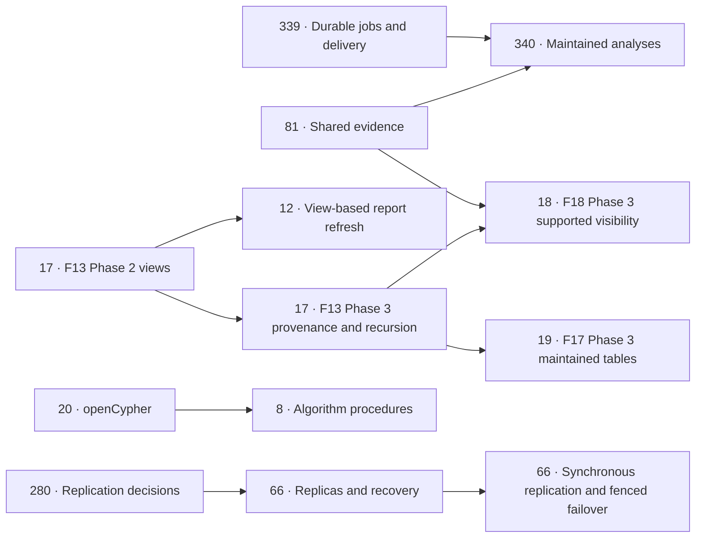

# Roadmap

This roadmap says what work is planned for Sparkles and in what order. Its goal is to
improve measured graph performance in practical use and to close the real feature gaps
in RDF extensions, reasoning, GeoSPARQL, search, agent memory and integration. Close
competitive results can be accepted with their measurements and tradeoffs recorded.
Packaging and the release contract follow the selected feature and reliability gates
and must be ready before the first release is cut.

The [feature index](FEATURES.md) and its category guides describe what Sparkles does
and does not do today. Every known gap names the roadmap item that addresses it.
[BENCHMARKS.md](benchmarks/overview/RESULTS.md#where-sparkles-loses) records the measured results and the
workloads where Sparkles loses. This document holds only the work that remains.

## Contents

- [How the roadmap is organized](#how-the-roadmap-is-organized)
- [Tracks and decisions](#tracks-and-decisions)
- [Completion paths for partially complete specs](#completion-paths-for-partially-complete-specs)
- [Tier 1: now](#tier-1-now)
- [Tier 2: high-impact features and the scale foundation](#tier-2-high-impact-features-and-the-scale-foundation)
- [Tier 3: big bets](#tier-3-big-bets)
- [Tier 4: worth doing, not urgent](#tier-4-worth-doing-not-urgent)
- [Tier 5: backlog](#tier-5-backlog)
- [Tier 6: release work](#tier-6-release-work)
- [Tier 7: compatibility leftovers](#tier-7-compatibility-leftovers)
- [Completed](#completed)
- [Keeping this current](#keeping-this-current)

## How the roadmap is organized

The work is grouped into seven tiers in order of priority. Tiers 1 to 4 are the main plan,
and Tiers 5 to 7 hold work that is wanted at a lower priority. The order weighs the effort
of an item against its impact on the goal above, and items move between tiers as results
come in. Within a tier, most items can run in parallel.

Each item has a number that stays fixed for its lifetime. Specs, FEATURES and code
comments refer to items by these numbers, so a number is never reused or changed. The
numbers are not a ranking, and a new item takes the next free number whatever its tier.

Implementation status is recorded in the [capability matrix](FEATURES.md#capability-status).
Complete means the stated scope is available. Partially complete means a usable subset
is available with remaining work named. In progress means implementation has started
but is not available on the main branch. Planned means implementation has not started.
A written spec alone is planned. Completed scope belongs in the list below even when
an extension to the same capability remains in a tier.

Each row says what remains to be done and links to the spec that holds the design. Items
that extend an existing spec are designed in a "Roadmap follow-ups" section at the end of
that spec's Outcome, and the Outcome also records what has already landed. An item that
is partly finished stays in its tier, and its row describes only the remaining part.
Finished items are listed under [Completed](#completed).

The Size column estimates the remaining effort.

| Size | Meaning |
|---|---|
| S | Days |
| M | One to two weeks |
| L | Several weeks |
| XL | A quarter or more |

The Value column in Tiers 1 to 3 rates the impact of an item on the goal. Lower tiers are
ordered by their tier alone.

## Tracks and decisions

Four tracks run through the tiers. Dependencies apply to the named remaining phases,
not to every extension in a spec or to phases that have already shipped.

| Track | Open items | Specs |
|---|---|---|
| **Performance** | 1 refreshes the evidence while 7, 86 and 4 address their remaining gates. Item 93 controls the spill default, and 111, 112 and 171 close the indexed group-commit gates. | X06, X08 Phase 2, X09 Phase 4, X07 |
| **Graph features** | 8 closes algorithm surfaces and acceptance. Item 12's view-based refresh waits for 17, while 20 supplies openCypher before its algorithm procedures can finish. | F14, C22, F13, F01 |
| **Reasoning** | 9 and 19 complete their remaining scale and query-time phases. Item 17 Phase 3 precedes 19 Phase 3 and 18 Phase 3, while existing explanations remain available. | F16, F17, F13, F18 |
| **Evidence and maintained analyses** | 81 and 339 can run independently, and both feed 340's shared representation and durable execution. Item 341 adds validity independently, and later incremental maintenance uses 17. | C25, C26, F22, C27, C22b |

The following dependencies describe the remaining phase contracts. Independent work can
proceed in parallel, including full recomputation of maintained analyses before later
incremental execution exists.

Item 19 Phase 2 does not wait for F13 Phase 3. Its `auto` mode must account for the
materialization states available when it lands. Item 100 Phase 1's report configurations
and item 341's validity profile can proceed independently. Item 100 Phase 2 uses 339 and
340 for durable refresh, without holding up existing GraphRAG refresh. Items 58 to 60
prepare the release, and item 65's new encrypted formats use the existing X12 format
registry and compatibility window.

The UI items fill time when a track is waiting on benchmark results. Item 14's adaptive
compaction policy waits for the sustained-write results of item 1; shared operation
progress can proceed independently.

Two decisions depend on what item 1 measures.

* If Sparkles already leads LDBC-style workloads, openCypher (item 20) moves up.
* If spill (item 7) turns out cheaper than expected, the incremental core (item 17)
  starts earlier, because the two share operator machinery.

## Completion paths for partially complete specs

Every partially complete entry in the [spec index](specs/README.md) has a path below.
The linked Outcome distinguishes remaining implementation from historical omissions
that later shipped. Each exit condition includes the spec's applicable acceptance,
conformance, access-control, recovery and measured performance gates. Finishing code
without its required validation does not complete that scope.

Complete means the accepted contract is delivered. Optional extensions need an explicit
scope decision, and rejected experiments retain their measured rejection rather than
becoming implementation requirements. A benchmark loss alone does not prevent completion
when the bounded work has improved the material gaps and recorded accepted close cases
and deferrals. Any accepted slowdown keeps its named follow-up under the engineering rules.

| Spec | Remaining items | Exit condition |
|---|---|---|
| [C01](specs/C01-observability-and-budgets.md#outcome) | 64, 342 | Startup exposes opening, failed and degraded states without losing readiness or access controls. JSON and OTLP include the Phase 2 work, memory-peak and rebuild series with the Prometheus units, labels and histogram semantics. |
| [C03](specs/C03-graphql/SPEC.md#outcome) | 37, 17 | Complete Phase 2's seeded execution, bounded per-parent windows, nested connections, UI/schema editing and persisted-query controls with differential and visibility tests. Subscriptions follow F13 when adopted, while mutations require the separate scope decision recorded in the Outcome. |
| [C06](specs/C06-clone-to-sandbox.md#outcome) | 45 | Remote and archive clones preserve a chosen branch/commit's data, stored blank identities, prefixes and configuration while creating correct new lineage. Interrupted, corrupt or cancelled transfers publish no destination. |
| [C17](specs/C17-agent-memory.md#outcome) | 57, 81 | Dataset-layered scratch expiry works over HTTP and stdio with the configured limits and notifications. Adopt the shared evidence profile with its source, review and independent-support acceptance queries; server model calls use the successor C18 contract. |
| [C18](specs/C18-natural-language-questions-and-ingest/SPEC.md#outcome) | 6, 15, 27, 77, 81, 90, 263, 318 | Finish the remaining evaluation matrix, multimodal ingestion, redaction and verified rewrites, and test grounding and VALUES changes against caller-visible data. Publish matching accuracy and latency evidence, preserving clarification for ambiguity and the original secret, budget and citation guarantees. |
| [C21](specs/C21-outbound-notifications.md#outcome) | 46 | Add email, the administration UI and complete backup-failure coverage. A slow destination cannot delay another channel, and delivery tests retain retry, outbound, secret and disabled-channel guarantees. |
| [C22](specs/C22-graph-rag-community-summaries.md#outcome) | 12, 100, 260, 261, 262, 264 | Add F13 view-based refresh counting, finish person-checked and broader-corpus evaluation, and validate global-question routing and schema-order decisions. Multiple report configurations follow C22b under 100, retaining shared spending and disclosure controls. |
| [F03](specs/F03-full-text-search/SPEC.md#outcome) | 23, 35, 50, 250, 251 | Complete online changes, uncommitted and historical search, multi-field documents and the named analyzer parity gaps. Verify tokens against the adopted Lucene references and preserve restricted-view scoring and query correctness across rebuilds and pins. |
| [F04](specs/F04-vector-search.md#outcome) | 34, 82 | Deliver the chosen quantization modes, result caching and statistics. Measure catch-up, worker sizing and binary16 recall on all named distance distributions, and verify cancellation, version invalidation and memory ownership. |
| [F05](specs/F05-snapshot-repositories/SPEC.md#outcome) | 61, 65, 220 | Restore whole-server and multi-dataset runs with consistent, versioned definitions and paused external work. Complete repository transfer, chunking adoption, optional retained-history capture and storage-retention controls, proving restored retained commits and preserving older backup readers. |
| [F06](specs/F06-snapshots-and-point-in-time.md#outcome) | 23, 52 | Complete pin rebasing, per-quad periods, graph feeds, expired-state reconstruction and settings history, with full-text reads at pins supplied by 23. Compare historical answers and diffs with fresh reconstruction through compaction and retention boundaries. |
| [F07](specs/F07-path-search.md#outcome) | 20, 275, 276, 277 | Add openCypher integration, length-bounded weighted search and bidirectional tied shortest paths with the reference path/cost tests. Resolve or explicitly disposition the measured control costs without weakening visit budgets or zero-weight semantics. |
| [F09](specs/F09-branches-and-merges.md#outcome) | 45 | Finish relink from the remote CLI and remote/archive cloning. Compare relink identities and clone contents with offline operations, including chosen commits, lineage, cancellation and corrupt-transfer refusal. |
| [F10](specs/F10-replication.md#outcome) | 74, 280, 66 | Settle the replication contract before implementing replicas, bootstrap, archives, promotion, synchronous acknowledgement and fenced failover. Test exact primary identities, stream gaps, restart and declared data-loss guarantees, and separately complete multi-transaction patch and blank-node semantics. |
| [F11](specs/F11-encryption-at-rest.md#outcome) | 61, 65, 58, 59 | Finish key workflows and recovery, Phase 2 chunking and write-only age-recipient repositories, then live-file and derived-index encryption. Pass the phase acceptance for provider outages, read-authority separation, rotation, locked states and format compatibility, with the feature enabled in release artifacts. |
| [F13](specs/F13-incremental-views-and-provenance.md#outcome) | 17, 220, 221, 222, 223, 224, 225, 226, 227, 265 | Complete graph and branch views, commit-time maintenance, transports, provenance and recursion, plus the named access, worker, guard and server-limit gaps. Differential, crash and subscriber/load tests must cover definition recovery, inferred data and measured commit costs. |
| [F14](specs/F14-graph-algorithms.md#outcome) | 8, 20, 36, 79, 80 | Finish Graphalytics acceptance, completion, background progress, the JVM handle and C23/openCypher integration. Define and independently validate the proposed broader weighted-betweenness domains before extending them, retaining exact refusal boundaries until then. |
| [F16](specs/F16-materialization-at-scale.md#outcome) | 9, 113 | Deliver the separate derived layer, canonical equality representatives and the remaining barrier-free and incremental-equality execution. Re-run the scale, differential, datatype and kept-closure memory gates, and settle the named small-change costs with matched measurements. |
| [F17](specs/F17-query-time-reasoning.md#outcome) | 19, 190, 191, 192, 193 | Finish automatic cost selection, hybrid rules, OWL 2 QL, settings and client surfaces, then F13-maintained tables and provenance. Close Phase 1's derived-schema completeness, cache accounting, DESCRIBE and per-query costs with demand/materialization equivalence tests. |
| [F18](specs/F18-explanations-and-entailment-diffs.md#outcome) | 18, 285, 286 | Add F13-backed supported visibility and reviewed-only derivations, result-cell actions and the explicitly extended unbound why-not contract. Compare filtered answers with fresh derivation after support withdrawal and policy changes, including multiple supports and truncated witnesses. |
| [F19](specs/F19-mappings-and-virtual-graphs/SPEC.md#outcome) | 43, 230, 231, 232, 233, 234, 235, 236, 237, 238, 239 | Finish the named source, binding, UI/task, conformance, function and term-identity gaps before claiming Phase 1 complete. Phase 2 virtual graphs must match materialized SPARQL answers with pushdown, access, cancellation and source-failure behavior tested. |
| [G01](specs/G01-geosparql/SPEC.md#outcome) | 24, 70 | Complete per-row nearest-neighbour joins, the named geometry/CRS limits and spatial syntax. Keep intentional default divergences explicit, and validate any optional Jena-compatible mode against its declared answers rather than changing the default silently. |
| [G02](specs/G02-shex/SPEC.md#outcome) | 54 | Complete combined guards, graph-plus-file schemas and CLI outbound controls with the adopted ShEx conformance and incremental/full equivalence tests. Unsupported reference syntax remains a stated language boundary rather than a claim of universal ShEx parity. |
| [G03](specs/G03-shaclc.md#outcome) | 48 | Add a lossless SHACLC parser and comment-preserving formatter across CLI, HTTP and editor, retaining semantic round trips and existing constraint tests. The separately listed SHACL 1.2 draft constraints are outside the adopted node-expression phase. |
| [P01](specs/P01-python-bindings.md#outcome) | 32, 33, 40, 58 | Deliver release/platform and async-wrapper coverage, reusable plans and the remaining bounded per-call and footprint assessment. Validate package installation and the Python API suite on the claimed runtimes while preserving cancellation, term identity and snapshots. |
| [P03](specs/P03-query-extensions.md#outcome) | 25 | Complete dynamic registered dispatch, foreign callbacks, batching and the adopted aggregate arities. Verify captured-view access, duplicate invocation, error, cancellation and transaction behavior, and measure callback costs. |
| [P04](specs/P04-jvm-bindings/SPEC.md#outcome) | 25, 32, 33, 58, 76 | Complete the named callback, plan, integration-harness, metrics and release gaps with the accepted Jena contract tests. Keep fallback BGP batching and optional module/allocator/transaction choices explicit, and substantiate performance claims with matched bridge measurements. |
| [P05](specs/P05-node-bindings.md#outcome) | 14, 32, 33, 44, 58, 329 | Complete progress callbacks, reusable plans and publication/runtime acceptance while preserving RDF/JS terms, bounded streams and transaction hand-off. Record optional Wasm/UI-migration decisions separately, and retain full-consumption controls for the measured query/export costs. |
| [X01](specs/X01-compression-codecs.md#outcome) | 61, 343 | Use the adopted X11 vocabulary and F05 repository codecs, and record the optional portable-decoder and repository-zstd decisions under the named follow-ups. Preserve format/feature refusal and codec round-trip tests; measured rejected storage codecs are not required to ship. |
| [X05](specs/X05-streaming-query-execution.md#outcome) | 7, 84, 93, 240, 243 | Finish the named fallback-demand, aggregate, early-output, UI and buffering gaps, and settle large-plan and serialization costs. Preserve eager/cursor equivalence, cumulative budgets and disconnect cancellation, widening defaults only after measured adoption gates. |
| [X06](specs/X06-benchmark-coverage.md#outcome) | 1, 8, 91, 290, 291, 292, 293, 299, 306, 328 | Finish the later benchmark batches, 100M BSBM, BI-driver reruns, noise controls and reproducible table regeneration. Retain the named cost checks and comparison inventory, accepting documented close cases without requiring every engine comparison to be a win. |
| [X07](specs/X07-cold-sparse-reads.md#outcome) | 4, 7 | Complete optional prewarm, remaining I/O reporting and the unmeasured billion-scale dense/window and counter-cost gates. Recheck cold sparse targets with controlled eviction, while treating unachieved stretch targets and read-ahead tradeoffs explicitly. |
| [X08](specs/X08-disk-spill-and-server-memory.md#outcome) | 1, 7, 40, 88, 93, 210 | Complete the remaining eager fallbacks, spill execution costs, cache accounting and footprint work, then decide the spill default under 93. Preserve the passed full-scale plain/encrypted matrix and verify ordered-join/grouping costs, one-pass outer joins, disk cleanup, admission and aggregate correctness before broadening defaults. |
| [X09](specs/X09-group-commit-by-default.md#outcome) | 86, 111, 112, 170, 171 | Establish the outstanding spatial serial and mixed-reader gates with valid drive-state calibration, and settle fence and reader-tail costs. Retain durability, crash recovery and the documented legacy-header limits while testing all indexed dataset classes. |
| [X11](specs/X11-index-compression-and-predicate-patterns.md#outcome) | 160, 241, 343 | Add dataset-local settings for the adopted codecs and patterns with lock, compaction and format compatibility tests. Keep FSST optional until its adoption gates pass, address the named lookup costs, and preserve the measured rejection of encoded IRIs, column codecs and the count shortcut. |
| [X12](specs/X12-release-engineering.md#outcome) | 58, 59, 60 | Complete unified versions, artifact publication and platform coverage, then the HTTP/CLI/library stability policy and checks. Release validation must exercise installed artifacts and older-format fixtures, including verbose version/capability reporting and required feature flags. |
| [U02](specs/U02-shape-driven-forms.md#outcome) | 21 | Add nested blank-node forms, list editing and `sh:or`/`sh:xone` choices, and complete validation beyond the current local radius. Test previews, guards, field conflicts and branch saves against the candidate state. |
| [U04](specs/U04-live-query-profiling.md#outcome) | 27 | Deliver live registry/progress, cancellation by id, hot spots and stop/explain, then integrate verified C18 rewrites. Test redaction and running/completed state transitions while retaining the shipped static overlay. |
| [U06](specs/U06-large-graph-rendering.md#outcome) | 29 | Deliver cached server layouts and versioned binary transfer, then pass the named GPU frame-rate and large-graph limits. Verify access-filtered grouping, cancellation and bounded transfer on the supported graph sizes. |
| [U07](specs/U07-data-quality-and-schema-diagram.md#outcome) | 31, 120, 121 | Build per-commit quality records, backfill, introducing-commit search and the schema diagram. Move overlays to the retained record and verify focus-scoped fix previews against the complete candidate validation result. |
| [U08](specs/U08-visual-query-builder.md#outcome) | 101 | Add Phase 3's union, graph, values, minus and not-exists editing plus overview entry. Preserve text outside edited spans, shared undo, stable layout and round trips for locked syntax. |
| [U11](specs/U11-linked-views.md#outcome) | 140, 141, 142 | Finish the named colouring, date-facet, mobile, keyboard and branch gaps, and settle persisted/filtered projection choices. Pass the GPU frame-time and lasso gates with linked selection and caller visibility preserved. |

## Tier 1: now

These items are cheap or foundational.

| # | Item | Spec | Size | Value |
|---|---|---|---|---|
| 1 | **Benchmark refresh.** Later X06 batches, BSBM at 100M, a rerun of the BSBM BI driver cells and the regeneration of the published tables remain. | [X06](specs/X06-benchmark-coverage.md), [F16](specs/F16-materialization-at-scale.md), [X08](specs/X08-disk-spill-and-server-memory.md#33-the-default-and-small-profiles) §3.3 | M | Very high |
| 4 | **Cold sparse lookups.** Phase 4 adds an optional prewarm of the pages a server used before it stopped. Cold `star-join` at 10.5M is slower with index format 3 and that cost should be removed. The Oxigraph targets need measuring again, and the 1.01B dense-read gate and its window sweep are not measured. | [X07](specs/X07-cold-sparse-reads.md) | M | High |
| 6 | **Ask evaluation on public benchmarks.** Runs of local and OpenAI-compatible models and an evaluation with independent roles remain, and LC-QuAD 2.0 waits for a Wikidata load from the full dump. | [C18](specs/C18-natural-language-questions-and-ingest/OUTCOME.md#roadmap-follow-ups-2026-10-12) | S–M | Medium |
| 263 | **Ask on DBpedia.** Question-aware grounding has mixed measured accuracy across models. A complete visibility-safe candidate evidence contract and context-sensitive namesake resolution remain, with genuine ambiguity kept as a clarification. Further changes need offline checks and end-to-end accuracy evaluation. | [C18](specs/C18-natural-language-questions-and-ingest/OUTCOME.md#ask-grounding-accuracy-item-263) | M | High |
| 318 | **Ask median latency.** The retained 107-question repeat has higher median wall time for Haiku and Sonnet, while p95 is nearly unchanged. Profile grounding and model time separately and reduce avoidable work while preserving caller visibility and required clarification. Provider variability and different GCC versions leave the cause unconfirmed. | [C18](specs/C18-natural-language-questions-and-ingest/OUTCOME.md#ask-grounding-accuracy-item-263), [Benchmarks](benchmarks/natural-language/RESULTS.md#ask-on-dbpedia) | M | High |

## Tier 2: high-impact features and the scale foundation

| # | Item | Spec | Size | Value |
|---|---|---|---|---|
| 7 | **Batch-oriented execution and disk spill.** The full-scale spill matrix passes, while execution follow-ups and the default decision remain under item 93. Spill stays opt-in, and several cases still run eagerly. The [remaining work](#remaining-work-for-item-7) is listed below. | [X08](specs/X08-disk-spill-and-server-memory.md) Phase 2, [X05](specs/X05-streaming-query-execution.md#roadmap-follow-ups-2026-10-12) | L | Very high |
| 8 | **Graph-algorithm library.** Algorithms and graph lenses are available. The full Graphalytics harness, algorithm-name completion, richer background progress, a JVM handle, the C23 writer and openCypher procedures remain. | [F14](specs/F14-graph-algorithms.md#outcome) | S–M | High |
| 9 | **Materialization at scale.** Phase 1 materialization is available. The separate derived-fact layer of Phase 2, `owl:sameAs` representatives of Phase 3 and eligible execution without iteration barriers and equality maintenance in Phase 4 remain. | [F16](specs/F16-materialization-at-scale.md), [C08](specs/C08-inference-freshness.md#roadmap-follow-ups-2026-10-12) | L | High |
| 12 | **GraphRAG community summaries.** Community reports, global answering and change-feed refresh are available. Counting changes from an F13 view remains planned and waits for item 17. | [C22](specs/C22-graph-rag-community-summaries.md) | M | High |
| 14 | **Compaction and operation progress.** Delta changes located per block, new vocabulary without a full rebuild, adaptive thresholds and automatic compaction in embedded use remain. Shared controlled load and compaction progress must also reach the Node callbacks without weakening cancellation or memory budgets. | [C13](specs/C13-automatic-compaction.md#roadmap-follow-ups-2026-10-12), [P05](specs/P05-node-bindings.md#operation-progress) | M | Medium–high |
| 15 | **Ingestion of images and audio.** The remaining follow-ups are recorded in C18. | [C18](specs/C18-natural-language-questions-and-ingest/OUTCOME.md#roadmap-follow-ups-2026-10-12) | M | Medium–high |
| 344 | **ChatGPT-plan model access.** Planned Sign in with ChatGPT connections let a caller use eligible plan access through the Responses API. Account-bound credentials, refresh, usage-limit handling and explicit provider selection preserve existing data and spending controls. | [C28](specs/C28-chatgpt-model-access.md) | M–L | High |
| 86 | **Group commit for indexed datasets.** The p90 of spatial serial inserts at 10.5M misses its gate. The spatial reader gate at 1.05M is not established, because the ordinary writer missed the schedule lag requirement. Items 111, 112 and 171 follow up. | [X09 section 17](specs/X09-group-commit-by-default.md#17-phase-4-group-commit-for-indexed-datasets) | M–L | Medium–high |
| 339 | **Durable jobs and delivery.** Planned checkpointed jobs, fenced external workers and a transactional outbox make collection, analysis and delivery resumable after a restart. Publication and delivery intent share the dataset transaction. | [C26](specs/C26-durable-jobs-and-delivery.md) | L | High |
| 113 | **Small changes and undos over a kept closure.** Changes of 100 triples at 16 threads and undos at 1 thread remain slower than before the F16 follow-up, and a profile of the full run should find or rule out a cost of about 5%. The options are an opt-in in-memory index of the input facts, charged to the memory budget, and per-thread counters in the block cache. | [F16](specs/F16-materialization-at-scale.md#roadmap-follow-ups-2026-10-18) | M | Low |

### Remaining work for item 7

* Spill stays opt-in while item 93 closes execution costs and the default decision,
  preserving the passed full-scale plain/encrypted acceptance matrix.
* LIMIT propagation into fallbacks, running state for FOLD and registered aggregates,
  and earlier first bytes remain from the X05 follow-ups.
* An EXISTS evaluated once per outer key, in BIND or an OPTIONAL condition, stays eager
  because the cursor was slower, and DESCRIBE does not stream.
* The UI's result table still asks for eager execution until it can show a streamed
  result's unknown total.
* The parallel cursor filters and range top-k were measured on 8 vCPUs and still need a
  12-thread measurement on an Intel host. Decoding ahead under many concurrent queries is
  unmeasured.
* The eager `regex-iri` filter keeps `regex::Regex`, and its 5% inlining sensitivity on
  forge is open.

## Tier 3: big bets

The reasoning track leads this tier in its own order. Full-text parity, GeoSPARQL, live
query profiling and query by example lead the items that fill time around it, and
openCypher comes last.

| # | Item | Spec | Size | Value |
|---|---|---|---|---|
| 19 | **Query-time reasoning.** Phase 2 adds `auto` with its cost model, the dataset setting, hybrid Jena rules, OWL 2 QL rewriting, reuse of tables across commits, the MCP argument, the UI and the G08 mapping. Phase 3 keeps tables current through F13 and adds `why` provenance on tables for F18. Items 190 to 193 cover what Phase 1 left. | [F17](specs/F17-query-time-reasoning.md#outcome) | L | High |
| 18 | **Explanations.** Provenance-aware protections with `reviewedOnly` over derived facts. Demand derivation trees, bounded why-not searches, entailment diffs and minimal justifications are available. Phase 3 needs F13. | [F18](specs/F18-explanations-and-entailment-diffs.md) | M–L | High |
| 17 | **Incremental computation core.** Phase 2 adds `graph` views, maintenance inside the commit, the WebSocket, MCP, the Node and JVM APIs, the UI, views per branch, `keepCommits`, ordered windows and data-dependent protections compiled to views. Phase 3 adds provenance per fact, recursion and GraphQL subscriptions. | [F13](specs/F13-incremental-views-and-provenance.md#outcome) | XL | Very high |
| 23 | **Full-text parity.** Online enabling and reconfiguring, search after uncommitted writes, and historical search remain. The analyzers that follow Lucene's and the dictionary analyzers are built. | [F03](specs/F03-full-text-search/OUTCOME.md#roadmap-follow-ups-2026-10-12) | M each | Medium |
| 24 | **GeoSPARQL.** k-NN with a query geometry bound per row, better polygon approximations than the cell grid and QLever's spatial syntax. The geometry limits to lift are datums other than WGS 84, grid-based and exact Helmert shifts, curved GML segments and solids, 3D constructions, and lines split at crossings. | [G01](specs/G01-geosparql/OUTCOME.md#roadmap-follow-ups-2026-10-12) | M | Medium |
| 27 | **Live query profiling and verified rewrites.** The static plan overlay is available. The running-query registry, live operator progress and hotspot views remain planned, followed by C18 Phase 6's result-equivalent rewrite suggestions and their integration in the live plan. | [U04](specs/U04-live-query-profiling.md), [C18](specs/C18-natural-language-questions-and-ingest/README.md) Phase 6 | M | Not rated |
| 28 | **Query by example** and Bloom-style search phrases. | [U03](specs/U03-query-by-example.md) | M | Not rated |
| 21 | **Editing forms generated from SHACL shapes.** Phase 3 adds nested forms for blank nodes, the list editor and `sh:or` and `sh:xone` choices. Validation of nodes more than two triples from the edited resource, in a check without a guard, also remains. | [U02](specs/U02-shape-driven-forms.md#outcome) | M–L | Medium–high |
| 25 | **Query extension completion.** Callback-family checks need to survive thread-local destruction. Dynamic dispatch, foreign callbacks, batching, additional aggregate arities and measurements also remain, including native Java dispatch beside ARQ. | [P03](specs/P03-query-extensions.md#roadmap-follow-ups-2026-10-12), [lifecycle acceptance](specs/P03-query-extensions.md#callback-context-during-thread-destruction) | M | Medium |
| 26 | **Local models.** GPU, ONNX and GGUF, rerankers, and models shared between processes. | [F12](specs/F12-local-embeddings.md#roadmap-follow-ups-2026-10-12) | M–L | Medium |
| 81 | **Shared evidence and review records.** Planned source revisions, unasserted claims, independent evidence, reversible identity decisions and review-controlled projections provide a common representation for agents and applications. Existing memory provenance and supersession remain available. | [C25](specs/C25-evidence-and-assessments.md), [C17](specs/C17-agent-memory.md#shared-memory-representation) | M–L | High |
| 340 | **Maintained analyses and evidence dependencies.** Planned immutable run manifests, conservative read dependencies and guarded publication track when assessments need review or recomputation. Begin with bounded full recomputation and add proven incremental maintenance through item 17. | [F22](specs/F22-analysis-lifecycle.md) | L | High |
| 341 | **Valid time and observation history.** Planned interval profiles, availability cutoffs, temporal query helpers and an event-time control distinguish when a statement applies from when it was recorded. Existing commit-time history remains available. | [C27](specs/C27-valid-time-profiles.md) | M–L | High |
| 20 | **openCypher,** with graph algorithms as procedures and LDBC SNB as acceptance. | [F01](specs/F01-cypher.md#roadmap-follow-ups-2026-10-12) | L–XL | High |

## Tier 4: worth doing, not urgent

This tier has three groups. The features are user-facing work, the performance follow-ups
investigate measured costs and planner losses, and the graph-interaction UI finishes a set
of canvas features.

### Features

| # | Item | Spec | Size |
|---|---|---|---|
| 29 | **Rendering very large graphs.** Phase 3 adds server layouts, the binary transfer format and GPU frame-rate tests. | [U06](specs/U06-large-graph-rendering.md#outcome) | M |
| 30 | **Notebooks** stored in the dataset. | [U05](specs/U05-notebooks.md) | M |
| 31 | **Data-quality timeline and schema diagram.** Validation overlays are available. Per-commit quality history, backfill and the schema diagram remain planned. | [U07](specs/U07-data-quality-and-schema-diagram.md) | M |
| 32 | **Parameterized reusable plans.** | [X10](specs/X10-reusable-query-plans.md), [P01](specs/P01-python-bindings.md#roadmap-follow-ups-2026-10-12) | L |
| 34 | **Vector quantization** and vector-result caching. | [F04](specs/F04-vector-search.md#roadmap-follow-ups-2026-10-12) | M |
| 35 | **Multi-field full-text entity documents.** | [F03](specs/F03-full-text-search/OUTCOME.md#roadmap-follow-ups-2026-10-12) | M |
| 36 | **Batched updates and commit triggers.** | [C23](specs/C23-batched-updates-and-triggers.md) | M |
| 37 | **GraphQL completion.** Child queries seeded with engine IDs, per-parent top-k, nested connections, the UI/schema editor and persisted queries with their MCP controls remain. Subscriptions use F13 when adopted, while mutations retain their separate scope decision. | [C03](specs/C03-graphql/OUTCOME.md#roadmap-follow-ups-2026-10-12) | M |
| 38 | **SERVICE enhancer.** A slice-aware cache, cache functions, a disk cache and parallel requests. | [G10](specs/G10-service-enhancer.md#roadmap-follow-ups-2026-10-12) | M |
| 39 | **Stored updates,** multi-value parameters and private stored queries. | [C16](specs/C16-stored-queries.md#roadmap-follow-ups-2026-10-12) | S–M |
| 41 | **Embedding conveniences.** Text input in Similar, chunk offsets kept beside vectors, and NixOS embedding settings. | [F08](specs/F08-embeddings-on-write.md#roadmap-follow-ups-2026-10-12) | S |
| 42 | **MCP observability.** Progress notifications, per-tool metrics and performance measurements. | [C11](specs/C11-mcp-server.md#roadmap-follow-ups-2026-10-12) | S–M |
| 43 | **Virtual graphs** over SQL, Parquet and Iceberg. | [F19](specs/F19-mappings-and-virtual-graphs/README.md) Phase 2 | XL |
| 44 | **A local-first engine** in WebAssembly that syncs through RDF Patch and branches. | [F20](specs/F20-local-first-engine.md) | XL |
| 72 | **JSON query languages,** and a Datalog surface syntax for rules and queries. | [C24](specs/C24-json-query-languages.md), [F17](specs/F17-query-time-reasoning.md) | M–L |
| 78 | **Incremental write-time validation** of recursive SHACL shapes and of SHACL-SPARQL constraints not anchored at the focus node. | [C10](specs/C10-write-time-validation.md#roadmap-follow-ups-2026-10-12) | M–L |
| 82 | **Cheaper vector catch-up and measured half-precision recall.** Catch-up should scan only new rows, binary16 recall needs measuring on Euclidean and offset dot-product data, and a measurement should pick the worker pool. A test should cancel a carry. | [F04](specs/F04-vector-search.md#roadmap-follow-ups-2026-10-12) | S–M |
| 83 | **Digest check on the ShEx guard's schema copy.** The guard should compare its schema copy with `schema.sha256` when it loads, and refuse the guard or validate in full when they differ. | [C10](specs/C10-write-time-validation.md#known-gap-schema-copy-digest-2026-10-16) | S |
| 100 | **Reports for distinct audiences.** Planned named GraphRAG configurations have separate principals, projections, guarded reports and review histories, with an explicit default and shared dataset spending limits. | [C22b](specs/C22b-report-configurations.md) | M |
| 250 | **Chinese segmentation after SmartChineseAnalyzer,** and Kuromoji's normal and extended modes and user dictionaries for `ja-dict` and `ko-dict`. `zh-dict` segments by jieba's frequencies today. `ja-dict` and `ko-dict` should also cut a run of unknown characters inside a surrogate pair where Lucene does, which they do before the pair. | [F03](specs/F03-full-text-search/OUTCOME.md#roadmap-follow-ups-2026-10-12) | M |
| 251 | **Analyzers for the other languages of jena-text,** such as Greek, Arabic, Persian and Hindi, that reproduce Lucene's tokens as the analyzers for nine languages do. | [F03](specs/F03-full-text-search/OUTCOME.md#roadmap-follow-ups-2026-10-12) | M |
| 222 | **View access by grant containment.** A caller reads a view only with full access or the principal's exact access. Containment of grant sets, a cache per caller and view, and a `view:{name}` grant that declassifies a view with an audit record are not built. | [F13](specs/F13-incremental-views-and-provenance.md#outcome) | M |
| 342 | **Metrics parity for JSON and OTLP.** Add the Phase 2 produced-row, query-memory-peak and rebuild counters and histograms to the JSON snapshot and OTLP export. Preserve Prometheus units, labels, reset rules and dataset visibility, with cross-format tests. | [C01](specs/C01-observability-and-budgets.md#metrics-parity) | S |
| 343 | **Dataset-local codec and pattern settings.** Add layered settings for adopted vocabulary codecs and predicate patterns, used by subsequent builds and compactions. Preserve existing generations and format refusals, and record the optional portable zstd decoder decision without reopening measured rejected codecs. | [X11](specs/X11-index-compression-and-predicate-patterns.md#dataset-local-settings), [X01](specs/X01-compression-codecs.md#remaining-codec-decisions) | M |

### Performance follow-ups

The measurements behind these items are in [BENCHMARKS.md](BENCHMARKS.md) and the linked
spec sections.

| # | Item | Spec | Size |
|---|---|---|---|
| 33 | **Per-call overhead in the bindings.** JNI calls cost 3 to 4 times Jena's in-memory store, and Node `has()` and export conversion are slower than published targets. Python value lookups trail by 0.67 µs, and some small queries by 11 to 20 µs. | [P01](specs/P01-python-bindings.md#current-source-per-call-assessment), [P04](specs/P04-jvm-bindings/OUTCOME.md#roadmap-follow-ups-2026-10-12), [P05](specs/P05-node-bindings.md#roadmap-follow-ups-2026-10-12) | M |
| 40 | **Memory footprint.** Idle server RSS, Python process RSS and full-text index size. | [X08](specs/X08-disk-spill-and-server-memory.md) Phase 3 | M |
| 84 | **Large query plans.** An n-ary join would let the 4000-level plan limit rise, and planning time still grows with the square of the number of triple patterns. A star of a variable that many patterns share remains slow at the limit. | [X05](specs/X05-streaming-query-execution.md#large-basic-graph-patterns) | M |
| 88 | **Allocator overhead of the server-wide caches.** The result cache's heap is about 1.2 times the bytes it counts, and evicted entries leave free pages on the tokio and Rayon threads. The item also covers about 3% more instructions on queries of a few microseconds. | [X08](specs/X08-disk-spill-and-server-memory.md#gates) | S–M |
| 90 | **VALUES pushdown in more shapes.** The rewrite misses a VALUES inside `GRAPH`, joins reached while flattening a group, and branches whose FILTER reads the table's variable. | [C18](specs/C18-natural-language-questions-and-ingest/OUTCOME.md#roadmap-follow-ups-2026-10-12) | S–M |
| 91 | **Large SP²Bench answers.** The `q4` answer is 1.96 GB of TSV and needs a `--max-result-mb` above the default. Profile large-result costs while preserving response budgets and bounded memory. The `q12b` comparison is inside the ten-percent tie band. | [X06](specs/X06-benchmark-coverage.md#matched-query-comparisons), [follow-up](specs/X06-benchmark-coverage.md#sp2bench-q4-and-q6-follow-up-2026-10-23) | M |
| 93 | **Spill execution costs and the default.** The full-scale acceptance matrix passes. Grouping cost above ordered spilled joins, the extra writes that restore probe order, a DISTINCT over ordered input that keeps its whole set, the [performance investigation](#spill-performance-investigation) and a decision on enabling spill by default remain. | [X08](specs/X08-disk-spill-and-server-memory.md#full-scale-spill-acceptance-item-93-2026-10-21) | M |
| 111 | **Spatial serial slowdowns of group commit at 10.5M.** Single geometry inserts and IRI inserts run a few percent slower at p90 with grouping. Find the cause, then fix it or state the tradeoff. | [X09 Outcome](specs/X09-group-commit-by-default.md#phase-4) | S–M |
| 112 | **Fence cost of group commit on indexed datasets.** A fence costs about half as much again as an ordinary commit and carries only about two commits with four writers. Find why and whether it can carry more, and measure it on a drive in its fast state too. | [X09 Outcome](specs/X09-group-commit-by-default.md#phase-4) | M |
| 160 | **FSST single-term lookups.** Looking up one term at a time with FSST costs more than decoding each earlier key in full, which slows `star-join` and cold long-literal lookups. A lookup that plans every key's need from the last key back measured 7% slower on single lookups, because the lookups wait on memory more than on decoding. Profile the cold lookups and find a path that keeps the partial decode for long literals without the cost on short keys. | [X11](specs/X11-index-compression-and-predicate-patterns.md#item-108-faster-fsst-reads) | S |
| 170 | **Reader tail of the parallel full-text checkpoint.** Since a checkpoint synchronizes its files from eight threads, the mixed full-text reader p99 at 1.05M measured about 4% higher, within the spread of the runs. Measure it with more rounds, and if the checkpoint's share holds, try fewer threads or a lower I/O priority for the synchronizing threads. | [X09 Outcome](specs/X09-group-commit-by-default.md#phase-4) | S |
| 171 | **Calibrate the spatial mixed cell for the drive's slow state.** The ordinary writers of the spatial mixed cell at 1.05M fell behind their schedule because the unpaced calibration averaged the drive's fast and slow states. Calibrate the rate against the ordinary writer in the slow state, or probe the flush time before each process, and rerun the cell to settle item 86's reader gate. | [X09 Outcome](specs/X09-group-commit-by-default.md#phase-4) | S |
| 276 | **Unweighted path searches after item 150.** Forge measured the unweighted `ps-pair`, `ps-pair-all`, `ps-pair-k5` and `ps-values10` 3 to 4% slower in every round and weighted `path:allShortest` 2.3% slower, although item 150 does not touch their searches. Compare their code generation in both builds and profile them to find what changed. | [Benchmarks](benchmarks/graph/RESULTS.md#weighted-pair-searches) | S |
| 223 | **Parallel view passes.** Each dataset runs its view passes on one worker thread, which falls behind a fast writer with 100 views. `--view-threads`, a shared worker pool and joins whose large deltas split across threads are not built. | [F13](specs/F13-incremental-views-and-provenance.md#outcome) | M |
| 225 | **The F13 benchmarks and tests.** The SNB update streams with live short reads and views, BSBM's mix with views, the fan-out test of 1,000 subscribers, a grammar-driven query generator for the differential tests and injected crashes for recovery are not built. A grouped COUNT's pass is only 15 to 35 times cheaper than the query on synthetic data, short of the 100 times target. | [F13](specs/F13-incremental-views-and-provenance.md#outcome) | M |
| 226 | **The cost of the change ring on commits.** While a view or live query is subscribed, each commit copies its changes into a ring, which adds about 4% to a two-quad commit on atlas. It needs a pinned forge measurement and a cheaper copy. | [F13](specs/F13-incremental-views-and-provenance.md#outcome) | S |
| 240 | **Buffered output of streamed answers.** The cursor writers of streamed SELECT and graph answers still write a few bytes at a time through the response writer and are compiled with the server. Give them the engine-side buffer that eager answers use, with the same count of the rows the client received. | [Benchmarking](BENCHMARKING.md#release-build-settings) | S |
| 241 | **Front coding on three warm DBpedia queries.** Since item 108, `pat-film-predicates` and `pat-film-predicate-list` take about 4% longer with front coding and `top-linked` 1.4% longer, in all 16 pinned rounds on forge. Count their instructions on both builds and remove the cost, or show that it comes from code placement. | [X11](specs/X11-index-compression-and-predicate-patterns.md#item-108-faster-fsst-reads) | S |
| 243 | **Cheaper row accounting in the result buffer.** The buffer checks the row count at every write so that an answer cut partway reports the rows the client received. Serializers write one character at a time, so the check costs 7% of the instructions of `optional-chain` and 14% of its client time on forge, 150.8 ms against 132.0 ms. A row log that the serializers fill themselves measured no cheaper. Find a way to record row ends that costs nothing per write. | [Benchmarks](benchmarks/engine/RESULTS.md#the-cost-of-result-serialization) | S |
| 265 | **The commit path without views.** Forge measurements of inferred-view rounds are published, but the persistent commit comparison varies between 0.27 and 1.61 ms even within one build after SSD trimming. Syscall tracing locates large variation inside WAL and vocabulary writes in both builds. Repeat the comparison with matched durable-write latency before assigning a cost to the inference change. | [F13](specs/F13-incremental-views-and-provenance.md#outcome) | S |
| 290 | **Durable write costs.** Preserve synchronization before acknowledgement and compare unsynced commits as a distinct durability class. Revisit serial storage waits and mixed-reader tails only when a material persistent cost or simple broad improvement justifies it, keeping completed read work in the comparison. | [X06](specs/X06-benchmark-coverage.md#outcome) | M |
| 291 | **Guard costs after secondary-key probes.** Recheck the accepted small LUBM and synthetic-query increases with more pinned Intel rounds, particularly LUBM `q10` and `q13` and the microsecond `path-plus` case. Separate instruction cost from code placement and remove any confirmed cost. | [X06](specs/X06-benchmark-coverage.md#secondary-index-probe-spans) | S |
| 292 | **Small costs after pure ASK demand.** Recheck the small accepted changes in SP²Bench `q8`, `q12a`, `q12c` and false and empty controls, together with the pinned small-query checks recorded in X06. Include repeated full join builds when tight resource limits require exact demand. Keep these low priority unless a material persistent cost or a simple broad fix emerges. | [X06](specs/X06-benchmark-coverage.md#pure-ask-comparison-and-small-costs) | S |
| 293 | **Cursor BIND reuse costs.** Improve general admission for sparse reuse while preserving cheap inputs and query budgets. The 50M slice shortcut and later reuse remain deferred. Recheck small eager and dense-string costs alongside the retained all-thread flags before making a broad fix. | [X06](specs/X06-benchmark-coverage.md#outcome) | M |
| 299 | **Short-query checks after keyed inner groups.** Verify the small Namespace guard increases for `class-predicates`, `exists-join` and `two-hop-count` on a quiet Intel host with matching compilers. Profile and remove any confirmed cost while retaining the keyed ASK and singleton-binding improvements. | [X06](specs/X06-benchmark-coverage.md#short-query-checks-after-keyed-inner-groups) | S |
| 306 | **Tiny queries after the combined feature changes.** In 16 pinned forge rounds, `count-all` server time rose from 5.3 to 6.0 µs and `distinct-obj` from 3.6 to 4.2 µs, while client time stayed within 1.2%. The later build runs about 11% fewer instructions across complete HTTP requests, and intermediate builds between `142cd28f` and `8798c2db` do not isolate one responsible change. Measure execution and its plan bookkeeping separately from serialization, distinguish instruction cost from code placement, and remove the cost. | [Benchmarks](benchmarks/engine/RESULTS.md#the-cost-of-result-serialization) | S |
| 328 | **Small query costs in the integration screen.** Confirm the below-threshold Namespace increases on a quiet Intel host with matching compilers. Cover the small scans, joins and expression queries listed in X06, including `count-all`, `star-lookup` and variations initially classified as noise, and remove any confirmed cost. | [X06](specs/X06-benchmark-coverage.md#small-query-costs-in-the-integration-screen) | S |

### Spill performance investigation

This work belongs to item 93 and to [X08](specs/X08-disk-spill-and-server-memory.md).
Repeat the default-path `expr-order-key` and `distinct-join` comparisons on a quiet Intel
host with matched builds and inputs. Capture the executed plans and profile shared cursor
buffer accounting, join and DISTINCT work before assigning a cause, and bisect
reproducible slowdowns that stay below the push limit as well as clear failures.

Measure ordered hash joins with a GROUP BY parent at tight and larger spill budgets,
including consolidation writes, merge passes, charged memory, result equality and
cleanup. Compare memory budgets within one build separately from comparisons between
builds, and keep coverage for partially ordered DISTINCT.

### Graph-interaction UI

These items finish a set of graph-interaction features whose first phases have landed.
Rows that need backend work name it first.

| # | Item | Spec | Size |
|---|---|---|---|
| 101 | **Visual query builder, Phase 3.** `UNION`, `GRAPH`, inline `VALUES`, `MINUS` and `FILTER NOT EXISTS` join the editable subset, and **Build a query** opens the pane from a class of the Explore overview. | [U08](specs/U08-visual-query-builder.md#outcome) | L |
| 120 | **The validation overlay on the quality record.** Once item 31 Phase 1 records the guard's results per commit, add `focus=` to `GET /$/validation/{ds}/results` and read the record at the head instead of validating. | [U07](specs/U07-data-quality-and-schema-diagram.md#outcome) §11 | S |
| 121 | **Conclusive previews of a suggested fix.** Let a dry run name focus nodes to validate in full against the candidate state, so that the overlay can say a fix resolves a result while other results remain. | [U07](specs/U07-data-quality-and-schema-diagram.md#outcome) §11, [C15](specs/C15-write-previews.md) | S |
| 140 | **Linked views remainder in the UI.** Colour the embedding map by a kept Leiden run and open it with `Shift+M`, count date facets by month for short spans, give the facets a full-screen tab on phones, and let Explore's map and facets read a branch. | [U11](specs/U11-linked-views.md#outcome) | M |
| 141 | **Frame times of the linked views on a GPU.** Run U11's A9 frame-rate and lasso targets in a Playwright performance project on a GPU runner, since they were measured only in software rendering. | [U11](specs/U11-linked-views.md#outcome) | S |
| 142 | **Projections on disk and for partial callers.** Decide whether to write projections beside the index in a versioned file, and whether to serve a projection filtered to what a caller can read instead of answering `403`. | [U11](specs/U11-linked-views.md#10-open-questions) | M |
| 275 | **Weighted shortest paths under a length limit.** A weighted shortest search with `path:maxLength` lists paths by cost until one is short enough, so a pair whose short paths are all dear runs to the visit limit, and the path finder always sends a limit. Search over pairs of node and length, keeping a label only when no other label at the node is both cheaper and shorter, and use the same search for Yen's spurs. | [F07](specs/F07-path-search.md#weighted-searches-from-both-ends-2026-10-24), [U09](specs/U09-path-finder.md#outcome) | M |
| 277 | **Weighted `path:allShortest` from both ends.** Every cheapest path of one pair without `path:maxLength`, cycles through the source and searches to several targets still run Dijkstra's algorithm from the source alone. Keep every tied parent on both ends and join the halves at every cheapest meeting. | [F07](specs/F07-path-search.md#weighted-searches-from-both-ends-2026-10-24) | S–M |

| 285 | **Explain intensional query result cells.** Offer a Why? action on a result row when the query's triple pattern was intensional, carrying the row bindings into the existing explanation panel. | [F18](specs/F18-explanations-and-entailment-diffs.md#outcome) | S–M |
| 286 | **Why-not explanations for unbound query patterns.** Extend target patterns beyond a ground triple so `why_empty` can explain a failing intensional pattern with unbound variables, without inventing constant values. | [F18](specs/F18-explanations-and-entailment-diffs.md#outcome) | M |

## Tier 5: backlog

These items are smaller or narrower. Each has a design sketch in the linked spec.

| # | Item | Spec | Size |
|---|---|---|---|
| 45 | **Branches and cross-server cloning.** Remote branch relinking from the CLI and cross-server clone and archive transfer remain. Verify chosen-commit contents, blank identities, prefixes, configuration and lineage, with no destination published on a failed transfer. | [F09](specs/F09-branches-and-merges.md#roadmap-follow-ups-2026-10-12), [C06](specs/C06-clone-to-sandbox.md#completion-path) | M |
| 46 | **Notifications.** An email channel, an administration UI, broader backup-failure coverage, and delivery that a slow channel cannot delay. | [C21](specs/C21-outbound-notifications.md#roadmap-follow-ups-2026-10-12) | M |
| 47 | **Rust client.** Typed bodies for the remaining administration calls, proactive rate-limit pacing, and credential integration tests. | [P02](specs/P02-rust-client.md#roadmap-follow-ups-2026-10-12) | S–M |
| 48 | **Formatter and linter.** A lossless SHACLC parser and comment-preserving formatting across CLI, HTTP and editor remain. Linting also needs N-Triples, N-Quads, JSON-LD, embedded SHACL queries, the shapes editor and an MCP tool. | [G03](specs/G03-shaclc.md#completion-path), [X02](specs/X02-formatter/OUTCOME.md#roadmap-follow-ups-2026-10-12), [X04](specs/X04-linter.md#roadmap-follow-ups-2026-10-12) | M |
| 49 | **Write previews.** Local dry-run flags, UI previews beyond the CSV import panel and merge page, `If-Match` on `/{ds}/update`, and handling of read-only servers and costly bulk previews. | [C15](specs/C15-write-previews.md#roadmap-follow-ups-2026-10-12) | S–M |
| 50 | **Restricted views.** Token scopes limited to graphs, validation and statistics for restricted views, and text scoring local to what a caller can see. | [C12](specs/C12-graph-access-control.md#roadmap-follow-ups-2026-10-12) | M |
| 51 | **ARQ.** Parallel LATERAL, user DESCRIBE handlers, the remaining client options and builder methods, and `shortest(…)` evaluation. | [G06](specs/G06-arq-query-extensions.md#roadmap-follow-ups-2026-10-12) | M |
| 52 | **History.** Pin rebasing, periods per quad, change feeds per graph, reconstruction of expired states, and history of settings. | [F06](specs/F06-snapshots-and-point-in-time.md#roadmap-follow-ups-2026-10-12) | M |
| 53 | **Inference settings.** Input-graph and RDFS settings in the UI, the remaining RDFS-on-read surfaces, and controls for the import policy. | [C08](specs/C08-inference-freshness.md#roadmap-follow-ups-2026-10-12) | S–M |
| 54 | **ShEx.** Combined SHACL and ShEx guards, schemas from a graph plus a file, and CLI outbound controls. | [G02](specs/G02-shex/OUTCOME.md#roadmap-follow-ups-2026-10-12) | M |
| 55 | **Completions and OpenAPI.** Dynamic and Nushell completions, and an OpenAPI "try it" page with named schemas. | [X03](specs/X03-openapi-and-completions.md#roadmap-follow-ups-2026-10-12) | S–M |
| 56 | **Legacy MCP resource subscriptions.** | [C11](specs/C11-mcp-server.md#roadmap-follow-ups-2026-10-12) | S |
| 57 | **Scratch-branch expiry** as a dataset setting and under stdio. Today only the server's `--mcp-scratch-branch-ttl` sets it. | [C17](specs/C17-agent-memory.md#roadmap-follow-ups-2026-10-12) | S |
| 71 | **An OWL 2 ontology object API,** as Jena's `jena-ontapi` provides. | [F21](specs/F21-ontology-api.md) | L |
| 73 | **Format coverage.** All formats in `load_str`, `dump_graph`, SPARQL `LOAD` and the JVM and Node bindings, and loading Thrift, Protobuf, RDF/JSON and TriX without a temporary N-Quads copy. | [G05](specs/G05-command-line-tools.md#roadmap-follow-ups-2026-10-12) | S–M |
| 74 | **RDF Patch.** Patches with several transactions applied as several commits, blank-node identity across datasets, and patch logs. | [F10](specs/F10-replication.md#roadmap-follow-ups-2026-10-12) | M |
| 75 | **Access control.** Validation endpoints for callers whose grants cover part of a dataset, the change feed for data-dependent protections, and hiding IRIs that visible triples mention. | [C12](specs/C12-graph-access-control.md#roadmap-follow-ups-2026-10-12), [C12b](specs/C12b-triple-access-control.md#roadmap-follow-ups-2026-10-12) | M–L |
| 76 | **Jena integration completion.** Complete assembler bodies, direct Graph Store naming per dataset, JVM metrics and batched fallback graph patterns. Expand the standalone HTTP harness to its full accepted cases, and record decisions for optional JVM module, allocator and transaction extensions. | [G08](specs/G08-fuseki-configuration.md#roadmap-follow-ups-2026-10-12), [P04](specs/P04-jvm-bindings/OUTCOME.md#remaining-integration-contract) | M |
| 77 | **Assistant ingestion.** The Ingest panel should say when it stores uploads without extracting facts because server ingestion is off, and server-side document ingestion needs redaction. | [C18](specs/C18-natural-language-questions-and-ingest/OUTCOME.md#roadmap-follow-ups-2026-10-12), [C19](specs/C19-layered-settings.md#roadmap-follow-ups-2026-10-12) | S–M |
| 79 | **Nonnegative weighted betweenness.** Define zero-weight path counting and validate an algorithm before extending the current finite, strictly positive domain. | [F14](specs/F14-graph-algorithms.md#nonnegative-weighted-betweenness-semantics) | M–L |
| 80 | **Positive-weight numerical robustness.** Extend the refused mixed-scale domain and define approximation guarantees for distances and path counts in weighted betweenness. | [F14](specs/F14-graph-algorithms.md#positive-weight-numerical-robustness) | M–L |
| 92 | **Per-crate Nix builds.** Compare the crate2nix prototype with Crane under matched settings, measure which crates rebuild after source changes, and validate packaging and platforms before deciding whether to migrate. | [X13](specs/X13-per-crate-nix-builds.md) | S–M |
| 190 | **Per-query cost of derivation on demand.** Selective LUBM queries under `reasoning=demand` miss F17's target of twice the time over a materialization, mostly in session setup, per-query program building and the merge of derived facts. Cache the specialized rules and programs per view, merge derived facts as a sorted run, and measure on forge. | [F17](specs/F17-query-time-reasoning.md#outcome) | M |
| 191 | **Schema facts that follow from derived instance facts under demand.** The schema pass reads only stored instance facts, so some `rdfs:Class`, `rdf:Property` and `owl:sameAs` facts are missed. Derive them from the demand program's own facts, or decide them by an existence test per class and property. | [F17](specs/F17-query-time-reasoning.md#outcome) | M |
| 192 | **Budget accounting of the derived-table cache.** The cache is a process-wide 256 MiB budget that no flag sets. Charge it to the result cache, or add a `serve` flag and report its use in `/$/stats`. | [F17](specs/F17-query-time-reasoning.md#outcome) | S |
| 193 | **DESCRIBE under derivation on demand.** `reasoning=demand` refuses DESCRIBE with `501`. Turn each described resource into demands for the facts the dataset's DESCRIBE mode follows before the description runs. | [F17](specs/F17-query-time-reasoning.md#outcome) | S |
| 210 | **One pass over the unbound build rows of a spilled outer join.** OPTIONAL, semi, anti and MINUS joins read that file once per partition. A bitmap of probe rows shared between the jobs would let one job read it once, as the inner join does. | [X08](specs/X08-disk-spill-and-server-memory.md#spilled-join-amplification-item-94-2026-10-24) | S |
| 220 | **Backups and clones of view definitions.** The backup layout has no path for `views/{name}/view.json`, so a restored or cloned dataset has no views. The layout needs versioned nested definitions, consistent capture and restore with automatic jobs and deliveries paused. | [F05](specs/F05-snapshot-repositories/OUTCOME.md#recovery-of-managed-definitions), [F13](specs/F13-incremental-views-and-provenance.md#outcome) | S |
| 221 | **Incremental views over inferred data.** A view or live query on a dataset with RDFS on read or materialized inferences evaluates its whole query again at each commit that touches it. Incremental maintenance needs circuit scans that read the inferred graph, and the RDFS rewrite compiled into the circuit again when the schema changes. | [F13](specs/F13-incremental-views-and-provenance.md#outcome) | M |
| 224 | **A server-wide limit of live queries.** `--max-live-queries` and `--max-live-queries-per-principal` count per dataset, where the design counts over the server. | [F13](specs/F13-incremental-views-and-provenance.md#outcome) | S |
| 227 | **Disclosure guards in circuits.** Circuits treat the graphs a C22 guard protects as unreadable, because a request decides a guard at its own snapshot. A view principal or live reader whose footprints prove a reports graph does not see it. Circuits need a guard decision that a pass can update as the footprints change. | [F13](specs/F13-incremental-views-and-provenance.md#outcome) | M |
| 230 | **PostgreSQL and DuckDB sources for mappings.** The `postgres` and `duckdb` connection kinds of F19 §4.4 with secret references, the outbound policy for PostgreSQL hosts, the R2RML test cases on PostgreSQL in CI, and acceptance examples A1 and A10. | [F19](specs/F19-mappings-and-virtual-graphs/SPEC.md#outcome) | M |
| 231 | **Mappings in the JVM and Node.js bindings.** The stored mappings handle and `run_mapping`, which the Rust library and Python have. | [F19](specs/F19-mappings-and-virtual-graphs/SPEC.md#outcome) | S |
| 232 | **RML join conditions written as expression maps,** and the IRI checks of RMLTC0027b. Six RML-Core test cases are excluded until then. | [F19](specs/F19-mappings-and-virtual-graphs/SPEC.md#outcome) | S–M |
| 233 | **A Mappings page in the web UI** that lists stored mappings, edits them, runs them with a dry run first and shows the last run. | [F19](specs/F19-mappings-and-virtual-graphs/SPEC.md#8-stored-mappings) | M |
| 234 | **Stored mapping runs as tasks.** Runs longer than 10 seconds become tasks of `/$/tasks` with progress and cancellation, as F19 §2.2 describes. A run is one request. | [F19](specs/F19-mappings-and-virtual-graphs/SPEC.md#outcome) | S–M |
| 235 | **The W3C CSVW test suite,** vendored as test data for the RDF tests in minimal and standard mode. | [F19](specs/F19-mappings-and-virtual-graphs/SPEC.md#131-conformance-and-equivalence) | S–M |
| 236 | **The remaining SPARQL functions in function maps,** such as the date, numeric and term functions, as `urn:x-sparkles:fn:` functions. | [F19](specs/F19-mappings-and-virtual-graphs/SPEC.md#outcome) | S |
| 237 | **Parquet sources in object stores** (`s3`, `gcs`, `azure`) through `object_store`, as F19 §4.4 lists. Parquet files are read from the local disk. | [F19](specs/F19-mappings-and-virtual-graphs/SPEC.md#outcome) | M |
| 238 | **Template lookups that keep the dataset's blank nodes.** A lookup that binds an existing blank node writes a new one, because the loader scopes blank node labels per file. | [F19](specs/F19-mappings-and-virtual-graphs/SPEC.md#outcome) | S–M |
| 239 | **JSON numbers with their source lexical form,** as F19 §4.2 asks. serde_json prints a non-integral number in its own form. | [F19](specs/F19-mappings-and-virtual-graphs/SPEC.md#outcome) | S |
| 260 | **Person-checked GraphRAG evaluation samples.** No person checked the 30 generated global questions or judged a sample of the Opus judgements, both of which §9 asks for. | [C22](specs/C22-graph-rag-community-summaries.md#paid-acceptance-and-evaluation-2026-10-24) | S |
| 261 | **GraphRAG evaluation on more sets.** §9 also names meeting transcripts and a DBpedia subset about one domain, and a text baseline that retrieves by vector search rather than BM25 over 20 documents. The effect of §7.3 on C18 and the refresh tokens per thousand changed facts remain unmeasured. | [C22](specs/C22-graph-rag-community-summaries.md#paid-acceptance-and-evaluation-2026-10-24) | M |
| 262 | **Classifying whole-graph questions.** `auto` mode sent 14 of 30 generated global questions to local mode, where most ended in a clarification or as unanswerable. The draft's scope decision needs examples or a rule for questions about the whole dataset. | [C22](specs/C22-graph-rag-community-summaries.md#paid-acceptance-and-evaluation-2026-10-24) | S |
| 264 | **Explicit property order in the other model schemas.** Constrained decoding writes members in the order a schema lists them, and only the global map and reduce schemas name an order. The draft, report and ingest schemas reach providers sorted by name, and a measured run should decide whether a reasoning-first order helps them. | [C22](specs/C22-graph-rag-community-summaries.md#paid-acceptance-and-evaluation-2026-10-24) | S |
| 270 | **Scope challenges inside MCP tools.** `/$/mcp` challenges a missing `sparkles:read` or `sparkles:update` before a message runs, but an operation inside a tool that needs admin, such as deleting a protected branch, is refused as a tool error without naming `sparkles:admin`. The tools need a way to return the challenge, or the message check needs to know which arguments need admin. | [C11](specs/C11-mcp-server.md#oauth-for-the-mcp-endpoint-item-67-2026-10-24) | S |
| 329 | **Node query and export controls.** Recheck the small-query process variation and the accepted 0.4% to 1.5% export costs of borrowed native term validation on a quiet Intel host. Keep complete term consumption and fresh-process pairing. | [P05](specs/P05-node-bindings.md#borrowed-native-term-validation), [Benchmarks](benchmarks/bindings/RESULTS.md#native-term-validation) | S |

## Tier 6: release work

These items prepare the first release after Tiers 1 to 5 have landed. Packages,
artifacts and the compatibility contract must pass their acceptance before cutting
that release. The operational extensions keep the phase dependencies recorded in
their specs.

| # | Item | Spec | Size |
|---|---|---|---|
| 58 | **Packages.** Publishing to PyPI, Maven Central and npm, Windows and Intel macOS builds, a musl JVM build, PyPy and free-threaded wheels, and Python async wrappers. The workflows exist with their publish jobs switched off. | [X12](specs/X12-release-engineering.md), [P01](specs/P01-python-bindings.md#roadmap-follow-ups-2026-10-12), [P04](specs/P04-jvm-bindings/OUTCOME.md#roadmap-follow-ups-2026-10-12), [P05](specs/P05-node-bindings.md#roadmap-follow-ups-2026-10-12) | M–L |
| 59 | **Server binaries and published container images.** | [X12](specs/X12-release-engineering.md) | M |
| 60 | **API stability policy.** X12 Phase 4 adds a stability policy for the HTTP, CLI and library APIs, with its checks. The on-disk side is in place. | [X12](specs/X12-release-engineering.md) | S–M |
| 61 | **Backup completion.** Whole-server and multi-dataset runs, remote CLI, repository copy and gated content-defined chunking remain. Add optional retained generations and pins, storage-class and Object Lock/WORM controls, and an explicit repository-zstd decision, with restoration and retention acceptance. | [F05](specs/F05-snapshot-repositories/OUTCOME.md#roadmap-follow-ups-2026-10-12), [X01](specs/X01-compression-codecs.md#remaining-codec-decisions) | L |
| 62 | **Audit events** for creating, deleting and cloning datasets and for creating and deleting branches. | [C09](specs/C09-dataset-access-control.md#roadmap-follow-ups-2026-10-12) | S |
| 63 | **Authentication additions.** Mutual TLS, OCSP, opaque-token introspection, front-channel logout and Cloudflare group lookup. | [C09](specs/C09-dataset-access-control.md#roadmap-follow-ups-2026-10-12) | M |
| 64 | **Startup resilience.** Binding the listener before datasets open, and degraded startup when a dataset fails to open. | [C01](specs/C01-observability-and-budgets.md#roadmap-follow-ups-2026-10-12) | M |
| 65 | **Encryption.** Finish key workflows, Vault/cloud KMS and recovery export, then Phase 2 write-only age-recipient repositories and age identities. Phase 3 live-dataset and Phase 4 derived-index encryption follow; item 61 owns the shared chunking gate. | [F11](specs/F11-encryption-at-rest.md#roadmap-follow-ups-2026-10-12) | L–XL |
| 280 | **Replication spec refresh.** Answer F10's open questions 15 to 23 before Phase 2 starts. They cover derived state on replicas, branches, encryption, the fencing and data-loss guarantees of lease-based failover, Kubernetes, scope, the estimate, how a peer joins and exchanges credentials, and one account of high availability with recovery targets and client routing. | [F10](specs/F10-replication.md#11-open-questions) | S |
| 66 | **Replication.** Read replicas, preserved primary IDs, promotion, failover, synchronous replication, and a patch log or continuous archive. | [F10](specs/F10-replication.md#roadmap-follow-ups-2026-10-12) | XL |

## Tier 7: compatibility leftovers

These were left out on purpose. They stay on the list and are reconsidered when users ask
for them.

| # | Item | Spec | Size |
|---|---|---|---|
| 69 | **ARQ extras.** JavaScript functions, `afn:context`, the Leviathan library, the `JSON` query form and locale collation. | [G06](specs/G06-arq-query-extensions.md#roadmap-follow-ups-2026-10-12) | M each |
| 70 | **Jena-compatible GeoSPARQL mode** that reproduces Jena's answers where Sparkles diverges on purpose, as [COMPARISON.md](COMPARISON.md#geosparql) describes. | [G01](specs/G01-geosparql/OUTCOME.md#roadmap-follow-ups-2026-10-12) | M |

## Completed

These items are finished. [FEATURES.md](FEATURES.md) describes what they deliver, and the
linked spec Outcome records how they landed.

- **2.** Server-wide cache sizing and query memory pool. [X08](specs/X08-disk-spill-and-server-memory.md) Phase 1
- **3.** Group commit as the default. [X09](specs/X09-group-commit-by-default.md)
- **5.** Correctness fixes in path search, change logs and Fuseki endpoints. [F07](specs/F07-path-search.md#roadmap-follow-ups-2026-10-12), [F06](specs/F06-snapshots-and-point-in-time.md#roadmap-follow-ups-2026-10-12), [G08](specs/G08-fuseki-configuration.md#roadmap-follow-ups-2026-10-12)
- **10.** Vector index maintenance. [F04](specs/F04-vector-search.md#roadmap-follow-ups-2026-10-12)
- **11.** Time slider. [U01](specs/U01-time-slider.md)
- **13.** Current shape standards. [G03](specs/G03-shaclc.md#roadmap-follow-ups-2026-10-12), [G02](specs/G02-shex/OUTCOME.md#roadmap-follow-ups-2026-10-12)
- **16.** Index compression after predicate patterns. [X11](specs/X11-index-compression-and-predicate-patterns.md#outcome)
- **22.** RML, R2RML and YARRRML loading. [F19](specs/F19-mappings-and-virtual-graphs/SPEC.md#outcome) Phase 1
- **67.** MCP OAuth. [C11](specs/C11-mcp-server.md#oauth-for-the-mcp-endpoint-item-67-2026-10-24)
- **68.** Sealed runtime secrets. [C19](specs/C19-layered-settings.md#roadmap-follow-ups-2026-10-12)
- **85.** Hash-join, ordered DISTINCT and encrypted spill. [X08](specs/X08-disk-spill-and-server-memory.md) §6.3 and §6.7
- **87.** Small incremental runs over a kept closure. [F16](specs/F16-materialization-at-scale.md#roadmap-follow-ups-2026-10-18)
- **89.** Ask and `check_query` on large datasets. [C18](specs/C18-natural-language-questions-and-ingest/OUTCOME.md#roadmap-follow-ups-2026-10-12)
- **94.** Spilled join amplification. [X08](specs/X08-disk-spill-and-server-memory.md#spilled-join-amplification-item-94-2026-10-24)
- **95.** Close-only locks on the database directory. [P06](specs/P06-library-admin-api.md), [F05](specs/F05-snapshot-repositories/SPEC.md#23-restore)
- **96.** Streaming NOT EXISTS over a Cartesian product. [X08](specs/X08-disk-spill-and-server-memory.md#automatic-streaming-without-spill-item-96-2026-10-23)
- **97.** Retuned `small` memory profile. [X08](specs/X08-disk-spill-and-server-memory.md#small-profile-retune-and-the-phase-1a-control-item-97-2026-10-23)
- **98.** Materialization limit and F16 acceptance at scale. [F16](specs/F16-materialization-at-scale.md#outcome)
- **99.** Truncated eager responses logged as truncated. [X06](specs/X06-benchmark-coverage.md#sp2bench-q4-and-q6-follow-up-2026-10-23)
- **102.** The plan drawn on the query's pattern. [U04](specs/U04-live-query-profiling.md#11-phase-4-the-plan-drawn-on-the-querys-pattern-2026-10-23) Phase 4
- **103.** Path finder. [U09](specs/U09-path-finder.md#outcome)
- **104.** Time-lapse and commit diffs on the canvas. [U01](specs/U01-time-slider.md#phase-4-time-lapse-and-commit-diffs-on-the-canvas-2026-10-23) Phase 4
- **105.** Canvas lenses and the derivation tree of an inferred edge. [U10](specs/U10-canvas-lenses.md#outcome)
- **106.** Validation overlay. [U07](specs/U07-data-quality-and-schema-diagram.md#11-phase-4-a-validation-overlay-on-the-graph-2026-10-23) Phase 4
- **107.** Linked views. [U11](specs/U11-linked-views.md#outcome)
- **108.** Faster FSST reads. [X11](specs/X11-index-compression-and-predicate-patterns.md#item-108-faster-fsst-reads)
- **109.** `order-by-full` with one codegen unit for sparkles-core, which runs the same instructions and keeps the setting. [Benchmarking](BENCHMARKING.md#release-build-settings)
- **110.** Bounded write stall of the locked full-text checkpoint. [X09](specs/X09-group-commit-by-default.md#phase-4)
- **135.** Partial derivation trees within search budgets. [F18](specs/F18-explanations-and-entailment-diffs.md#outcome)
- **136.** Explanations through generalized facts and default geometries. [F18](specs/F18-explanations-and-entailment-diffs.md#outcome)
- **137.** Rule bindings and passed builtins in derivation trees. [F18](specs/F18-explanations-and-entailment-diffs.md#outcome)
- **138.** Interruptible RDFS schema builds for queries and explanations. [F18](specs/F18-explanations-and-entailment-diffs.md#outcome)
- **139.** Mixed materialized and RDFS-on-read derivations. [F18](specs/F18-explanations-and-entailment-diffs.md#outcome)
- **150.** Weighted path searches from both ends. [F07](specs/F07-path-search.md#weighted-searches-from-both-ends-2026-10-24)
- **114.** Client time of large results, from eager serializers compiled with the engine and buffered. [Benchmarking](BENCHMARKING.md#release-build-settings), [Benchmarks](benchmarks/engine/RESULTS.md#the-cost-of-result-serialization)
- **161.** Front coding on warm DBpedia after item 108, which forge measured at a geometric mean of 1.004. [X11](specs/X11-index-compression-and-predicate-patterns.md#item-108-faster-fsst-reads)
- **180.** Plan pattern references only for a shown plan. [U04](specs/U04-live-query-profiling.md#phase-4-2026-10-23) Phase 4
- **181.** Compiler provenance in the Namespace query screen. [Benchmarking](BENCHMARKING.md#namespace-query-screens)
- **182.** `subquery-agg` after the U02 forms, U11 Phase 3 and item 94 merges, which forge measured unchanged. [Benchmarking](BENCHMARKING.md#namespace-query-screens)
- **242.** `two-hop-count` after the result buffer, which forge measured at 0.998 of the build before the buffer in 24 pinned rounds. [Benchmarks](benchmarks/engine/RESULTS.md#the-cost-of-result-serialization)

- **307.** Bounded competitive assessment of bindings, durable writes and grouping queries. Residual costs remain under items 33, 290 and 293. [X06](specs/X06-benchmark-coverage.md#outcome)

## Keeping this current

Update this document when an item ships, changes tier or gets a new spec. A new known gap
in a feature guide gets a roadmap item in the same commit. When an item ships, its spec's
Outcome records what landed, [FEATURES.md](FEATURES.md), the affected guide and the
relevant [benchmark report](benchmarks/README.md) change
in the same commit, and the Known gaps bullet drops the item's number. The item's row then
moves to a one-line entry under [Completed](#completed). When part of an item ships, its
row is cut down to the part that remains.
