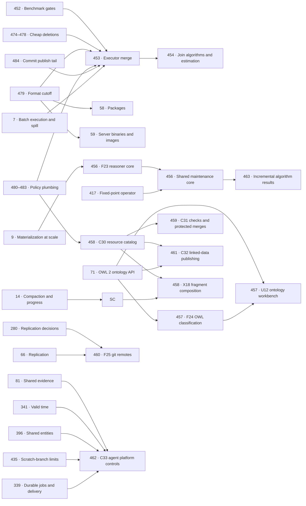
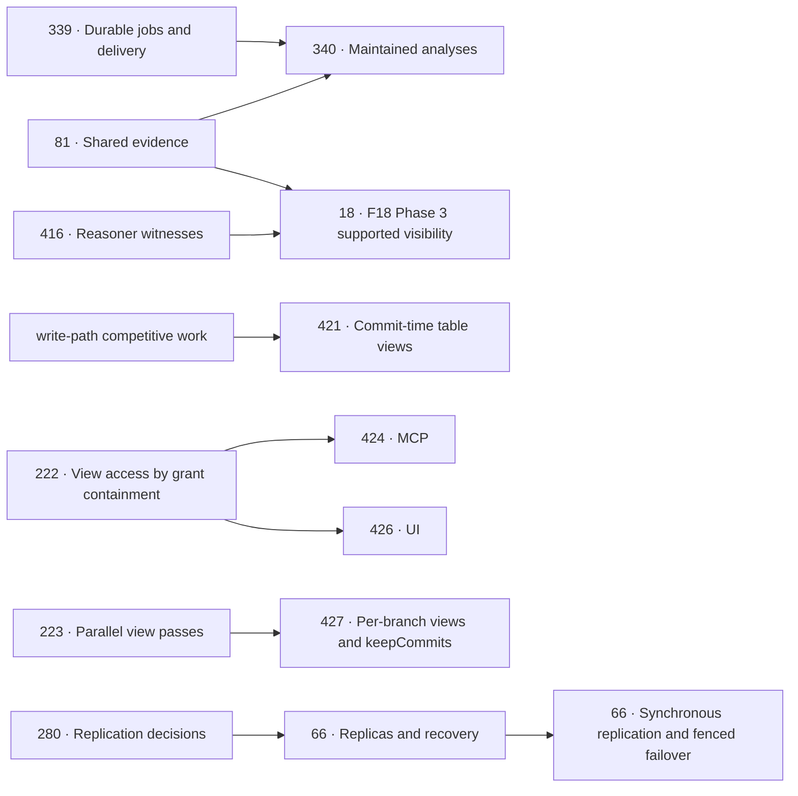

# Roadmap

This roadmap prioritizes correctness, standards conformance, performance, robustness
and the standard features expected of a graph database.
Embedded agent memory and entity representation follow, and applications built on top of
Sparkles, such as the supply-chain pilot, come after them. New features enter the delivery
path when a concrete use case or an adopted dependency requires them. A separate analyst
workbench follows these goals.

Existing storage, query, reasoning, search, security and recovery capabilities retain
their required phases and acceptance gates. Close competitive results can be accepted
with their measurements and tradeoffs recorded. Packaging, recovery, installed-artifact
testing and the API compatibility contract advance alongside capability completion.

The [feature index](FEATURES.md) and its category guides describe what Sparkles does
and does not do today. Every known gap names the roadmap item that addresses it.
[BENCHMARKS.md](BENCHMARKS.md#where-sparkles-loses) records the measured results and the
workloads where Sparkles loses. The tiers list remaining work, followed by a record of
completed items.

The current priorities are engine correctness, performance and standard features in
Waves A and A2, followed by embedded agent memory and the ontology platform, including its
editor, in Waves B and C, which run alongside them. Shared entity representation follows
memory. Packaging, recovery and the API compatibility contract advance alongside capability
completion. The [delivery priorities](#delivery-priorities) explain their dependencies.
The numbered tiers are the detailed backlog, and [Completed](#completed) records finished
items.

## Contents

- [How the roadmap is organized](#how-the-roadmap-is-organized)
- [Delivery priorities](#delivery-priorities)
- [Tracks and decisions](#tracks-and-decisions)
- [Completion paths for partially complete specs](#completion-paths-for-partially-complete-specs)
- [Tier 1: now](#tier-1-now)
- [Tier 2: high-impact features and the scale foundation](#tier-2-high-impact-features-and-the-scale-foundation)
- [Tier 3: big bets](#tier-3-big-bets)
- [Tier 4: worth doing, not urgent](#tier-4-worth-doing-not-urgent)
- [Tier 5: backlog](#tier-5-backlog)
- [Tier 6: later operational completion](#tier-6-later-operational-completion)
- [Tier 7: compatibility leftovers](#tier-7-compatibility-leftovers)
- [Completed](#completed)
- [Keeping this current](#keeping-this-current)

## How the roadmap is organized

The work is grouped into seven tiers. Complete the adopted requirements of partial
capabilities and the selected release contracts before unrelated new breadth, including
requirements whose follow-ups appear in a lower tier. The tiers order eligible phases
and extensions by effort, dependencies and impact on the goals above. Independent phases
can run in parallel. A deferred adopted requirement keeps its parent capability partial.

Each item has a number that stays fixed for its lifetime. Specs, FEATURES and code
comments refer to items by these numbers, so a number is never reused or changed. The
numbers are not a ranking, and a new item takes the next free number whatever its tier.

Implementation status is recorded in the [capability matrix](FEATURES.md#capability-status).
Complete means the stated scope is available. Partially complete means a usable subset
is available with remaining work named. In progress means implementation has started
but is not available on the main branch. Planned means implementation has not started.
A written spec alone is planned. Completed scope belongs in the list below even when
an extension to the same capability remains in a tier.

Each row says what remains to be done and links to the spec that holds the design. Items
that extend an existing spec are designed in a "Roadmap follow-ups" section at the end of
that spec's Outcome, and the Outcome also records what has already landed. An item that
is partly finished stays in its tier, and its row describes only the remaining part.
Finished items are listed under [Completed](#completed).

The Size column estimates the remaining effort.

| Size | Meaning |
|---|---|
| S | Days |
| M | One to two weeks |
| L | Several weeks |
| XL | A quarter or more |

The Value column in Tiers 1 to 3 rates the impact of an item on the goal. Lower tiers are
ordered by their tier alone.

## Delivery priorities

The goal comes first. Sparkles should be the best graph database by objective measures,
which are correctness, conformance, performance, robustness and the standard features.
Embedded agent memory in C17 and C18 and the ontology platform of items 457 to 461, with
its editor, come second and run alongside each other. Shared entity representation in
A01 and C25 comes third. Applications built on top of Sparkles, such as the cyber and
public-health supply-chain pilot, come after these. The engine supplies generic
primitives, and domain adapters and matching logic stay application work rather than
engine infrastructure.

Complete named spec phases and their acceptance gates. A parent capability remains
partially complete while adopted requirements remain. Building an application on a
usable subset does not waive those requirements. Correctness, recovery, bounded
resources and source identity go ahead of unrelated feature expansion.

### Release

The first release fixes the storage formats that later versions must read and completes
backup. Item 343 settles the dataset-local codec settings, item 479 then sets the
first-release format cutoff, and item 61 completes backup. The feature waves below come
first, and these items take only capacity that the waves leave free. Published artifacts follow the first release: the server
binaries and container images of item 59 and the PyPI, Maven Central and npm packages of
item 58, both after the format cutoff. The later encryption phases of item 65, security and audit in item 466, the developer ecosystem of
items 468 and 47, notifications in item 46, the per-crate Nix builds of item 92 and the
replication refresh of item 280 follow the first release.

### Wave A: engine quality

Wave A holds the work that most improves the engine against objective measures.

* Competitive benchmark losses come first, as
  [BENCHMARKS.md](BENCHMARKS.md#where-sparkles-loses) records them.
* The benchmark gates of item 452 exist before any engine rewrite starts. Items 469 to
  473 add the eager-against-cursor forge matrix, the W3C suites under
  `execution=streaming`, `incr_bench` as a mise task, a demand and RDFS-on-read latency
  benchmark and an instruction-count screen. Each further loss that item 452's
  competitive coverage finds becomes its own Wave A item.
* Streaming execution follows through item 7.
* The first three stages of the unified executor, item 453, follow. The deletions of
  items 474 to 478 are complete, and items 480 to 483 have consolidated the execution
  policy, the reasoning mode, request building and rank fusion. The first-release format
  cutoff of item 479 and the commit publish tail of item 484 remain.
* Stage A of item 17 is complete with items 416 and 417, the reasoner witnesses and
  the fixed-point operator.
* Small items that finish a capability run in free capacity, such as item 77.

### Wave A2: engine rewrites

Wave A2 holds the rewrites that the Wave A gates protect. These are the accounting model,
shared kernels and executor merge of item 453, the join algorithms and estimation of item
454, the storage consolidation of item 455 and the reasoner core of item 456, which ends
with the incremental-maintenance core it shares with views. Each rewrite is measured on
forge before it lands. No query may be 5% or more slower on forge at 12 threads, and no
query under 0.3 ms may be slower on an Intel host.

### Wave B: memory and entities

Wave B starts with item 81 Phase 3, then items 341, 396 and 435 and the remaining C18
work. Item 12 can move its refresh onto an internal circuit now, and item 18 Phase 3
builds on the reasoner witnesses of item 416. The MCP tools of item 462 also belong to Wave B. They are the `ask` MCP tool in item 488, MCP tool
profiles in item 489 and a hybrid search tool that embeds query text in item 490.

### Wave C: ontology and data platform

Wave C builds the ontology and data platform of items 457 to 461 on item 71's axiom
model. The ontology syntax readers come first, followed by OWL classification and the
ontology workbench. The resource catalog of item 458 comes first on the data side,
followed by checks and protected merges, linked-data publishing and git export.
Fragment composition follows the storage consolidation of item 455. Wave C runs
alongside Wave A2 on the policy plumbing of items 480 to 483.

OWL classification continues in three streams once phase 4 of item 603 lands. Each
stream is held to the same speed target, which is three to five times as fast as the
fastest reference reasoner at the same reasoning level in every stratum, with a tie as
the floor.
1. Item 603's phases 5 to 8 run in order, as counting and data, then nominals, then the
   engine half of phase 7, then the final speed gate. The surfaces of phase 7, which
   expose `complete`, the incomplete classes and the consistency state, run beside them
   because they need only phase 4's API.
2. The cost of the Horn rules is worked as one piece. It covers the rest of item 693,
   the conclusion growth of item 710 that reproduces it on 13 axioms, and the
   individuals, functional data properties and top properties of item 692.
3. The cost of the EL engine is worked as one piece. It covers the cold runs on small
   files of item 709 and then the saturation memory of item 695.

The workbench UI runs as one stream of about two lanes beside the engine work. After the
DL Query tab, the SKOS editor and the web UI shell of item 632 come these, in order:
1. The ontology browser's rendering preferences (625), metrics (621) and the editor's
   trees on the hierarchy route (607), all on item 632's shell and item 631's command
   palette.
2. The design review of every page of item 633.
3. Inferred axioms in entity frames (622), with the inferred property and individual
   trees of item 609. Their explanation links wait for F24's justifications.
4. The visual SHACL shape editor of item 617.
5. Entity history (620), discussions (618) and watches (619), the last after the
   notifications of item 46.
7. Import resolution (624), bulk edits (626) and pattern-based axiom generation (623).
8. Vocabulary governance and change requests (627), after item 459.

Tagging documents with concepts (628) belongs to Wave B's ingest work, and real-time
co-editing (629) comes last.

### How the waves share capacity

The waves run in parallel, and each has its own capacity. Waves A2 and C take the
capacity first, and Wave B runs when a stream is free of them. When work competes for gate, review or benchmark time, the
dependency order and how ready the work is decide which goes first, not the wave it
belongs to. The goal at the start of this section states what Sparkles optimizes
for, and it does not order the waves.

The waves group the work by delivery, and the tiers below rate its value. A wave can
therefore hold items from several tiers. Within a wave, the order its section gives
applies, and across waves the dependency order and readiness decide.

### Production readiness

Production readiness runs alongside the waves. It covers items 60, 59 and 58 for the
API policy, server artifacts and packages, item 61 for backups and item 65 for
encryption, together with items 402 and 400. Item 64 and the adopted phases of 65 close
startup and key workflows. The format cutoff of item 479 lands before the release
artifacts of items 58 and 59, so the first release reads only the formats it supports.

### Deferred

Items 339 and 340 for durable jobs and maintained analyses, item 100 for report
configurations, the supply-chain application, item 20 for openCypher, item 72 for JSON
query languages and item 344 for ChatGPT-plan model access wait for the work above. A
prerequisite can bring one of them forward when a concrete use case needs it. Work
that depends on them waits with them. The data-change triggers of item 462 wait for item
339, the scheduled stored queries and updates of item 467 wait for item 339's durable
jobs, and the Bolt protocol of item 465 waits for item 20.

### Sequencing

Write-path competitive work goes before the commit-time maintenance part of item 17,
which is item 421, because both change the commit path. Item 421 then measures its cost
against the improved baseline.

Several workstreams have hard orderings.

* Item 7 lands before the executor merge of item 453.
* Items 446 and 447 land before the commit-path merge of item 455, which is the long-term
  half of its shared publish tail.
* Storage consolidation in X16 lands before fragment composition in X18.
* The format cutoff of item 479 lands before the release artifacts of items 58 and 59.
* The Horn-rule work of items 693, 710 and 692 lands before or between item 603's phases
  5 to 8, since both change the classifier's index in `classify/index.rs`.
* OWL classification in F24 stays separate from the reasoner core in F23. The two meet
  only through the F21 axiom model of item 71.

### Acceptance by milestone

| Milestone | Work | Acceptance |
|---|---|---|
| Reliable baseline | Close confirmed correctness failures and retain qualified measurements. | The integration passes its required review, tests, conformance and performance gates. |
| Production readiness | Items 58–60 complete packages, server artifacts and compatibility policy. Item 402 and the adopted phases of 65 close startup and key workflows. | Installed artifacts, supported platforms, upgrade and recovery tests pass before a release is cut. |
| Shared capability completion | Close the relevant search, path, view, reasoning, explanation, validation, API and visualization phases from the completion paths below. | The declared scope passes its correctness, visibility, recovery and measured resource gates. |
| Trusted sources and resumable work | Item 81 delivers C25 Phases 1–2, and item 341 delivers C27 Phase 1. Item 339 delivers C26 Phase 1 when it is taken up. Backups and clones already carry view definitions paused, and C26 extends that to jobs and deliveries. | Source revisions and decisions retain their identity and evidence. Interrupted work resumes safely, and restored external work stays paused. |
| Shared entity representation | Bounded private offline replay and selected fixture mappings are available over the entity, identifier, resolution and evolution resources. Item 396 retains authenticated managed integration. | Independent query fixtures preserve source claims through conflicting identifiers, merge and split decisions, source correction and mapping migrations. |
| Reproducible assessments | Item 340 delivers F22 Phase 1 after C25's typed records and C26's fenced publication are available. Full recomputation is the initial execution model. | Inputs, outputs and methods are reproducible. New matching data, source withdrawals, expiry and authorization changes invalidate affected results. |
| Unattended operation | Complete C26 Phase 2 and F22 Phase 2, including temporal scheduling. Item 100 supplies guarded report configurations when distinct audiences are required. | Fenced database publication rejects stale attempts and duplicate accepted database effects. External delivery is at least once with stable event IDs, so receivers deduplicate repeated deliveries. Recovery preserves current authorization. |
| Unified engine | Item 453 merges the executors, with the stages before the merge and the gates of items 469 to 473 in place. | The single executor passes the gates of items 469 to 473. No query is 5% or more slower on forge at 12 threads, and no query under 0.3 ms is slower on an Intel host. |
| Ontology and data platform | Items 457 to 461 deliver the axiom model, classification, the ontology workbench, the resource catalog, checks and linked-data publishing. | The catalog, checks, workbench and publishing pass the phase gates of their specs. |
| Full partial-feature completion | Finish the other adopted partial-feature phases and release contracts, including explicitly scheduled large phases. | Required feature, compatibility, packaging and operational acceptance are complete before release. |

Item 396 defines shared entities and domain mappings without duplicating C25 review
operations, C27 time semantics or F22 dependency maintenance. Its first phases use
ordinary RDF, SHACL and SPARQL with pinned evidence and expected answers. Live managed
integration follows the exact C25, C26, C27 and F22 contracts it consumes.

C25's first phase supplies vocabulary, shapes, fixtures and competency queries. It does
not supply the managed runtime APIs of later phases. C26 Phase 1 and C27's static
profile resources can proceed independently. Full C27 Phase 1 additionally requires
A4's authenticated availability and backdating refusal through C25 Phase 2 and the
shared protected-write boundary. F13-backed incremental execution and F18-supported inferred
visibility follow their explicit prerequisites. Initial analyses use full recomputation
and authorized projections, with the required freshness and access checks. Exact retained
references use item 395 for bounded history and permission preparation.

Optimize measured ingestion, dependency joins, paths, refresh and retrieval costs, and
the competitive losses that Wave A lists. Preserve durability, cancellation and
visibility. Broader competitive refreshes that do not name a recorded loss remain
tracked without driving this delivery sequence.

Existing partial UI and profiling contracts remain in the completion program and can
follow the shared knowledge and production phases. New query-by-example, notebook,
query-language, local-first and provider conveniences follow demonstrated use-case need.
A prerequisite can bring a bounded planned feature forward. Conditional integrations do
not delay independent core phases, and retain their declared dependencies.

Virtual graphs in F19 and replication in F10 are substantial later phases of partial
specs. They remain visible completion work with explicit phase boundaries. They are not
prerequisites for the first memory workflow.

## Tracks and decisions

Seven tracks run through the tiers. Dependencies apply to the named remaining phases,
not to every extension in a spec or to phases that have already shipped.

| Track | Open items | Specs |
|---|---|---|
| **Performance** | 1 refreshes the evidence while 7 addresses its remaining gates. 560 and 561 correct the quota's count of preallocated space. Write-path work goes before item 421. | X06, X08 Phase 2, X09 Phase 4, X07 |
| **Graph features** | 8 closes algorithm surfaces and acceptance. Item 12's view-based refresh can use the internal circuits of F13. | F14, C22, F13 |
| **Reasoning** | 9 and 19 complete their remaining scale and query-time phases. Item 18 Phase 3 reads the reasoner witnesses of 416, and item 19 Phase 3 can build on item 417's fixed-point operator, while existing explanations remain available. Item 456 completes OWL 2 RL and rebuilds the reasoner core, starting with items 485 to 487. | F16, F17, F13, F18, F23 |
| **Engine architecture** | 453 unifies the executors behind the gates of 469 to 473, starting with items 474 to 484. Item 454 follows the executor merge, and 455 follows 14. | X14, X15, X16, X17, X05 |
| **Ontology and data platform** | 71 is the root of the ontology workbench 457. Items 458 to 461 add the resource catalog, checks and protected merges, git sync and linked-data publishing once the policy plumbing of 480 to 483 has landed. | F21, F24, U12, C30, X18, C31, F25, C32 |
| **Agent platform** | 462 adds tool profiles, review queues, handoff and framework adapters, starting with 488 to 490. Its data-change triggers wait for 339. | C33, C11, C17, C18 |
| **Evidence and maintained analyses** | 81 and 339 can run independently, and both feed 340's shared representation and durable execution. Item 396 specializes the available evidence and temporal profiles with entity modeling and offline fixtures. Item 341 adds validity, and later incremental maintenance uses the parts of item 17. | C25, C26, A01, F22, C27, C22b |

The workstreams depend on each other and on existing items as follows.

The following dependencies describe the remaining phase contracts. Independent work can
proceed in parallel, including full recomputation of maintained analyses before later
incremental execution exists.

Item 226 comes before item 12 moves its refresh onto an internal circuit, because every
commit copies its changes into the change ring while an internal circuit is attached. Item 223 comes before item 427, and item 222 comes before
items 424 and 426. The other item 17 parts in Stage B and Stage C are listed in the
[table of its parts](#parts-of-item-17).

Item 19 Phase 2 does not wait for F13 Phase 3. Its `auto` mode must account for the
materialization states available when it lands. Item 100 Phase 1's report configurations
and item 341's validity profile can proceed independently. Item 100 Phase 2 uses 339 and
340 for durable refresh, without holding up existing GraphRAG refresh. Items 58 to 60
prepare the release, and item 65's new encrypted formats use the existing X12 format
registry and compatibility window.

Use free capacity for independent completion phases and application acceptance work.
Item 14's adaptive compaction policy uses sustained-write measurements from item 1;
shared operation progress can proceed independently. Measurements select necessary
execution improvements, while feature order follows the delivery milestones above.

## Completion paths for partially complete specs

Every partially complete entry in the [spec index](specs/README.md) has a path below.
The linked Outcome distinguishes remaining implementation from historical omissions
that later shipped. Each exit condition includes the spec's applicable acceptance,
conformance, access-control, recovery and measured performance gates. Finishing code
without its required validation does not complete that scope.

Complete means the accepted contract is delivered. Optional extensions need an explicit
scope decision, and rejected experiments retain their measured rejection rather than
becoming implementation requirements. A benchmark loss alone does not prevent completion
when the bounded work has improved the material gaps and recorded accepted close cases
and deferrals. Any accepted slowdown keeps its named follow-up under the engineering rules.

| Spec | Remaining items | Exit condition |
|---|---|---|
| [C01](specs/C01-observability-and-budgets.md#outcome) | 342, 402 | Startup reports a dataset whose derived index is unavailable as degraded, and the progress of a log replay, without losing readiness or access controls. JSON and OTLP include the Phase 2 work, memory-peak and rebuild series with the Prometheus units, labels and histogram semantics. |
| [C03](specs/C03-graphql/SPEC.md#outcome) | 37 | Complete Phase 2's seeded execution, bounded per-parent windows, nested connections, UI/schema editing and persisted-query controls with differential and visibility tests. Subscriptions are deferred until a workload asks for them, and then use F13. Mutations generated from the mapping are planned under item 465 and are not part of this exit condition. |
| [C06](specs/C06-clone-to-sandbox.md#outcome) | 45 | Remote and archive clones preserve a chosen branch/commit's data, stored blank identities, prefixes and configuration while creating correct new lineage. Interrupted, corrupt or cancelled transfers publish no destination. |
| [C17](specs/C17-agent-memory.md#outcome) | 81, 435 | Scratch branches honor a per-principal limit, warnings before expiry and a keep option, beside the dataset-layered expiry that works over HTTP and stdio. Adopt the shared evidence profile with its source, review and independent-support acceptance queries; server model calls use the successor C18 contract. |
| [C18](specs/C18-natural-language-questions-and-ingest/SPEC.md#outcome) | 6, 15, 27, 77, 81, 263, 318 | Finish the remaining evaluation matrix, multimodal ingestion, redaction and verified rewrites, and test grounding and VALUES changes against caller-visible data. Publish matching accuracy and latency evidence, preserving clarification for ambiguity and the original secret, budget and citation guarantees. |
| [C25](specs/C25-evidence-and-assessments.md#outcome) | 81, 395 | Build review-controlled projections, withdrawal, support ownership and reversible identity decisions on the available authenticated proposals, protected metadata and retained-view resolution. Phase 3 integrates recall, ingestion, reports and maintained analyses, with exact identity, authorization, retry and crash acceptance. |
| [C27](specs/C27-valid-time-profiles.md#outcome) | 341 | Complete Phase 1 with authenticated availability and backdating refusal through C25 Phase 2 and protected writes. Then add the temporal projection helper, event-time controls and expiry integration with interval, visibility and recovery acceptance. |
| [C21](specs/C21-outbound-notifications.md#outcome) | 46 | Add email, the administration UI and complete backup-failure coverage. A slow destination cannot delay another channel, and delivery tests retain retry, outbound, secret and disabled-channel guarantees. |
| [C22](specs/C22-graph-rag-community-summaries.md#outcome) | 12, 100, 260, 261, 262, 264 | Add refresh counting with an accumulator on an internal F13 circuit, finish person-checked and broader-corpus evaluation, and validate global-question routing and schema-order decisions. Multiple report configurations follow C22b under 100, retaining shared spending and disclosure controls. |
| [F03](specs/F03-full-text-search/SPEC.md#outcome) | 23, 35, 50, 250, 251 | Complete online changes, uncommitted and historical search, multi-field documents and the named analyzer parity gaps. Verify tokens against the adopted Lucene references and preserve restricted-view scoring and query correctness across rebuilds and pins. |
| [F04](specs/F04-vector-search.md#outcome) | 34, 82 | Deliver the chosen quantization modes, result caching and statistics. Measure catch-up, worker sizing and binary16 recall on all named distance distributions, and verify cancellation, version invalidation and memory ownership. |
| [F05](specs/F05-snapshot-repositories/SPEC.md#outcome) | 61, 65, 401 | Restore whole-server and multi-dataset runs with consistent, versioned definitions and paused external work. Complete repository transfer, chunking adoption, optional retained-history capture and storage-retention controls, proving restored retained commits and preserving older backup readers. |
| [F06](specs/F06-snapshots-and-point-in-time.md#outcome) | 23, 52, 395 | Complete pin rebasing, per-quad periods, graph feeds, expired-state reconstruction and settings history, with full-text reads at pins supplied by 23. Compare historical answers and diffs with fresh reconstruction through compaction and retention boundaries. Add bounded replay and permission preparation through item 395. |
| [F07](specs/F07-path-search.md#outcome) | 275, 276 | Add length-bounded weighted search with the reference path/cost tests. Resolve or explicitly disposition the measured control costs without weakening visit budgets or zero-weight semantics. |
| [F09](specs/F09-branches-and-merges.md#outcome) | 45 | Finish relink from the remote CLI and remote/archive cloning. Compare relink identities and clone contents with offline operations, including chosen commits, lineage, cancellation and corrupt-transfer refusal. |
| [F10](specs/F10-replication.md#outcome) | 74, 280, 66 | Settle the replication contract before implementing replicas, bootstrap, archives, promotion, synchronous acknowledgement and fenced failover. Test exact primary identities, stream gaps, restart and declared data-loss guarantees, and separately complete multi-transaction patch and blank-node semantics. |
| [F11](specs/F11-encryption-at-rest.md#outcome) | 61, 65, 58, 59 | Finish key workflows and recovery, Phase 2 chunking and write-only age-recipient repositories, then live-file and derived-index encryption. Pass the remaining phase acceptance for provider outages, read-authority separation, rotation, locked states and format compatibility. Standard builds include repository encryption with protected keys on Linux and macOS; later phases remain open. |
| [F13](specs/F13-incremental-views-and-provenance.md#outcome) | 17, 418–430, 528, 530, 531, 221, 222, 223, 224, 225, 226, 227, 265 | Complete graph and branch views, commit-time maintenance, transports, provenance and recursion, plus the named access, worker, guard and server-limit gaps. Differential, crash and subscriber/load tests must cover inferred data and measured commit costs. |
| [F14](specs/F14-graph-algorithms.md#outcome) | 8 | Finish Graphalytics acceptance, completion, background progress and the remaining algorithm surfaces. The C23 writer is item 36 and openCypher procedures are item 20, and each belongs to its own capability. Items 79 and 80 extend weighted betweenness as optional work, and the exact refusal boundaries stand until a broader domain is defined and independently validated. |
| [F16](specs/F16-materialization-at-scale.md#outcome) | 9, 113 | Deliver the separate derived layer, canonical equality representatives and the remaining barrier-free and incremental-equality execution. Re-run the scale, differential, datatype and kept-closure memory gates, and settle the named small-change costs with matched measurements. |
| [F17](specs/F17-query-time-reasoning.md#outcome) | 19, 190, 192, 193 | Finish automatic cost selection, hybrid rules, OWL 2 QL, settings and client surfaces, then F13-maintained tables and provenance. Close Phase 1's cache accounting, DESCRIBE and per-query costs with demand/materialization equivalence tests. |
| [F18](specs/F18-explanations-and-entailment-diffs.md#outcome) | 18, 285, 286 | Add F13-backed supported visibility and reviewed-only derivations, result-cell actions and the explicitly extended unbound why-not contract. Compare filtered answers with fresh derivation after support withdrawal and policy changes, including multiple supports and truncated witnesses. |
| [F21](specs/F21-ontology-api.md#outcome) | 539, 559, 565, 578 | Enforce the read budget, measure the A7 targets, fetch imports through the outbound policy, and read inferences and entity reports over MCP and the CLI. |
| [F19](specs/F19-mappings-and-virtual-graphs/SPEC.md#outcome) | 43, 230, 233, 234, 236, 237, 238, 239, 404, 450 | Finish the named source, UI/task, conformance, function and term-identity gaps before claiming Phase 1 complete. Phase 2 virtual graphs must match materialized SPARQL answers with pushdown, access, cancellation and source-failure behavior tested. |
| [G01](specs/G01-geosparql/SPEC.md#outcome) | 24 | Complete per-row nearest-neighbour joins, QLever's spatial syntax, metric-property rewrites, polygon approximations, datum shifts and curved GML segments as item 24 lists them. Keep intentional default divergences explicit, since item 70's Jena-compatible mode is not adopted. |
| [G02](specs/G02-shex/SPEC.md#outcome) | 54 | Complete combined guards, graph-plus-file schemas and CLI outbound controls with the adopted ShEx conformance and incremental/full equivalence tests. Unsupported reference syntax remains a stated language boundary rather than a claim of universal ShEx parity. |
| [P01](specs/P01-python-bindings.md#outcome) | 32, 33, 40, 58 | Complete release/platform and further async administration and bulk coverage, reusable plans and the remaining bounded per-call and footprint assessment. Validate package installation and the Python API suite on the claimed runtimes while preserving cancellation, term identity and snapshots. |
| [P03](specs/P03-query-extensions.md#outcome) | 25 | Complete dynamic registered dispatch, foreign callbacks, batching and the adopted aggregate arities. Verify captured-view access, duplicate invocation, error, cancellation and transaction behavior, and measure callback costs. |
| [P04](specs/P04-jvm-bindings/SPEC.md#outcome) | 25, 32, 33, 58, 76, 405 | Complete the named callback, plan, integration-harness, metrics and release gaps with the accepted Jena contract tests. Keep fallback BGP batching and optional module/allocator/transaction choices explicit, and substantiate performance claims with matched bridge measurements. |
| [P05](specs/P05-node-bindings.md#outcome) | 14, 32, 33, 44, 58, 329, 405 | Complete progress callbacks, reusable plans and publication/runtime acceptance while preserving RDF/JS terms, bounded streams and transaction hand-off. Record optional Wasm/UI-migration decisions separately, and retain full-consumption controls for the measured query/export costs. |
| [X01](specs/X01-compression-codecs.md#outcome) | 61, 343 | Use the adopted X11 vocabulary and F05 repository codecs, and record the optional portable-decoder and repository-zstd decisions under the named follow-ups. Preserve format/feature refusal and codec round-trip tests; measured rejected storage codecs are not required to ship. |
| [X05](specs/X05-streaming-query-execution.md#outcome) | 7, 84, 93, 240, 243 | Finish the named fallback-demand, aggregate, early-output, UI and buffering gaps, and settle large-plan and serialization costs. Preserve eager/cursor equivalence, cumulative budgets and disconnect cancellation, widening defaults only after measured adoption gates. |
| [X06](specs/X06-benchmark-coverage.md#outcome) | 1, 8, 91, 290, 291, 292, 293, 299, 306, 328, 575, 576, 577 | Finish the later benchmark batches, 100M BSBM, BI-driver reruns, noise controls and reproducible table regeneration. Retain the named cost checks and comparison inventory, accepting documented close cases without requiring every engine comparison to be a win. |
| [X07](specs/X07-cold-sparse-reads.md#outcome) | 7, 516, 572, 573, 574 | Finish the remaining I/O reporting, the counter-cost gate and the follow-ups on the first query after an idle start, dense exports at 1.01B and the warm cost of the rebuilt binary, while treating unachieved stretch targets and read-ahead tradeoffs explicitly. |
| [X08](specs/X08-disk-spill-and-server-memory.md#outcome) | 1, 7, 40, 88, 93, 210 | Complete the remaining eager fallbacks, spill execution costs, cache accounting and footprint work, then decide the spill default under 93. Preserve the passed full-scale plain/encrypted matrix and verify ordered-join/grouping costs, one-pass outer joins, disk cleanup, admission and aggregate correctness before broadening defaults. |
| [X09](specs/X09-group-commit-by-default.md#outcome) | 170, 448, 560, 561 | Settle the reader tail of the parallel checkpoint and the small costs that the gates accept, and count each branch's preallocated space. Retain durability, crash recovery and the documented legacy-header limits while testing all indexed dataset classes. |
| [X11](specs/X11-index-compression-and-predicate-patterns.md#outcome) | 160, 241, 343 | Add dataset-local settings for the adopted codecs and patterns with lock, compaction and format compatibility tests. Keep FSST optional until its adoption gates pass, address the named lookup costs, and preserve the measured rejection of encoded IRIs, column codecs and the count shortcut. |
| [X12](specs/X12-release-engineering.md#outcome) | 58, 59, 60 | Complete unified versions, artifact publication and platform coverage, then the HTTP/CLI/library stability policy and checks. Release validation must exercise installed artifacts and older-format fixtures, including verbose version/capability reporting and required feature flags. |
| [U02](specs/U02-shape-driven-forms/SPEC.md#outcome) | 612, 613, 614, 615, 395 | Add node-level `sh:or` and `sh:xone` sub-forms, editable nested values through complex paths, blank-named graph contexts with admission for model sources, and the remaining target and query producers. Adopt item 395's controlled scan and decode seam. Keep previews, guards, graph-specific conflicts and branch saves tested against the candidate state. |
| [U04](specs/U04-live-query-profiling.md#outcome) | 27 | Deliver live registry/progress, cancellation by id, hot spots and stop/explain, then integrate verified C18 rewrites. Test redaction and running/completed state transitions while retaining the shipped static overlay. |
| [U06](specs/U06-large-graph-rendering.md#outcome) | 29 | Deliver cached server layouts and versioned binary transfer, then pass the named GPU frame-rate and large-graph limits. Verify access-filtered grouping, cancellation and bounded transfer on the supported graph sizes. |
| [U07](specs/U07-data-quality-and-schema-diagram.md#outcome) | 31, 120, 121 | Build per-commit quality records, backfill, introducing-commit search and the schema diagram. Move overlays to the retained record and verify focus-scoped fix previews against the complete candidate validation result. |
| [U08](specs/U08-visual-query-builder.md#outcome) | 101 | Add Phase 3's union, graph, values, minus and not-exists editing plus overview entry. Preserve text outside edited spans, shared undo, stable layout and round trips for locked syntax. |
| [U11](specs/U11-linked-views.md#outcome) | 140, 141, 142 | Finish the named colouring, date-facet, mobile, keyboard and branch gaps, and settle persisted/filtered projection choices. Pass the GPU frame-time and lasso gates with linked selection and caller visibility preserved. |

### Scope decisions for partially complete capabilities

These decisions fix what completes four capabilities in the [capability matrix](FEATURES.md#capability-status).

* Formatting, linting and command-line tools are complete. Item 55 is a follow-up
  outside that capability.
* Paths and graph algorithms complete with items 8, 275 and 276. OpenCypher
  procedures belong to item 20 under additional query languages, and the C23 writer belongs
  to item 36 under batched updates and triggers. The weighted-betweenness extensions in
  items 79 and 80 are optional and outside the completion path.
* Server and Fuseki integration completes with items 76, 38, 51, 37 and 39. Item 37
  excludes subscriptions, and item 51 excludes `shortest(…)` evaluation, which ARQ does not
  evaluate either. Item 69 adds the ARQ extensions that it lists as a lower-priority
  extension outside the completion path.
* GeoSPARQL completes with item 24. Item 70's Jena-compatible mode is not adopted, and
  exact arithmetic on curves, GML solids, 3D constructions and splitting lines at crossings
  are not part of the capability.

## Tier 1: now

The first wave establishes evidence, durable execution, time profiles and recovery.
Item 340 waits for the C25 records and C26 publication contract it uses. Ask completion
continues within its caller-visible evidence and measured-latency scope.

| # | Item | Spec | Size | Value |
|---|---|---|---|---|
| 81 | **Shared evidence and review records.** Versioned resources, bounded preparation, current memory compatibility checks, safe catalog disposal, the managed-graph write boundary with reader admission, administered evidence settings with review policies, durable source holds, exact retained-reference and record resolution, authenticated claim proposals through `POST /{ds}/claims` with server-owned receipts, first availability, record digests, idempotency, an authority fence and an operation marker, and review decisions with accepted projections, support ownership and withdrawals through `POST /{ds}/claims/review` and `POST /{ds}/claims/withdraw`, and identity proposals reviewed under matching policies into reversible resolution maps read through `POST /{ds}/claims/identities` are available, as are assessment inputs written as `prov:used` and the dependents of changed records through `POST /{ds}/claims/dependents`. Recall and Ask citations, ingestion, reports and MCP tools remain planned as items 650 to 653, and maintained analyses as item 340. | [C25](specs/C25-evidence-and-assessments.md), [C17](specs/C17-agent-memory.md#shared-memory-representation) | M–L | High |
| 508 | **Declared evidence settings.** Evidence settings are recorded only through `PUT /$/evidence/{ds}/settings` and the Rust API, and `serve --settings` cannot declare them. Add them to the C19 declared layer with locks, and refuse typed evidence operations while the declared and recorded settings differ, without weakening protection. | [C25](specs/C25-evidence-and-assessments.md#outcome), [C19](specs/C19-layered-settings.md) | S | Medium |
| 509 | **Evidence settings, holds and resolution in the bindings.** Python, the JVM and Node.js cannot read, configure or detach evidence settings, list, acquire and release evidence holds, resolve evidence references, propose claims, review them or withdraw them, and `bindings.toml` plans the seven operations, the proposal, the review and the withdrawal. The MCP tools for proposals and reviews wait for Phase 3 of item 81. Bind them with the typed evidence operations and remove the Python parity test's deferral. | [C25](specs/C25-evidence-and-assessments.md#outcome) | S | Medium |
| 542 | **Delta charge of shared live states in evidence resolution.** A bounded history read charges 2 KiB for each quad of a state's unindexed delta even when the state is the store's shared live snapshot, so evidence resolution under its 64 MiB allowance answers `incomplete-evidence` for a state with tens of thousands of writes since its last compaction. Charge a shared live or cached state by what the request retains, and measure resolution at 10⁴ to 10⁵ delta quads. | [C25](specs/C25-evidence-and-assessments.md#resolution-decisions), [C29](specs/C29-bounded-view-preparation/README.md) | S | Medium |
| 550 | **Holds for stored facts of other datasets.** A claims proposal verifies a stored fact of another dataset of the catalog but holds only the facts of its own dataset, so retention can later make such a reference unavailable. Hold the other dataset's commits under the operation, with a reconciliation check that finds the operation across datasets. | [C25](specs/C25-evidence-and-assessments.md#outcome) | S–M | Medium |
| 551 | **Proposals that select existing records.** A proposed passage of an existing rendition, a reference to an existing passage and a structured value of an existing or non-JSON revision answer `incomplete-evidence`. Verify them against the retained text, the passage's own revision and rendition, and the retained bytes of the existing records. | [C25](specs/C25-evidence-and-assessments.md#outcome) | M | Medium |
| 581 | **Reconciling a projection after a changed protection.** A detach and new protection of a review policy's decisions, supports or output graph leaves the output's triples while their supports and decisions no longer authenticate, so reviews and withdrawals under the policy answer `projection-unavailable`. Add an administered reconciliation that rebuilds the output graph from the supports it vouches for, or empties it, and records the new protections in a projection record. | [C25](specs/C25-evidence-and-assessments.md#outcome) | S–M | Medium |
| 582 | **Support-aware visibility of accepted projections.** An acceptance copies a proposition into a policy's output graph, which each reader reads under its own grants, and a review checks only the reviewer's access to the evidence. Check that an output's readers can read its policy's boundary, or show a projected triple only to callers who can read one of its live supports, using the supported-visibility machinery of F18. | [C25](specs/C25-evidence-and-assessments.md#review-decisions), [F18](specs/F18-explanations-and-entailment-diffs.md) | M | Medium |
| 643 | **Rebuilding a resolution map after a boundary change.** A matching policy's map follows the matches of the identity graphs it was built from, so removing one of them from the boundary, or detaching and protecting it again, makes reviews and reads under the policy answer `projection-unavailable`. Add an administered rebuild that recomputes the clusters of the policy's current accepted decisions in the new boundary, rewrites the output graph and records the new boundary in a map revision. | [C25](specs/C25-evidence-and-assessments.md#identity-decisions) | S–M | Medium |
| 650 | **Recall and Ask citing reviewed claims.** C17 recall and C18 Ask cite memory facts but not evidence records. Let them cite claim occurrences with their review state under a named policy, resolve entities through a matching policy's map, and answer only what the caller's grants allow, with A10 labelling of source instructions. | [C25](specs/C25-evidence-and-assessments.md#outcome), [C17](specs/C17-agent-memory.md#shared-memory-representation) | M | High |
| 651 | **Ingestion into claim proposals.** C18 ingestion writes extracted facts as asserted memory. Add a mode that writes them as claim proposals with source revisions, passages and evidence links in one evidence batch, so that a review decides what is projected. | [C25](specs/C25-evidence-and-assessments.md#outcome) | M | Medium |
| 652 | **Reports on accepted evidence.** C22 community summaries and C22b reports read graph content without review state. Let them draw on a review policy's accepted projection, cite the supporting claims and decisions, and name the assessments they record as `prov:used` inputs. | [C25](specs/C25-evidence-and-assessments.md#outcome) | M | Medium |
| 653 | **Evidence tools in MCP.** Proposals, reviews, withdrawals, evidence resolution, identity resolution and dependents are HTTP and Rust only. Add MCP tools that run as the caller with the same refusals. | [C25](specs/C25-evidence-and-assessments.md#outcome) | S–M | Medium |
| 552 | **Re-authentication after a detach.** Detaching an evidence graph and protecting it again chooses a new protection nonce, so the records of the earlier protection answer `origin-not-reproduced` and their identities refuse new proposals. Add an administered reconciliation that checks such records against their recorded digests and marks the ones it vouches for under the new protection. | [C25](specs/C25-evidence-and-assessments.md#outcome) | M | Medium |
| 396 | **Shared entity managed integration.** Bounded private offline replay and selected fixture mappings are available. Integrate with actual C25 managed review and protected records, C27 authenticated availability, C26 durable publication and F22 freshness while preserving exact causal inputs, conflicts, scopes and historical views. Validate through the store and the shipped shapes, and charge each input byte once, replacing the private validator and its conservative accounting. | [A01](specs/A01-shared-entity-representation/README.md) | M–L | High |
| 395 | **Bounded preparation of read views.** Capped historical snapshots preserve exact retained origins, and bounded Rust permission masks support graph, predicate and class rules with the built-in disclosure guard. Complete protection-pattern planning and retained nested-provider accounting. Adopt the shared preparation budget in guarded Dataset queries and U02 readers, as exact evidence references already do. On adoption, replace the controlled term decoder with the existing key decoder for graph and predicate names, and reconsider the bounded cache-key formatter, private containers and linear mask-cache scan, which currently have no production callers. | [C29](specs/C29-bounded-view-preparation/README.md) | M | High |
| 409 | **Controlled preparation cost follow-ups.** A cold controlled disclosure index skips repeated graph and footprint pairs, but rows with distinct pairs still cost about 4.5 times the legacy index because each one decodes, copies and hashes its names. Reduce that per-row cost before guarded callers adopt the provider. Legacy masks now meter their delta writes, and loaded-host runs showed no difference outside noise, so confirm on a quiet Intel host that legacy mask preparation is no slower. | [C29](specs/C29-bounded-view-preparation/SPEC.md#outcome) | S | Medium |
| 400 | **Retained bytes of interrupted deletes.** A crash after a delete saves the registry and moves the root aside leaves `databases/.kept-<name>-<token>` behind. Startup neither removes nor reports it. A recorded delete intent or a startup warning for unregistered kept directories would let the next start finish the cleanup. | [C25](specs/C25-evidence-and-assessments.md) | S | Medium |
| 339 | **Durable jobs and delivery.** Planned checkpointed jobs, fenced external workers and a transactional outbox make collection, analysis and delivery resumable after a restart. Publication and delivery intent share the dataset transaction. | [C26](specs/C26-durable-jobs-and-delivery.md) | L | High |
| 341 | **Valid time and observation history.** Versioned RDF resources, SHACL shapes and typed temporal templates are available. Phase 1 remains incomplete at A4 until C25 Phase 2 and protected writes establish server-owned availability and refuse backdating. Later phases add the projection helper, event-time UI and expiry integration. | [C27](specs/C27-valid-time-profiles.md) | M–L | High |
| 340 | **Maintained analyses and evidence dependencies.** Planned immutable run manifests, conservative read dependencies and guarded publication track when assessments need review or recomputation. Begin with bounded full recomputation and add proven incremental maintenance through item 17. | [F22](specs/F22-analysis-lifecycle.md) | L | High |
| 58 | **Packages and async coverage.** Python async queries, bounded cursors and transactions are available. Publishing to PyPI, Maven Central and npm, Windows and Intel macOS builds, a musl JVM build, PyPy and free-threaded wheels, and further Python async administration and bulk coverage remain. The workflows exist with their publish jobs switched off. The format cutoff of item 479 lands before these artifacts are published. | [X12](specs/X12-release-engineering.md), [P01](specs/P01-python-bindings.md#async-datasets-and-cursors), [P04](specs/P04-jvm-bindings/OUTCOME.md#roadmap-follow-ups-2026-10-12), [P05](specs/P05-node-bindings.md#roadmap-follow-ups-2026-10-12) | M–L | High |
| 59 | **Server binaries and published container images.** An unpublished GNU x86_64 archive pipeline passes packaging and installed persistence checks on pinned Debian 11 and Rocky Linux 8 runtimes. Other platforms, provenance, releases and container publication remain. The HTTP client should start without a system CA store, and the candidate workflow should run on demand, on a schedule and for packaging changes, with tests that import its preflight script. The format cutoff of item 479 lands before these artifacts are published. | [X12](specs/X12-release-engineering.md) | M | High |
| 60 | **API stability policy.** The policy and HTTP and standard CLI development-baseline checks are available. Library and binding comparisons, CLI JSON and exit-code coverage, MCP and metrics guards, deprecation signals and release baseline integration remain under X12 Phase 4. | [X12](specs/X12-release-engineering.md) | S–M | High |
| 61 | **Backup completion.** Whole-server and multi-dataset runs, remote CLI, repository copy and gated content-defined chunking remain. Add optional retained generations and pins, storage-class and Object Lock/WORM controls, and an explicit repository-zstd decision, with restoration and retention acceptance. | [F05](specs/F05-snapshot-repositories/OUTCOME.md#roadmap-follow-ups-2026-10-12), [X01](specs/X01-compression-codecs.md#remaining-codec-decisions) | L | High |
| 263 | **Ask on DBpedia.** Ask grounding lists the predicates that the question's entities and classes use, links by popularity and asks for one predicate per relation. With the exploration repair, on 150 held-out QALD-9-plus questions the current build answers 95 to 113 across six Claude and OpenAI models, against 41 to 72 before, and GPT-6 Luna answers 106 at $0.0021 a question, within the noise of the best model. A gold resource missing from the prompt remains the main cause of wrong answers, followed by query shape, with genuine ambiguity kept as a clarification. Changes need offline and end-to-end checks. | [C18](specs/C18-natural-language-questions-and-ingest/OUTCOME.md#ask-grounding-from-predicate-use-item-263) | M | High |
| 318 | **Ask median latency.** The retained 107-question repeat has higher median wall time for Haiku and Sonnet, while p95 is nearly unchanged. Bounded debug tracing separates grounding, tool calls and nested embedding work. Collect representative stage profiles and reduce avoidable work while preserving caller visibility and required clarification. The retained paid run does not establish the cause. | [C18](specs/C18-natural-language-questions-and-ingest/OUTCOME.md#ask-grounding-accuracy-item-263), [Benchmarks](benchmarks/natural-language/RESULTS.md#ask-on-dbpedia) | M | High |
| 593 | **Ask linking through redirects and aliases.** A gold resource is missing from the prompt for about half of the wrong answers with predicate-use grounding, as when "President Obama" does not reach `dbr:Barack_Obama`. Resolve a redirect or alias resource to the entity it names from links in the data, generic to any dataset, and measure it on unseen questions. | [C18](specs/C18-natural-language-questions-and-ingest/OUTCOME.md#ask-grounding-from-predicate-use-item-263), [Benchmarks](benchmarks/natural-language/RESULTS.md#ask-grounding-from-predicate-use) | M | High |
| 594 | **Ask accuracy after the cache ordering.** Haiku 5.5 at commit 2d43aa5a answered 26 and 22 of the 107 QALD-9-plus questions, against 27 to 29 at 7b3b6df5 before the grounding was reordered for prompt caching, while it answered 21 of 74 db25 questions against 19. Repeat the paired runs to decide whether the ordering costs accuracy. It belongs to item 503. | [C18](specs/C18-natural-language-questions-and-ingest/OUTCOME.md#ask-grounding-from-predicate-use-item-263), [Benchmarks](benchmarks/natural-language/RESULTS.md#ask-grounding-from-predicate-use) | S | Medium |
| 595 | **A larger Ask validation set.** Only 51 QALD-9-plus questions are left for validating Ask options, so an option must gain about 3 questions to pass the spread of three runs. The synthetic DBpedia sets in `testsuite/ask/synth` have executed gold but are far easier, about 82% for Haiku 5.5 against about 55% on the 51 questions, so they only coarsely rank options. Build harder synthetic questions in the shapes of real ones, such as comparisons, categories and aggregates over sparse relations, and check that their ranking of options agrees with the public sets. | [Benchmarks](benchmarks/natural-language/RESULTS.md#ask-repair-options), [Ask evaluation](../testsuite/ask/README.md#synthetic-dbpedia-sets) | S | Medium |
| 596 | **Prompt caching in the OpenAI preset.** The `openai` preset leaves `promptCaching` off, so a provider added from it sends each Ask repair as one message and pays OpenAI's cache-write price for a prefix it never reads. Turn the follow-up form on in the preset and in the settings form, and measure the cost on the Ask sets. | [Benchmarks](benchmarks/natural-language/RESULTS.md#ask-across-providers) | S | Medium |
| 597 | **Ask grounding size as a cost lever.** Most of an Ask's cost is the grounding written to the prompt cache once per question. Measure accuracy and cost with smaller predicate and candidate lists on held-out questions, and keep a smaller default only when it stays within the noise. | [Benchmarks](benchmarks/natural-language/RESULTS.md#ask-across-providers) | M | Medium |
| 598 | **Anthropic cache diagnostics in the paid harness.** Anthropic's cache diagnostics header reports why a prefix missed the cache. Add an optional harness flag that sends it and records the reasons, so that cache misses can be told from prefix changes. | [Benchmarks](benchmarks/natural-language/RESULTS.md#ask-across-providers) | S | Low |
| 599 | **Opus baseline on the held-out Ask set.** Opus 5.5 with the baseline build has not answered the 150 held-out QALD-9-plus questions, so its gain from the final build on that set is unmeasured. Run it once the paid budget allows. | [Benchmarks](benchmarks/natural-language/RESULTS.md#ask-across-providers) | S | Low |
| 654 | **Memory estimate of a class and predicate lookup.** On DBpedia 2022.12.01, `check_query`'s lookup of whether any instance of a class has a predicate, written with the two terms as bindings, passed the 2 GiB query memory estimate for `dbo:River` with `dbo:location`, while the same ASK with the terms written in runs in under a second. Find out whether the estimate is far above the real cost of that shape, a join of two graph unions with bound terms, and correct the estimate if it is. The lookup now writes its terms in and treats a budget failure as no answer. | [AI guide](ai/README.md) | S | Medium |
| 655 | **Cheap-tier Ask accuracy on held-out questions.** With the final build, Haiku 5.5 answers 102 and GPT-6 Luna 101 of the 150 held-out QALD-9-plus questions, within the noise of Sol but short of 70%, and Opus with the same build leads both beyond the noise. Find generic changes that lift the cheapest models to 105, judged on validation questions and confirmed once on the held-out set. The Opus run of the provider comparison predates the check fixes, prefix completion, the ranked class profile and the projection rule. Effort `high` gained nothing on validation. The next lever is synthetic questions closer to real ones, since the current ones score about 30 points higher than QALD and only coarsely rank changes. | [Benchmarks](benchmarks/natural-language/RESULTS.md#ask-on-the-cheapest-models) | M | Medium |

## Tier 2: high-impact features and the scale foundation

| # | Item | Spec | Size | Value |
|---|---|---|---|---|
| 17 | **Incremental computation core.** This umbrella item is split into items 413 to 429, so that each part has its own size and dependencies. Item 17 is complete when all of its parts are. Item 413 is complete, and the [table of its parts](#parts-of-item-17) lists the others. GraphQL subscriptions are deferred under item 37 until a workload asks for them. | [F13](specs/F13-incremental-views-and-provenance.md#outcome) | XL | Very high |
| 18 | **Explanations.** Provenance-aware protections with `reviewedOnly` over derived facts. Demand derivation trees, bounded why-not searches, entailment diffs and minimal justifications are available. Phase 3 reads the reasoner witnesses of item 416, which use F13's provenance algebra. | [F18](specs/F18-explanations-and-entailment-diffs.md) | M–L | High |
| 23 | **Full-text parity.** Online enabling and reconfiguring, search after uncommitted writes, and historical search remain. The analyzers that follow Lucene's and the dictionary analyzers are built. | [F03](specs/F03-full-text-search/OUTCOME.md#roadmap-follow-ups-2026-10-12) | M each | Medium |
| 24 | **GeoSPARQL completion.** Add per-row nearest-neighbour joins that run at least 50 times faster than the generic plan, QLever's `spatialSearch:` syntax, metric-property rewrites and polygon approximations in a versioned index format. Add exact Helmert datum shifts and geographic CRSs on datums other than WGS 84, opt-in grid-based shifts from operator-supplied grid files that still refuse when a needed grid is missing, and curved GML segments read by densifying arcs into line segments within a stated tolerance. Exact arithmetic on curves, GML solids, 3D constructions and splitting lines at crossings are not adopted. | [G01](specs/G01-geosparql/OUTCOME.md#roadmap-follow-ups-2026-10-12) | L | Medium |
| 100 | **Reports for distinct audiences.** Planned named GraphRAG configurations have separate principals, projections, guarded reports and review histories, with an explicit default and shared dataset spending limits. | [C22b](specs/C22b-report-configurations.md) | M | High |
| 65 | **Encryption.** Finish key workflows, Vault/cloud KMS and recovery export, then Phase 2 write-only age-recipient repositories and age identities. Phase 3 live-dataset and Phase 4 derived-index encryption follow; item 61 owns the shared chunking gate. A delayed initializer with the wrong key should remove its own leftover intent, and the marker-attachment branches should share one helper. | [F11](specs/F11-encryption-at-rest.md#roadmap-follow-ups-2026-10-12) | L–XL | High |
| 7 | **Batch-oriented execution and disk spill.** Spill is on by default and the full-scale spill matrix passes. Several cases still run eagerly. The [remaining work](#remaining-work-for-item-7) is listed below. | [X08](specs/X08-disk-spill-and-server-memory.md) Phase 2, [X05](specs/X05-streaming-query-execution.md#roadmap-follow-ups-2026-10-12) | L | Very high |
| 453 | **Unified executor.** Sparkles runs queries through an eager columnar executor and a pull-cursor executor, so every kernel exists twice and each entry point encodes its own execution policy. This workstream merges them into one morsel-driven pull engine in six stages, from cheap deletions and policy plumbing through one accounting model and shared kernels to the merge itself. Items 474 to 484 hold the first three stages, items 671 to 675 and 678 hold the fourth, of which 671 to 674 are complete, and the merge needs item 7 and the gates of items 469 to 473. | [X14](specs/X14-unified-executor/README.md) | XL | Very high |
| 454 | **Join algorithms and estimation.** The planner estimates stars, object joins and chains from subject and node characteristic sets with a remainder, and joins on several keys with exponential back-off. It stops exhaustive ordering at 16 inputs and runs cyclic patterns through binary joins. Characteristic pairs, sampling of large inputs, a worst-case-optimal join, scalable enumeration, adaptive re-optimization, OPTIONAL reordering, a reachability index and factorized results remain, with the estimation follow-ups in items 697 to 705. | [X15](specs/X15-join-algorithms-and-estimation/README.md) | XL | High |
| 697 | **Characteristic pairs across a link.** Node sets estimate a join on an object or a chain link from what the joined node has, and take the far end's restrictions to be independent of it. When an input also restricts a node-set variable by a constant object, a subquery or a VALUES table, its joins over outgoing items fall back to the subject sets and its joins with incoming items to distinct values, as do the joins on the object of `?x a ?c`. BSBM BI `q1` and WatDiv `F1` are such joins. Count pairs keyed by both ends' sets, as Gubichev and Neumann do, and estimate these joins from them. | [X15](specs/X15-join-algorithms-and-estimation/README.md) | M | Medium |
| 698 | **Sampled estimates of large inputs and subplans.** Key probes read a source of at most 1,024 rows, and a join of larger inputs that no statistic covers keeps the estimate from distinct values. Sample a large source from the first keys of its blocks and a subplan from its first rows, within the probe's decode budget, with the graph, equality and duplicate handling that scans apply. | [X15](specs/X15-join-algorithms-and-estimation/README.md) | M | Medium |
| 699 | **Degree caps for joins with one pattern.** A join of an input with one pattern on keys that cover the pattern's subject or object produces at most the input's rows times the largest number of triples of one subject or object. Count those degrees per predicate during the node-set pass and cap such estimates, once the remaining overestimates of LUBM and WatDiv `C` show that a cap would lower them. | [X15](specs/X15-join-algorithms-and-estimation/README.md) | S | Low–medium |
| 700 | **A binary file for the planner statistics.** The node sets and the larger subject-set cap grow `stats.json` from 5.0 MB to 44.3 MB on the 8.2M-triple DBpedia slice and from 2.5 MB to 16.3 MB on WatDiv at scale 100. Move the sets into a versioned binary file of their own if the time to open a store or the memory of retained statistics makes this matter. | [X15](specs/X15-join-algorithms-and-estimation/README.md) | S | Low |
| 704 | **Load the node sets at the first query that needs them.** This is an optional cost reduction. A store reads its node sets with the rest of `stats.json` when it opens. On atlas the 8.2M-triple DBpedia slice opens in 0.30 s instead of 0.07 s and holds 214 MB instead of 133 MB once ready, and WatDiv at scale 100 opens in 0.13 s instead of 0.10 s and holds 156 MB instead of 127 MB, counting the larger subject-set cap too. Read the node sets when the planner first estimates from them, so that a store whose queries never do pays neither cost. | [X15](specs/X15-join-algorithms-and-estimation/README.md) | S | Low |
| 705 | **Memory-mapped planner statistics.** This is an optional cost reduction that builds on 700. Opening a store parses the subject and node sets of `stats.json` into maps, which costs the open time and memory that 704 lists. Write the sets in a versioned binary layout that the planner reads in place through a memory map, so that opening parses nothing and the sets' pages belong to the page cache instead of the heap. | [X15](specs/X15-join-algorithms-and-estimation/README.md) | M | Low |
| 708 | **The first query after opening a store with correlation statistics.** On atlas at 1.05M triples with one thread, the first run of the synthetic `expr-bind-group` in a fresh server takes a median of 1.19 ms of server time against 0.98 ms before item 454, with the same plan, about the same instructions and unchanged later runs. Turning off `set_remainders`, `node_sets`, `key_backoff` and `characteristic_sets` does not change it, and a store without the `correlations` member does not show it. perf counted no more user-space instructions or cycles for that request, so look at kernel time, such as the allocator returning or faulting in memory that parsing the statistics left behind, as well as cache misses, and remove the cost. Items 704 and 705 may remove it too. | [X15](specs/X15-join-algorithms-and-estimation/README.md) | S | Low |
| 701 | **Index-join probe cost by key locality.** WatDiv `S4-2` and `S4-4` run about 1.6 times as long since the node sets estimate their `artist` and `familyName` join within 3%. The planner then probes `familyName` with 704 keys, which takes about 0.1 ms longer than the base plan's merge join with a scan. On atlas, keys spread at random over a pattern cost 3 to 7 times what the galloping reader's terms price, and keys close together cost about a third of that. A cost term of the square root of the rows per key brought the base plan of `S4` back but made the other 64 queries whose plans it changed 1.15 times as slow, with DBpedia's `abstract-contains` 8.5 times and LUBM `q2` 2.4 times. Price a probe by how its keys spread over the pattern, from a statistic of the subjects a predicate shares with others or from the first blocks the galloping reader reads, switching to a merge scan when the keys turn out to be spread. | [X15](specs/X15-join-algorithms-and-estimation/README.md) | M | Medium |
| 702 | **Planning cost of the set estimates.** Registering the subject and node sets of a group's variables and walking the plan for their masks adds 1 to 6 microseconds to the planning of short synthetic, WatDiv, BSBM explore and DBpedia queries and 0.08 to 0.09 ms to the 0.8 to 0.9 ms planning of WatDiv `F4`, 5% to 10% of their time on forge. Keep each group's registered sets and masks across the candidate plans and queries of one generation instead of rebuilding them, and measure the short synthetic, WatDiv and DBpedia queries again. | [X15](specs/X15-join-algorithms-and-estimation/README.md) | S | Medium |
| 703 | **Execution differences with unchanged plans.** Against main on forge, in eight rounds, the synthetic `f-regex-iri-join` ran 1.06 times as long with the correlation-aware estimates and `f-expr-range-join` 1.11 times, in execution and with the same plans. The rounds of either build ran `f-expr-range-join` in 1.7 to 2.3 ms or in 2.7 to 3.3 ms of execution. An earlier pair of builds instead ran `two-hop-count` 1.15 times and DBpedia's `births-by-decade` 1.13 times as long, and those ran 0.98 and 1.00 times here. Count instructions and cache misses of these queries on both builds with `mise run bench:insn`, so that code layout is told from code, and align or split the hot loops that stay slower. | [X15](specs/X15-join-algorithms-and-estimation/README.md) | S | Low |
| 455 | **Storage consolidation.** The store still reads every pre-release format, keeps about 80 twin readers and publishes commits through three paths. The format cutoff of item 479, budgeted readers through one Control trait, the shared publish tail of item 484 and one load plan remove that duplication, and partitioned vocabularies with per-range generations make maintenance follow the size of a change. Tiered segments in X17 add an object-store tier, and the work follows items 446, 447 and 14. | [X16](specs/X16-storage-consolidation/README.md) | XL | High |
| 8 | **Graph-algorithm library.** Algorithms and graph lenses are available. The full Graphalytics harness, algorithm-name completion, richer background progress and the remaining binding and JVM surfaces for the existing algorithms remain. New algorithms belong to item 463. The C23 writer is item 36 and openCypher procedures are item 20. JVM statistics inside a transaction use a binding copy of the library's statistics code, while Node.js and Python statistics read only the head, so a library method that takes the snapshot should give the bindings one implementation. | [F14](specs/F14-graph-algorithms.md#outcome) | S–M | High |
| 9 | **Materialization at scale.** Phase 1 materialization is available. The separate derived-fact layer of Phase 2, `owl:sameAs` representatives of Phase 3 and eligible execution without iteration barriers and equality maintenance in Phase 4 remain. Representatives would also let derivation on demand read equality without the `eq-rep-*` rules. Today a demand on a small view where `owl:sameAs` relates classes and properties can take much longer than materializing the whole view. | [F16](specs/F16-materialization-at-scale.md), [C08](specs/C08-inference-freshness.md#roadmap-follow-ups-2026-10-12) | L | High |
| 456 | **Reasoning engine.** Full materialization closes transitive and equivalence relations with closure operators and has the OWL 2 RL rules of the Profiles tables, while incremental updates and query-time reasoning evaluate those relations as joins. Rule planning is greedy, derived facts cost about 135 bytes each in memory, and the reasoner's maintenance is separate from the incremental core of F13. A columnar derived tier, compact provenance, a native n-ary Datalog core, SHACL-AF and translated SWRL, SPIN and N3 follow, and the shared maintenance core moves the reasoner onto item 417's fixed-point operator after item 547 measures its rule plug-in on LUBM. | [F23](specs/F23-reasoner-core/README.md) | XL | High |
| 12 | **GraphRAG community summaries.** Community reports, global answering and change-feed refresh are available. Counting changes with an accumulator on an internal F13 circuit, which F13 provides, remains planned. Item 226 measures the change ring's cost first. | [C22](specs/C22-graph-rag-community-summaries.md) | M | High |
| 14 | **Compaction and operation progress.** Delta changes located per block, new vocabulary without a full rebuild, adaptive thresholds and automatic compaction in embedded use remain. Shared controlled load and compaction progress must also reach the Node callbacks without weakening cancellation or memory budgets. | [C13](specs/C13-automatic-compaction.md#roadmap-follow-ups-2026-10-12), [P05](specs/P05-node-bindings.md#operation-progress) | M | Medium–high |
| 15 | **Ingestion of images and audio.** The remaining follow-ups are recorded in C18. | [C18](specs/C18-natural-language-questions-and-ingest/OUTCOME.md#roadmap-follow-ups-2026-10-12) | M | Medium–high |
| 113 | **Small changes and undos over a kept closure.** Changes of 100 triples at 16 threads and undos at 1 thread remain slower than before the F16 follow-up, and a profile of the full run should find or rule out a cost of about 5%. The options are an opt-in in-memory index of the input facts, charged to the memory budget, and per-thread counters in the block cache. | [F16](specs/F16-materialization-at-scale.md#roadmap-follow-ups-2026-10-18) | M | Low |

### Parts of item 17

Stage A makes the incremental core safe and supplies what items 12, 18 and 19 need.
Items 12, 18 Phase 3 and 19 Phase 3 do not need all of Phase 2 and Phase 3. Item 18
Phase 3 reads the witnesses of item 416, and item 19 Phase 3 builds on the fixed-point
operator of item 417. Item 12
uses the internal circuits that are already available. Stage B delivers the rest of Phase 2. Stage C delivers view
provenance. The F13 spec records the design decisions that the parts follow. Items that
affect the write path measure with the `--views none|async:N|commit:Q|graph:N` option of
`scripts/nsc-writes.sh`.

| # | Item | Spec | Size | Depends on |
|---|---|---|---|---|
| 418 | **Aggregates and correlated EXISTS.** Maintain `MIN`, `MAX`, `GROUP_CONCAT`, `SAMPLE`, `HAVING` and correlated `EXISTS` instead of recomputing them. | [F13](specs/F13-incremental-views-and-provenance.md#42-added-in-phase-2) | M | None |
| 419 | **Ordered windows.** Keep `ORDER BY` with `LIMIT` and `OFFSET` as a window with a reserve, and report row positions in live diffs. | [F13](specs/F13-incremental-views-and-provenance.md#44-ordered-windows) | S–M | None |
| 420 | **Asynchronous graph views.** Add `graph` views with `view.json` format 3, the `View` commit kind, reserved graphs and skolem IRIs over distinct solutions. On a dataset that restricts reads, a graph view always needs `declassify: true` with an audit record naming the view, its query, the output graph and the declassifying principal. A view without it marks its output graph when it first writes it. The mark stays with the graph and its history after the view is deleted, with or without `dropGraph`, and under a read-restricting policy only administrators read a marked graph until one declassifies the graph with an audit record. Installing such a policy first suspends every undeclassified graph view, including one that has not written its graph, and applies the restriction before the policy is visible. The mark lives in a versioned dataset file that older releases refuse, and this item defines the format. Tests read a populated output graph across the policy transition, cover a C12b protection that hides an input triple, cover a view with no output yet, and delete the view with and without `dropGraph` before checking that current and historical reads are refused to non-administrators. This is the graph-view counterpart of the `view:{name}` grant of item 222. | [F13](specs/F13-incremental-views-and-provenance.md#22-reading-a-view) | M | None |
| 421 | **Commit-time table views.** Maintain table views inside the commit with a defined position relative to the WAL, a fall back from group commit, and suspension on failure by default. Write-path competitive work goes first. | [F13](specs/F13-incremental-views-and-provenance.md#33-maintenance-passes) | L | None |
| 422 | **Commit-time graph views.** Write a graph view's triples in the commit that caused them. | [F13](specs/F13-incremental-views-and-provenance.md#33-maintenance-passes) | M | 420, 421 |
| 423 | **WebSocket transport.** Serve live queries over WebSocket with axum's `ws` feature and include item 224's server-wide limit of live queries. | [F13](specs/F13-incremental-views-and-provenance.md#12-dependencies) | M | None |
| 424 | **MCP views.** Add `watch_query`, `list_views` and `read_view` to the MCP server. | [F13](specs/F13-incremental-views-and-provenance.md#24-cli-library-bindings-and-mcp) | S–M | 222 |
| 425 | **Node and JVM view APIs.** Expose views and live queries in the Node and JVM bindings. | [F13](specs/F13-incremental-views-and-provenance.md#24-cli-library-bindings-and-mcp) | M | None |
| 426 | **Views in the UI.** Add view management and live results to the web UI. | [F13](specs/F13-incremental-views-and-provenance.md#24-cli-library-bindings-and-mcp) | M | 222 |
| 427 | **Per-branch views and `keepCommits`.** Keep state per branch with defined fork semantics, and keep recent diffs in memory only for reads at past commits. | [F13](specs/F13-incremental-views-and-provenance.md#7-branches-and-history) | M | 223 |
| 428 | **Data-dependent protections as views.** Compile protections that depend on data into views, so a live reader no longer recomputes its whole query. | [F13](specs/F13-incremental-views-and-provenance.md#62-live-queries) | L | None |
| 429 | **View provenance.** Add `view:witness` and `view:why`, and provenance on one-off queries, together with item 221's views over inferred data. | [F13](specs/F13-incremental-views-and-provenance.md#53-uses) | M | None |

### Numbered phases of items 453, 455 and 456

These phases of the engine workstreams are ready to start. Each row names its
workstream, and the spec that holds the design gives its gates. They run in Wave A.

| # | Item | Spec | Size | Workstream |
|---|---|---|---|---|
| 512 | **Test-only reference evaluator.** The differential tests use `Optimizations::NONE` as their oracle, so a generic operator that a deleted off path would leave is still part of the engine. A test-only evaluator that follows the SPARQL algebra literally replaces that oracle, after which the remaining replacement-style off paths that only the tests reach can go. | [X14](specs/X14-unified-executor/SPEC.md#superseded-replacement-toggles) | M | 453 |
| 513 | **Cold-read switches made test-only.** Item 4 has measured them. Make `SPARKLES_IO_HINTS`, `SPARKLES_SPARSE_VOCAB`, `SPARKLES_READ_WINDOW_KB` and the prefetch and decoding switches of `Optimizations` test-only or remove them, after item 573 for `SPARKLES_IO_HINTS`. | [X14](specs/X14-unified-executor/SPEC.md#test-only-implementation-switches) | S | 453 |
| 675 | **Hierarchical budget.** Link the reasoner budget, the per-view memory of incremental views and the query pool into one tree in which a child reserves from its parent in chunks. It depends on items 192 and 673. | [X14](specs/X14-unified-executor/SPEC.md#stage-4-one-accounting-model) | L | 453 |
| 678 | **Decoding twins of cursors.** A cursor batch compares two string columns row by row, because the lexicographic floors of `string_order_mask` reconstruct strings without reserving their decoding, and it decodes a variable's dictionary values through `cursor_dictionary_values`, while a larger input uses the charged sorted pre-decode of `decode_for`. Give the floors checked decoding, merge the two pre-decodes and lower the bound of mode checks to five. | [X14](specs/X14-unified-executor/SPEC.md#charged-query-state-and-chunked-live-reservations) | S | 453 |
| 479 | **First-release format cutoff.** Fix the cutoff, refuse older formats with the dump-and-reload message or migrate each one, and drop the pre-release readers and the legacy WAL machinery. It lands after item 343 and before the release artifacts of items 58 and 59. | [X16](specs/X16-storage-consolidation/SPEC.md#candidate-phases) | M | 455 |
| 517 | **Property chains and keys of any length.** The `owl-rl` profile has chain rules for 2 and 3 properties and key rules for 1 and 2, because each longer rule adds thousands of rules to the demand programs of query-time reasoning. Evaluate `owl:propertyChainAxiom` and `owl:hasKey` over their lists in the n-ary core, so that one rule covers every length. | [F23](specs/F23-reasoner-core/SPEC.md#core) | M | 456 |
| 518 | **Literal value equality in OWL 2 RL.** `dt-type2`, `dt-eq` and `dt-diff` are left out, because as rules they would type every literal and relate every pair of literals with equal or different values. An operator that reads literal values from the dictionary could serve them, `owl:sameAs` between literals and the key and cardinality rules on literals. | [F23](specs/F23-reasoner-core/SPEC.md#core) | S–M | 456 |
| 484 | **Shared commit publish tail, short-term half.** Extract the WAL transaction encoder, a snapshot builder and the shared publish tail from the three publish paths and the compaction writer. The long-term half, in which the group leader writes through the direct handles, waits for item 446. | [X16](specs/X16-storage-consolidation/SPEC.md#candidate-phases) | M | 455 |

### Remaining work for item 7

* An EXISTS inside a larger expression, such as IF or OR, an aggregate argument or an
  ORDER BY key, is still evaluated once per distinct outer key, and such plans stay
  eager under automatic execution. An OPTIONAL whose condition is an EXISTS stays eager
  until item 570 makes the cursor's conditional OPTIONAL as fast as the eager one.
* A streamed body's reader may stall for as long as the request's timeout. A separate
  `--stream-idle-timeout` would bound it on its own.
* The UI's result table still asks for eager execution until it can show a streamed
  result's unknown total.
* The parallel cursor filters and range top-k were measured on 8 vCPUs and still need a
  12-thread measurement on an Intel host. Decoding ahead under many concurrent queries is
  unmeasured.

## Tier 3: big bets

These remaining reasoning, integration and live-profiling phases follow the foundation
and shared capability work above. Each phase keeps its declared prerequisites and acceptance. The ontology and data platform workstreams follow them, rooted in the axiom model of item 71.

| # | Item | Spec | Size | Value |
|---|---|---|---|---|
| 19 | **Query-time reasoning.** Phase 2 adds `auto` with its cost model, the dataset setting, hybrid Jena rules, OWL 2 QL rewriting, reuse of tables across commits, the MCP argument, the UI and the G08 mapping. Phase 3 keeps tables current through F13 after item 417, and adds `why` provenance on tables for F18. Items 190, 192 and 193 cover what Phase 1 left. | [F17](specs/F17-query-time-reasoning.md#outcome) | L | High |
| 25 | **Query extension completion.** Dynamic dispatch, foreign callbacks, batching, additional aggregate arities and measurements remain, including native Java dispatch beside ARQ. | [P03](specs/P03-query-extensions.md#roadmap-follow-ups-2026-10-12) | M | Medium |
| 27 | **Live query profiling and verified rewrites.** The static plan overlay is available. The running-query registry, live operator progress and hotspot views remain planned, followed by C18 Phase 6's result-equivalent rewrite suggestions and their integration in the live plan. | [U04](specs/U04-live-query-profiling.md), [C18](specs/C18-natural-language-questions-and-ingest/README.md) Phase 6 | M | Medium |
| 457 | **Ontology workbench.** Sparkles reads, checks, edits and classifies ontologies by OWL 2 EL but cannot refactor or explain them as ontology tools do. Item 71's axiom model is the base for OWL syntaxes, refactoring, diffs, module extraction and OWL and SHACL translation in F21, the DL bridge, inferred-axiom export, justifications and repairs in F24 after item 580's EL classifier, and the editable schema diagram in U12, whose ontology editor, DL Query tab and thesaurus editor are available. A Manchester reader of class expressions and one-line axioms is available, and whole Manchester documents remain in F21's syntaxes phase. Classification stays separate from the reasoner core of item 456. | [F21](specs/F21-ontology-api.md#ontology-workbench-workstream), [U12](specs/U12-ontology-workbench/SPEC.md#outcome) | XL | High |
| 539 | **Ontology read budget and scale.** Refuse an ontology read above a configured triple count with `507` and code `ontology-size`, as F21 §4.5 describes, and measure reads, checks and edits on LUBM and on large OBO ontologies against the A7 targets. Reads are bounded only by the query deadline. | [F21](specs/F21-ontology-api.md#outcome) | S | Medium |
| 559 | **Fetched ontology imports.** Let an ontology read fetch an `owl:imports` target that is not a graph of the dataset, through the outbound policy and only when the caller asks for it, as the reasoner's `imports: fetch` does. Reads now follow imports to graphs of the dataset only. | [F21](specs/F21-ontology-api.md#outcome) | S | Medium |
| 565 | **Inferred ontology reads over MCP and the CLI.** Give the MCP ontology tool and the CLI's ontology commands the `inferences` member that the library, the bindings and the HTTP routes take, with the freshness of the inferences in the answer. These surfaces now read the asserted axioms only. | [F21](specs/F21-ontology-api.md#outcome) | S | Low |
| 578 | **Entity reports over MCP and the CLI.** Give `sparkles ontology` and the MCP ontology tool the entity listing and the entity report that the library, the bindings and `/$/ontology/{ds}/entity` answer. These surfaces now list and edit axioms only. | [F21](specs/F21-ontology-api.md#entity-accessors-and-the-edit-builder) | S | Low |
| 586 | **EL classification over MCP.** Give the MCP ontology tool the classification that the library, the bindings, the CLI and `/$/ontology/{ds}/classify` answer, with the taxonomy write and its preview. | [F24](specs/F24-owl-classification/SPEC.md#outcome) | S | Low |
| 661 | **DL queries and Manchester input over MCP and the CLI.** Give the MCP ontology tool and `sparkles ontology` the DL query and the Manchester reader that the library, the bindings and `/$/ontology/{ds}/dl-query` and `parse` answer. | [U12](specs/U12-ontology-workbench/SPEC.md#dl-query) | S | Medium |
| 588 | **Reads with the classification.** Let the entity accessors and the axiom listings answer from the dataset's kept classification, as `inferences` answers from a materialization. DL queries answer from the kept classification through `ds.ontology().dl_query()`, whose engine these reads can reuse. | [F24](specs/F24-owl-classification/SPEC.md#outcome) | M | Medium |
| 589 | **Durable and automatic classification.** A classification runs within one request's deadline. Run it as a durable job for ontologies the size of SNOMED CT, and reclassify on commit as `/$/reason/{ds}/auto` rematerializes. It depends on item 339. | [F24](specs/F24-owl-classification/SPEC.md#outcome) | M | Medium |
| 590 | **Kept classification with assertions.** The dataset keeps only classifications of the terminology, so a run with `assertions` saturates everything each time. Keep and update the assertions' share incrementally from the changed triples. | [F24](specs/F24-owl-classification/SPEC.md#outcome) | S–M | Low |
| 603 | **Native OWL 2 DL classification at EL speed.** The classifier takes Horn axioms outside OWL 2 EL in ontologies without individuals with Kazakov's rules for Horn-SHIQ, and axioms that need case analysis in ALCHI ontologies without individuals or data properties with the consequence-based calculus of Bate and others, which can return a partial answer under a deadline. Counting, nominals and axioms that need case analysis beside individuals or data properties go to an external reasoner through F24's planned bridge. Classify OWL 2 DL natively and completely by extending the classifier's consequence-based calculus, in the manner of the published calculi for Horn-SHIQ and SRIQ, so that one `classify` uses the cheapest rules complete for what an ontology contains. It stays polynomial and complete on OWL 2 EL, RL and QL. Beyond them, case analysis runs only for the classes that the non-EL axioms reach, so the exponential worst case of OWL 2 DL applies only to that part. A run under a deadline returns the sound subsumptions derived so far and reports what it did not finish, and incremental runs reclassify only the affected module. It must match a complete DL reasoner's answers on the ORE 2015 DL sample and classify faster than Konclude, measured with item 604's harness, falling back to saturation with a tableau only if the calculus cannot. It follows items 587 and 602. | [F24](specs/F24-owl-classification/SPEC.md#non-goals) | XL | High |
| 692 | **Horn reasoning with individuals.** The Horn rules of item 603 run only on ontologies without individuals, functional data properties or top properties, and leave the axioms outside OWL 2 EL out otherwise. Run them in the worlds that classify classes reaching individuals, with nominals and `∀U`, which needs a table of conjunction contexts for each world. | [F24](specs/F24-owl-classification/SPEC.md#the-horn-rules) | L | High |
| 714 | **Partial answers from every tier.** `Limits::partial` makes a run of the disjunctive rules that its deadline, cancellation or memory budget stops return the subsumptions it proved, with the classes it left open and the consistency it knows. Runs of the EL and Horn rules ignore the flag and fail on a stop. Give them the same dependency record and partial answer, and expose the flag through `ClassifyRequest`, HTTP and the bindings. | [F24](specs/F24-owl-classification/SPEC.md#the-disjunctive-rules) | M | Medium |
| 694 | **The ELK mode everywhere.** `Limits::el_only` and `ClassifyRequest::el_only` classify by the OWL 2 EL rules alone, and `sparkles ontology reason` and `reduce` set it with `--reasoner ELK`. Give the classify route, `sparkles ontology classify`, DL queries and the Python, Node.js and JVM bindings the same option, and key the dataset's kept classification by it, so that every surface can reproduce ELK's taxonomy. | [F24](specs/F24-owl-classification/SPEC.md#the-horn-rules) | S | Medium |
| 663 | **Literals the EL classifier cannot compare and chains through the top property.** The classifier treats an XML literal, an ill-typed literal, a literal of a datatype outside the OWL 2 datatype map and a number past 128 bits as an atom that equals only itself, and it does not compose the links of a property chain through the top object property, so it reports such axioms as used in part. Give XML literals their canonical form, numbers arbitrary precision and ill-typed literals the inconsistency that OWL 2 gives them, and compose chains through the top property, so that no OWL 2 EL axiom is used in part. | [F24](specs/F24-owl-classification/SPEC.md#outcome) | S–M | Low |
| 664 | **Incremental EL classification with individuals.** A change to an axiom with an individual or a key saturates every context again, and so does any change after a run that merged a context with an individual, used a key or found a fact of a universal role, since those tie contexts together in ways the invalidation does not follow. Track which contexts each merge, key and world used, so that a run after such a change saturates again only what it reaches, as a change to the terminology does. | [F24](specs/F24-owl-classification/SPEC.md#outcome) | M | Medium |
| 685 | **`--server` for the ROBOT-compatible commands.** `sparkles ontology reason`, `reduce`, `relax` and their chains read a file or a database directory. Reading the ontology of a dataset on a server, with `--server` and `--dataset`, needs every axiom over HTTP, such as by paging `/$/ontology/{ds}/axioms` with the assertions, and writing a result back needs an edit of the dataset. | [F24](specs/F24-owl-classification/SPEC.md#outcome) | S | Low |
| 686 | **OWL/XML, Manchester, OBO and OBO Graphs JSON output.** ROBOT writes `.owx`, `.omn`, `.obo` and `.json` outputs, and `sparkles ontology reason`, `reduce` and `relax` refuse them, since Sparkles has writers for functional-style syntax and the RDF syntaxes only. OBO release pipelines write `.obo` and `.json` files, so these writers make the commands a full replacement there. | [F24](specs/F24-owl-classification/SPEC.md#outcome) | M | Medium |
| 687 | **`reason --prevent-invalid-references`.** ROBOT checks the axioms for references to deprecated and dangling entities before it reasons, logs them and fails with `--prevent-invalid-references true`. `sparkles ontology reason` accepts `false` and refuses `true`. | [F24](specs/F24-owl-classification/SPEC.md#outcome) | S | Low |
| 688 | **ROBOT's figures for `reduce`, `relax`, `materialize` and the chains on the benchmark host.** The ROBOT workflows comparison takes `robot reason` from the benchmark host and `robot reduce`, `relax`, `materialize` and `reason relax reduce` from one run on a loaded laptop. Run ROBOT 1.9.11's commands on the benchmark host with the same files and rounds as the Sparkles commands, compare their outputs axiom for axiom with the Sparkles outputs on GO, ChEBI lite and an ORE 2015 EL sample, including each option, and replace the laptop figures. For `materialize` this covers regulates on GO, every property on GO, ChEBI lite and the ORE sample, and the chain `reason materialize reduce`, whose outputs are compared with ROBOT's only on part of and has role. | [EL results](benchmarks/el-classification/RESULTS.md#robot) | S | Low |
| 691 | **`reason --reasoner emr`.** ROBOT's `reason` with the expression materializing reasoner also asserts the direct superclasses `ObjectSomeValuesFrom(p C)` for every object property, as `materialize` does with no term. `sparkles ontology reason` accepts `emr` with a warning and asserts named superclasses only. | [F24](specs/F24-owl-classification/SPEC.md#outcome) | S | Low |
| 458 | **Resource catalog.** The first phase keeps versioned sources, vocabularies and datasets with pinned references, SPDX licence classes, propagated obligations and vocabulary namespaces, described in DCAT 3. Loading a public dataset is still manual and unrecorded. The content-addressed source store and update monitoring wait for items 61 and 339, and mirrors build on item 81. Recipes and harvesters, load manifests with reload from sources, pinned-import lockfiles, IRI minting, vocabulary graph bundles and the dataset manager UI, CLI and MCP tools remain. Fragment composition in X18 follows item 455. | [C30](specs/C30-resource-catalog/README.md) | L–XL | High |
| 525 | **Licence gates on export and publication.** The resource catalog reports a licence verdict, but the dump, Graph Store downloads, backups to shared repositories, git export of item 460 and publication of item 461 do not consult it. Each surface warns by default and refuses under `--license-policy enforce`. | [C30](specs/C30-resource-catalog/SPEC.md#licences) | S–M | Medium |
| 526 | **Croissant export of the resource catalog.** ML consumers read dataset metadata as MLCommons Croissant, and the catalog describes itself only in DCAT 3. | [C30](specs/C30-resource-catalog/SPEC.md#description-in-dcat-3-prov-o-spdx-vann-and-void) | S | Low |
| 459 | **Checks and protected merges.** Protected branches check only the write guard. Gate suites defined in RDF, required checks on merge candidates, breaking-change analysis for vocabularies, per-commit check records and review workflows add continuous integration inside the server. | [C31](specs/C31-checks-and-protected-merges/README.md) | L | Medium–high |
| 460 | **Git sync and remotes.** Vocabularies kept in git cannot round-trip through Sparkles, and no operation moves divergent history between servers. A canonical serialization, git export and import, and remotes with fetch, push and pull add both, with remotes after items 280 and 66. | [F25](specs/F25-git-sync-and-remotes/README.md) | L | Medium |
| 461 | **Linked-data publishing.** Hosted vocabularies have no resolvable IRIs, term pages or cross-catalog search. Content negotiation, term and ontology pages with generated documentation, term search and an OLS API subset publish one server's resources, while hub features wait for a reason to host a public hub. | [C32](specs/C32-linked-data-publishing/README.md) | M–L | Medium |

## Tier 4: worth doing, not urgent

This tier has four groups. The workstreams hold later capability work with a primary
spec each, the features are user-facing work, the performance follow-ups investigate
measured costs and planner losses, and the graph-interaction UI finishes a set of canvas
features.

### Workstreams

Each workstream has a primary spec that lists its candidate phases. A phase gets its own
numbered item when it is ready to start.

| # | Item | Spec | Size |
|---|---|---|---|
| 462 | **Agent platform.** Every MCP session sees about 34 tools, only one tool has a review path, agents poll for changes, and agent frameworks reach memory only through the generic HTTP routes, without adapters of their own. Tool profiles, an approval queue, data-change resources, branch handoff, framework adapters, in-process memory APIs and A2A skills address this, with items 488 to 490 first. | [C33](specs/C33-agent-platform-controls/README.md) | XL |
| 488 | **An `ask` MCP tool.** Expose the checked, self-repairing question-to-SPARQL pipeline as a tool, since MCP reaches Ask only through the `ask_graph` prompt. It belongs to item 462 and follows items 263 and 318. | [C18](specs/C18-natural-language-questions-and-ingest/OUTCOME.md#agent-platform-workstream) | S |
| 489 | **MCP tool profiles.** Add `--mcp-tools` and `--mcp-profile` subsets such as explore, memory and admin, so a session loads only the tools it needs. It belongs to item 462. | [C33](specs/C33-agent-platform-controls/SPEC.md#candidate-phases) | S |
| 490 | **A hybrid search tool that embeds query text.** Add `search_semantic`, which embeds the query text and runs hybrid search, since `similar_entities` needs a vector and `search_text` is BM25 only. It belongs to item 462. | [C11](specs/C11-mcp-server.md#agent-platform-workstream) | S |
| 463 | **Analytics library.** The algorithm library lacks DAG tools, centralities, structural criticality, batched personalized PageRank and comparisons across commits. These extend F14, while temporal paths in F26, impact and identity primitives in F27 and ML and probabilistic integration in F28 add new capabilities. Incremental algorithm results follow the shared maintenance core of item 456. | [F14](specs/F14-graph-algorithms.md#analytics-library-workstream) | XL |
| 464 | **Search depth.** Full-text search has no facets, synonyms or suggester, hybrid ranking offers only reciprocal rank fusion, and vectors have no product or binary quantization or sparse retrieval. These extend F04, F03, F08 and F12. | [F04](specs/F04-vector-search.md#search-depth-workstream) | L |
| 465 | **Interop and query surfaces.** Columnar result transfer, HDT, archive inputs, SHACL 1.2 Core, GraphQL aggregates and mutations, interactive HTTP transactions, GQL and a SQL surface remain. Each part extends the spec that owns its surface, as the spec index lists. The Bolt protocol waits for item 20. | [Spec index](specs/README.md#interop-and-query-surfaces) | XL |
| 466 | **Security and audit.** Reads, writes and tool calls have no audit stream, and personal data cannot be erased from history and backups. C34 adds both with field-level encryption and PII detection, and C09, C12 and F11 gain attribute conditions, deny rules, local user management and further key providers. | [C34](specs/C34-audit-and-erasure/README.md) | L–XL |
| 467 | **Operations and streaming.** The access log records neither the query text nor a normalized hash, there are no per-statement statistics or per-principal budgets, and no connector delivers changes to a broker. These extend C01, C21, C26, F13 and X12, and the scheduled stored queries wait for item 339. | [C01](specs/C01-observability-and-budgets.md#operations-and-streaming-workstream) | L–XL |
| 468 | **Developer ecosystem and UI.** Python has no remote client, there is no plugin API or crates.io release, and several Explore views read only `main`. These extend P01, the other binding and client specs and the U-series specs. | [P01](specs/P01-python-bindings.md#developer-ecosystem-and-ui-workstream) | L |

### Features

| # | Item | Spec | Size |
|---|---|---|---|
| 717 | **Ask grounding from the structured context.** A question asked from a page carries its resource as `about`, which the server renders into the prompt as the `(about <IRI>)` suffix and stores on the record. Let grounding use it directly, as a linked entity with its predicate use and class, so that the model need not find the IRI in the text, and measure the effect on the evaluation sets before turning it on. | [C18](specs/C18-natural-language-questions-and-ingest/OUTCOME.md#ask-threads-in-the-web-ui) | S |
| 718 | **Stored answers of pinned and concurrent asks.** A stored Ask answer keeps a disclosure footprint only when every step read one head that did not move, because steps that take no `at` read the head. Record the state each step reads, or pin every step to one resolved commit, so that an answer at an earlier state or across a write stays visible to readers with limited grants who can read what it used. | [C18](specs/C18-natural-language-questions-and-ingest/OUTCOME.md#ask-threads-in-the-web-ui) | S |
| 612 | **Node-level alternatives in forms.** Forms offer `sh:or` and `sh:xone` only when every alternative is a value shape without paths. An alternative with its own property shapes, as in an address that is either postal or electronic, is not shown as a choice of sub-forms. Build the sub-form choice, check the chosen branch in the browser and keep saves atomic. | [U02](specs/U02-shape-driven-forms/SPEC.md#outcome) | M |
| 613 | **Nested values through complex paths.** A field whose path is a sequence, alternative or repeated path is read-only, and the nested model refuses when such a field declares `sh:node` instead of reading its children. Edit the values where the path names one triple to change, and admit the path's producer before it runs. | [U02](specs/U02-shape-driven-forms/SPEC.md#outcome) | M |
| 614 | **Blank-named graphs and model-source admission in forms.** The nested model refuses when a visible value sits in a graph named by a blank node, because the form's graph members are IRIs. Represent such graphs, and bring source-shape parsing and prefix metadata under the nested model's preparation allowance. | [U02](specs/U02-shape-driven-forms/SPEC.md#231-nested-read-models-in-the-rust-library) | S–M |
| 615 | **Remaining target producers in form checks.** Form checks refuse graph-reading target filters, the other target-node expression producers, property functions, computed predicates and indirect SPARQL dependencies before they run. Give each a bounded localization so that checks of shapes that use them complete. | [U02](specs/U02-shape-driven-forms/OUTCOME.md#bounded-affected-target-checks) | M |
| 520 | **The OWL 2 RL test cases.** The rule tests of `owl-rl` follow the OWL 2 Profiles tables, because the OWL 2 test-case repository was not reachable. Vendor the approved OWL 2 RL test cases from a mirror and run them as a conformance suite. | [F23](specs/F23-reasoner-core/SPEC.md#owl-2-rl-rules) | S |
| 503 | **Prompt caching measurements.** The hit rate of Anthropic's prompt cache on real Ask, ingestion and GraphRAG calls, and Ask's accuracy with the grounding reordered for caching, have not been measured against a provider. A paired evaluation run and a two-call check of `cacheReadInputTokens` close it. | [C18](specs/C18-natural-language-questions-and-ingest/SPEC.md#36-structured-output-by-kind-and-small-models) | S |
| 535 | **Cache pricing defaults and OpenAI cached input.** A model's pricing leaves out cache prices by default at 1.25, 2 and 0.1 times its input price, but Sonnet 5.5 and Opus 5.5 bill cache reads at 0.05 times input, so estimates overstate their reads. The token budget weights the cache classes with the same fixed multiples. The `openai` kind reads only `prompt_tokens` and `completion_tokens`, so cached input from `prompt_tokens_details.cached_tokens` counts at the full input price. Take the defaults per provider and split OpenAI's cached input with its own price. | [C18](specs/C18-natural-language-questions-and-ingest/SPEC.md#34-providers-keys-privacy-and-cost) | S |
| 536 | **Model catalog and billing reconciliation.** Model limits, capabilities and prices are declared in each provider's configuration. Fill unset limits and capabilities from a provider's models endpoint where it reports them, such as Anthropic's `/v1/models` with its input and output limits, effort levels and structured output support, and warn before a deprecated or retired model is used. Prices have no provider API, so add an optional price source with its name and fetch date on every estimate, while explicit configuration wins. With an administrator key, compare the server's daily usage and estimated cost with the provider's cost and usage reports. | [C18](specs/C18-natural-language-questions-and-ingest/SPEC.md#34-providers-keys-privacy-and-cost) | M |
| 6 | **Ask evaluation on public benchmarks.** Runs of local and OpenAI-compatible models and an evaluation with independent roles remain, and LC-QuAD 2.0 waits for a Wikidata load from the full dump. | [C18](specs/C18-natural-language-questions-and-ingest/OUTCOME.md#roadmap-follow-ups-2026-10-12) | S–M |
| 28 | **Query by example** and Bloom-style search phrases. | [U03](specs/U03-query-by-example.md) | M |
| 20 | **openCypher,** with graph algorithms as procedures and LDBC SNB as acceptance. This item belongs to the additional query languages capability and is outside the completion path of paths and graph algorithms. | [F01](specs/F01-cypher.md#roadmap-follow-ups-2026-10-12) | L–XL |
| 26 | **Local models.** GPU, ONNX and GGUF, rerankers, and models shared between processes. | [F12](specs/F12-local-embeddings.md#roadmap-follow-ups-2026-10-12) | M–L |
| 344 | **ChatGPT-plan model access.** Planned Sign in with ChatGPT connections let a caller use eligible plan access through the Responses API. Account-bound credentials, refresh, usage-limit handling and explicit provider selection preserve existing data and spending controls. | [C28](specs/C28-chatgpt-model-access.md) | M–L |
| 29 | **Rendering very large graphs.** Phase 3 adds server layouts, the binary transfer format and GPU frame-rate tests. | [U06](specs/U06-large-graph-rendering.md#outcome) | M |
| 30 | **Notebooks** stored in the dataset. | [U05](specs/U05-notebooks.md) | M |
| 31 | **Data-quality timeline and schema diagram.** Validation overlays are available. Per-commit quality history, backfill and the schema diagram remain planned. | [U07](specs/U07-data-quality-and-schema-diagram.md) | M |
| 32 | **Parameterized reusable plans.** | [X10](specs/X10-reusable-query-plans.md), [P01](specs/P01-python-bindings.md#roadmap-follow-ups-2026-10-12) | L |
| 34 | **Vector quantization** and vector-result caching. | [F04](specs/F04-vector-search.md#roadmap-follow-ups-2026-10-12) | M |
| 35 | **Multi-field full-text entity documents.** | [F03](specs/F03-full-text-search/OUTCOME.md#roadmap-follow-ups-2026-10-12) | M |
| 36 | **Batched updates and commit triggers,** including the C23 writer that graph algorithms use. This item belongs to the batched updates and triggers capability. | [C23](specs/C23-batched-updates-and-triggers.md) | M |
| 37 | **GraphQL completion.** Child queries seeded with engine IDs, per-parent top-k, nested connections, the UI/schema editor and persisted queries with their MCP controls remain. Subscriptions are deferred until a workload asks for them, and then use F13 as a live query. Mutations retain their separate scope decision. | [C03](specs/C03-graphql/OUTCOME.md#roadmap-follow-ups-2026-10-12) | M |
| 38 | **SERVICE enhancer.** A slice-aware cache, cache functions, a disk cache and parallel requests. | [G10](specs/G10-service-enhancer.md#roadmap-follow-ups-2026-10-12) | M |
| 39 | **Stored updates,** multi-value parameters and private stored queries. | [C16](specs/C16-stored-queries.md#roadmap-follow-ups-2026-10-12) | S–M |
| 41 | **Embedding conveniences.** Text input in Similar, chunk offsets kept beside vectors, and NixOS embedding settings. | [F08](specs/F08-embeddings-on-write.md#roadmap-follow-ups-2026-10-12) | S |
| 42 | **MCP observability.** Progress notifications, per-tool metrics and performance measurements. | [C11](specs/C11-mcp-server.md#roadmap-follow-ups-2026-10-12) | S–M |
| 43 | **Virtual graphs** over SQL, Parquet and Iceberg. | [F19](specs/F19-mappings-and-virtual-graphs/README.md) Phase 2 | XL |
| 44 | **A local-first engine** in WebAssembly that syncs through RDF Patch and branches. | [F20](specs/F20-local-first-engine.md) | XL |
| 72 | **JSON query languages,** and a Datalog surface syntax for rules and queries. | [C24](specs/C24-json-query-languages.md), [F17](specs/F17-query-time-reasoning.md) | M–L |
| 78 | **Incremental write-time validation** of recursive SHACL shapes and of SHACL-SPARQL constraints not anchored at the focus node. | [C10](specs/C10-write-time-validation.md#roadmap-follow-ups-2026-10-12) | M–L |
| 82 | **Cheaper vector catch-up and measured half-precision recall.** Catch-up should scan only new rows, binary16 recall needs measuring on Euclidean and offset dot-product data, and a measurement should pick the worker pool. A test should cancel a carry. | [F04](specs/F04-vector-search.md#roadmap-follow-ups-2026-10-12) | S–M |
| 250 | **Chinese segmentation after SmartChineseAnalyzer,** and Kuromoji's normal and extended modes and user dictionaries for `ja-dict` and `ko-dict`. `zh-dict` segments by jieba's frequencies today. `ja-dict` and `ko-dict` should also cut a run of unknown characters inside a surrogate pair where Lucene does, which they do before the pair. | [F03](specs/F03-full-text-search/OUTCOME.md#roadmap-follow-ups-2026-10-12) | M |
| 251 | **Analyzers for the other languages of jena-text,** such as Greek, Arabic, Persian and Hindi, that reproduce Lucene's tokens as the analyzers for nine languages do. | [F03](specs/F03-full-text-search/OUTCOME.md#roadmap-follow-ups-2026-10-12) | M |
| 222 | **View access by grant containment.** A caller reads a view only with full access or the principal's exact access. Containment of grant sets, a cache per caller and view, and a `view:{name}` grant that declassifies a view with an audit record are not built. Item 222 comes before items 424 and 426. | [F13](specs/F13-incremental-views-and-provenance.md#outcome) | M |
| 342 | **Metrics parity for JSON and OTLP.** Add the Phase 2 produced-row, query-memory-peak and rebuild counters and histograms to the JSON snapshot and OTLP export. Preserve Prometheus units, labels, reset rules and dataset visibility, with cross-format tests. | [C01](specs/C01-observability-and-budgets.md#metrics-parity) | S |
| 343 | **Dataset-local codec and pattern settings.** Add layered settings for adopted vocabulary codecs and predicate patterns, used by subsequent builds and compactions. Preserve existing generations and format refusals, and record the optional portable zstd decoder decision without reopening measured rejected codecs. | [X11](specs/X11-index-compression-and-predicate-patterns.md#dataset-local-settings), [X01](specs/X01-compression-codecs.md#remaining-codec-decisions) | M |
| 407 | **Software inventory corpus review and matcher.** The `testsuite/software-inventory/v1` fixtures await independent review before a matcher consumes them, and a test checks their manifest digests. Review the adjudicated outcomes, then build the bounded matcher or remove the unused fixtures. | [A01](specs/A01-shared-entity-representation/README.md) | M |

### Performance follow-ups

The measurements behind these items are in [BENCHMARKS.md](BENCHMARKS.md) and the linked
spec sections.

| # | Item | Spec | Size |
|---|---|---|---|
| 585 | **`predicate-counts` after the parallel reads of changed blocks.** A Namespace screen and its rerun gave this 11 µs query a ratio of 1.10 after the change, and `atlas` showed no difference at its 10 µs resolution. Time it on the benchmark host and fix any slowdown that it confirms. | [X06](specs/X06-benchmark-coverage.md#changed-store-reads-and-the-write-rows) | S |
| 693 | **The cost of the Horn rules on GO and Uberon.** GO's inverse properties take the Horn rules, which classify it in 306 ms on one thread on the benchmark host against 274 ms for the EL rules alone, 12% slower, with a peak resident set of 223 MiB against 196 MiB. On ore_ont_9663 and ore_ont_14817 of the ORE 2015 DL sample the Horn rules finish in 4.0 and 2.2 s on one thread against 0.77 and 0.68 s for the EL rules alone, since the Horn rules derive 52.0 and 29.4 million conclusions where the EL rules derive 18.5 and 20.8 million, with 99,440 and 70,736 contexts of conjunctions. Find a cheaper form of the conjunction contexts, such as one created only when its extra classes can fire a rule, or one that reads its members' conclusions instead of deriving them again. | [F24](specs/F24-owl-classification/SPEC.md#the-horn-rules) | M |
| 709 | **Small ORE 2015 DL files against Konclude.** In the development set comparison of the ORE 2015 DL sample, the estimated time of one cold run of the classifier on the laptop is above Konclude 0.7.0's on 12 small files, though warm runs of each take 0.3 to 23 ms and beat Konclude's time. The cold estimates against Konclude's times are 15 against 9 ms for ore_ont_13581, 35 against 10 for 1445, 20 against 9 for 2775, 19 against 9 for 3231, 35 against 19 for 5564, 29 against 16 for 5940, 46 against 11 for 6855, 26 against 10 for 7584, 11 against 8 for 7663, 59 against 51 for 8203, 245 against 82 for 8273 and 35 against 33 for 9096. Measure where a cold run's time goes on these files and cut the fixed costs. | [F24](specs/F24-owl-classification/SPEC.md#the-horn-rules) | S |
| 710 | **Conclusions of the Horn rules on small ontologies.** A generated ontology of 13 axioms, with two properties that are each other's inverses, an at-most restriction and nested existential restrictions, derives 4.1 million conclusions in 115 contexts of conjunctions and classifies in 128 ms on the laptop. Find why so few axioms give so many conclusions and bound them. | [F24](specs/F24-owl-classification/SPEC.md#the-horn-rules) | S |
| 712 | **BioTop with the disjunctive rules.** ore_ont_12141 of the ORE 2015 DL sample, BioTop, has 279 classes and 64 clauses that need case analysis, and the disjunctive rules classify it in 360 ms on four threads on the laptop against 23 ms for Konclude 0.7.0, with the same taxonomy. Its contexts store 783,000 clauses, and 728,000 of them are the 1,070 clauses with an empty body that `owl:Thing`'s context derives from the global case analysis, derived again in each of 681 contexts. Its hypothetical successors have up to 681 predecessors and hold about 20,000 clauses each. A one-thread profile spends 43% of the time in the store's subsumption checks, 28% of it in the forward check that scans clauses by their first literal, and about 15% in allocation. Share `owl:Thing`'s clauses with every context as premises instead of copying them, which reaches every ontology with global case analysis and is the first step of phase 5, then index subsumption by more than the first literal, and measure the gain against Konclude. | [F24](specs/F24-owl-classification/SPEC.md#the-disjunctive-rules) | M |
| 713 | **ore_ont_3215 within the disjunctive rules' budget.** ore_ont_3215 of the ORE 2015 DL sample has 54,973 classes and 18,323 unions over a transitive property. The disjunctive rules pass their memory budget, and the run classifies again by the Horn rules without the unions in about 250 s at a peak resident set of 5.2 GB on four threads on the laptop, a sound answer that is not complete. Konclude 0.7.0 classifies it in 57 s, and HermiT does not finish. Measure where the clauses go and bound them, for example with the shared clauses of item 712 or contexts that the automata states share. | [F24](specs/F24-owl-classification/SPEC.md#the-disjunctive-rules) | M |
| 695 | **EL saturation memory with millions of existential restrictions.** ore_ont_8737 of the ORE 2015 DL sample has 136,612 classes and 2.5 million existential restrictions, and its EL saturation passes 10 GiB in 19 s on the laptop, where Konclude 0.7.0 classifies it in 11 s with 7 GB. Measure where the memory goes and bound it, for example by holding fewer waiting messages. | [F24](specs/F24-owl-classification/SPEC.md#the-horn-rules) | M |
| 668 | **The reverse mapping on several threads.** A classification of a file of triples spends most of its time in the reverse mapping of the OWL 2 mapping, which runs on one thread. On `atlas` it takes 1.4 s of GO's 2.9 s and 2.9 s of ChEBI lite's 5.7 s from RDF/XML, after the parse on several threads, and the store path pays it too. Group the triples' structures by subject in parallel, read independent axioms on several threads and merge their axioms in the order one thread gives. | [F24](specs/F24-owl-classification/SPEC.md#outcome) | M |
| 669 | **RDF/XML loads on several threads.** The loader parses RDF/XML on one thread. The file path of `sparkles ontology classify` cuts a document between the top-level elements of `rdf:RDF` and parses the pieces on several threads with the sequential parse's triples and errors. Give `sparkles load` and the other loaders the same cut, with each piece's blank node scope kept apart as the whole document keeps it. | [F24](specs/F24-owl-classification/SPEC.md#outcome) | S–M |
| 670 | **More functional-style documents without a store.** A functional-style document goes through a store in memory when the reverse mapping of its triples could read it otherwise, such as one with an anonymous individual, an undeclared entity, an `ObjectInverseOf` outside a plain property assertion, an n-ary equivalence with an expression, or an axiom that an annotated copy shares a triple with. Each such document pays for the store, about three times the file path on ChEBI lite. Read these documents into the axioms that the mapping's round trip gives, with the store's labels and typing, so that they keep the file path. | [F24](specs/F24-owl-classification/SPEC.md#outcome) | M |
| 647 | **Integer class ids through the EL classifier.** Normalization hashes each IRI once and holds it once, and a class's expression is found by its id. The taxonomy still sorts the classes by comparing IRIs and finds a class's node by a binary search on IRIs. Give the classifier the ontology's term ids, or intern IRIs once into integers shared with the ontology, so that only the output names a class by its IRI. That would take most of the IRI comparisons out of the taxonomy, which takes 267 ms of `ore_ont_868`'s 599 ms on eight threads on forge. | [F24](specs/F24-owl-classification/SPEC.md#outcome) | M |
| 648 | **EL contexts with less overhead.** `ore_ont_13482` gives 659,619 contexts with 23 conclusions each. Small contexts keep their subsumers in lists, and marking a context active touches no shared counter, but each activation still pays a context allocation and a slot lookup. Its saturation takes 544 ms on one thread on forge. Allocate context state from per-worker slabs and take fewer locks per activation. A saturation 40% faster would take that ontology from 0.90 to about 0.68 s on one thread. | [F24](specs/F24-owl-classification/SPEC.md#outcome) | M |
| 683 | **EL saturation order on ChEBI lite.** ChEBI lite's axioms in the order of its RDF/XML file, which the reader sorts, saturate about 40% slower on eight threads than in the order of its functional-style file, with the same conclusions. Find which order of roots keeps hub contexts from becoming long activations, and order the roots so that every input saturates as fast as the best order. | [F24](specs/F24-owl-classification/SPEC.md#outcome) | S–M |
| 684 | **The EL index stage on several threads.** After the parallel normalization, the index stage takes 263 ms of `ore_ont_868`'s 599 ms on eight threads on forge, mostly the merge of the chunks' names and expressions and `Index::build`, which run on one thread. A merge through sharded tables measured slower, as [PERFORMANCE-EXPERIMENTS.md](PERFORMANCE-EXPERIMENTS.md) records. Build the index's records in parallel chunks and find a merge that scales. | [F24](specs/F24-owl-classification/SPEC.md#outcome) | M |
| 600 | **Mixed-load writes on forge with load-based placement.** The forge mixed-load rows of the writes benchmark were measured while every request ran on the performance cores. Run the 1.05M and 10.5M mixed loads on `forge` again with the placement of item 583 and update the writes results and the BENCHMARKS row. | [X06](specs/X06-benchmark-coverage.md#request-placement-under-concurrent-load) | S |
| 601 | **Two commit speeds under mixed load.** With 16 readers on `atlas`, a durable single-triple commit took either about 2.4 ms or 3.2 to 3.9 ms, in runs of each, under every request placement. Find whether the drive's state, the WAL's sync or the group-commit fence sets the slower speed, and remove it if the engine causes it, since it widens the write rows' run-to-run spread. | [X06](specs/X06-benchmark-coverage.md#request-placement-under-concurrent-load) | S–M |
| 510 | **Streaming alternative closures with two unbound ends.** A path such as `?s (ex:p|ex:q)* ?t` still reads its whole edge relation before the first row, so an `ASK` of it on DBpedia fails the 2 GiB budget where the simple-predicate form answers in under a second. Walk such an alternative by index lookups from chunked start nodes under a `LIMIT` or `ASK`, and measure whether the full closure should keep the edge relation. | [X08](specs/X08-disk-spill-and-server-memory.md#property-path-closures-2026-10-31), [Querying](querying/README.md#planning-and-execution) | S |
| 511 | **Edge relation cost of an alternative closure with two unbound ends.** `?a (ex:advisor\|ex:worksFor)+ ?b` at 100,000 people measured 2.8% slower on Namespace after its edge relation was charged as it is built, at 79.2 ms against 77.1 ms with every round between 1.02 and 1.03. Confirm on an Intel host or forge and, if it holds, build the charged adjacency lists without the per-graph lookup for each edge. | [X08](specs/X08-disk-spill-and-server-memory.md#property-path-closures-2026-10-31) | S |
| 519 | **Charged predicate counts in the reasoner.** The reasoner's base caches the stored count of each predicate it probes for the whole run without a charge to the memory budget, and the closure operators charge their share only while they hold it, so a run that starts again without operators leaves those entries uncharged. Charge the cache where it grows. | [F23](specs/F23-reasoner-core/SPEC.md#closure-operators) | S |
| 522 | **OWL2Bench at 10 universities.** With closure operators, OWL 2 RL materialization of OWL2Bench completes at 5 universities in 44 s at 9.5 GiB, but at 10 universities it exceeded a 28 GiB limit. Profile where the memory goes, between the derived facts, the candidate buffers and the operators' workspace, and bring the run within the memory of a 32 GiB host. | [results](benchmarks/reasoning/RESULTS.md#owl2bench) | M |
| 523 | **Entailment analysis with the full OWL 2 RL rule set.** The rules added to `owl-rl` raise its rule count from 108 to 152, and each oracle run of a justification evaluates all of them, so the class-support justification test with about 3,000 checks went from 5.9 to 7.5 s in a development build. Evaluate only the rules relevant to the analysed target in each oracle run, or reuse one run's closure across the checks that share it. | [F23](specs/F23-reasoner-core/SPEC.md#owl-2-rl-rules) | S–M |
| 521 | **Closure operators beyond full materialization.** Incremental updates and query-time reasoning evaluate transitive and equivalence rules as joins, so an update or a demand that touches a long transitive relation repeats the cost the operators remove from a full run. Give the incremental core and the demand engine the same operators. | [F23](specs/F23-reasoner-core/SPEC.md#closure-operators) | M |
| 445 | **First-call cost of a Python file-object load.** A one-triple load from a file object in a new process measured 6.4 ms on atlas, against 2.7 ms for the previous binding's transaction. Find where the 4 ms go, such as the start of the signal watcher and of the request's thread, and remove the fixed cost. | [Loading results](benchmarks/loading/RESULTS.md#python-file-objects) | S |
| 1 | **Benchmark refresh.** Later X06 batches, BSBM at 100M, a rerun of the BSBM BI driver cells and the regeneration of the published tables remain. | [X06](specs/X06-benchmark-coverage.md), [F16](specs/F16-materialization-at-scale.md), [X08](specs/X08-disk-spill-and-server-memory.md#33-the-default-and-small-profiles) §3.3 | M |
| 452 | **Benchmark gates and competitive coverage.** Several areas that the engine rewrites touch have no performance gate, and several comparisons are missing, such as a reasoning suite and BSBM Explore throughput. Items 469 to 473 add the gates before any rewrite. Competitive coverage then runs one benchmark at a time, weakest claims first, and each loss it finds becomes a Wave A item. | [X06](specs/X06-benchmark-coverage.md#benchmark-gates-and-competitive-coverage-workstream) | XL |
| 532 | **Per-query cost of OWL RL demand on LUBM.** The latency gate measured about two seconds for every LUBM query under OWL RL derivation on demand at 10 universities on forge, including `q1`, which derives nothing, against 2.5 ms in F17's earlier measurement. Its tables also overflow the 256 MiB cache, so cached queries save little. Find where the time goes, bisect from d80c0ce7, and decide the cache's default size. | [F17](specs/F17-query-time-reasoning.md#outcome), [Reasoning results](benchmarks/reasoning/RESULTS.md#query-time-reasoning-latency) | M |
| 533 | **Equality-stage fixtures in the reasoning latency gate.** Add the soundness fixture, the selective OWL RL views with and without `owl:sameAs`, the schema-heavy view and the tiny feedback view of item 190's local measurements to `bench:reasoning-latency`, so that the equality table and rule index have a gate on forge. | [F17](specs/F17-query-time-reasoning.md#local-measurements-of-the-equality-table-and-rule-index) | S |
| 534 | **Streamed response cost.** The executor matrix on forge found that a streamed response takes about 0.3 ms more wall time than an eager one at 12 threads on the shortest queries, with equal execution times. Streaming is also 8% to 51% slower end to end on the large answers of `export-500k`, `optional-chain`, `star-join` and `order-by-full`. Chunked live reservations removed no measurable share of it, since the median gap on the queries under 1 ms read 0.31 and 0.25 ms at 1.05M and 10.5M triples before stage 4 of item 453 and 0.27 and 0.28 ms after it. Find where the time goes between the cursor and the response writer and remove it before item 453 makes cursors the only executor. | [X14](specs/X14-unified-executor/README.md), [Synthetic results](benchmarks/synthetic/RESULTS.md#eager-against-cursor-matrix) | M |
| 572 | **First query after an idle start.** A first `path-plus` that arrives about 2 s after the server became ready takes 9.6 to 11.6 ms on forge at 10.5M instead of under 4 ms, with or without a warm-up query before the wait. The cost follows the wake-up of idle threads and cores rather than the query's work. Find where the time goes, such as the decode pool's threads or the CPU's idle states, and decide whether a first request should avoid the handoff that waits for them. | [X07](specs/X07-cold-sparse-reads.md#first-request-after-a-start) | S |
| 573 | **Dense export reads at 1.01B.** Cold `export-1m` on the 1.01B store in format 3 takes 1,293 ms, 4% above the 1,239 ms that X07 §9 took from a format 2 store, and 22,118 ms with `SPARKLES_IO_HINTS=off`, where on format 2 the export without hints took 1,231 to 1,239 ms and was the faster of the two. Find whether the export reads more pages in format 3 and why the reads without hints are 17 times slower, before item 513 makes the switch test-only. | [X07](specs/X07-cold-sparse-reads.md#dense-reads-at-101b) | S |
| 574 | **Warm `regex-iri` and `lang-filter` in the build with the startup warm-up.** On forge at 10.5M the build that added the warm-up and the code mapping runs warm `regex-iri` 8.1% and `lang-filter` 5.3% slower than main in each of eight rounds, and the same binary with both steps turned off runs them as fast as with them on. Count instructions and cycles per request to tell added work from code placement, and fix the placement if it is placement. | [X07](specs/X07-cold-sparse-reads.md#first-request-after-a-start) | S |
| 516 | **Cold check of the join lookahead on warm lookups.** The index join asks the block cache whether the segments of a fresh block's first range are held before it reads them, and warm `star-lookup` and `employee-docs` run 1.6% and 2.5% more instructions per request for it. Decide on the walk at the cache miss instead. | [X07](specs/X07-cold-sparse-reads.md#phase-4-and-the-join-read) | S |
| 33 | **Per-call overhead in the bindings.** JNI calls cost 3 to 4 times Jena's in-memory store, and Node `has()` and export conversion are slower than published targets. Python value lookups trail by 0.67 µs, and some small queries by 11 to 20 µs. The scorecard in scripts/bench-bindings/scorecard.py can compare cases once the harness records the API layer, term consumption and oracle evidence and the scorecard accepts ordered and pooled fingerprints. The Python async cursor converts each row of a batch through a separate native call and reads the plan and statistics again for every batch, which is unmeasured. | [P01](specs/P01-python-bindings.md#current-source-per-call-assessment), [P04](specs/P04-jvm-bindings/OUTCOME.md#roadmap-follow-ups-2026-10-12), [P05](specs/P05-node-bindings.md#roadmap-follow-ups-2026-10-12) | M |
| 40 | **Memory footprint.** Idle server RSS, Python process RSS and full-text index size. | [X08](specs/X08-disk-spill-and-server-memory.md) Phase 3 | M |
| 84 | **Large query plans.** An n-ary join would let the 4000-level plan limit rise, and planning time still grows with the square of the number of triple patterns. A star of a variable that many patterns share remains slow at the limit. | [X05](specs/X05-streaming-query-execution.md#large-basic-graph-patterns) | M |
| 88 | **Allocator overhead of the server-wide caches.** The result cache's heap is about 1.2 times the bytes it counts, and evicted entries leave free pages on the tokio and Rayon threads. The item also covers about 3% more instructions on queries of a few microseconds. | [X08](specs/X08-disk-spill-and-server-memory.md#gates) | S–M |
| 91 | **Large SP²Bench answers.** The `q4` answer is 1.96 GB of TSV and needs a `--max-result-mb` above the default. Profile large-result costs while preserving response budgets and bounded memory. The `q12b` comparison is inside the ten-percent tie band. | [X06](specs/X06-benchmark-coverage.md#matched-query-comparisons), [follow-up](specs/X06-benchmark-coverage.md#sp2bench-q4-and-q6-follow-up-2026-10-23) | M |
| 496 | **Order restoration of spilled joins.** A spilled hash join below an operator that relies on its probe input's order, such as an ORDER BY, a DISTINCT, a LIMIT or a grouping with GROUP_CONCAT or SAMPLE, numbers its probe rows and writes its output once more to merge it back into that order. Restore the order with fewer writes, or let a sort above the join order its ties without it. | [X08](specs/X08-disk-spill-and-server-memory.md#spill-execution-costs-and-the-default-item-93-2026-10-31) | S–M |
| 497 | **DISTINCT over value-ordered input.** A DISTINCT above an ORDER BY that cannot move below the sort, or above a ranking or a join that passes such an order on, keeps the set of every row it emitted and fails at its budget. Hold one run of equal sort keys at a time when every sort key is projected, as a DISTINCT over input ordered on a column does, because an unprojected key can put equal rows in different runs. | [X08](specs/X08-disk-spill-and-server-memory.md#spill-execution-costs-and-the-default-item-93-2026-10-31) | S |
| 498 | **Automatic execution of a partly ordered DISTINCT.** Automatic execution runs `SELECT DISTINCT ?s ?o { ?s ?p ?o }` eagerly in about 1 s at 10.5M, while the cursor, which now holds one run of `?s` at a time, takes 174 ms and 1.2 MB. Measure such shapes and admit them, or let the eager DISTINCT use the input's order as well. | [X05](specs/X05-streaming-query-execution.md#outcome), [X08](specs/X08-disk-spill-and-server-memory.md#spill-execution-costs-and-the-default-item-93-2026-10-31) | S |
| 499 | **Cost of the item 85 spill work on `expr-order-key`.** On forge at 10.5M the last commit of the opt-in spill work, c88c5969, takes 1.035 times the server time of a build before it, 5453f9d0, on `expr-order-key` in all 16 rounds, while `distinct-join` reads 1.004. Capture the plans, profile the shared cursor buffer accounting and bisect the commits of that work before choosing a fix. | [X08](specs/X08-disk-spill-and-server-memory.md#spill-execution-costs-and-the-default-item-93-2026-10-31) | S |
| 504 | **Sub-millisecond screen flags of the batch that enabled spill by default.** A Namespace screen flagged `count-all`, `distinct-obj`, `employee-docs`, `values-star`, `star-lookup`, `types-grouped`, `path-plus` and `exists-join` 10 to 64% slower in server time, and a rerun with eight rounds of 40 requests measured each within 4.8%. Pin these queries on forge, including an Intel check of those under 0.3 ms, and bisect any confirmed slowdown across the batch. | [X06](specs/X06-benchmark-coverage.md) | S |
| 560 | **Preallocation counts of branch stores.** Branch stores share their dataset's quota, which counts the zeros preallocated after each store's log and delta vocabulary as the value the last store set. With several branches written, the quota counts the zeros of the others as data, which can refuse a write near the limit. Report each store's change, as `annotations.bin` does. | [X09 Outcome](specs/X09-group-commit-by-default.md#phase-4) | S |
| 561 | **Change-log preallocation in the quota.** The dataset quota counts the zeros preallocated in the change log's open segment as data, up to 1 MiB per dataset. Leave them out as the fence and log preallocation are left out. | [X09 Outcome](specs/X09-group-commit-by-default.md#phase-4) | S |
| 448 | **Small costs that the indexed group-commit gates accept.** A serial commit finds the group idle and takes the ordinary path, but its admission checks add about 1,000 user instructions, 0.1% to 0.3% of a spatial commit at 10.5M. Atlas measured serial spatial deletes at 10.5M at paired p50 and p90 ratios of 1.016 and 1.019, and forge measured the spatial readers at 1.05M under mixed load at a paired p50 ratio of 1.028, all within their gates. Measure them with more rounds and skip the checks that an idle group does not need. | [X09 Outcome](specs/X09-group-commit-by-default.md#phase-4) | S |
| 524 | **Microsecond screen delta of the X14 policy plumbing.** The Namespace screen of items 480 to 483 at 1.05M with one thread read `distinct-obj` at 1.130 of the base in server time, and a rerun of 12 rounds read 1.155, from 0.008 ms to 0.010 ms, with spreads of 144% to 217% and 9 of 12 per-round ratios above 1. The geometric mean of the 30 queries read 0.984. Server time covers only plan execution, which the items do not change for this query, so the effect is likely code layout. Measure it on an Intel host with pinned rounds and profile it if the difference holds. The forge matrix of e52937ca, after stages 1 and 3, also flagged 61 queries under 0.3 ms against the matrix of 04d49b57, among them streamed `employee-docs` at 10.5M with one thread at 53.5 µs against 45.2 µs, which a single matrix run cannot time to that precision. Run the latency harness of X14's decision D4 on 04d49b57 against e52937ca for those queries as well. | [X14 Outcome](specs/X14-unified-executor/SPEC.md#measurements-of-stage-3) | S |
| 680 | **Streamed `expr-order-key` at 10.5M after the mode-neutral sort keys.** On forge at 10.5M triples with 12 threads, the final build of item 453's stage 4 streams `expr-order-key` 1.045 times as long as the build before the mode-neutral kernels, about 0.49 ms of 10.8 ms in four rounds of each order, while it reads 1.019 at 1.05M and the eager query is 3% faster. Profile the cursor's sort over the dense integer slots and the per-distinct evaluation of its key, and remove what the cursor adds. | [X14 Outcome](specs/X14-unified-executor/SPEC.md#measurements-of-stage-4) | S |
| 682 | **Small eager costs of stage 4 of item 453 on filters and aggregates.** Against 005df56d, the main before stage 4, on forge with 12 threads, eager `subquery-agg` at 10.5M triples takes 1.040 of its time, `lang-filter` 1.026, `regex-iri` 1.021 and `expr-bind-group` 1.020, and at 1.05M triples `regex-iri` takes 1.055, `lang-filter` 1.048, `contains` 1.036 and `expr-bind-group` 1.029. The fixes of item 679 left them where stage 4 put them, within 1.02 of its build. Each is within the 5% gate. Count instructions per request for the eager charges these queries now take, such as the collector charge of the parallel map, the decoded-column charges and the per-piece key-filter charges, and remove what eager execution does not need. | [X14 Outcome](specs/X14-unified-executor/SPEC.md#per-query-costs-after-stage-4) | S |
| 696 | **Code alignment of the join loops.** The build that made the regular-expression map and the value cache's shards lazy ran `distinct-join` at 1.037 of the build before it on atlas with 12 threads, 3.66 against 3.54 ms, and at 1.036 of the stage 4 build on forge. All of the time is in `join_pairs`, whose code is the same size in both builds and starts 32 bytes later within its 64-byte line. The same build ran `star-lookup` with one thread on forge at 1.031 of the build before it and 1.019 of 005df56d, 1.1 µs more with an upper bound of 1.026, and all of that time is in `indexjoin::search` of the galloping reads, whose code is the same and starts 16 bytes into its line instead of at its start. Streamed `star-lookup` read 1.017 of main before item 679 and was not measured again. Measure how much of these loops' time depends on their alignment, for example with loop alignment flags or by moving the loops, and make their speed independent of where the linker places them. | [X14 Outcome](specs/X14-unified-executor/SPEC.md#per-query-costs-after-stage-4) | S |
| 160 | **FSST single-term lookups.** Looking up one term at a time with FSST costs more than decoding each earlier key in full, which slows `star-join` and cold long-literal lookups. A lookup that plans every key's need from the last key back measured 7% slower on single lookups, because the lookups wait on memory more than on decoding. Profile the cold lookups and find a path that keeps the partial decode for long literals without the cost on short keys. | [X11](specs/X11-index-compression-and-predicate-patterns.md#item-108-faster-fsst-reads) | S |
| 170 | **Reader tail of the parallel full-text checkpoint.** Since a checkpoint synchronizes its files from eight threads, the mixed full-text reader p99 at 1.05M measured about 4% higher, within the spread of the runs. Measure it with more rounds, and if the checkpoint's share holds, try fewer threads or a lower I/O priority for the synchronizing threads. | [X09 Outcome](specs/X09-group-commit-by-default.md#phase-4) | S |
| 276 | **Unweighted path searches after item 150.** Forge measured the unweighted `ps-pair`, `ps-pair-all`, `ps-pair-k5` and `ps-values10` 3 to 4% slower in every round and weighted `path:allShortest` 2.3% slower, although item 150 does not touch their searches. The Namespace screen of item 277 then measured `ps-pair-all` 1.9% and the weighted cheapest pair 0.5% slower, which it judged to be noise. Compare their code generation in both builds and profile them to find what changed, and recheck the item 277 pair on forge. | [Benchmarks](benchmarks/graph/RESULTS.md#weighted-pair-searches) | S |
| 223 | **Parallel view passes.** Each dataset runs its view passes on one worker thread, which falls behind a fast writer with 100 views. `--view-threads`, a shared worker pool and joins whose large deltas split across threads are not built. Item 223 comes before item 427. | [F13](specs/F13-incremental-views-and-provenance.md#outcome) | M |
| 430 | **Streaming view reads.** `ViewRows` and the snapshot events of live queries decode the whole result before they return it. Stream the rows in bounded chunks, so that reading a large view or opening a large live query does not hold the whole result in memory. | [F13](specs/F13-incremental-views-and-provenance.md#22-reading-a-view), [X05](specs/X05-streaming-query-execution.md#outcome) | M |
| 225 | **The F13 benchmarks.** The SNB update streams with live short reads and views, BSBM's mix with views and the fan-out test of 1,000 subscribers are not built. A grouped COUNT's pass is only 15 to 35 times cheaper than the query on synthetic data, short of the 100 times target. | [F13](specs/F13-incremental-views-and-provenance.md#outcome) | M |
| 226 | **The cost of the change ring on commits.** While a view or live query is subscribed, each commit copies its changes into a ring, which adds about 4% to a two-quad commit on atlas. It needs a pinned forge measurement and a cheaper copy. An internal circuit keeps the ring filled on every commit, so item 226 comes before item 12 attaches one to every dataset with automatic refresh. | [F13](specs/F13-incremental-views-and-provenance.md#outcome) | S |
| 506 | **Small screen differences after the internal circuits.** In Namespace screens, the internal circuits build ran `two-hop-count` 4.8% slower over 12 interleaved rounds than the build before them. The `writers` scenario ran 0.8% fewer transactions per second without views and 2.2% fewer with four table views, though the change touches neither the query path nor the commit path. Pin both on forge and bisect what holds. | [F13](specs/F13-incremental-views-and-provenance.md#internal-circuits) | S |
| 507 | **View checkpoints across the union default graph setting.** A view checkpoint's fingerprint does not cover `union_default_graph`, so a dataset reopened with the other setting can load a view state that reads other quads. Internal circuits cover it. Adding it to the view fingerprint builds such views again once. | [F13](specs/F13-incremental-views-and-provenance.md#outcome) | S |
| 528 | **Witnesses through recompute nodes and template blank nodes.** Rows of a `recompute` node and triples of a CONSTRUCT template with blank nodes carry provenance with unknown atoms, so they report `truncated` with no witnesses. Evaluating such a subtree with annotations, or splitting a solution's derivations across its occurrences, would give them witnesses. | [F13](specs/F13-incremental-views-and-provenance.md#provenance-annotations) | M |
| 529 | **Small differences after the provenance annotations.** On Namespace, the plain pass of the `team-sizes` view measured 0.010 ms with the annotations against 0.008 ms before them, though its operators did not change. The query screen measured `types-grouped` 6.4% slower at 0.017 ms and `order-by-full` 2.0% slower, though the query path did not change. Pin them on forge and remove the cost, or show that it comes from code placement. | [Writes benchmark](benchmarks/writes/RESULTS.md#provenance-annotations) | S |
| 530 | **Estimate-ordered probes in plain passes.** A plain pass extends a changed quad by the pattern with most bound positions, so a new member of a large team in `colleagues-known` can scan the whole team. The annotated path reads the pattern with the fewest estimated quads and passes 9 times faster on that view. Use the same order for plain passes, and measure it on forge. | [Writes benchmark](benchmarks/writes/RESULTS.md#provenance-annotations) | S |
| 531 | **Faster annotated builds.** An annotated build matches its patterns with nested index probes, because the query engine does not report the quads behind a row. A three-pattern join over 200,000 people takes 2.2 seconds against 9 ms without annotations. Join the patterns with hash or merge joins that keep each row's quads. | [F13](specs/F13-incremental-views-and-provenance.md#provenance-annotations) | M |
| 554 | **Witness option check on an Intel host.** With witnesses off, a Namespace host measured OWL 2 RL materialization of OWL2Bench with one university 7% slower in median and LUBM with 10 universities 5% slower than the build before item 416, though means were within 3% and the path only checks an option. The latency gate on the same host flagged five queries under 0.6 ms, `owl-rl` materialized `q4`, `q5` and `q12`, `rdfs` on read `q13` and `rdfs` demand-cached `q7`. Repeat both A/Bs pinned on forge and find the cause if a difference holds. | [results](benchmarks/reasoning/RESULTS.md#reasoner-witnesses) | S |
| 555 | **Faster reasoner witnesses.** At a bound of 8, witnesses make an OWL 2 RL materialization of LUBM with 10 universities about forty times slower, and a change of 1,000 triples over a kept RDFS closure takes 5.3 s against 12 ms. Evaluate witnesses in parallel, find rule instances without a join per fact, and narrow the truncated region that an update evaluates again. | [F18](specs/F18-explanations-and-entailment-diffs.md#reasoner-witnesses-item-416) | M |
| 556 | **Compact and stored reasoner witnesses.** The witnesses of LUBM with 10 universities hold 574 MiB under RDFS and 1.75 GiB under OWL 2 RL, OWL2Bench with one university does not fit in 11 GB, and a closure read back from the dataset builds them again. Store them in columnar form, charge them as they grow, and keep them with the stored closure in a versioned format. | [F18](specs/F18-explanations-and-entailment-diffs.md#reasoner-witnesses-item-416) | M |
| 557 | **Exact witnesses through negation and hidden supports.** Every fact of a program with `noValue`, `listNotContains`, GeoSPARQL default geometries, head actions or a list of the closure that is not plain is always truncated, and the truncation of a premise marks every fact it reaches. Absence atoms for `noValue`, as F13 defines them, a stratified treatment of negation, and witnesses for default geometries would make more facts exact. | [F18](specs/F18-explanations-and-entailment-diffs.md#reasoner-witnesses-item-416) | M |
| 558 | **Allocator-exact witness accounting.** The witnesses charge the nodes and supports they keep and their tables by capacity, but not the spare capacity of the node list and of each fact's support list, nor the old table while a table grows, and the search before a deletion charges its visited set per entry. The rule plans are charged once they are built, as incremental updates charge theirs, though their forward plans grow with the square of a rule's body. Charge allocated capacities, both tables during a move and each plan as it is built, so that a run cannot pass `max_memory` by the size of its largest growing container. | [F18](specs/F18-explanations-and-entailment-diffs.md#reasoner-witnesses-item-416) | S |
| 543 | **Complete witness sets for fixed-point rows.** A row of the fixed-point operator reports the one witness of its recorded derivation and counts one derivation, so a reachable pair with several paths names only one. Keep bounded witness sets by rederivation and report them minimal with the algebra's `report`. | [F13](specs/F13-incremental-views-and-provenance.md#fixed-point-operator) | M |
| 544 | **More path shapes on the fixed-point operator.** Paths with `?`, negated property sets, nested `*` or `+`, and closures in a sequence such as `:a/:b+` are still `recompute` nodes. Compile them to joins and unions around the operator, or to one program over the whole path. | [F13](specs/F13-incremental-views-and-provenance.md#fixed-point-operator) | M |
| 545 | **Zero-length rows over hidden named graphs.** A view's circuit sees only the commits its reader can read, so a constant end's zero-length `*` row over the union default graph can stay stale when a named graph the reader cannot read gains its first quad or loses its last, until the next commit the reader sees. Pass graph existence changes to the circuit without revealing the hidden graph's data. | [F13](specs/F13-incremental-views-and-provenance.md#fixed-point-operator) | S |
| 546 | **Seeded path walks.** A path whose ends are both variables walks from every subject of its step, even when a pattern joined with it binds one end to a few values. Seed the walks from those bindings, as magic sets do, and maintain the seeds with the join. | [F13](specs/F13-incremental-views-and-provenance.md#fixed-point-operator) | M |
| 547 | **The reasoner's rule plug-in on LUBM.** `RuleProgram` runs forward triple-pattern rules on the fixed-point operator and is tested against a naive closure, but it has not been measured against the reasoner's own maintenance. Measure both on LUBM with insertions and deletions before item 456's shared maintenance core moves the reasoner onto the operator. | [F13](specs/F13-incremental-views-and-provenance.md#fixed-point-operator), [F23](specs/F23-reasoner-core/README.md) | M |
| 548 | **Faster fixed-point builds.** On Namespace at 200,000 people, building the path view `:p0 :knows+ ?q` took 176 ms against 53 ms when the path was evaluated again, and `?u :partOf* :u0` took 7.7 ms against 2.9 ms, because the operator records a derivation for each reachable node. Its state was up to 11% larger. Build from the query engine's walk and record derivations in bulk, and measure it on forge. | [Writes benchmark](benchmarks/writes/RESULTS.md#property-path-views) | S |
| 549 | **Hidden variable names of compiled views.** The view compiler names its internal variables with the prefix `__incr`, which a query can also use, so a view whose query names such a variable may join on the compiler's variable. The fixed-point operator moved its own names to a prefix that SPARQL variables cannot spell. Check whether the `__incr` names can collide and move them the same way if they can. | [F13](specs/F13-incremental-views-and-provenance.md#outcome) | S |
| 240 | **Buffered output of streamed answers.** The cursor writers of streamed SELECT and graph answers still write a few bytes at a time through the response writer and are compiled with the server. Give them the engine-side buffer that eager answers use, with the same count of the rows the client received. | [Benchmarking](BENCHMARKING.md#release-build-settings) | S |
| 241 | **Front coding on three warm DBpedia queries.** Since item 108, `pat-film-predicates` and `pat-film-predicate-list` take about 4% longer with front coding and `top-linked` 1.4% longer, in all 16 pinned rounds on forge. Count their instructions on both builds and remove the cost, or show that it comes from code placement. | [X11](specs/X11-index-compression-and-predicate-patterns.md#item-108-faster-fsst-reads) | S |
| 243 | **Cheaper row accounting in the result buffer.** The buffer checks the row count at every write so that an answer cut partway reports the rows the client received. Serializers write one character at a time, so the check costs 7% of the instructions of `optional-chain` and 14% of its client time on forge, 150.8 ms against 132.0 ms. A row log that the serializers fill themselves measured no cheaper. Find a way to record row ends that costs nothing per write. | [Benchmarks](benchmarks/engine/RESULTS.md#the-cost-of-result-serialization) | S |
| 265 | **The commit path without views.** Forge measurements of inferred-view rounds are published, but the persistent commit comparison varies between 0.27 and 1.61 ms even within one build after SSD trimming. Syscall tracing locates large variation inside WAL and vocabulary writes in both builds. Repeat the comparison with matched durable-write latency before assigning a cost to the inference change. | [F13](specs/F13-incremental-views-and-provenance.md#outcome) | S |
| 290 | **Durable write costs.** Preserve synchronization before acknowledgement and compare unsynced commits as a distinct durability class. Revisit serial storage waits and mixed-reader tails only when a material persistent cost or simple broad improvement justifies it, keeping completed read work in the comparison. | [X06](specs/X06-benchmark-coverage.md#outcome) | M |
| 291 | **Guard costs after secondary-key probes.** Recheck the accepted small LUBM and synthetic-query increases with more pinned Intel rounds, particularly LUBM `q10` and `q13` and the microsecond `path-plus` case. Separate instruction cost from code placement and remove any confirmed cost. | [X06](specs/X06-benchmark-coverage.md#secondary-index-probe-spans) | S |
| 292 | **Small costs after pure ASK demand.** Recheck the small accepted changes in SP²Bench `q8`, `q12a`, `q12c` and false and empty controls, together with the pinned small-query checks recorded in X06. Include repeated full join builds when tight resource limits require exact demand. Keep these low priority unless a material persistent cost or a simple broad fix emerges. | [X06](specs/X06-benchmark-coverage.md#pure-ask-comparison-and-small-costs) | S |
| 293 | **Cursor BIND reuse costs.** Improve general admission for sparse reuse while preserving cheap inputs and query budgets. The 50M slice shortcut and later reuse remain deferred. Recheck small eager and dense-string costs alongside the retained all-thread flags before making a broad fix. | [X06](specs/X06-benchmark-coverage.md#outcome) | M |
| 441 | **Tie order when ordered top-k reads a whole piece.** The whole-piece path of ordered top-k, and its cursor form, cut a piece to k rows in the order of the reordered scan before the generic tie order applies. Equal values with different ids, such as `"01"^^xsd:int` and `"001"^^xsd:int`, can then keep a different row at the cut than the generic plan, for example under `ORDER BY DESC(?v) LIMIT 1`. Truncation should use the generic tie keys or keep every tie at the boundary until the final ranking. | [Optimizations](internals/OPTIMIZATIONS.md#further-scan-and-filter-optimizations) | S |
| 442 | **Backups beside a view that fails its check.** A backup or persistent clone captures every stored `view.json` and refuses the whole capture when one fails its check, for example a view listed as failed with `unsupported-option` after a hand edit. One such view therefore blocks every backup of its dataset. The capture should keep a failed definition byte for byte as a failed entry that restores paused, and refuse only a file it cannot read or that exceeds the size limit. | [F05](specs/F05-snapshot-repositories/OUTCOME.md#recovery-of-managed-definitions) | S |
| 443 | **Branch calls from a thread that holds a branch's write transaction.** A thread that holds a write transaction on a branch and then deletes that branch, or sets its note, waits forever. `delete_branch` and the `branch_info` lookup of `set_branch_note` both wait for that branch's open transaction, which the same thread holds. These calls should refuse with a conflict rather than wait. | [F09](specs/F09-branches-and-merges.md#outcome) | S |
| 451 | **A race in `cohort_waits_cover_earlier_permits_only`.** The test enters the family gate with `no_wait` while its waiter thread can hold the gate's state lock between waits, so under load the entry fails with `WriterBusy` and the test fails. The test should enter with a short wait or synchronize with the waiter. | [F09](specs/F09-branches-and-merges.md) | S |
| 299 | **Short-query checks after keyed inner groups.** Verify the small Namespace guard increases for `class-predicates`, `exists-join` and `two-hop-count` on a quiet Intel host with matching compilers. Profile and remove any confirmed cost while retaining the keyed ASK and singleton-binding improvements. | [X06](specs/X06-benchmark-coverage.md#short-query-checks-after-keyed-inner-groups) | S |
| 306 | **Tiny queries after the combined feature changes.** In 16 pinned forge rounds, `count-all` server time rose from 5.3 to 6.0 µs and `distinct-obj` from 3.6 to 4.2 µs, while client time stayed within 1.2%. The later build runs about 11% fewer instructions across complete HTTP requests, and intermediate builds between `142cd28f` and `8798c2db` do not isolate one responsible change. Measure execution and its plan bookkeeping separately from serialization, distinguish instruction cost from code placement, and remove the cost. | [Benchmarks](benchmarks/engine/RESULTS.md#the-cost-of-result-serialization) | S |
| 328 | **Small query costs in integration screens.** Recheck all screen queries on a quiet Intel host, including `count-all`, `star-lookup`, `values-star`, `predicate-counts`, `types-grouped`, `order-by-full`, `predicate-subjects`, `star-join`, `subquery-agg`, `distinct-obj`, `path-plus` and `range-topk`. Cover standard capabilities, bounded history, store finalization, shared runtime ownership and citations, shared entity replay, schema-copy verification, bounded demand completion, resident source disposal, controlled preparation and fallible sort decoding. Pursue further tuning only for a persistent material cost or a simple broad improvement. | [X06](specs/X06-benchmark-coverage.md#small-query-costs-in-the-integration-screen), [integration control](specs/X06-benchmark-coverage.md#short-queries-after-evidence-integration), [standard profile](specs/X06-benchmark-coverage.md#standard-capability-integration-screen) | S |
| 575 | **Two request times per BSBM BI instance.** On forge, BSBM BI `q1`, `q2` and `q5` instances at 10M take one of two times in each server process, such as 11 to 13 ms or 16 to 17 ms for a `q2` instance, under every thread placement and pool size that item 449 measured. Their work runs on the request thread. With request threads on the performance cores, the pooled `q2` median took 15.25 ms against 13.15 ms in one comparison and matched in another. Find what selects the slower time, such as a plan choice, memory placement or code layout, and remove it. | [X06](specs/X06-benchmark-coverage.md#query-threads-on-hybrid-cores) | S |
| 576 | **Thread placement beyond one hybrid host.** Request work keeps to the performance cores of a hybrid processor on Linux while at most one request per performance core is in flight, which was measured only on an Intel Core i5-13500 whose kernel lists its cores in `/sys/devices/cpu_core/cpus` and `/sys/devices/cpu_atom/cpus`. Measure other hybrid processors, other core counts and macOS, where the server does not place threads, and change the placement, its limit or the pool size where another choice measures faster. Start on every CPU the threads that other code starts from a request thread on the performance cores, which inherit those CPUs. | [X06](specs/X06-benchmark-coverage.md#request-placement-under-concurrent-load) | S |
| 577 | **Aging of the quick-query history.** The server keeps each query text's fastest eager run and fastest whole cursor run and runs the text in the faster mode. The fastest runs do not age, so a text whose costs change after writes keeps its earlier choice until the history forgets it. The history holds up to 4,096 texts and forgets all of them at once when a new text arrives after that. Age or bound the remembered times, for example by the commits since they were measured, and measure the effect on texts whose answers grow. | [X06](specs/X06-benchmark-coverage.md#query-threads-on-hybrid-cores) | S |
| 494 | **Probed OPTIONAL in streamed execution.** Eager execution reads an OPTIONAL's triple pattern only for the keys of a small left side, and a streamed OPTIONAL still reads the whole pattern. Give the cursor's OPTIONAL the same probe for a left side whose rows it holds, within the cursor's memory budget. | [X06](specs/X06-benchmark-coverage.md#wave-a-query-losses) | S |
| 570 | **Conditional OPTIONAL in the cursor.** An OPTIONAL with a condition, such as `OPTIONAL { ?p ex:advisor ?o FILTER(?o != ex:x) }`, takes 3.7 times as long in the cursor as in eager execution at 10.5M quads on Namespace, 45.9 ms against 12.3 ms, and automatic execution streams it at that size. The cause is not yet profiled. Make the cursor's conditional OPTIONAL as fast as the eager one, or keep such plans eager, and then admit an OPTIONAL whose condition is an EXISTS with a key set, which [PERFORMANCE-EXPERIMENTS.md](PERFORMANCE-EXPERIMENTS.md#query-execution) records. | [X05](specs/X05-streaming-query-execution.md#item-7-follow-ups-2026-11-01) | S–M |
| 571 | **Tiny queries after the item 7 follow-ups.** A Namespace screen at 1.05M of 4bd70845 against ec6cd326 with one query thread showed `predicate-counts` 14% slower in server time, 15 µs against 17 µs, and `distinct-obj`, `predicate-subjects` and `types-grouped` 7 to 8% slower, with spreads between server processes of 18 to 80%. Client time and the geometric mean stayed within 1.1%. Recheck them on a quiet Intel host and remove any confirmed cost. | [X05](specs/X05-streaming-query-execution.md#item-7-follow-ups-2026-11-01) | S |
| 495 | **Cost check of a rejected OPTIONAL probe.** On forge with one query thread, `optional-count` takes 1.9% more server time, about 10 µs, because the probed OPTIONAL counts up to its most worthwhile keys among 30,000 sorted left rows before it declines. Bound the decision by an estimate of the left side's distinct keys where the plan has one, or remove the cost another way. | [X06](specs/X06-benchmark-coverage.md#wave-a-query-losses) | S |

### Graph-interaction UI

These items finish a set of graph-interaction features whose first phases have landed.
Rows that need backend work name it first.

| # | Item | Spec | Size |
|---|---|---|---|
| 101 | **Visual query builder, Phase 3.** `UNION`, `GRAPH`, inline `VALUES`, `MINUS` and `FILTER NOT EXISTS` join the editable subset, and **Build a query** opens the pane from a class of the Explore overview. | [U08](specs/U08-visual-query-builder.md#outcome) | L |
| 120 | **The validation overlay on the quality record.** Once item 31 Phase 1 records the guard's results per commit, add `focus=` to `GET /$/validation/{ds}/results` and read the record at the head instead of validating. | [U07](specs/U07-data-quality-and-schema-diagram.md#outcome) §11 | S |
| 121 | **Conclusive previews of a suggested fix.** Let a dry run name focus nodes to validate in full against the candidate state, so that the overlay can say a fix resolves a result while other results remain. | [U07](specs/U07-data-quality-and-schema-diagram.md#outcome) §11, [C15](specs/C15-write-previews.md) | S |
| 140 | **Linked views remainder in the UI.** Colour the embedding map by a kept Leiden run and open it with `Shift+M`, count date facets by month for short spans, give the facets a full-screen tab on phones, and let Explore's map and facets read a branch. | [U11](specs/U11-linked-views.md#outcome) | M |
| 141 | **Frame times of the linked views on a GPU.** Run U11's A9 frame-rate and lasso targets in a Playwright performance project on a GPU runner, since they were measured only in software rendering. | [U11](specs/U11-linked-views.md#outcome) | S |
| 142 | **Projections on disk and for partial callers.** Decide whether to write projections beside the index in a versioned file, and whether to serve a projection filtered to what a caller can read instead of answering `403`. | [U11](specs/U11-linked-views.md#10-open-questions) | M |
| 275 | **Weighted shortest paths under a length limit.** A weighted shortest search with `path:maxLength` lists paths by cost until one is short enough, so a pair whose short paths are all dear runs to the visit limit, and the path finder always sends a limit. Search over pairs of node and length, keeping a label only when no other label at the node is both cheaper and shorter, and use the same search for Yen's spurs. | [F07](specs/F07-path-search.md#weighted-searches-from-both-ends-2026-10-24), [U09](specs/U09-path-finder.md#outcome) | M |
| 491 | **Pair searches for a few bound targets.** A source with several bound targets runs one search from the source, with or without weights, while a search from both ends per pair settles far fewer nodes when the targets are few and distant. Choose between them from the number of targets and the work of the first pair searches, and keep one search from the source for many targets. | [F07](specs/F07-path-search.md#every-cheapest-path-from-both-ends-2026-10-31) | S–M |
| 492 | **Weighted cycle spurs from both ends.** Yen's weighted spur searches that close a cycle through the source still run Dijkstra's algorithm from one end. Give the search from both ends of item 277 Yen's banned nodes and edges and use it for these spurs. | [F07](specs/F07-path-search.md#every-cheapest-path-from-both-ends-2026-10-31) | S |
| 493 | **Exact weighted ties at any range of weights.** Costs are double-double sums, which are exact only while a path's weights lie within a factor of about 2^28 of each other, so with wider weights two equally cheap paths can rank apart and `path:allShortest` misses one. Decide ties with an exact accumulator, or verify near-ties by an exact sum, in both searches. | [F07](specs/F07-path-search.md#every-cheapest-path-from-both-ends-2026-10-31) | S–M |
| 607 | **Ontology editor trees on the hierarchy route.** The ontology editor reads every entity and hierarchy axiom of a graph, up to 50,000 of each, so its trees are slow on large ontologies and incomplete beyond the cap. On the Gene Ontology the class tree shows bare IDs such as `GO_0000002` instead of labels. Move its class and property trees onto `GET /$/ontology/{ds}/hierarchy`, which the ontology browser reads one level at a time, while keeping the tree filter, the inferred class tree and the drag and drop edits. | [U12](specs/U12-ontology-workbench/SPEC.md#ontology-browser) | M |
| 609 | **Inferred property and individual trees.** Show the inferred object and data property hierarchies and each individual's inferred types beside the asserted trees, from the classifier or a materialization. Only the class tree has an inferred view. | [U12](specs/U12-ontology-workbench/SPEC.md#outcome), [F24](specs/F24-owl-classification/SPEC.md#outcome) | S–M |
| 610 | **IRI policies on the server.** Keep the IRI policy of new entities per dataset or graph on the server, with a minting service that reserves sequence numbers, through the resource catalog of C30. The ontology editor keeps its policy in the browser, so two editors can mint the same sequence IRI and only the collision check stops the second. | [U12](specs/U12-ontology-workbench/SPEC.md#outcome), [C30](specs/C30-resource-catalog/README.md) | S |
| 611 | **Branch write grants in the UI.** The server should answer the caller's effective level on a branch, and the UI should use it. `/$/whoami` reports a level per dataset, so a caller with read access on `main` and write access on `dev*` sees the ontology editor and other editing pages read-only on a development branch. | [U12](specs/U12-ontology-workbench/SPEC.md#outcome) | S |
| 657 | **A persisted entity search index.** Each branch builds its entity search index at its first search after the server starts, which takes about 1.3 s for ChEBI lite on atlas while that search waits. Build the indexes of open datasets in the background at start, or persist them in a versioned format that refuses versions it does not know, and measure which costs less. | [U12](specs/U12-ontology-workbench/SPEC.md#ontology-browser-search) | S–M |
| 658 | **Entity search at a past commit and with inferences.** The entity search reads the head of a branch and refuses `at` and `inferences`. Search a retained commit through a temporary index, and include the kinds and labels that reasoning infers, such as inferred classes and SKOS concepts typed through sub-properties. | [U12](specs/U12-ontology-workbench/SPEC.md#ontology-browser-search) | M |
| 659 | **Word segmentation in entity search.** The entity search splits words at spaces, punctuation, camel case and digits, so a Japanese, Chinese or Thai label matches only as a whole text or a prefix of it. Segment such labels with the dictionaries of the text index. | [U12](specs/U12-ontology-workbench/SPEC.md#ontology-browser-search) | S |
| 660 | **One entity search across the ontology pages.** The ontology editor's tree filter matches the names it has loaded, the thesaurus editor's label search scans labels for a substring, and DL Query completes entity names on its own. Move them to `GET /$/ontology/{ds}/search`, which ranks and tolerates typos at ChEBI's size. | [U12](specs/U12-ontology-workbench/SPEC.md#ontology-browser-search) | S |
| 617 | **Visual SHACL shape editor.** Author node and property shapes as trees and forms, with targets, paths, constraints and severities, previewed as commits and validated live against sample data. TopBraid Composer and EDG users expect it beside the SHACLC text. | [U12](specs/U12-ontology-workbench/SPEC.md#candidate-phases) | L |
| 618 | **Discussions on entities.** Comment threads on an entity or axiom with mentions, resolve and reopen, shown in the entity frame and listed per ontology, as WebProtégé offers. | [U12](specs/U12-ontology-workbench/SPEC.md#candidate-phases) | M |
| 619 | **Watches on entities.** Let a user watch an entity or its subtree and be told of commits that change it, through the notifications of item 46. | [U12](specs/U12-ontology-workbench/SPEC.md#candidate-phases) | S–M |
| 620 | **Entity history.** A history tab in the entity frame listing the commits that changed the entity's axioms and annotations, with diffs and revert. | [U12](specs/U12-ontology-workbench/SPEC.md#candidate-phases) | S–M |
| 621 | **Ontology metrics and expressivity.** Show axiom counts by type, entity counts and the DL expressivity of an ontology, such as SROIQ(D), with its OWL 2 profile report. | [U12](specs/U12-ontology-workbench/SPEC.md#candidate-phases) | S |
| 622 | **Inferred axioms in entity frames.** Show the classifier's inferences inline in the editor's frame and on the ontology browser's pages and hierarchy, marked as inferred, with an explanation link per axiom from F24's justifications. The hierarchy and term routes refuse `inferences`. | [U12](specs/U12-ontology-workbench/SPEC.md#candidate-phases) | M |
| 623 | **Pattern-based axiom generation.** Generate axioms from spreadsheet rows through templates and design patterns, in the manner of Cellfie, ROBOT template and DOSDP, previewed as one commit. | [U12](specs/U12-ontology-workbench/SPEC.md#candidate-phases) | M |
| 624 | **Import resolution.** Resolve `owl:imports` to local copies, catalog entries of C30 or XML catalogs, show the imports closure and let views include or exclude imported axioms. | [U12](specs/U12-ontology-workbench/SPEC.md#candidate-phases) | M |
| 625 | **Rendering preferences.** Let a user show entities by label, prefixed name or IRI, with a language order, across the editor, browser and query results. | [U12](specs/U12-ontology-workbench/SPEC.md#candidate-phases) | S |
| 626 | **Bulk edits.** Find and replace across labels and annotations, set or remove an annotation on many entities and move many classes at once, each as one previewed commit. | [U12](specs/U12-ontology-workbench/SPEC.md#candidate-phases) | M |
| 627 | **Vocabulary governance and change requests.** Editor, reviewer and approver roles per vocabulary, and change requests that collect edits on a branch for review and approval before they merge, on top of item 459's checks. | [U12](specs/U12-ontology-workbench/SPEC.md#candidate-phases) | L |
| 628 | **Tagging documents with concepts.** Suggest a thesaurus's concepts for ingested documents from their labels and embeddings, with review, as EDG's tagger does, through the C18 ingest pipeline. | [U12](specs/U12-ontology-workbench/SPEC.md#candidate-phases) | M–L |
| 629 | **Real-time co-editing.** Show other editors' presence and merge concurrent edits to one entity live, which U05 §1 leaves open. | [U12](specs/U12-ontology-workbench/SPEC.md#candidate-phases) | L |
| 706 | **The remaining forms of the browser's edit mode.** Edit SKOS-XL labels and collection members on a browser page, and give property assertions, keys and property chains forms of their own instead of the add row of any axiom. | [U12](specs/U12-ontology-workbench/SPEC.md#ontology-browser-edit-mode) | S |
| 707 | **A fast first preview on large ontologies.** A browser page's first dry run waits for the axioms route to open the whole ontology, about 5 s for GO on a debug build. Map only the axioms an edit touches, or keep the opened ontology warm per branch, so the first preview answers as fast as later ones. | [U12](specs/U12-ontology-workbench/SPEC.md#ontology-browser-edit-mode) | M |
| 633 | **Web UI design review.** Review every page of the web UI once the ontology browser, command palette and edit mode of items 616, 631 and 630 exist, for a clean, uncluttered and consistent design on large, medium and phone screens in light and dark themes. Pages may be reordered, split or collapsed when every function stays reachable. Each change is checked with Playwright against a server seeded with realistic data, and the review builds on the shell and design system of item 632. The Query, Explore, dataset, admin, Similar and Memory pages follow the shared layout, which `ui/tests/design/rhythm.spec.ts` checks for the gutter, toolbar rows, panel heights, sideways scroll and focus rings. The browser pages, edit mode and the Ontology and Thesaurus editors remain, with the regeneration of the UI images in `docs/images`. | [Web UI](visualization/README.md#web-ui) | M |
| 689 | **Palette commands on the remaining pages.** Register command palette commands on the Explore, Similar, Memory, Embedding, Backups, Server and Tokens pages, such as opening a resource, a lens or a review item, and give their own search fields to `/`, as the Query, Ontology and Thesaurus pages do. | [Web UI](visualization/README.md#app-shell) | S |
| 690 | **One keymap for page shortcuts and the palette.** Read the shortcut the command palette shows for a command from the keymap that binds it, so a page's keys and the palette cannot disagree, and let the palette list every key a page answers to. | [Web UI](visualization/README.md#app-shell) | S |
| 638 | **Large thesauri in the thesaurus editor.** The concept tree reads at most 2,000 narrower concepts of a concept and 5,000 roots of a scheme, and the label search scans every label for a substring and answers its first 100 matches. Page the levels of the tree and search labels through the full-text index with ranking. | [U12](specs/U12-ontology-workbench/SPEC.md#thesaurus-editor) | M |
| 639 | **Mappings across datasets in the thesaurus editor.** A mapping's target in another dataset is shown by its IRI, and the relations tab lists the mappings a concept states and not those other concepts state about it. Read the target's labels from its dataset and list the inverse mappings beside the stated ones. | [U12](specs/U12-ontology-workbench/SPEC.md#thesaurus-editor) | S |
| 640 | **SKOS-XL label relations.** The thesaurus editor edits SKOS-XL labels and their literal forms but not `skosxl:labelRelation` links between labels, such as acronyms and their expansions. | [U12](specs/U12-ontology-workbench/SPEC.md#thesaurus-editor) | S |
| 641 | **SKOS rules beside a dataset's own shapes.** Installing the SKOS shapes as a write guard replaces the dataset's guard, so a dataset cannot enforce its own shapes and the SKOS rules together. Let a guard combine several shapes sources, such as stored shapes and the built-in SKOS shapes. | [U12](specs/U12-ontology-workbench/SPEC.md#thesaurus-editor), [C10](specs/C10-write-time-validation.md) | M |
| 642 | **Graph scope and commit preconditions for editing forms.** Forms find a resource's shapes through the default graph, read its values from every graph, write where the dataset's `forms` setting says, and check each changed field's stored values rather than a commit. Let a request scope the model, check and save to one graph, nested nodes and list cells included, and carry `If-Match`, so the thesaurus editor's notes and members forms can edit a dataset with several graphs and fail on any commit since the page loaded. | [U12](specs/U12-ontology-workbench/SPEC.md#thesaurus-editor), [U02](specs/U02-shape-driven-forms/README.md) | M |
| 662 | **Faster DL queries for instances and outside EL.** An instance query classifies the ontology again with the assertions, since the dataset keeps only the terminology's classification, and a query outside OWL 2 EL copies the ontology into memory for the RL rules each time. Reuse item 590's kept classification with assertions and keep the RL copy between queries of one commit. | [U12](specs/U12-ontology-workbench/SPEC.md#dl-query) | S |

| 285 | **Explain intensional query result cells.** Offer a Why? action on a result row when the query's triple pattern was intensional, carrying the row bindings into the existing explanation panel. | [F18](specs/F18-explanations-and-entailment-diffs.md#outcome) | S–M |
| 286 | **Why-not explanations for unbound query patterns.** Extend target patterns beyond a ground triple so `why_empty` can explain a failing intensional pattern with unbound variables, without inventing constant values. | [F18](specs/F18-explanations-and-entailment-diffs.md#outcome) | M |

## Tier 5: backlog

These items are smaller or narrower. Each has a design sketch in the linked spec.

| # | Item | Spec | Size |
|---|---|---|---|
| 45 | **Branches and cross-server cloning.** Remote branch relinking from the CLI and cross-server clone and archive transfer remain. Verify chosen-commit contents, blank identities, prefixes, configuration and lineage, with no destination published on a failed transfer. | [F09](specs/F09-branches-and-merges.md#roadmap-follow-ups-2026-10-12), [C06](specs/C06-clone-to-sandbox.md#completion-path) | M |
| 46 | **Notifications.** An email channel, an administration UI, broader backup-failure coverage, and delivery that a slow channel cannot delay. | [C21](specs/C21-outbound-notifications.md#roadmap-follow-ups-2026-10-12) | M |
| 47 | **Rust client.** Typed schema reports, statistics, stored queries, backup listings, snapshot and branch metadata and mutations, and bounded JSON diffs are available. Typed change feeds, clones, merges, search, reasoning, validation and settings remain, along with proactive rate-limit pacing and environment and saved-credential integration tests. | [P02](specs/P02-rust-client.md#roadmap-follow-ups-2026-10-12) | S–M |
| 444 | **Linter reach.** Lint N-Triples and N-Quads documents larger than memory in bounded memory, as the formatter streams them. Lint SHACL query literals in the line formats, JSON-LD queries under `@index` maps, and the queries and fixes of JSON-LD documents over 8 MiB or beyond the probe budget. Lint embedded query literals that are skipped today because their holder is ambiguous, such as the same query text on two blank nodes, by mapping parsed terms to source spans. Decide whether a query that resolves only through the document's own prefixes, which validation rejects, gets a finding of its own. | [X04](specs/X04-linter.md#linter-extensions-item-48-part-b) | S |
| 49 | **Write previews.** Local dry-run flags, UI previews beyond the CSV import panel and merge page, `If-Match` on `/{ds}/update`, and handling of read-only servers and costly bulk previews. | [C15](specs/C15-write-previews.md#roadmap-follow-ups-2026-10-12) | S–M |
| 401 | **Views in in-memory clones.** A persistent clone carries the source's view definitions paused, but an in-memory clone carries none, as it carries no stored queries. Seed the clone's view runtime with the captured definitions, paused with the reason `cloned`, through every binding that adopts an in-memory clone. | [F05](specs/F05-snapshot-repositories/OUTCOME.md#recovery-of-managed-definitions), [C06](specs/C06-clone-to-sandbox.md#completion-path) | S |
| 563 | **A deterministic write-rate test.** `a_build_can_be_held_to_a_write_rate` in sparkles-core times a rate-limited compaction against the wall clock, and it fails now and then on a loaded host, so nextest retries it. Measure the limiter's own accounting of bytes and sleeps instead of the elapsed time, then remove its retry from `.config/nextest.toml`. | [DEVELOPMENT](DEVELOPMENT.md#known-flaky-tests) | S |
| 579 | **Load-sensitive server and formatter tests.** Under a full workspace run on a loaded host, `http::router_tests::auth::generation::streams_end_when_their_credential_expires` has failed twice, and `cli_memory`'s `memory_import_sync_and_brief` (a 401) and `sparkles-fmt`'s JSON-LD deadline test once each. All pass alone. Make their timing deterministic, or give them the runner's test slots as the timing group does. | [DEVELOPMENT](DEVELOPMENT.md#known-flaky-tests) | S |
| 666 | **The default spill test needs a temporary directory on disk.** `spill_is_on_by_default_and_an_unusable_directory_only_fails_an_explicit_request` in `crates/sparkles-server/tests/cli_spill_default.rs` puts the data directory under the system temporary directory and expects spill to be enabled by default. On a Namespace instance, whose `/tmp` is a tmpfs, the server reported spill disabled and the test failed, and it passed with `TMPDIR` on disk. Make the test place its data on a disk-backed directory, or assert the answer the server gives on a memory-backed one, so that it passes wherever the workspace tests run. | [DEVELOPMENT](DEVELOPMENT.md) | S | Low |
| 667 | **A flaky cohort test in the store.** `store::family_tests::cohort_waits_cover_earlier_permits_only` in sparkles-core failed once in a `scripts/ci.sh --fast` run on a 32-vCPU Namespace instance, with the main thread's `enter(&no_wait())` at line 578 failing and the waiter thread panicking at line 573, and passed in two other full runs and five separate runs on the same instance. Find the race between the waiter's registration and the later permit and make the test deterministic. | [DEVELOPMENT](DEVELOPMENT.md) | S | Medium |
| 567 | **Shared compiler outputs for the binding checks.** `py:lint`, `jvm:lint`, `node:lint` and the binding tests compile `sparkles-core` and about 350 dependencies in their own Cargo workspaces, where 44 of the shared crates, among them `serde`, `syn`, `tokio`'s HTTP stack and `sparkles-core` itself, get other features than in the root workspace's Clippy and test builds, so nothing is reused. Matching the root's features from the bindings' manifests would compile server features into the wheels and the addon. Measure a shared feature-unification crate, or Clippy of the bindings as non-default members of the root workspace, against the binding checks' time on a gate host. | [DEVELOPMENT](DEVELOPMENT.md#checks-a-batch-selects) | S–M |
| 568 | **Optimized sparkles-core test builds in the whole gate.** At `opt-level = 1`, `sparkles-core`'s own tests ran in two thirds of the time on atlas, but a change to the crate took 400 s to rebuild and test against 345 s, so the setting was not kept ([experiments](PERFORMANCE-EXPERIMENTS.md#loading-and-builds)). Measure a whole-workspace gate at both levels, for one batch that changes `sparkles-core` and one that does not, since the other crates' tests also run its code, and adopt it if the gate's ci half is shorter. | [DEVELOPMENT](DEVELOPMENT.md#testing) | S |
| 569 | **Parallel crash images.** After the splits of the slowest tests, the four full-text crash image tests of `power_loss.rs` and `crash_images_keep_every_acknowledged_commit` are the longest in a full run, at 148 to 190 s on a 20-core gate host, followed by the first part of the heavy-key spill join at 130 s. Each crash image test replays one writer's log through a model and checks images in order, so a split must share the writer run and the model state. Split them only if a replay from a recorded log keeps every image and assertion. | [DEVELOPMENT](DEVELOPMENT.md#testing) | S |
| 564 | **A partitioned gate test step.** The batch gate's ci half runs every nextest share on one host, because the gate hosts cannot reach each other and have no Namespace login. Let the gate driver relay the archive that the ci half builds to a second idle gate host or a Namespace instance with `mise run test:partitioned`, and adopt it only if the gate's test step measures shorter after the transfer. | [DEVELOPMENT](DEVELOPMENT.md#partitioned-test-runs) | S |
| 677 | **Incremental reuse in the build configuration.** Timed binaries are built with `MBX_LEARNED_INCREMENTAL=false`, since one local release build that reused Boxington's learned incremental state for `sparkles-core` had a `.text` section about 2% smaller than a fresh compile of the same commit and ran `expr-agg-arg` in cursors 12% slower at 10.5M with 12 threads on atlas. Record in the build configuration whether a build reused incremental state, so that `bench-gate.py compare` and `bench-gate.py build-config` can refuse a mixed pair. | [BENCHMARKING](BENCHMARKING.md#rewrite-gates) | S |
| 656 | **A narrower `--changed` selection for OWL changes.** `sparkles-core` depends on `sparkles-owl` only for reading and writing functional-style syntax in `io.rs`, so any change under `crates/sparkles-owl` selects about twelve packages and most of the workspace's tests. Move that conversion behind a crate that `sparkles-core` does not need, or teach `scripts/changed-crates.py` that the edge carries only the syntax modules, and check that the selection still catches every test that a nightly full gate fails. | [DEVELOPMENT](DEVELOPMENT.md#batch-gate) | S |
| 500 | **Larger CI runners measured.** Run CI and the binding workflows with `SPARKLES_RUNNER_LARGE` and `SPARKLES_RUNNER` set on the chosen provider. Record each job's time, the remote cache download, OIDC to the cache, memory and swap use, and the starts and cost per push. Then choose the runner sizes and `SPARKLES_TEST_SLICES`. | [DEVELOPMENT.md](DEVELOPMENT.md#larger-runners) | S |
| 50 | **Restricted views.** Token scopes limited to graphs, validation and statistics for restricted views, and text scoring local to what a caller can see. | [C12](specs/C12-graph-access-control.md#roadmap-follow-ups-2026-10-12) | M |
| 51 | **ARQ.** Parallel LATERAL, user DESCRIBE handlers, and the remaining client options and builder methods. Sparkles does not evaluate `shortest(…)`, and ARQ does not either. | [G06](specs/G06-arq-query-extensions.md#roadmap-follow-ups-2026-10-12) | M |
| 52 | **History.** Pin rebasing, periods per quad, change feeds per graph, reconstruction of expired states, and history of settings. | [F06](specs/F06-snapshots-and-point-in-time.md#roadmap-follow-ups-2026-10-12) | M |
| 53 | **Inference settings.** Input-graph and RDFS settings in the UI, the remaining RDFS-on-read surfaces, and controls for the import policy. | [C08](specs/C08-inference-freshness.md#roadmap-follow-ups-2026-10-12) | S–M |
| 54 | **ShEx.** Combined SHACL and ShEx guards, schemas from a graph plus a file, and CLI outbound controls. | [G02](specs/G02-shex/OUTCOME.md#roadmap-follow-ups-2026-10-12) | M |
| 55 | **Completions and OpenAPI.** Dynamic and Nushell completions, and an OpenAPI "try it" page with named schemas. This follow-up is outside the completion of formatting, linting and command-line tools. | [X03](specs/X03-openapi-and-completions.md#roadmap-follow-ups-2026-10-12) | S–M |
| 56 | **Legacy MCP resource subscriptions.** | [C11](specs/C11-mcp-server.md#roadmap-follow-ups-2026-10-12) | S |
| 435 | **Scratch-branch limits and warnings.** Add `scratchBranches.maxPerPrincipal` and `scratchBranches.notifyBefore` to the memory settings, a `keep` argument on `create_branch`, and an `admin` route that clears a scratch mark. The brief and the branches resource list the branches that expire within the window, and the `memory.review.pending` event names the ones that hold unreviewed proposals. | [C17](specs/C17-agent-memory.md#roadmap-follow-ups-2026-10-12) | S |
| 74 | **RDF Patch.** Patches with several transactions applied as several commits, blank-node identity across datasets, and patch logs. | [F10](specs/F10-replication.md#roadmap-follow-ups-2026-10-12) | M |
| 75 | **Access control.** Validation endpoints for callers whose grants cover part of a dataset, the change feed for data-dependent protections, and hiding IRIs that visible triples mention. | [C12](specs/C12-graph-access-control.md#roadmap-follow-ups-2026-10-12), [C12b](specs/C12b-triple-access-control.md#roadmap-follow-ups-2026-10-12) | M–L |
| 76 | **Jena integration completion.** Complete assembler bodies, direct Graph Store naming per dataset, JVM metrics and batched fallback graph patterns. Expand the standalone HTTP harness to its full accepted cases, and record decisions for optional JVM module, allocator and transaction extensions. | [G08](specs/G08-fuseki-configuration.md#roadmap-follow-ups-2026-10-12), [P04](specs/P04-jvm-bindings/OUTCOME.md#remaining-integration-contract) | M |
| 77 | **Assistant ingestion.** The Ingest panel should say when it stores uploads without extracting facts because server ingestion is off, and server-side document ingestion needs redaction. | [C18](specs/C18-natural-language-questions-and-ingest/OUTCOME.md#roadmap-follow-ups-2026-10-12), [C19](specs/C19-layered-settings.md#roadmap-follow-ups-2026-10-12) | S–M |
| 79 | **Nonnegative weighted betweenness.** Define zero-weight path counting and validate an algorithm before extending the current finite, strictly positive domain. This optional extension is outside the completion path of paths and graph algorithms. | [F14](specs/F14-graph-algorithms.md#nonnegative-weighted-betweenness-semantics) | M–L |
| 80 | **Positive-weight numerical robustness.** Extend the refused mixed-scale domain and define approximation guarantees for distances and path counts in weighted betweenness. This optional extension is outside the completion path of paths and graph algorithms. | [F14](specs/F14-graph-algorithms.md#positive-weight-numerical-robustness) | M–L |
| 92 | **Per-crate Nix builds.** Compare the crate2nix prototype with Crane under matched settings, measure which crates rebuild after source changes, and validate packaging and platforms before deciding whether to migrate. | [X13](specs/X13-per-crate-nix-builds.md) | S–M |
| 399 | **Build and benchmark tooling upkeep.** Check that the Nix development shell evaluates whenever `rust-toolchain.toml` or `flake.lock` changes, since the manual Nix workflow does not catch a toolchain the overlay lacks. Derive the Boxington version in workflows and scripts from the `mise.toml` pin, and build `scripts/nsc-writes.sh` revisions through `mbx` like `nsc-bench.sh`. Keep normalized records, manifests and checksums of benchmark runs in `docs/benchmarks` and move bulky raw logs, headers and responses to digest-pinned storage outside the repository. | [DEVELOPMENT](DEVELOPMENT.md#continuous-integration), [BENCHMARKING](BENCHMARKING.md) | S |
| 527 | **Load-sensitive group commit quota test.** `store::group::tests::a_fence_releases_its_reservation_with_its_growth` failed once under a load average of 37 and passes alone. Its failpoint waits at most 2 s for the queued reservations to drain, so a slow fence can report a reservation that is still queued. Find whether the wait or the release order is at fault, and make the test wait on an event instead of a deadline. | [X09](specs/X09-group-commit-by-default.md) | S |
| 190 | **Per-query cost of derivation on demand.** An OWL RL demand over a 40-triple view expands about 100 specialized rules into about 35,000 generated rules in three stages, and planning these rules costs more than the joins. The two equality stages do not depend on the query and hold about two thirds of the rules. Their facts are kept once per view in the derived-table cache, but every session still builds them, and the first session of each view evaluates them. The engine plans only the rules with an atom whose predicate has new facts. In order, measure the equality stage table, its retained memory and the rule index on Forge, including the index's effect on materialization, which local measurement did not resolve, prove more schema relations complete so that property rules lose their variable predicates, and merge duplicate keys, such as those that differ only by asking for distinct subject and object, if measurement favours it. Also reduce schema-completeness scans and workspace reservation, repeated program setup and derived-fact merging, including the loss of staged schema reuse for `makeTemp` programs and temporary generator work during implicit fact replay. Cache safe specialization and program results per view, merge derived facts as a sorted run, and measure the reasoner development profile's compilation and cache tradeoff. Complete matched Forge measurement of the bounded temporary closure for tiny positive feedback views against materialization and selective, schema, no-feedback and asserted controls, record its retained-fact memory cost, and follow up every accepted slower control before assessing F17's cost target. | [F17](specs/F17-query-time-reasoning.md#outcome) | M |
| 192 | **Budget accounting of the derived-table cache.** The cache is a process-wide 256 MiB budget that no flag sets. Charge it to the result cache, or add a `serve` flag and report its use in `/$/stats`. | [F17](specs/F17-query-time-reasoning.md#outcome) | S |
| 193 | **DESCRIBE under derivation on demand.** `reasoning=demand` refuses DESCRIBE with `501`. Turn each described resource into demands for the facts the dataset's DESCRIBE mode follows before the description runs. | [F17](specs/F17-query-time-reasoning.md#outcome) | S |
| 210 | **One pass over the unbound build rows of a spilled outer join.** OPTIONAL, semi, anti and MINUS joins read that file once per partition. A bitmap of probe rows shared between the jobs would let one job read it once, as the inner join does. | [X08](specs/X08-disk-spill-and-server-memory.md#spilled-join-amplification-item-94-2026-10-24) | S |
| 221 | **Incremental views over inferred data.** A view or live query on a dataset with RDFS on read or materialized inferences evaluates its whole query again at each commit that touches it. Incremental maintenance needs circuit scans that read the inferred graph, and the RDFS rewrite compiled into the circuit again when the schema changes. | [F13](specs/F13-incremental-views-and-provenance.md#outcome) | M |
| 224 | **A server-wide limit of live queries.** `--max-live-queries` and `--max-live-queries-per-principal` count per dataset, where the design counts over the server. | [F13](specs/F13-incremental-views-and-provenance.md#outcome) | S |
| 227 | **Disclosure guards in circuits.** Circuits treat the graphs a C22 guard protects as unreadable, because a request decides a guard at its own snapshot. A view principal or live reader whose footprints prove a reports graph does not see it. Circuits need a guard decision that a pass can update as the footprints change. | [F13](specs/F13-incremental-views-and-provenance.md#outcome) | M |
| 230 | **PostgreSQL and DuckDB sources for mappings.** The `postgres` and `duckdb` connection kinds of F19 §4.4 with secret references, the outbound policy for PostgreSQL hosts, the R2RML test cases on PostgreSQL in CI, and acceptance examples A1 and A10. | [F19](specs/F19-mappings-and-virtual-graphs/SPEC.md#outcome) | M |
| 233 | **A Mappings page in the web UI** that lists stored mappings, edits them, runs them with a dry run first and shows the last run. | [F19](specs/F19-mappings-and-virtual-graphs/SPEC.md#8-stored-mappings) | M |
| 234 | **Stored mapping runs as tasks.** Runs longer than 10 seconds become tasks of `/$/tasks` with progress and cancellation, as F19 §2.2 describes. A run is one request. | [F19](specs/F19-mappings-and-virtual-graphs/SPEC.md#outcome) | S–M |
| 450 | **CSVW processing rules at the command line and over HTTP.** The library reads metadata and cells leniently with `Options.lenient` and `csvw::parse_with`, warning and using the default as CSVW specifies. `sparkles csv`, `sparkles load` and uploads still read strictly. A `--csvw-errors warn` option and a `csvwErrors` upload parameter would expose the mode and report its warnings. | [F19](specs/F19-mappings-and-virtual-graphs/SPEC.md#131-conformance-and-equivalence) | S |
| 236 | **The remaining SPARQL functions in function maps,** such as the date, numeric and term functions, as `urn:x-sparkles:fn:` functions. | [F19](specs/F19-mappings-and-virtual-graphs/SPEC.md#outcome) | S |
| 237 | **Parquet sources in object stores** (`s3`, `gcs`, `azure`) through `object_store`, as F19 §4.4 lists. Parquet files are read from the local disk. | [F19](specs/F19-mappings-and-virtual-graphs/SPEC.md#outcome) | M |
| 238 | **Template lookups that keep the dataset's blank nodes.** A lookup that binds an existing blank node writes a new one, because the loader scopes blank node labels per file. | [F19](specs/F19-mappings-and-virtual-graphs/SPEC.md#outcome) | S–M |
| 239 | **JSON numbers with their source lexical form,** as F19 §4.2 asks. serde_json prints a non-integral number in its own form. | [F19](specs/F19-mappings-and-virtual-graphs/SPEC.md#outcome) | S |
| 404 | **Python mapping run controls.** `Dataset.run_mapping` and `Dataset.mappings.run` take no cancellation token or timeout and wait without Python's signal handlers, so Ctrl-C cannot stop them. Pass the token and deadline as write options, as the JVM and Node.js runs do. | [F19](specs/F19-mappings-and-virtual-graphs/SPEC.md#outcome) | S |
| 405 | **One test hook for binding control phases.** The JVM algorithm write and Node.js statistics tests each use their own file-based handshake, built into the binding under a test feature, to pause at a progress boundary. A shared library hook would replace both. The JVM probe's deadline-forwarding check compares the deadline with itself. | [P04](specs/P04-jvm-bindings/SPEC.md#outcome), [P05](specs/P05-node-bindings.md#outcome) | S |
| 260 | **Person-checked GraphRAG evaluation samples.** No person checked the 30 generated global questions or judged a sample of the Opus judgements, both of which §9 asks for. | [C22](specs/C22-graph-rag-community-summaries.md#paid-acceptance-and-evaluation-2026-10-24) | S |
| 261 | **GraphRAG evaluation on more sets.** §9 also names meeting transcripts and a DBpedia subset about one domain, and a text baseline that retrieves by vector search rather than BM25 over 20 documents. The effect of §7.3 on C18 and the refresh tokens per thousand changed facts remain unmeasured. | [C22](specs/C22-graph-rag-community-summaries.md#paid-acceptance-and-evaluation-2026-10-24) | M |
| 262 | **Classifying whole-graph questions.** `auto` mode sent 14 of 30 generated global questions to local mode, where most ended in a clarification or as unanswerable. The draft's scope decision needs examples or a rule for questions about the whole dataset. | [C22](specs/C22-graph-rag-community-summaries.md#paid-acceptance-and-evaluation-2026-10-24) | S |
| 264 | **Explicit property order in the other model schemas.** Constrained decoding writes members in the order a schema lists them, and only the global map and reduce schemas name an order. The draft, report and ingest schemas reach providers sorted by name, and a measured run should decide whether a reasoning-first order helps them. | [C22](specs/C22-graph-rag-community-summaries.md#paid-acceptance-and-evaluation-2026-10-24) | S |
| 270 | **Scope challenges inside MCP tools.** `/$/mcp` challenges a missing `sparkles:read` or `sparkles:update` before a message runs, but an operation inside a tool that needs admin, such as deleting a protected branch, is refused as a tool error without naming `sparkles:admin`. The tools need a way to return the challenge, or the message check needs to know which arguments need admin. | [C11](specs/C11-mcp-server.md#oauth-for-the-mcp-endpoint-item-67-2026-10-24) | S |
| 329 | **Node query and export controls.** Recheck the small-query process variation and the accepted 0.4% to 1.5% export costs of borrowed native term validation on a quiet Intel host. Keep complete term consumption and fresh-process pairing. | [P05](specs/P05-node-bindings.md#borrowed-native-term-validation), [Benchmarks](benchmarks/bindings/RESULTS.md#native-term-validation) | S |

## Tier 6: later operational completion

Release artifacts, recovery, startup, audit and the adopted encryption workflows advance
in the parallel completion program above. These larger operational extensions retain
their explicit adoption, compatibility and failure-model decisions. Their later placement
does not waive a required phase or delay an independent accepted capability.

| # | Item | Spec | Size |
|---|---|---|---|
| 63 | **Authentication additions.** Mutual TLS, OCSP, opaque-token introspection, front-channel logout and Cloudflare group lookup. | [C09](specs/C09-dataset-access-control.md#roadmap-follow-ups-2026-10-12) | M |
| 280 | **Replication spec refresh.** Answer F10's open questions 15 to 23 before Phase 2 starts. They cover derived state on replicas, branches, encryption, the fencing and data-loss guarantees of lease-based failover, Kubernetes, scope, the estimate, how a peer joins and exchanges credentials, and one account of high availability with recovery targets and client routing. | [F10](specs/F10-replication.md#11-open-questions) | S |
| 402 | **Startup degraded datasets and replay progress.** A dataset whose full-text, vector or spatial index is unavailable opens without that index and reports a `degraded` state with the reason, and an opening dataset reports the progress of its log replay in `/$/ready`. The bind-before-open states, policies and access rules stay as they are. A one-dataset store measured about 8 ms (6%) slower to become ready on a loaded laptop, and a quiet Intel host should confirm or remove that cost. | [C01](specs/C01-observability-and-budgets.md#roadmap-follow-ups-2026-10-12) | M |
| 66 | **Replication.** Read replicas, preserved primary IDs, promotion, failover, synchronous replication, and a patch log or continuous archive. | [F10](specs/F10-replication.md#roadmap-follow-ups-2026-10-12) | XL |

## Tier 7: compatibility leftovers

These were left out on purpose. They stay on the list and are reconsidered when users ask
for them.

| # | Item | Spec | Size |
|---|---|---|---|
| 69 | **ARQ extras.** JavaScript functions, `afn:context`, the Leviathan library, the `JSON` query form, ARQ's `EXISTS { … }` group element, `AGG` with more than one argument, printing in `afn:print` and `afn:execTime`, and locale collation. This lower-priority extension is outside the completion path of server and Fuseki integration. | [G06](specs/G06-arq-query-extensions.md#roadmap-follow-ups-2026-10-12) | M each |
| 70 | **Jena-compatible GeoSPARQL mode.** Not adopted. Sparkles keeps the answers that [COMPARISON.md](COMPARISON.md#geosparql) describes, and the number stays listed so that it is not reused. | [G01](specs/G01-geosparql/OUTCOME.md#roadmap-follow-ups-2026-10-12) | M |

## Completed

These items are finished. [FEATURES.md](FEATURES.md) describes what they deliver, and the
linked spec Outcome records how they landed.

- **711 and 715.** Code layout of the EL engine. Release builds compile `sparkles-owl` as one codegen unit, and each rule set of the saturation has a worker that inlines its own activation, so that code the EL rules never run no longer moves their time. On one thread on forge `ore_ont_3836` classifies in 0.97 of the time of the build before, `ore_ont_13482` in 0.96, ChEBI lite in 0.98 and GO in 0.99, with the same taxonomies, and the crate compiles in 25 to 27 s instead of 9 to 12 s on atlas. [F24](specs/F24-owl-classification/SPEC.md#the-disjunctive-rules)
- **716.** Ask threads in the web UI. One thread component serves `/ui/ask` and a drawer docked beside any page, opened with `Shift+A` or the palette, with the page's resource or query as a context chip, folds for each answer's query, rows, sources and steps, follow-ups, Stop and a history that reopens threads. The server keeps each answer without its rows in format 2 of `asks.json`, with a thread id, the `about` resource and a footprint of the graphs it read, and shows a stored answer only to a reader whose grants cover that footprint. [C18](specs/C18-natural-language-questions-and-ingest/OUTCOME.md#ask-threads-in-the-web-ui)
- **630.** Edit mode on browser pages. A caller who can write switches an ontology browser page into edit mode and changes its definition, synonyms, annotations, parents and axioms, or a concept's labels and links, in place, each change a previewed commit through the editors' session branches, undo and access checks, with a bottom bar on a phone. [U12](specs/U12-ontology-workbench/SPEC.md#ontology-browser-edit-mode)
- **616.** Ontology browser. `/ui/browse` gives each entity of a dataset's ontologies and thesauri a read-only page with its definition, synonyms, notes, labels, cross-references, an infobox, a lineage tree with a graph view on the Explore canvas, its axioms as linked Manchester prose, what links here, its use in other datasets and downloads in four formats, and each ontology a landing page with its header, counts, top classes and search. The pages read the new `hierarchy` and `term` routes, which scan the store's indexes around one entity. [U12](specs/U12-ontology-workbench/SPEC.md#ontology-browser)
- **681.** Eager `star-lookup` after stage 4 of item 453. The charged query state no longer adds to it. With 12 threads on forge the final build reads 0.964 of the stage 4 build and 0.996 of 005df56d, and with one thread the build after review reads 0.988 of 005df56d. The final build's 1.9% with one thread is the alignment of an unchanged search loop, which item 696 follows. [X14](specs/X14-unified-executor/SPEC.md#per-query-costs-after-stage-4)
- **679.** Per-query costs of stage 4 of item 453. A query makes its regular-expression map and the value cache's shards on first use, small FILTER, BIND and ORDER BY inputs skip the checks of the larger-input paths, a small sort's key column charges its payload a step ahead, and a sort of many distinct terms decodes them in one parallel pass and frees them on the pool. With one thread on forge, `count-all`, `distinct-obj` and `path-plus` run 5% to 8% faster than before stage 4 and `types-grouped` 0.38 µs slower, and eager `order-by-full` with 12 threads takes 8.9 ms against 13.1 ms. [X14](specs/X14-unified-executor/SPEC.md#per-query-costs-after-stage-4)
- **645.** EL saturation scaling on ChEBI. Workers deliver their messages to other contexts in batches grouped by destination, share the contexts a long activation wakes with idle workers and count pending work without a counter per context, so ChEBI lite classifies in 393 ms on eight threads on forge against 912 ms, with the same taxonomy. The 480 ms that `sparkles ontology classify` once measured came from the order of the store's axioms, which item 683 follows. [F24](specs/F24-owl-classification/SPEC.md#outcome)
- **644.** EL normalization on several threads. Chunks of the axioms normalize in parallel and merge in order with the ids of one thread, so every thread count gives the same ids and taxonomy, which takes the index stage of `ore_ont_868` from 495 to 263 ms on eight threads on forge and ChEBI lite's from 139 to 72 ms. [F24](specs/F24-owl-classification/SPEC.md#outcome)
- **665.** The cost of item 587's rules on GO. The rules run in a second instantiation without the checks for individuals when the index has none of them, and GO classifies in 279 ms on one thread and 77 ms on eight on forge, against 288 and 88 ms before. [F24](specs/F24-owl-classification/SPEC.md#outcome)
- **631.** Command palette. `Ctrl+K` or `Cmd+K` opens the top bar's search as a palette with recent picks, the open page's commands and the pages, and a query searches entities, commands, pages, datasets, branches and saved queries. The prefixes `>`, `@`, `#` and `?` and their chips show one kind, pages register commands with a shortcut and an `active` predicate through `useCommands`, and `/` focuses a page's own search where it has one. [Web UI](visualization/README.md#app-shell)
- **632.** Web UI shell and design system. Every page shares a top bar with the dataset switcher, an entity search that `Ctrl+K`, `Cmd+K` and `/` focus and that item 631 extends through `launcher.register`, and a rail that shows icons at medium width and becomes a drawer on a phone, where the search expands over the bar. Light and dark tokens meet WCAG AA contrast, the pages share panels, buttons, count badges, tables, form rows and equal-height list and detail panes, and the ontology editor's trees show labels on ontologies larger than its axiom listing. [Web UI](visualization/README.md#app-shell)
- **636.** `sparkles ontology materialize`. It asserts the direct superclasses `ObjectSomeValuesFrom(p C)` for the properties of `--term` and `--term-file`, or every property, with ROBOT 1.9.11's options, validation and exit statuses, from a file or a database and in chains with the other ROBOT-compatible commands. Its outputs equal ROBOT's on GO with part of and ChEBI lite with has role. [Reasoning](reasoning/README.md#owl-2-ontologies)
- **634, 635 and 637.** ROBOT-compatible ontology commands. `sparkles ontology reason`, `reduce` and `relax` take ROBOT 1.9.11's options with its values, defaults, errors and exit statuses, read a file without a database or a database with `--loc`, and chain in one process with `classify` and `check`. Their outputs and the chain `reason relax reduce` equal ROBOT's with ELK on GO and ChEBI lite axiom for axiom. [F24](specs/F24-owl-classification/SPEC.md#outcome), [results](benchmarks/el-classification/RESULTS.md#robot)
- **649.** File classification without a store. `sparkles ontology classify FILE` and `check FILE` read a file of one graph into memory, parsing RDF/XML, Turtle and functional-style documents on several threads, and give the store path's answers. On forge ChEBI lite classifies from its functional-style file in 1.13 s against 3.36 s, and from RDF/XML in 5.9 s against 8.2 s, at a lower peak resident set. [F24](specs/F24-owl-classification/SPEC.md#outcome)
- **646.** EL taxonomy assembly on several threads. The taxonomy sorts its classes by IRI, builds its nodes and looks up a class's node on several threads, with the same taxonomy on every thread count, which takes the taxonomy of `ore_ont_868` from 372 to 249 ms on eight threads on forge. [F24](specs/F24-owl-classification/SPEC.md#outcome)
- **671.** Charged query-scoped state. Both accounting modes charge one decoded value cache of at most 64 MiB or an eighth of the budget, one decode envelope, the computed terms and memos and the geometry memo, with one record of a memory failure and one checked counter of produced rows. 674 charges the EXISTS memo. [X14](specs/X14-unified-executor/SPEC.md#charged-query-state-and-chunked-live-reservations)
- **672.** One regular-expression engine. `REGEX`, `REPLACE` and the key filter compile each pattern once per query into a charged program in both modes, workers search with their own clones, and a process-wide table keeps up to 64 programs and 16 MiB of the workers' warm search caches between queries. The thread-local cache of uncharged programs is gone. [X14](specs/X14-unified-executor/SPEC.md#charged-query-state-and-chunked-live-reservations)
- **514.** Small screen deltas of the X14 deletions. The `regex-iri` filter now runs on the query-owned engine of 672, which finds each thread's program once per piece of keys. Forge measured eager `regex-iri` at 0.998 and 1.020 of main's thread-local engine at 1.05M and 10.5M triples with 12 threads, and at 0.990 with one thread. `class-predicates` read 0.98 to 0.99 of the stage 1 and 3 record in the forge matrix of stage 4 at 12 threads. [X14](specs/X14-unified-executor/SPEC.md#measurements-of-stage-4)
- **673.** Chunked live reservations. A live account of the ledger reserves from its grant in steps of 64 KiB and gives back what lies more than 1 MiB above its live bytes. [X14](specs/X14-unified-executor/SPEC.md#charged-query-state-and-chunked-live-reservations)
- **674.** Mode-neutral kernels. Retained scratch and the EXISTS memo are charged in both modes, per-value reuse in BIND and FILTER, sort keys, top k and the decoded-column pre-pass choose their algorithms by input size instead of the mode, `CursorMemory` is gone, and a unit test bounds the six places that still read the mode. 678 holds the two decoding twins that remain. [X14](specs/X14-unified-executor/SPEC.md#charged-query-state-and-chunked-live-reservations)
- **676.** Forge matrix of stages 1 and 3. The eager-against-cursor matrix of e52937ca on forge is the baseline of stage 4, and interleaved forge A/Bs found its flags above 0.3 ms to be noise. [Synthetic results](benchmarks/synthetic/RESULTS.md#forge-record-after-stages-1-and-3)
- **606.** HermiT on the benchmark host. HermiT 1.4.5.519 classifies GO in 29 s, ChEBI lite in 112 s and the largest ORE 2015 EL ontologies in 30 to 525 s on forge, with taxonomies equal to the classifier's except for the 7 GO edges that come from GO's inverse property, which Konclude gives too.
- **604.** ROBOT workflow parity and more reference reasoners. ROBOT, ELK, HermiT, Whelk and Konclude are flake packages from checksum-pinned releases that `scripts/elk-compare/elk.sh` runs. Konclude agrees with the classifier on the 298 ORE ontologies and ChEBI lite, Whelk agrees on ChEBI lite and 296 of them, differs on one and exceeded its memory cap on another, ROBOT's reason, reduce, relax and materialize assert the classifier's hierarchy on GO and ChEBI lite, and on forge the classifier is ahead of Konclude everywhere and `sparkles ontology classify` runs 3.1 to 3.3 times as fast as `robot reason`.
- **21.** Editing forms generated from SHACL shapes. Forms edit nested blank-node children from the pooled nested model, SHACL 1.2 lists with an ordered editor and `sh:or` or `sh:xone` value alternatives, and save every change of a form as one previewed, guarded commit that checks each child's anchor and each field's loaded values under the writer lock. HTTP, the Rust library and Python share the nested model and the nested change entries, and a SKOS fixture covers concepts, SKOS-XL labels and ordered collections. [U02](specs/U02-shape-driven-forms/SPEC.md#outcome)
- **587.** Complete OWL 2 EL classification. The classifier reasons with individuals, ranges that meet them, the datatypes, literals and data ranges of the profile, functional data properties, data property ranges, datatype definitions, keys, negative property assertions and the top and bottom properties by the rules of EL++, and classifies again in a world of its own each class that reaches an individual through a context that is not real. Its subsumptions equal HermiT's on 400 random OWL 2 EL ontologies, and its taxonomies of GO, ChEBI lite and the ORE 2015 EL sample are unchanged. [F24](specs/F24-owl-classification/SPEC.md#outcome), [results](benchmarks/el-classification/RESULTS.md#complete-el)
- **605.** Tautological top-property axioms in the EL classifier's report. The classifier uses the top and bottom properties in full and no longer reports `SubObjectPropertyOf(p owl:topObjectProperty)`. [F24](specs/F24-owl-classification/SPEC.md#outcome)
- **602.** EL classification faster than ELK. On forge the classifier classifies GO, ChEBI lite and the largest ORE 2015 EL ontologies 2.5 to 13.3 times as fast as ELK 0.6.0 on one and eight threads, 3.0 times on ChEBI lite on eight threads, with a lower peak resident set than ELK and than the build before, and with the same taxonomies. [F24](specs/F24-owl-classification/SPEC.md#outcome), [results](benchmarks/el-classification/RESULTS.md#against-elk)
- **592.** EL classifier memory and sequential stages. The classifier reads the open ontology's axioms in place instead of keeping a copy, its memory estimate counts the taxonomy and comes within 14% of a counted peak heap, and its profile check and taxonomy run on several threads. [F24](specs/F24-owl-classification/SPEC.md#outcome), [results](benchmarks/el-classification/RESULTS.md#classification-time-and-memory)
- **608.** Manchester input in the ontology editor. `sparkles_owl::manchester` reads class expressions, data ranges, individuals, literals and one-line axioms against the ontology's names and labels, with spans and the candidates of an ambiguous name, and the frame's add fields and an axiom field take Manchester syntax with completion. [U12](specs/U12-ontology-workbench/SPEC.md#manchester-input)
- **591.** EL classification against ELK. The classifier's taxonomies equal ELK 0.6.0's on GO, ChEBI lite and the 298 ORE 2015 EL ontologies and HermiT's on the 36 of them with individuals, and the report gives times and memory beside ELK's on forge, where ELK is faster only on ChEBI lite on eight threads. `scripts/elk-compare/elk.sh` runs ELK or HermiT from pinned jars. [F24](specs/F24-owl-classification/SPEC.md#outcome), [results](benchmarks/el-classification/RESULTS.md#against-elk)
- **584.** Changed-store reads in parallel. The reads that visit index blocks in parallel merge the delta into the blocks it changes, so `two-hop-count` on the changed 1.05M store takes 6.2 ms against Fluree's 7.8 ms, and the write rows against Oxigraph and the WatDiv `L1-1` comparison were measured again on forge. [X06](specs/X06-benchmark-coverage.md#changed-store-reads-and-the-write-rows), [results](benchmarks/writes/RESULTS.md#queries-after-updates)
- **583.** Hybrid placement under mixed load. Request work runs on the performance cores of a hybrid processor only while at most one request per physical performance core is in flight, and on every CPU when more are, so sixteen readers and a writer answer as many reads and writes as with `--request-cpus all` while one client keeps item 449's latency. [X06](specs/X06-benchmark-coverage.md#request-placement-under-concurrent-load)
- **580.** An OWL 2 EL classifier, F24's first phase. `sparkles_owl::classify` computes the inferred class hierarchy and the unsatisfiable classes with a consequence-based, concurrent calculus in the manner of ELK, keeps its contexts so that a run after a change saturates only what the change reaches, and reports the axioms it leaves out or uses in part. `ds.ontology().classify()`, `POST /$/ontology/{ds}/classify`, `sparkles ontology classify` and the Python, Node.js and JVM bindings run it, and a run can write the taxonomy to a graph with provenance. [F24](specs/F24-owl-classification/SPEC.md#outcome), [results](benchmarks/el-classification/RESULTS.md)
- **566.** Faster batch gates. The gate selects its checks from the batch's diff and runs them with the task cache, a nightly gate runs every check on `origin/main`, the conformance half goes to a second gate host when one is free, the compile jobs follow each host's memory, the W3C suite runs its tests in parallel, the binding checks key their cache on the crates the bindings compile, and seven more slow tests run in parallel parts. [DEVELOPMENT](DEVELOPMENT.md#checks-a-batch-selects)
- **540.** Ontology entity accessors and edit builder. The read ontology answers the classes, superclasses, property domains and the other accessors of F21 §2.1, the open handle streams instances and assertions from the store, `OntologyScope` builds reads and closure edits, `/$/ontology/{ds}/entities` and `/entity` serve the accessors, and Python and Node.js gain typed axiom constructors. [F21](specs/F21-ontology-api.md#entity-accessors-and-the-edit-builder)
- **541.** Literal checks in the OWL 2 profiles. The OWL 2 DL check, and so every profile report, checks the lexical forms of literals against the OWL 2 datatype map, the facet pairs of datatype restrictions and the use of defined datatypes. [F21](specs/F21-ontology-api.md#literal-checks)
- **562.** Faster test and gate iteration. The four longest tests run as one test per configuration, `mise run test:partitioned` runs the nextest suite in shares on several machines from one archive with a coverage check, `scripts/ci.sh --changed` narrows a lane's checks to the packages its change can affect, known flaky tests get visible retries, `scripts/premerge.sh` checks generated and copied files before a gate, `bench:nsc` reruns its flagged queries, and the gate driver checks free disk before it starts. [DEVELOPMENT](DEVELOPMENT.md#partitioned-test-runs)
- **537.** The ontology API's Python, Node.js and JVM surfaces, the JVM entry point that runs `jena-ontapi` over a Sparkles graph, reads that include materialized inferences, the OWL 2 RL warning of reasoning runs and the profile partition for OWL 2 QL rewriting. [F21](specs/F21-ontology-api.md#phase-2)
- **4.** Cold sparse lookups. Cold `path-plus`, `star-lookup`, `values-star` and `employee-docs` meet their targets of 1.1 times Oxigraph at 1.05M and 10.5M, after `serve` warms its query path and maps its code before it reports ready, and gate A5 holds at 1.01B. [X07](specs/X07-cold-sparse-reads.md#first-request-after-a-start)
- **553.** Concurrent `mise run bench:nsc` runs of one commit, which build in private source directories under a lock per cache entry, so the second run waits and reuses the first build. [BENCHMARKING](BENCHMARKING.md)
- **501.** Annotation records in group commit fences. A fence writes its commits' messages and digests through a write-through handle of `annotations.bin` at the same time as its records and terms, so it no longer flushes the device cache. [X09](specs/X09-group-commit-by-default.md#phase-4), [results](benchmarks/writes/RESULTS.md#written-through-annotation-records)
- **502.** Write-through fences in each drive state. Probes on `forge` that alternate both fence shapes found write-through fences faster in the drive's fast and slow states, so fences keep writing through. [X09](specs/X09-group-commit-by-default.md#phase-4), [results](benchmarks/writes/RESULTS.md#fences-in-each-drive-state)
- **449.** Request threads on the performance cores of a hybrid processor, a query pool that leaves one CPU free for every four efficiency cores, cursor BIND and FILTER batches mapped over the pool when their rows are expensive, and one eager trial of a text whose automatic cursor is slow. BSBM BI `q3` at 10M now leads QLever, and DBpedia's `births-by-decade` no longer has slow server processes. [X06](specs/X06-benchmark-coverage.md#query-threads-on-hybrid-cores)
- **416.** Reasoner witnesses with F13's provenance algebra, off by default, maintained by incremental runs and exact for every fact whose minimal supports fit the bound. [F18](specs/F18-explanations-and-entailment-diffs.md#reasoner-witnesses-item-416)
- **417.** A fixed-point operator in F13 with a plug-in for the reasoner's forward rules, property paths with `+` and `*` maintained by backward and forward rederivation, and `VIEW_STATE` format 2 for its state. [F13](specs/F13-incremental-views-and-provenance.md#fixed-point-operator)
- **538.** An OWL 2 ontology API, F21 Phase 3. A functional-style syntax reader that `sparkles load`, `sparkles ontology check`, the file loaders, SPARQL `LOAD` and Graph Store writes use, axiom diffs between commits at `/$/ontology/{ds}/diff`, and the `ontology_axioms` MCP tool with previews and PROV-O provenance. [F21](specs/F21-ontology-api.md#phase-3)
- **71.** An OWL 2 ontology API, F21 Phase 1. The `sparkles-owl` crate holds the axiom model, the reverse and forward mappings with lenient and strict reads, the functional-style writer and the OWL 2 DL, EL, QL and RL checks. The `ds.ontology()` handle, `/$/ontology/{ds}` and `sparkles ontology` read, check and edit it. [F21](specs/F21-ontology-api.md#outcome)
- **415.** The `count`, `lineage` and `why` provenance annotations with 128-bit fact keys and bounded witness sets, on internal circuits that keep rows. [F13](specs/F13-incremental-views-and-provenance.md#provenance-annotations)
- **483.** One library rank fusion, `sparkles::rank::fuse_rrf`, and one `text:query` call and hit reader, which `spk:hybridSearch`, MCP search and the memory layer share. [X14](specs/X14-unified-executor/SPEC.md#shared-rank-fusion-and-text-hits)
- **482.** A library query request builder, `QueryRequest` with `Budgets`, and the server's `CallerContext`, which build the options of the query endpoints, MCP and the bindings and put GraphRAG under the server's budgets. [X14](specs/X14-unified-executor/SPEC.md#query-request-builder-and-caller-context)
- **481.** A typed reasoning mode, `ReasoningMode`, and one inference view on `Dataset` for the query options, incremental views and explanations, which the HTTP, CLI and MCP reasoning choices use. [X14](specs/X14-unified-executor/SPEC.md#typed-reasoning-mode-and-one-inference-view)
- **480.** One execution-policy function, `choose_execution`, which HTTP, the CLI, the Node addon and the FFI call with the needs of their consumers. [X14](specs/X14-unified-executor/SPEC.md#one-execution-policy)
- **485.** Closure operators for transitive and equivalence rules, `rdfs:subClassOf`, `rdfs:subPropertyOf` and `owl:sameAs`, so that OWL2Bench under OWL RL completes at 5 universities within a 14 GiB run limit. At 10 universities the run exceeded a 28 GiB limit, which item 522 investigates. [F23](specs/F23-reasoner-core/SPEC.md#outcome)
- **486.** The OWL 2 RL rules of the Profiles tables, each with a test, with chains and keys bounded as items 517 and 518 describe. [F23](specs/F23-reasoner-core/SPEC.md#outcome)
- **487.** Cost-based rule-body planning, built and measured and not adopted because it was no faster and used more memory. [PERFORMANCE-EXPERIMENTS.md](PERFORMANCE-EXPERIMENTS.md#reasoning) [F23](specs/F23-reasoner-core/SPEC.md#outcome)
- **478.** Test-only implementation switches for the numeric column, steady writeback, direct log writes and the idle group bypass. The X07 cold-read switches remain under item 513. [X14](specs/X14-unified-executor/SPEC.md#test-only-implementation-switches)
- **477.** One registry of RDF syntax names, extensions and media types, one inferred-graph constant, one duration parser, one durable atomic write, and Turtle escaping in the R2RML draft writer. [X14](specs/X14-unified-executor/SPEC.md#shared-format-registry-and-small-helpers)
- **476.** The off paths of five superseded optimization switches, `flat_hash_join`, `selective_columns`, `delta_statistics`, `filter_key_ranges` and `filter_id_ranges`. The test-only reference evaluator remains under item 512. [X14](specs/X14-unified-executor/SPEC.md#superseded-replacement-toggles)
- **475.** One join-order planner, the program on cost summaries, with its greedy plan for groups it cannot track. [X14](specs/X14-unified-executor/SPEC.md#one-join-order-planner)
- **474.** The dead compaction arm of `rebuild_locked` and one shared generation switch for bulk commits and compactions. [X14](specs/X14-unified-executor/SPEC.md#dead-compaction-arm-and-one-generation-switch)
- **414.** Internal circuits with a rows or accumulator sink and a server-only `InternalAccess`, and the `--views` option of `scripts/nsc-writes.sh`. [F13](specs/F13-incremental-views-and-provenance.md#internal-circuits)
- **413.** Load-time checks of view definitions, the `COMPILER` version test and the views runtime split into modules. [F13](specs/F13-incremental-views-and-provenance.md#outcome)
- **2.** Server-wide cache sizing and query memory pool. [X08](specs/X08-disk-spill-and-server-memory.md) Phase 1
- **3.** Group commit as the default. [X09](specs/X09-group-commit-by-default.md)
- **86.** Group commit for datasets with a full-text, spatial or embedding index, meeting the gates of X09 section 17.9. [X09](specs/X09-group-commit-by-default.md#phase-4) Phase 4
- **111.** Spatial serial commits at 10.5M, which take the ordinary path in both settings and met their gates on forge. The admission cost remains under item 448. [X09](specs/X09-group-commit-by-default.md#phase-4)
- **112.** Fence cost of group commit on indexed datasets, traced to two device flushes per fence. [X09](specs/X09-group-commit-by-default.md#phase-4)
- **446.** Write-through group commit fences. The leader writes a prefix's records and terms through the write-through handles, with no device cache flush. [X09](specs/X09-group-commit-by-default.md#phase-4)
- **447.** Small gaps of group commit on indexed datasets. Staged documents count in the queue's limit, the next fence synchronizes while the last one publishes, and the model test searches text from a speculative head. [X09](specs/X09-group-commit-by-default.md#phase-4)
- **171.** The spatial mixed cell at 1.05M, calibrated for the drive's slow state. [X09](specs/X09-group-commit-by-default.md#phase-4)
- **277.** Weighted `path:allShortest` of one pair and the cheapest weighted cycles through a node from both ends, with ties decided on exact sums. [F07](specs/F07-path-search.md#every-cheapest-path-from-both-ends-2026-10-31)
- **5.** Correctness fixes in path search, change logs and Fuseki endpoints. [F07](specs/F07-path-search.md#roadmap-follow-ups-2026-10-12), [F06](specs/F06-snapshots-and-point-in-time.md#roadmap-follow-ups-2026-10-12), [G08](specs/G08-fuseki-configuration.md#roadmap-follow-ups-2026-10-12)
- **10.** Vector index maintenance. [F04](specs/F04-vector-search.md#roadmap-follow-ups-2026-10-12)
- **11.** Time slider. [U01](specs/U01-time-slider.md)
- **13.** Current shape standards. [G03](specs/G03-shaclc.md#roadmap-follow-ups-2026-10-12), [G02](specs/G02-shex/OUTCOME.md#roadmap-follow-ups-2026-10-12)
- **16.** Index compression after predicate patterns. [X11](specs/X11-index-compression-and-predicate-patterns.md#outcome)
- **22.** RML, R2RML and YARRRML loading. [F19](specs/F19-mappings-and-virtual-graphs/SPEC.md#outcome) Phase 1
- **231.** JVM and Node.js stored mappings and direct mapping runs. [F19](specs/F19-mappings-and-virtual-graphs/SPEC.md#outcome)
- **232.** RML join conditions written as expression maps and `rml:UnsafeIRI` templates. [F19](specs/F19-mappings-and-virtual-graphs/SPEC.md#outcome)
- **235.** The W3C CSVW test suite, vendored and passing in minimal and standard mode. [F19](specs/F19-mappings-and-virtual-graphs/SPEC.md#outcome)
- **48.** Formatter and linter. [G03](specs/G03-shaclc.md#linter-extensions-item-48-part-b), [X02](specs/X02-formatter/OUTCOME.md#roadmap-follow-ups-2026-10-12), [X04](specs/X04-linter.md#linter-extensions-item-48-part-b)
- **64.** Bind-before-open startup with opening, failed and degraded states. [C01](specs/C01-observability-and-budgets.md#roadmap-follow-ups-2026-10-12)
- **62.** Dataset and branch administration audit events. [C09](specs/C09-dataset-access-control.md#dataset-administration-audit)
- **67.** MCP OAuth. [C11](specs/C11-mcp-server.md#oauth-for-the-mcp-endpoint-item-67-2026-10-24)
- **68.** Sealed runtime secrets. [C19](specs/C19-layered-settings.md#roadmap-follow-ups-2026-10-12)
- **73.** Format coverage. [G05](specs/G05-command-line-tools.md#roadmap-follow-ups-2026-10-12)
- **83.** Verified ShEx schema copies and full validation for legacy configurations. [C10](specs/C10-write-time-validation.md#known-gap-schema-copy-digest-2026-10-16)
- **85.** Hash-join, ordered DISTINCT and encrypted spill. [X08](specs/X08-disk-spill-and-server-memory.md) §6.3 and §6.7
- **87.** Small incremental runs over a kept closure. [F16](specs/F16-materialization-at-scale.md#roadmap-follow-ups-2026-10-18)
- **89.** Ask and `check_query` on large datasets. [C18](specs/C18-natural-language-questions-and-ingest/OUTCOME.md#roadmap-follow-ups-2026-10-12)
- **90.** VALUES pushdown into GRAPH patterns, through the GRAPH operands of a group and past FILTERs and BINDs on variables the pattern binds. [C18](specs/C18-natural-language-questions-and-ingest/OUTCOME.md#item-90-values-pushdown-in-more-shapes)
- **93.** Spill execution costs and spill on by default. [X08](specs/X08-disk-spill-and-server-memory.md#spill-execution-costs-and-the-default-item-93-2026-10-31)
- **94.** Spilled join amplification. [X08](specs/X08-disk-spill-and-server-memory.md#spilled-join-amplification-item-94-2026-10-24)
- **95.** Close-only locks on the database directory. [P06](specs/P06-library-admin-api.md), [F05](specs/F05-snapshot-repositories/SPEC.md#23-restore)
- **96.** Streaming NOT EXISTS over a Cartesian product. [X08](specs/X08-disk-spill-and-server-memory.md#automatic-streaming-without-spill-item-96-2026-10-23)
- **97.** Retuned `small` memory profile. [X08](specs/X08-disk-spill-and-server-memory.md#small-profile-retune-and-the-phase-1a-control-item-97-2026-10-23)
- **98.** Materialization limit and F16 acceptance at scale. [F16](specs/F16-materialization-at-scale.md#outcome)
- **99.** Truncated eager responses logged as truncated. [X06](specs/X06-benchmark-coverage.md#sp2bench-q4-and-q6-follow-up-2026-10-23)
- **102.** The plan drawn on the query's pattern. [U04](specs/U04-live-query-profiling.md#11-phase-4-the-plan-drawn-on-the-querys-pattern-2026-10-23) Phase 4
- **103.** Path finder. [U09](specs/U09-path-finder.md#outcome)
- **104.** Time-lapse and commit diffs on the canvas. [U01](specs/U01-time-slider.md#phase-4-time-lapse-and-commit-diffs-on-the-canvas-2026-10-23) Phase 4
- **105.** Canvas lenses and the derivation tree of an inferred edge. [U10](specs/U10-canvas-lenses.md#outcome)
- **106.** Validation overlay. [U07](specs/U07-data-quality-and-schema-diagram.md#11-phase-4-a-validation-overlay-on-the-graph-2026-10-23) Phase 4
- **107.** Linked views. [U11](specs/U11-linked-views.md#outcome)
- **108.** Faster FSST reads. [X11](specs/X11-index-compression-and-predicate-patterns.md#item-108-faster-fsst-reads)
- **109.** `order-by-full` with one codegen unit for sparkles-core, which runs the same instructions and keeps the setting. [Benchmarking](BENCHMARKING.md#release-build-settings)
- **110.** Bounded write stall of the locked full-text checkpoint. [X09](specs/X09-group-commit-by-default.md#phase-4)
- **135.** Partial derivation trees within search budgets. [F18](specs/F18-explanations-and-entailment-diffs.md#outcome)
- **136.** Explanations through generalized facts and default geometries. [F18](specs/F18-explanations-and-entailment-diffs.md#outcome)
- **137.** Rule bindings and passed builtins in derivation trees. [F18](specs/F18-explanations-and-entailment-diffs.md#outcome)
- **138.** Interruptible RDFS schema builds for queries and explanations. [F18](specs/F18-explanations-and-entailment-diffs.md#outcome)
- **139.** Mixed materialized and RDFS-on-read derivations. [F18](specs/F18-explanations-and-entailment-diffs.md#outcome)
- **150.** Weighted path searches from both ends. [F07](specs/F07-path-search.md#weighted-searches-from-both-ends-2026-10-24)
- **114.** Client time of large results, from eager serializers compiled with the engine and buffered. [Benchmarking](BENCHMARKING.md#release-build-settings), [Benchmarks](benchmarks/engine/RESULTS.md#the-cost-of-result-serialization)
- **161.** Front coding on warm DBpedia after item 108, which forge measured at a geometric mean of 1.004. [X11](specs/X11-index-compression-and-predicate-patterns.md#item-108-faster-fsst-reads)
- **180.** Plan pattern references only for a shown plan. [U04](specs/U04-live-query-profiling.md#phase-4-2026-10-23) Phase 4
- **181.** Compiler provenance in the Namespace query screen. [Benchmarking](BENCHMARKING.md#namespace-query-screens)
- **182.** `subquery-agg` after the U02 forms, U11 Phase 3 and item 94 merges, which forge measured unchanged. [Benchmarking](BENCHMARKING.md#namespace-query-screens)
- **191.** Schema facts from derived instances under demand, including declarations, schema-term equality and preserved fresh witnesses. [F17](specs/F17-query-time-reasoning.md#instance-derived-schema-facts)
- **242.** `two-hop-count` after the result buffer, which forge measured at 0.998 of the build before the buffer in 24 pinned rounds. [Benchmarks](benchmarks/engine/RESULTS.md#the-cost-of-result-serialization)

- **307.** Bounded competitive assessment of bindings, durable writes and grouping queries. Residual costs remain under items 33, 290 and 293. [X06](specs/X06-benchmark-coverage.md#outcome)

- **220.** Backups and persistent clones of view definitions, captured with the data and restored paused. [F05](specs/F05-snapshot-repositories/OUTCOME.md#recovery-of-managed-definitions), [F13](specs/F13-incremental-views-and-provenance.md#outcome)

- **397.** Native Rust direct mapping controls through conversion and the final atomic load. [F19](specs/F19-mappings-and-virtual-graphs/SPEC.md#outcome)
- **403.** Credential expiry for long-lived reads and fenced OIDC sign-in. [C09](specs/C09-dataset-access-control.md)
- **438.** Python file objects load through a one-shot reader source, with no temporary copy. [Libraries and integrations](integrations/README.md#libraries-and-bindings), [Loading results](benchmarks/loading/RESULTS.md#python-file-objects)
- **433.** A FILTER over two variables of different UNION branches keeps the rows that a later pattern of the group completes. [Querying](querying/README.md#standards-conformance)
- **434.** A FILTER on a variable that `VALUES … { UNDEF }` leaves unbound keeps the rows that a later property path binds. [Querying](querying/README.md#standards-conformance)
- **439.** View circuits answer `EXISTS` and `NOT EXISTS` over a zero-length path from an outer variable by substitution, as SPARQL does. [F13](specs/F13-incremental-views-and-provenance.md#outcome)

- **398.** Controlled preparation costs: indexed delta-vocabulary lookup, owned-storage accounting and parallel mask writes. [C29](specs/C29-bounded-view-preparation/SPEC.md#outcome)

- **431.** SP²Bench `q11` at 10M, an ascending top-k over plain strings that now reads its column in vocabulary order. [Optimizations](internals/OPTIMIZATIONS.md#further-scan-and-filter-optimizations), [SP²Bench](benchmarks/sp2bench/RESULTS.md#comparison-summary)
- **437.** Delete and rename wait briefly for a dataset's short-lived holders, such as a starting view worker. [F13](specs/F13-incremental-views-and-provenance.md#outcome)

- **57.** Scratch-branch expiry as the dataset setting `memory.scratchBranches.ttl` and under `sparkles mcp --loc`. The limit per principal, the warnings before deletion and the `keep` option remain under item 435. [C17](specs/C17-agent-memory.md#roadmap-follow-ups-2026-10-12)

- **440.** `values-star` after the startup and credential changes, which forge measured at 0.959 of the parent build for the flagged batch and 1.019 for the head in 24 pinned rounds each, so there is no regression on forge. [Synthetic results](benchmarks/synthetic/RESULTS.md#short-query-check-of-the-startup-and-credential-changes), [X06](specs/X06-benchmark-coverage.md#values-star-after-the-startup-and-credential-changes)

- **469.** The eager-against-cursor matrix of the 31 synthetic queries at 1.05M and 10.5M triples with 12 threads and one, `mise run bench:executors`, with a forge baseline that checks both modes' answers. [Synthetic results](benchmarks/synthetic/RESULTS.md#eager-against-cursor-matrix), [X06](specs/X06-benchmark-coverage.md#rewrite-gates)
- **472.** A latency benchmark of derivation on demand and RDFS on read on LUBM-style data, `mise run bench:reasoning-latency`, with a forge baseline that checks every answer. [Reasoning results](benchmarks/reasoning/RESULTS.md#query-time-reasoning-latency), [X06](specs/X06-benchmark-coverage.md#rewrite-gates)
- **470.** The W3C query suites under `execution=streaming`, as `mise run test:w3c:streaming` and in CI, with a gate record of passes and eager fallbacks. [Engine results](benchmarks/engine/RESULTS.md#w3c-suites-under-streaming-execution), [X06](specs/X06-benchmark-coverage.md#rewrite-gates)
- **471.** `incr_bench` as `mise run bench:incr`, five processes of every incremental-view benchmark with checked answers, with a forge baseline. [Writes results](benchmarks/writes/RESULTS.md#incremental-view-gate-baseline), [X06](specs/X06-benchmark-coverage.md#rewrite-gates)
- **473.** An instruction-count screen of vocabulary scans and WAL replay, `mise run bench:insn`, in five processes with checked results and a guard against work on other threads, with a forge baseline. [Engine results](benchmarks/engine/RESULTS.md#instruction-counts-of-vocabulary-scans-and-wal-replay), [X06](specs/X06-benchmark-coverage.md#rewrite-gates)
- **505.** Property path closures within the query memory budget and timeout in both executors, so the Ask queries that ran out of memory at 12 to 28 GB now answer or fail cleanly. [X08](specs/X08-disk-spill-and-server-memory.md#property-path-closures-2026-10-31)

- **432.** DBpedia `births-by-decade` on forge after decimal arithmetic and inline date parts, which now takes 3.9 ms warm and 27.5 ms cold against QLever's 17.2 and 29.3 ms in the complete-HTTP timer. [DBpedia](benchmarks/dbpedia/RESULTS.md#decimal-arithmetic-and-inline-dates), [X06](specs/X06-benchmark-coverage.md#births-by-decade-after-decimal-arithmetic-on-forge)

## Keeping this current

Update this document when an item ships, changes tier or gets a new spec. A new known gap
in a feature guide gets a roadmap item in the same commit. When an item ships, its spec's
Outcome records what landed, [FEATURES.md](FEATURES.md), the affected guide and the
relevant [benchmark report](benchmarks/README.md) change
in the same commit, and the Known gaps bullet drops the item's number. The item's row then
moves to a one-line entry under [Completed](#completed). When part of an item ships, its
row is cut down to the part that remains.
