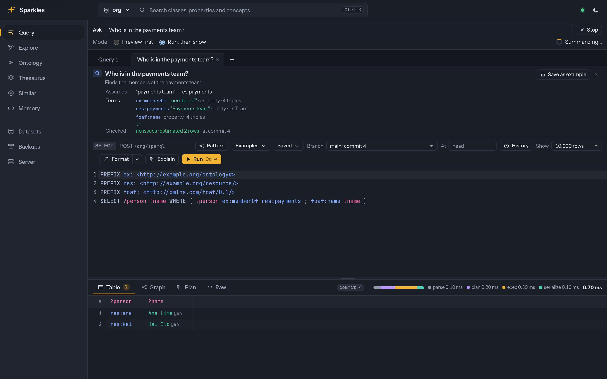

# AI and agents capabilities

This page describes the available capabilities and their current limits. The
[capability matrix](../FEATURES.md#capability-status) records delivery status within
each stated scope.

## AI and agents

An MCP server gives agents bounded, grant-checked access to the data. The server and the
web UI turn questions into checked queries, keep cited agent memory, ingest documents and
build community reports.

### MCP server

* `sparkles mcp` serves MCP over stdio, and `serve --mcp` serves it over Streamable HTTP
  at `/$/mcp`, with the `mcp` cargo feature, which is on by default
  ([USAGE.md](../USAGE.md#mcp-server-llm-agents)). It supports MCP revisions `2026-07-28`,
  `2025-11-25` and `2025-06-18`, with completions, `subscriptions/listen` and the tasks
  extension. `sparkles mcp --url` bridges stdio to a running server with the saved login.
* Its tools list datasets, describe the schema, run bounded SPARQL, explain queries,
  describe resources, find paths, list commits and changes, run full-text and vector
  search, validate with SHACL and ShEx, draft shapes, compare schemas, format SPARQL and
  RDF, run graph algorithms, and run GraphQL. Each stored query is a tool of its own.
* `check_query` checks a query against the schema without running it,
  `similar_queries` finds stored queries for a question, `link_entities` maps names to
  entities, and `recall` returns the facts around a question with a citation for each.
* Results come as a compact table or JSON, and truncation reports the exact total.
  `atCommit` keeps several calls on one snapshot, and `at` reads a past state. Every call
  runs under the engine's budgets with SERVICE off.
* Over HTTP each call runs as the request's caller, so tools, resources and prompts see
  only the datasets that caller may read, and the server's rate limits apply.
* Standard MCP hosts connect over HTTP with OAuth and no hand-made token
  ([USAGE.md](../USAGE.md#connecting-with-oauth)). The host finds the OIDC provider through
  the endpoint's protected-resource metadata, signs the user in there and asks for the
  `sparkles:update` scope only when a write tool needs it. `--mcp-require-auth` makes
  anonymous requests start the sign-in even when anonymous callers may read a dataset.
* The `sparql_update` tool is off unless the operator enables it, and is listed only for
  callers that may write. Writes pass write-time validation and carry a commit message,
  `LOAD` is refused, `dryRun` previews, `ifHead` makes a write conditional, and `patch`
  applies an RDF Patch.
* `ontology_axioms` lists the OWL 2 axioms of a dataset's graphs in functional-style
  syntax. When updates are enabled it also adds and removes axioms in one commit, with
  `dryRun`, `ifHead` and a commit message as `sparql_update` takes them, and annotates
  each added axiom with PROV-O provenance that names the call's activity, its time and
  its source ([OWL 2 ontologies](../reasoning/README.md#owl-2-ontologies)).
* Every tool that reads or writes takes `branch`, and `list_branches`, `create_branch`,
  `merge_branch` and `delete_branch` manage scratch branches. Merges preview by default,
  need the previewed heads and refuse conflicts. `--mcp-scratch-branch-ttl` deletes idle
  scratch branches, and a dataset's `memory.scratchBranches.ttl` overrides it for that
  dataset. `sparkles mcp --loc` applies the dataset setting as well.
* `link_entities` can include versioned evidence about the named types and literal
  labels retained for each candidate, with separate flags for display, per-entity and
  query limits. It reports values and counts from the caller's query view. Bounded text
  and vector search do not establish a complete candidate universe or unique intent. Full
  evidence fields are counted before formatting and share the configured result-byte
  allowance across mentions. The final check also includes branch and policy metadata.
  Query memory limits govern lookup and ranking state.
* Resources give each dataset's schema summary and prefixes and each stored query's
  definition. Eight prompts start common workflows. `explore_dataset` describes the
  server's tool workflow with the dataset's prefixes. `answer_question` answers a
  question with bounded, verified queries. `run_stored_query` runs one of the dataset's
  stored queries through its tool and explains its parameters. `ask_graph` grounds a
  plain-language question in the schema and the entities, drafts and checks a query, runs
  it, repairs it when it fails and answers from the rows. `explain_term` explains a class,
  predicate or resource from its description and usage. `agent_memory` answers from a
  dataset used as long-term memory and records new facts with their sources.
  `ingest_document` turns a document into facts that cite their passages, on a branch for a
  person to review. `consolidate_memory` proposes consolidated facts, duplicate entities
  and conflicts from session graphs, also on a branch for review.

### Questions in plain language

* A question becomes a checked SPARQL query through `sparkles ask`, `POST /{ds}/ask` or
  the web UI's [Ask thread](#the-ask-thread)
  ([C18](../specs/C18-natural-language-questions-and-ingest/README.md),
  [USAGE.md](../USAGE.md#asking-questions-with-a-model),
  [API.md](../API.md#natural-language-questions)). On DBpedia's billion quads, an Ask
  takes about two seconds with under 512 MiB of anonymous memory.
* The server knows model providers of three kinds, Ollama, the OpenAI protocol and
  Anthropic, with keys from named secrets and an ordered list of models for each role.
  `--model-config`, `GET /$/models` and `POST /$/models/{name}/test` configure and test
  them. The server detects structured output per model and falls back to JSON mode and
  plain text.
* Anthropic providers use prompt caching by default. Each call marks its system text,
  Ask marks the grounding that every question of a dataset shares and each question's
  own part for its repairs, and ingestion marks the vocabulary of a document's chunks
  ([API.md](../API.md#model-providers)). `promptCaching` turns it off or sets the 1-hour
  TTL. Records report cache writes and reads apart, and token budgets and cost estimates
  price each class. OpenAI caches long prompts on its own, but only where the latest
  user message ends, so an `openai` provider with `promptCaching.enabled` set to true
  receives each Ask repair as the first draft's message followed by a second user
  message, and the repair reads the cached question.
* Ask keeps half of its schema budget for common vocabulary and retrieves the rest by
  matching the question against every visible class and predicate. Recognized candidate
  evidence preserves full choice identities and can order explicitly named kinds using
  known ontology types. Full retained types guard resource preferences against disambiguation
  types beyond the display limit. An ambiguous initial request still asks for a clarification, because
  bounded search does not prove unique intent. The generic `link_entities` verdict is
  unchanged. If rich evidence exceeds the result-byte allowance, Ask retries ordinary
  linking once under the same deadline and permissions and keeps its display rule.
* Ask also asks the data which predicates the linked entities use as subject and as
  object, and which a sample of 200 instances of the two classes that best match the
  question use. It lists them by namespace with their counts, ranked by the question's
  words and then by use. Each query runs as the caller within five seconds and the MCP
  limits, and a failed one only leaves its line out. Ask links with `popularity`, so
  label matches are ordered by how many triples name each one. The draft rules tell the
  model that the context is partial and to use one predicate per relation. This adds
  about 8% to a first-draft prompt and two to three bounded queries per linked entity.
* Ask has four repair options. The exploration, on by default, drafts once more after a
  draft gives no query or an empty result, with further link candidates and the
  predicates the entities use. The shape check, multi-draft voting and type hints are off
  by default. A dataset sets them under `repairs` in `assistant.json`, a request sets
  `explore`, `shapeCheck`, `drafts` and `typeHints`, and `sparkles ask` takes
  `--explore`, `--shape-check`, `--drafts N` and `--type-hints`, each with a `--no-`
  form. Over three runs of 51 validation questions with Haiku 5.5, the exploration raised
  the mean from 25.0 to 28.0 for 16% more cost per question, the shape check and voting
  stayed within the baseline's spread, and type hints lowered it to 22.7. Voting costs
  63% more per question. The
  [results](../benchmarks/natural-language/RESULTS.md#ask-repair-options) give each run.
* The draft rules ask for only the variables that answer the question, without label,
  predicate or helper columns unless the question asks for them. With them, answers
  with columns beyond the gold's fell from 27 to 8 for Haiku 5.5 and from 59 to 10 for
  GPT-6 Luna over three runs of 51 validation questions.
* A draft often uses a common vocabulary prefix without declaring it. Before the check,
  Ask declares each of these that the query uses and neither the query nor the dataset
  defines: `dbo`, `dbr`, `dbp` and `dbc` for DBpedia's ontology, resources, properties
  and categories, `yago` for DBpedia's YAGO classes, `dct` for Dublin Core terms, `geo`
  for the W3C WGS84 vocabulary, and `wd`, `wdt` and `wikibase` for Wikidata. A prefix
  that the dataset binds to another namespace keeps the dataset's binding, and any other
  unknown prefix is still reported by the check.
* Checking a draft reports a typed variable whose class has no instance with the
  predicate the draft uses. That lookup names the class and the predicate in its query,
  and a lookup that passes the query memory budget leaves the pattern unjudged instead
  of failing the check. Its suggestions are the predicates that a sample of 200
  instances uses, those in the namespace of the draft's predicate first, ranked by
  their share of the sample and how rare they are in the dataset.
* The extra kind preference recognizes the English words film, movie, book, novel,
  song, album, city, town, country, river and person through supported DBpedia,
  schema.org and FOAF class IRIs. Unknown class namespaces and incomplete or competing
  type evidence retain conservative clarification choices.
* `POST /{ds}/ask` runs as the caller and streams each step as a server-sent event, or
  answers one JSON object ([API.md](../API.md#asking-in-the-server)). `assistant.json`,
  through `/$/assistant/{ds}`, turns the assistant on for a dataset and sets what may leave
  the server per provider, with token budgets, a deadline and history retention.
* Each role moves from a cheaper model pair to a stronger one only on signals the server
  checks, such as a repair that still fails, an empty result that `why_empty` blames on
  the query, a failed call, a complex query, or **Try harder**.
* `why_empty` and `POST /{ds}/sparql/diagnose` name the first pattern, join or filter of a
  query without solutions, with a verdict of `query`, `data` or `unknown`.
  `POST /{ds}/check` and `POST /{ds}/recall` run `check_query` and `recall` over HTTP.
* An agent hands a query it wrote to the web UI with the `share_query` tool, and the
  query page opens it with the question, the explanation and the terms it uses, without
  running it.
* The server keeps each person's questions for `historyDays` in `/$/asks/{ds}`, with
  their threads and their answers without rows, records feedback, and counts answers, escalations, tokens and cost in `GET /$/models/usage` and
  `/$/metrics`. `scripts/eval-ask` measures each model on the 68 questions of
  `testsuite/ask/demo.json`.

### The Ask thread

The web UI asks through one thread component, shown as a page at `/ui/ask` and as a
drawer docked beside any page
([C18 §6.1](../specs/C18-natural-language-questions-and-ingest/SPEC.md#61-where-it-lives)).

* The thread opens from `Shift+A`, the palette's Ask row or the rail's Ask page when the
  dataset has an assistant. The drawer docks at the right of a wide window, floats over a
  medium one and is a bottom sheet on a phone, and **Open as page** moves the thread to
  `/ui/ask`.
* A Browse, Ontology, Thesaurus or Explore page passes its resource, and the Query page its
  query, as a context chip with questions that suit it. The request carries the resource
  as `about`, so the history keeps the person's own words, and the chip can be removed.
* Each turn shows the answer with its citations, and folds for the query, the rows as a
  table or a small graph, the sources and the steps with their diagnostics. The sources are
  the cited rows, the memory facts about the cited entities with their quotes and documents,
  and the community reports a global answer read. **Open in Query**, **Open in Explore**,
  **Save as query** and **Right**, **Edited** or **Wrong** act on the turn.
* A running turn shows its current step and **Stop**. Follow-ups carry the thread's id and
  earlier turns, and **New thread** starts over. The run mode, the answer source and the
  model stay beside the field.
* On the Query page the thread docks beside the editor and opens each answer in a tab, as
  the Ask bar did, with retries, clarifications and **Try harder** in place.
* The history lists threads by day and reopens one from the answers the server keeps.
  Rows are not kept, so **Show rows** reruns the stored query read-only at its commit
  without a model. A reader whose grants do not cover every graph the answer read gets
  the record without its answer ([API.md](../API.md#ask-history)).



### Ask stage diagnostics

Set `RUST_LOG=warn,sparkles::ask::profile=debug` to record bounded stage timings
through the existing log and tracing configuration. Local Ask records grounding,
common and question-ranked schema retrieval, examples, entity linking, optional
community recall, query checking and execution. Each completion records one call,
inclusive nanoseconds, a finite outcome and error category, and the selected commit
when the tool returns one. Each scoped completion also records a process-generated numeric pipeline identifier
and the context-window size when selected. These remain in JSON logs without
ancestor span lists. Standalone tool stages have no Ask identifier. These are diagnostic fields, not metric labels.
The added fields contain no questions, labels, entity IRIs, prompts or error messages.

Nested stages identify example-query and example-document embedding preparation and
linker vector search. These include caches, admission and any local or remote model
work. Vector search also includes query execution. Parent timings include their child
stages and must not be summed together. These diagnostics do not change the API's
`elapsedMs` or `modelMs`. The latter remains the inclusive Ask role-call time and does
not include embeddings performed inside tools.

### Agent memory

* `assert_facts`, over MCP or `POST /{ds}/facts`, writes facts into one named graph per
  source or session, each with an RDF 1.2 reifier that records PROV-O provenance, the
  source, time, caller and an optional confidence and quote
  ([API.md](../API.md#memory-writes)). It mints IRIs for new entities, refuses unknown
  predicates and classes, invented IRIs and likely duplicates with suggestions,
  supersedes old values while keeping their record, and makes retries with an idempotency
  key write nothing. Each call is one commit on the normal write path.
* `memory.json` names a dataset's memory graphs, and `recall` marks facts found only there
  as unreviewed. `reviewedOnly` hides memory graphs from an Ask.
  `sparkles auth grant --template agent` prints grants for an agent that writes its own
  graphs and proposes changes to curated ones on branches.
* `sparkles memory import` and `sync` read the memory files of coding agents
  ([USAGE.md](../USAGE.md#agent-memory), [API.md](../API.md#importing-agent-memory)). They cover
  Claude Code's memory files, `MEMORY.md`, `CLAUDE.md` and rules, Codex's `AGENTS.md` and
  generated memories, `GEMINI.md`, Cursor rules and GitHub Copilot's instructions. Secrets
  are redacted, each file becomes a source, and its facts cite their line span and stay
  unreviewed until a person promotes them.
* A sync writes only what changed. An edit re-anchors facts to where their quotes now
  occur and retracts the rest, and a rename carries them to the new file. With
  `imports.extract: "server"`, a sync starts a server extraction of each changed file.
* Session transcripts of Claude Code, Codex, Gemini CLI, Cursor, the GitHub Copilot CLI
  and Aider, and any file the generic adapter can read, become searchable episodes when
  both the dataset and the person opt in.
* `sparkles memory brief` and `POST /{ds}/memory/brief` print a ranked, bounded and cited
  brief, and `sparkles memory setup claude-code|codex` installs hooks that sync on writes
  and print the brief when a session starts. The `memory` subcommands also cover `init`,
  `sources`, `status`, `recall`, `query`, `assert`, `forget`, `inbox`, `review`,
  `promote`, `reject` and `export --sources`.
* A consolidation task asserts once, in the consolidated graph, the facts that several
  agent graphs repeat and no reviewed graph asserts, and lists duplicates and conflicts
  ([USAGE.md](../USAGE.md#maintaining-agent-memory), [API.md](../API.md#memory-maintenance)). A
  retention task deletes old session graphs whose facts all appear in reviewed graphs.
  Both run on demand or on a schedule and support dry runs.
* The server counts what waits in each review inbox and reports it in metrics, the
  maintenance answer, a badge in the UI, the brief and the MCP resource
  `sparkles://{ds}/memory/review`. `recall` takes `recency`, a half-life that ranks recent
  and corroborated facts first.

Recall citations identify a registered passage's document source through visible
rendition metadata. A source IRI may differ from the fact's graph IRI. When several
documents apply, the singular source field prefers relationships in the fact's graph,
then elsewhere in the caller's view, with lexical IRI ordering within each group.
Opaque legacy sources follow those documents, while recognized passages and visible
derivation reifiers are excluded from that fallback. This is a bounded provenance
representative and does not rank evidence or establish complete provenance. Historical
and branch recall use their own metadata snapshots, and all metadata reads respect
the caller's view without loading source text or chunks.

The deterministic [project handover corpus](../../testsuite/memory/acceptance/README.md)
checks current MCP and HTTP memory workflows with independently specified source
occurrences, correction, withdrawal, retained-commit recall, graph visibility, branch
separation and citation fidelity. It uses explicit entity seeds and does not establish
retrieval quality, model accuracy or latency. Shared-profile independence, accepted
support ownership and dependent freshness remain planned. Roadmap items 81 and 340.

Idle scratch branches expire after the dataset's `memory.scratchBranches.ttl`, over HTTP
and in a `sparkles mcp --loc --allow-update` session. A limit per principal, warnings
before a branch expires and a way to keep one branch remain planned. Roadmap item 435.

### Document ingestion

* An agent registers a document's text as a source with `register_source`, reads it back
  with `read_chunks`, and writes facts with `assert_facts` and a `span` whose quote the
  server checks against the text
  ([USAGE.md](../USAGE.md#ingesting-documents-and-reviewing-memory),
  [API.md](../API.md#review-inbox)). A changed text makes a new rendition, and `retractStale`
  retracts facts it no longer supports. Ingest profiles live in `/$/ingest/{ds}`.
* The review inbox, `GET /$/memory/{ds}/inbox`, lists unreviewed agent facts with span,
  link, guard and corroboration signals and the open review branches. `promote`,
  `reject`, `relink` and `edit` act on them as the caller.
* `POST /$/ingest/{ds}` and `sparkles ingest` ingest a Markdown, HTML, plain-text, PDF,
  Word, PowerPoint or OpenDocument document as a task
  ([USAGE.md](../USAGE.md#ingesting-documents-in-the-server), [API.md](../API.md#ingestion)).
  The server converts it to Markdown, asks the `extract` model role for facts in the
  profile's vocabulary, finds each quote to compute its span, links names to existing
  entities, and writes the facts on a review branch. `mode: "preview"` holds them for
  approval, and `mode: "auto"` merges them when every check passes.
* `mode: "claims"` registers the document's source and chunks as the other modes do and
  writes its extracted facts as claim proposals of one evidence batch in the same commit,
  so that a review policy decides what is projected. It needs enabled evidence settings,
  `write` on the update endpoint, update grants on the evidence graphs and `keepText`, and
  it checks them before any model call. Each fact becomes a reported, positive claim
  occurrence attributed to its source, with its passage, a supporting evidence link and
  the extraction model's confidence. New entities get name-based IRIs, and their classes
  and labels are claims too. A repeat of the same source, graph and text answers
  `already-proposed` without a model call, and an extraction of more than 1,000 claims is
  refused as `too-large` with nothing written. The evidence rendition keeps the text that
  a review verifies, so the text is stored once in the chunks and once in the evidence
  graph. [C25](../specs/C25-evidence-and-assessments.md#ingestion-into-claim-proposals)
  records the contract.
* PDF conversion uses pdf-inspector with the `pdf` cargo feature, on by default, and the
  `pdf-ocr` feature is included by default. Scanned pages use OCR models and native
  libraries that the operator provides. Office
  files are read by `sparkles-office` under the `office` feature, on by default. On Linux
  each conversion runs in a child process with an address-space limit, which limits
  resources but is not a sandbox.
* A CSV, TSV, Excel or OpenDocument spreadsheet gets a CSVW mapping draft for
  `sparkles csv` per sheet, written by a model from the header and 20 sample rows, with
  the triples of a dry run. IRI columns are linked to existing entities through a lookup.
* `scripts/eval-ingest` scores an ingestion of `testsuite/ingest/sample.json`, and
  `scripts/eval-text2kg` runs Text2KGBench.

### Evidence profile

The version 1 [evidence resources](../../crates/sparkles/resources/evidence/v1/README.md)
provide an RDF vocabulary, SHACL shapes, competency queries and read-only views of
existing memory records. Rust applications select them with
`sparkles::evidence::profile(1)`. Unknown versions return `None`. The CLI can validate
profile RDF with `sparkles shacl` and run the supplied queries with `sparkles query`.

A dataset's [evidence settings](../API.md#evidence-settings) name the graphs of six
roles, the named review policies and the named matching policies. The roles hold source records, proposals, review
decisions, acceptance supports, identity records and dedicated projections. Each policy
names its admitted claim kinds, required scope predicates, conflict mode, evidence
boundary and the decisions, supports and projection graphs it uses. Administrators
record them with `PUT /$/evidence/{ds}/settings`, and Rust applications with
`sparkles::evidence::configure`. Enabled settings protect every graph of every role as a
managed graph of the evidence owner and store canonical `evidence.json` bytes. A
configuration never stops protecting a graph. A graph leaves protection only through
`POST /$/evidence/{ds}/detach` or `sparkles::evidence::detach`, and the next
configuration protects it again. Protection does not authenticate what a graph already
holds. Evidence resolution reads records from these graphs, and
[evidence proposals](../API.md#evidence-proposals) write them.

[Evidence holds](../API.md#evidence-holds) keep the commits that evidence references
name readable. A hold names commits of `main` or any branch by the branch's identity, and
history trimming, retention limits, compaction and generation retirement keep those
commits until the hold is released. A held branch is deleted only by a deletion that
releases its holds. Administrators acquire, list and release holds through
`/$/evidence/{ds}/holds`, and Rust applications use `sparkles::evidence::acquire_hold`,
`holds`, `release_hold` and `reconcile_holds`. The last releases old holds that the
evidence owner no longer needs, such as those of an operation whose commit never
published. A claims proposal acquires a hold for the stored facts of its dataset that
it references, before its commit, and releases the holds of operations that never
published once they are an hour old.

Rust importers can prepare typed batches with `sparkles_core::evidence::prepare_input`.
It checks local content digests and retained text or JSON selectors within its bounds.
The result keeps explicit requirements for references needing authorized runtime
resolution. JSON selection uses the named lexical UTF-8 method and preserves exact
retained value bytes. These local helpers provide no authenticated write or receipt.

[Evidence resolution](../API.md#evidence-resolution) verifies references without
writing. `POST /{ds}/claims/resolve` reads a stored fact at exactly the commit of the
branch its identities name, through the caller's view of that dataset and branch, and a
starting commit from the upstream that serves it. A record resolves only as an
authenticated record of the protected evidence graphs with a receipt of this dataset,
and a passage's selector is checked against its rendition's retained text. A missing,
unretained and unreadable reference give the same `evidence-unavailable` answer. Rust
applications use `sparkles::evidence::resolve::Resolution`, which shares one 64 MiB
allowance, the deadline and cancellation across an operation's references.

[Evidence proposals](../API.md#evidence-proposals) are the authenticated typed writer.
`POST /{ds}/claims` and `sparkles::evidence::propose` publish one batch of source
revisions, renditions, passages, references, claims, links and assessments as one
commit of the evidence owner, and a claim describes its proposition without asserting
it. The caller needs update grants on the written graphs and read access to every
referenced record and fact, and a hidden reference answers as a missing one. Record
identities are derived from the dataset, the authenticated caller and each record's
keys, so an equal record is not written twice and a different one under the same
identity conflicts. The server sets the receipt, the creation activity and its agent,
the first availability of each source revision and each record digest. A repeated
idempotency key returns the first receipt, `ifHead` refuses a moved head, and a
credential revoked before the commit publishes refuses it. Every graph has a protection
nonce, which the operation records, so a record written while its graph was detached
never authenticates. The Python, JVM and Node.js bindings do not propose claims.

[Evidence reviews](../API.md#evidence-reviews) decide what a dataset accepts.
`POST /{ds}/claims/review` and `sparkles::evidence::review` append immutable review
decisions under a named policy, and a later decision supersedes an earlier one by name.
An acceptance of a positive claim that the policy admits records an acceptance support
and projects the claim's proposition into the policy's dedicated output graph, which is
the only place the proposition is asserted. Each occurrence owns its own support, and a
projected triple stays while one live support owns it. A reviewer must be able to read
the claim's evidence and any negative claim of the same proposition, and a hidden one
answers as an unavailable target. Contrary evidence refuses an acceptance or is admitted
and labelled, as the policy says. `POST /{ds}/claims/withdraw` and
`sparkles::evidence::withdraw` record that claim occurrences are withdrawn, which ends
their supports without inventing a contrary claim. Both operations report the supports
and projected triples they changed. A detach and new protection of a projection's graph
makes later reviews under its policy refuse with `projection-unavailable`, because its
supports no longer authenticate. Readers of an output graph read it under their own
grants, so an administrator gives them read access to the policy's evidence boundary.

[Evidence identities](../API.md#evidence-identities) are reviewed and reversible.
An identity proposal in a claims batch names two or more exact entity IRIs as a possible
match or as distinct entities, and asserts no `owl:sameAs`. A review under a matching
policy decides proposals, and the policy's accepted matches join entities into clusters
whose current resolution map is the policy's output graph, `<member> ev:resolvesTo
<representative>`. An accepted separation keeps its entities apart, and a review that
would join them refuses with `identity-conflict`. A split is a decision that supersedes
the match's acceptance, and accepting the match again restores the earlier map. Every
change of the decisions a map follows writes an immutable map revision that names its
predecessor and the decisions it added and ended, and the review answers the entities
whose selected entity changed. `POST /{ds}/claims/identities` and
`sparkles::evidence::resolve_entities` read what the map selects for an entity, its
cluster and the decisions that join it. Queries join the output graph explicitly and are
never rewritten through a map. Reviews and resolutions are not available through the
bindings.

An assessment names the records it consumed in `inputs`, written as `prov:used`, and
[evidence dependents](../API.md#evidence-dependents) find the assessments whose target or
inputs changed. A review or withdrawal names what it changed, such as withdrawn claims,
ended supports and the map revision a split follows, and `POST /{ds}/claims/dependents`
or `sparkles::evidence::find_dependents` answers the authenticated assessments in the
proposal graphs the caller can read that depend on them, optionally transitively. The
answer marks nothing stale by itself. Maintained analyses that act on it are planned.
Roadmap item 340.

`recall` and `POST /{ds}/recall` cite claims under a named policy. With `reviewPolicy`,
a fact of the policy's output graph cites the claim occurrences of its live acceptance
supports, and a claims section lists the occurrences in the policy's boundary whose
proposition has an entity of the result as its subject or object. Each occurrence has
its state under the policy, which is `accepted`, `rejected`, `needs-evidence`,
`unreviewed` or `withdrawn`, with its current decision and the policy version that
decision was made under. A claim's proposition is never shown as a fact, and the section
is labelled as source data. An occurrence whose source is typed `mem:Instructions` in any
graph of the caller's view, the default graph included, reports `origin=instructions`, and no label changes what the caller may
do. `maxClaims`, 50 by default and at most 200, bounds the section, and a fact whose
occurrences do not all fit is left out with the result marked truncated. The JSON
`claims` member carries `version` 1. With `matchingPolicy`, entities name their
representative under the policy's resolution map, and the other members of each seed's
cluster join the seeds under their own IRIs. A call without either argument returns
what it returned before.

A call that names a policy reads one evidence view of the requested state, with the
policies of that view's configuration. A store without activated configuration history
refuses it with `409 configuration-history-inactive`, and the closed-store migration
activates it. A caller needs read grants on the policy's decisions, supports and output
graphs, or on a matching policy's decisions, maps, output and boundary identity graphs.
Otherwise it gets the same `bad-argument` refusal as an unknown policy name. An
occurrence is shown only when the caller's view holds its claim, its current decision,
any withdrawal and the support that cites it, and a hidden one leaves no count. Finding
the claims about the result reads each boundary proposal graph and refuses with
`incomplete-evidence` past one million quads, a bound that counts the graph's hidden
quads too. `sparkles::evidence::claim_states` and
`sparkles::evidence::with_policy_claims` read the same states for Rust callers at a
`BoundEvidenceView`, and `sparkles::evidence::resolve_entities_at` reads a map there.

`POST /{ds}/ask` takes the same `reviewPolicy` and `matchingPolicy`. The summary step,
and no other step, receives the claims of the entities the question links exactly, and
it may cite them as `[c1]`, which the summary lists in `claimCitations`. The final JSON
and the `summary` event carry the `claims` member. The policies are checked before any
model call, and an ask with a policy answers from the data, so `mode` `global` is
refused. A refused policy keeps the status `recall` gives it. An unlisted `[cN]` marker
is removed from the summary's text. Ask reads the claims again before it publishes the
summary, and any difference, including a moved head, withholds the answer with a
`forbidden` error, as does an access policy reload or a credential that ends meanwhile. A kept answer
stores the occurrences its summary cites and is shown again under its existing
footprint rule. The CLI's `sparkles ask` does not take the policies.

MCP exposes these same operations as the caller. Administrators first configure the
dataset's evidence settings over HTTP or Rust. The tools take the corresponding
[HTTP payloads](../API.md#evidence-proposals), with optional `dataset`, `branch` and
`timeoutSeconds` arguments. The tool schemas describe every record and field.

| Tool | Operation |
|---|---|
| `propose_claims` | Publish source revisions, renditions, passages, references, claims, links, assessments and identity proposals in one batch. |
| `review_claims` | Review exact targets under a claim or matching policy, with accepted projections, supersession and identity map revisions. |
| `withdraw_claims` | Withdraw claim occurrences and end their acceptance supports. |
| `resolve_evidence` | Verify authenticated records and facts at their exact retained origins. |
| `resolve_identities` | Read a matching policy's current representatives, clusters and decisions. |
| `find_evidence_dependents` | Find assessments that depend on changed records, optionally transitively. |

The three write tools require `--mcp-allow-update` over HTTP or `--allow-update` over
stdio and a server that permits writes. Tool listings follow the caller's grants,
and `--mcp-disable-tool` or `--disable-tool` can remove each tool. A call still needs
its query or update endpoint grant on the selected branch and the same graph grants
as its HTTP operation. Its references share the evidence resolver's 64 MiB preparation
allowance, deadline and cancellation. Hidden evidence has the same refusal as missing
evidence. Writes retain protected graphs, revision checks and the publication-time
credential check. Use `dryRun` to preview a write, then `ifHead` to publish against
the head reviewed and `idempotencyKey` to retry safely.

The write tools advertise `idempotentHint: false`. Without an `idempotencyKey`, a
proposal or withdrawal can publish another operation even when its records already
exist or its claim is already withdrawn. An explicit key makes an identical retry
return the first operation's receipt without publishing another commit. Reviews
require `ifHead`, so an identical keyless retry refuses the head moved by its first
successful call.

A successful JSON-RPC response can contain a refused operation. Check `isError` and
`_meta["io.github.kclejeune.sparkles/error"]` for the HTTP refusal code, status and
body in `data`. Successful results retain the HTTP operation's receipt, preview or
resolution body in `structuredContent`. Retrieved quotes and claims remain data and
never authorize instructions or actions.

The Rust controlled permission helper can prepare graph, predicate and class masks
and the built-in disclosure guard under one memory cap and `Control`. It explicitly
refuses unsupported providers, unresolved providers nested in retained rules and
protection-pattern planning. Evidence resolution uses it, and guarded Dataset queries
still require caller adoption. [Roadmap item 395](../ROADMAP.md). A prepared visibility
view provides no source authenticity, managed-write authority or proof that an
unavailable reference is absent.

Source revisions, renditions and passages retain exact identities and digests. Claim
occurrences describe a proposition with an RDF 1.2 triple term without asserting it.
Evidence links distinguish support, contradiction and mention. Declared lineage stays
separate from an assessment of independence. Qualified confidence retains its evaluator
and scale. Domain scope remains application RDF.

Rust applications can hand named graphs to a profile owner with
`Store::enable_managed`. A managed graph then refuses SPARQL Update, Graph Store
writes, LOAD, RDF Patch, merges, replays and cherry-picks with
`profile-managed-graph`, which the server answers with `409`. Dry runs report the
same refusal, and skipping write-time validation does not skip it. The registry is
recorded in `managed.json`, which needs dataset reader 6, and it covers main and every
branch, including branches created before it. Backups and clones carry it. A registry
that this build cannot enforce, such as a newer `managed.json` or an owner settings
file whose digest does not match, keeps reads and refuses every write with
`managed-unavailable` and `503`. `Store::detach_managed` returns one graph to
ordinary writes. Only a transaction that carries the owner's `ManagedWrite` capability
can change the owner's graphs. Its commit is published alone, and
`WriteTxn::managed_stamp` gives its exact sequence number and time in advance. In
library mode the capability guards against mistakes, not against code in the same
process. No typed evidence operation uses it so far, so profile records in managed
graphs are protected from ordinary writes but remain unauthenticated RDF.

These resources are ordinary caller-visible data under the existing access policy. Their
shapes check structure, while the fixtures independently check source bytes and selectors.
Loading a review decision or receipt does not authenticate it, admit facts or enable
execution. A claims ingestion through `POST /$/ingest/{ds}` with `mode: "claims"` proposes
extracted facts through the same typed writer, with its source registration in the same
commit, as in [document ingestion](#document-ingestion). Existing `assert_facts` and
source registration keep their current behavior.
[C25](../specs/C25-evidence-and-assessments.md#outcome) records the exact phase boundary
and remaining managed operations.

### Shared entity representation

[A01](../specs/A01-shared-entity-representation/README.md) provides versioned RDF
resources for shared entities, source descriptions, scoped identifiers and reviewed
resolution maps. Source revisions, world changes, identity decisions and ontology or
mapping migrations retain separate identities and history. The profile reuses C25
claims and C27 temporal records.

In Rust, `sparkles::shared_entity::profile(1)` returns the vocabulary, structural
shapes, matching policy, digest manifest and eight competency queries. Unknown
versions return `None`. Selecting these static resources opens no dataset. The
[resource package](../../crates/sparkles/resources/entity-representation/v1/README.md)
and [fixed corpus](../../testsuite/entity-representation/v1/README.md) provide software,
organization, place, event and aggregate-observation examples with exact query
answers, retained source bytes and explicit unknowns. They can be loaded and queried
with the existing RDF, SHACL and SPARQL interfaces.

The private [offline example](../../crates/sparkles/examples/shared_entity_replay.rs)
computes resolution from explicit view manifests, entities, proposals and selected
review declarations. It preserves historical decision inputs, reports conflicts across
entire connected components and leaves undecided matches unknown. Authored assignment and conflict rows
are excluded from matching. Representatives belong to the selected view and do not
assert logical equality.

Run the comparison CLI from the repository root with explicit local deliveries.

```sh
mbx run --locked -p sparkles --example shared_entity_replay -- \
  --view urn:example:a01:A12:pair --scope urn:example:a01:A12 \
  --rdf ttl=testsuite/entity-representation/v1/valid/common.ttl \
  --rdf ttl=testsuite/entity-representation/v1/valid/resolution.ttl \
  --rdf ttl=crates/sparkles/resources/entity-representation/v1/policies/default.ttl \
  --source urn:example:a01:r1=testsuite/entity-representation/v1/raw/r1.json \
  --deadline-ms 10000
```

The CLI accepts Turtle, N-Triples, TriG and N-Quads through `ttl`, `nt`, `trig` and
`nq` format names. It checks retained source digests and mandatory evidence selectors
reached through selected records and their domain dependencies. `--reference` adds
an explicit selector check. Replay refusals produce a stable code before comparison
bytes are emitted. The tool performs no network fetch, file discovery, dataset write
or current-pointer update.

Default limits are 10,000 entities, 20,000 descriptions, 50,000 claims, 20,000 decisions
and 50,000 relations. Decoded deliveries share a 64 MiB invocation cap, retained source
files have a 16 MiB cap each and operation memory is capped at 256 MiB. The
`--limit-entities`, `--limit-descriptions`, `--limit-claims`, `--limit-decisions`,
`--limit-relations`, `--limit-decoded`, `--limit-source` and `--limit-memory` flags
accept lower caps. Supply byte limits as integer byte counts. The memory accounting
charges each delivery about seven times its size before its statements, so the memory
cap refuses deliveries above about 36 MiB before the decoded cap applies. Replay builds
only complete views and refuses a missing input with `incomplete-input`, so its only
unknown code is `possible-match`. `--deadline-ms` sets a
relative deadline, and private helpers also honor the shared cancellation control. A
refusal emits no
partial comparison.

Private helpers compute the fixed rule for occurrence withdrawal, source lineage groups,
simulated availability cutoffs, mapping migrations and terminal observation revisions.
The availability rule accepts canonical fixed-width UTC timestamps. The observation
adapter supports reported positive occurrences in the declared synthetic series and
selects its unique terminal source revision. Unsupported headers or rules refuse or
remain explicit unknowns. The separate Cargo.lock version 4 adapter checks supplied
family and version bindings against the existing software-inventory bytes, whose
manifest digests a test recomputes. Reviewing that corpus is tracked separately. Roadmap
item 407. These
bindings do not establish release, build, artifact or deployment evidence. The CLI
emits resolution comparisons, while these evolution and mapping helpers are exercised
through the [replay tests](../../crates/sparkles/tests/shared_entity_replay.rs).

All review and availability declarations in this reference remain simulated. A separately
supplied public scope demonstrates isolation without implementing real authorization.
Managed integration with C25 review and protected records, C27 authenticated availability,
C26 durable publication and F22 freshness remains planned. Roadmap item 396. Synthetic
count examples define no operational health policy or connector.

### Community reports (GraphRAG)

* A GraphRAG build groups a projection's resources into the Leiden hierarchy and has the
  `community` model role write one report per community, with findings that cite their
  facts ([C22](../specs/C22-graph-rag-community-summaries.md),
  [USAGE.md](../USAGE.md#community-reports-graphrag), [API.md](../API.md#graphrag)).
* Reports are triples with provenance and review status in a reports graph, which a reader
  sees only when its access covers everything the build read.
* A build's queries run under the server's row, memory, rows-produced and spill budgets
  and its update timeout, as an algorithm write-back does, and the report routes run under
  the query timeout and the same budgets.
* A build reports an upper bound of its tokens and waits for confirmation, and reserves
  every request against per-build and daily budgets. A refresh rewrites only the reports
  of communities that changed, and `refresh.mode: auto` starts one when enough facts
  change.
* With `reviewPolicy` in the settings, the reports read a review policy's accepted
  projection. A finding cites the accepted claims and current decisions behind its facts,
  the report's activity names every claim, decision and child report it read with
  `prov:used`, and a withdrawn, reversed or superseded claim rewrites the reports that
  read it ([C25](../specs/C25-evidence-and-assessments.md#reports-on-accepted-evidence)).
* Ask answers questions about the whole dataset from the reports by map-reduce, and falls
  back to a query for callers who may not read them. The MCP tool `community_reports`,
  `recall` with `communities`, the brief, `sparkles graphrag` and the UI's Communities tab
  expose them.

### Valid-time profile

The version 1 [valid-time resources](../../crates/sparkles/resources/valid-time/v1/README.md)
provide an RDF vocabulary, SHACL shapes, an import normalization contract and typed
stored-query definitions. The library exposes them through
`sparkles::valid_time::profile(1)`. Unknown versions return `None`. Applications can
install the active-claim and overlapping-claim templates through the existing stored
query API and apply the shapes using ordinary SHACL validation.

Intervals are half-open and preserve uncertain, unknown and explicitly unbounded
endpoints. Query rows retain the claim, source revision, interval, temporal verdict
and normalization status. A temporal match does not assert the claim's proposition
or establish its acceptance. Recorded history still selects an actual retained commit;
valid-time parameters do not change the meaning of `at`.

C27 Phase 1 remains incomplete. The resources cannot authenticate local availability
or refuse client backdating of an ordinary RDF timestamp. That A4 acceptance requirement
needs C25's planned server-owned receipts and the shared protected-write boundary, or
a separately reviewed runtime helper. Publication dates and arbitrary receipt triples
do not establish a knowledge cutoff. The projection helper, event-time UI and expiry
integration remain planned. Roadmap item 341.

### Durable jobs

A durable job keeps accepted work inside the dataset, so a collector or an analysis
worker resumes after a restart and its result reaches the data atomically. The ledger is
the control graph `urn:x-sparkles:jobs:ledger`, which the jobs owner of the managed-graph
registry protects from ordinary writes, and every transition is one commit of the
dataset's main store. The design is in [C26](../specs/C26-durable-jobs-and-delivery.md).

The settings in `jobs.json` register definitions. Each names a kind, the graphs its
publications may change, the principals that may submit and claim it, and its retry and
lease policy. The kind in this build is `quads`, whose typed result is bounded insert and
delete quads in the definition's graphs with an opaque source checkpoint. The first
configuration raises the dataset reader to 9, so a release that does not know the ledger
refuses to open the dataset.

A submission carries an idempotency key scoped to the dataset, the branch, the caller,
the definition's name and revision and the operation kind. The same key with the same
payload, checkpoint, input set and retried run returns the existing run, and another
request under the key is a conflict. A worker claims the first submitted eligible run of its
permitted definitions and receives a bearer lease token, which the ledger never records
beyond its SHA-256 verifier. Every claim raises the run's lease generation, and the
process that granted a lease has a boot epoch, so a token whose generation was superseded,
whose lease expired, whose process restarted or whose definition no longer admits the
run or the worker fails with `lease-lost`, and a caller with no part in the run gets the
answer of an unknown run. An expired lease follows the retry policy the run was accepted
with before another worker takes the run over, and a run whose definition was edited or
removed waits until it is restored. A publication
commits the quads, the publication record, the checkpoint and the run's completion
together, and a repeated publication operation returns the original receipt even after
the lease ended, so a retry after a lost response never duplicates its effects. A
transient failure retries with exponential backoff within the definition's attempts and
horizon, a permanent one ends the run, cancellation fences the active attempt, and an
explicit retry makes a new run that links the old one.

In Rust, `Dataset::jobs()` configures, submits, claims, renews, publishes, fails, cancels,
retries and inspects. Over HTTP the routes are under `/$/jobs/{ds}`, described in
[the API reference](../API.md#durable-jobs). The ledger graph leaves every caller's
query, Graph Store, listing and history view, whatever the caller's grants say, and only
the jobs inspection renders its records. Statistics, the dataset listings, validation,
materialization and the MCP tools leave it out as well, and the history routes leave out
the counts that cover every graph while a dataset hides one. The library's Graph Store,
history, diff and dump handles subtract hidden graphs only from a view the caller gives,
which roadmap item 902 covers, and a text, geo or vector index whose scope includes the
ledger graph still indexes it, which item 904 covers. Once configured, the ledger stays protected and hidden while jobs are disabled,
and a `managed.json` that cannot be read still hides it. A submitter's own grants must reach the definition's
graphs, but a worker's publication is not intersected with the submitter's grants as they
stand at publication, which item 903 covers. Delivery through an outbox, recurring
definitions and recovery after a restore or clone are roadmap item 339, and the analysis
and batch kinds are items 899 and 900.

## Known gaps

These limits name the roadmap items that address them. Current priorities and
dependencies are recorded in the [central roadmap](../ROADMAP.md).

### AI and agents

* A durable job's publication writes quads only; an analysis publication with F22's
  freshness checks and a batch publication with C23's pinned iterator are roadmap items
  899 and 900. The outbox, recurring definitions and recovery after a restore are item
  339, and the ready-time index, cursor paging, per-principal bounds and shutdown fencing
  of claims are item 902.
* A question asked with a context chip reaches the model as the question followed by
  `(about <IRI>)`, as a typed suffix would. Grounding does not seed entity linking or
  predicate use from the structured `about` resource. Roadmap item 717.
* A stored Ask answer records what it read only when every step read one head that did
  not move. An ask pinned to an earlier state, or one during which the dataset changed,
  keeps its answer for unrestricted readers only, so a reader with limited grants sees
  such a turn without its answer when the thread reopens. Recording each state the steps
  read is planned. Roadmap item 718.
* ChatGPT-plan model access is planned in [C28](../specs/C28-chatgpt-model-access.md).
  The existing OpenAI-compatible provider uses Chat Completions with configured API
  credentials. It does not accept a ChatGPT subscription as model access. Roadmap
  item 344.
* Ask has been evaluated with Anthropic models only, on the demo set, CK25, QALD-9-plus
  and 74 DBpedia-only questions
  ([C18](../specs/C18-natural-language-questions-and-ingest/OUTCOME.md#roadmap-follow-ups-2026-10-12),
  [BENCHMARKS.md](../benchmarks/natural-language/RESULTS.md#ask-grounding-from-predicate-use)).
  With the current build, on 150 held-out QALD-9-plus training questions that no tuning
  step read, Opus 5.5 answers 114, GPT-6.1 Terra 111, GPT-6.1 Sol 109, Haiku 5.5 102 and
  GPT-6 Luna 101 under projected-column scoring, against 41 to 72 for the build before
  predicate-use grounding. Sonnet 5.5 answered 106 with the build before the check fixes
  and the projection rule. Luna and Haiku are within the noise of Sol but not of Opus
  ([results](../benchmarks/natural-language/RESULTS.md#ask-on-the-cheapest-models)). Luna
  costs $0.0019 per question, Sonnet $0.029 and Opus $0.060. With the earlier build, on
  the 107 retained QALD-9-plus test questions, which Ask grounding was tuned on, Opus
  answers 60, Sonnet 55 and Luna 47, and on the 74 retained Text2SPARQL'25 DBpedia
  questions 46, 45 and 40
  ([results](../benchmarks/natural-language/RESULTS.md#ask-across-providers)). The
  `openai` provider preset starts with Luna and the `anthropic` preset with Sonnet, the
  cheapest models per correct answer within the noise of the best one in the provider
  comparison. When accuracy matters more than cost, choose GPT-6.1 Terra, which answers
  about 74% of the held-out questions strictly, within the noise of Opus, at about 9 times
  Luna's cost. A gold resource missing from the prompt causes about half of the wrong
  answers, and wrong query shape most of the rest. Property path evaluation runs within
  Ask's query memory budget and timeout, so a generated query with a property path fails
  with the usual error rather than exhausting memory. Model-dependent accuracy and
  contextual namesake resolution remain open. Roadmap item 263. The median end-to-end
  latency is also higher. Roadmap item 318. Local and OpenAI-compatible models, LC-QuAD
  2.0, which needs a Wikidata load from the full dump, and an evaluation of independent
  roles have not run. Roadmap item 6.
* Prompt caching has not been measured against Anthropic. Neither the cache hit rate of
  real calls nor Ask's accuracy with its grounding reordered for the cache has run.
  Roadmap item 503.
* The UI's ingestion controls do not turn on assistant ingestion. Roadmap item 77.
* An MCP tool operation that needs admin, such as deleting a protected branch, refuses an
  OAuth token without `sparkles:admin` as a tool error instead of a scope challenge.
  Roadmap item 270.
* Agent memory does not import from Cursor's SQLite store or the editors' Copilot Chat
  storage, and redaction finds only the secrets its patterns describe. Roadmap item 15.
* The server does not convert images or audio. Scanned PDF pages need configured
  OCR models, PDFium and ONNX Runtime. The standard binary includes the OCR code. The Office converter is not registered with
  the query memory pool, and a workbook's token estimate for `confirmTokens` does not
  cover all its sheets. Roadmap items 15 and 77.
* A CSV mapping draft links an IRI column's values only to entities whose labels match
  exactly or after folding case and spacing. A value with several matches keeps a minted
  IRI until a person chooses, and the lookup reports only the first variant of an
  ambiguous group. Roadmap item 15.
* Maintained analyses remain planned in [C25](../specs/C25-evidence-and-assessments.md).
  Ordinary RDF shape validation does not establish the runtime guarantees of the typed
  evidence operations. Roadmap item 340.
* The automatic refresh of reports read under a review policy notices only the changes
  of the policy's evidence that the principal's change feed lists. A hidden decision,
  support or withdrawal, a settings-only change of the evidence configuration, a reload
  of the access policy and a state left behind by a crash wait for the next visible
  change or a manual refresh. Roadmap item 652.
* A report waiting for a rewrite after its claim was withdrawn keeps its earlier
  citations while the daily budget holds the rewrite back, without a `stale` mark.
  Roadmap item 809.
* No search lists the reports whose activity used a changed claim or decision, as
  `claims/dependents` does for assessments. Roadmap item 810.
* A global answer refuses `reviewPolicy`, and reports do not resolve identities through
  a matching policy. Roadmap item 811.
* Recall finds the claims about its entities by reading each boundary proposal graph,
  and refuses past one million quads, because no index maps a proposition's terms to its
  claims. Roadmap item 766.
* `sparkles ask` and the bindings do not take `reviewPolicy` or `matchingPolicy`. Roadmap
  items 767 and 509.
* Durable jobs, worker leases, collection checkpoints and a transactional delivery outbox
  are planned in [C26](../specs/C26-durable-jobs-and-delivery.md). Current server tasks and
  operator notifications do not provide the proposed recovery contract. Roadmap item 339.
* Maintained analysis records with reproducible inputs, read dependencies and guarded
  result publication are planned in [F22](../specs/F22-analysis-lifecycle.md). Existing
  reasoner and view maintenance does not provide that application lifecycle. Roadmap
  item 340.
* The [valid-time profile](#valid-time-profile) supplies static resources and temporal
  queries. C27 Phase 1 remains incomplete until server-owned availability and backdating
  refusal pass A4, dependent on C25 Phase 2 and protected writes. The runtime projection
  helper, event-time control and expiry integration remain planned. Roadmap item 341.
* A dataset has one GraphRAG configuration, so readers with different views cannot each
  have reports built from their own view. Roadmap item 100. Global answering is evaluated
  on one generated question set on the demo graph, compared with BM25 rather than vector
  retrieval, with no samples checked by a person. Roadmap items 260 and 261. `auto` mode
  answers about half of the questions about the whole graph locally. Roadmap item 262. An
  automatic refresh counts changes from the change feed rather than from an incremental
  view. Roadmap item 12.

## Configuration and usage

The following guides describe configuration and supported UI, command-line, HTTP
or library workflows. Exact HTTP contracts remain in the API reference.

* Read [MCP server (LLM agents)](../USAGE.md#mcp-server-llm-agents).
* Read [Connecting with OAuth](../USAGE.md#connecting-with-oauth).
* Read [Asking questions with a model](../USAGE.md#asking-questions-with-a-model).
* Read [Agent memory](../USAGE.md#agent-memory).
* Read [Evidence profile resource usage](../../crates/sparkles/resources/evidence/v1/README.md).
* Read [Maintaining agent memory](../USAGE.md#maintaining-agent-memory).
* Read [Ingesting documents and reviewing memory](../USAGE.md#ingesting-documents-and-reviewing-memory).
* Read [Ingesting documents in the server](../USAGE.md#ingesting-documents-in-the-server).
* Read [Community reports (GraphRAG)](../USAGE.md#community-reports-graphrag).
* Read [Natural-language questions](../API.md#natural-language-questions).
* Read [Asking in the server](../API.md#asking-in-the-server).

## Roadmap

The remaining work described above refers to [item 6](../ROADMAP.md), [item 12](../ROADMAP.md), [item 15](../ROADMAP.md), [item 77](../ROADMAP.md), [item 81](../ROADMAP.md), [item 100](../ROADMAP.md), [item 260](../ROADMAP.md), [item 261](../ROADMAP.md), [item 262](../ROADMAP.md), [item 263](../ROADMAP.md), [item 270](../ROADMAP.md), [item 318](../ROADMAP.md), [item 339](../ROADMAP.md), [item 340](../ROADMAP.md), [item 341](../ROADMAP.md), [item 344](../ROADMAP.md), [item 396](../ROADMAP.md), [item 503](../ROADMAP.md).
The central roadmap owns priority and dependencies. Its
[completion paths](../ROADMAP.md#completion-paths-for-partially-complete-specs)
link partially complete specs to their remaining work and acceptance criteria.
