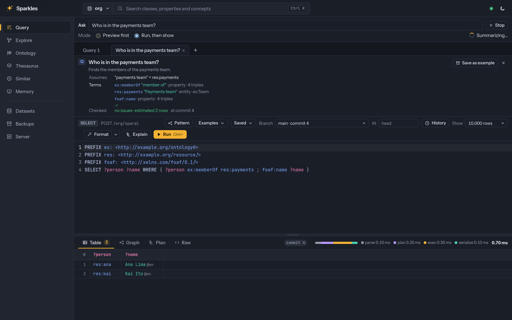

# AI and agents

Sparkles exposes RDF datasets to AI agents through a grant-checked MCP server, grounded plain-language Ask queries, cited agent memory, document ingestion, Leiden GraphRAG community reports, and versioned evidence, entity, valid-time, and durable-job primitives. The [capability matrix](../FEATURES.md#capability-status) records delivery status for each area.

| Section | What it covers |
|---|---|
| [MCP server](#mcp-server) | Stdio and Streamable HTTP transports, tool profiles, OAuth 2.1, scratch branches, and prompts. |
| [Questions in plain language](#questions-in-plain-language) | Grounded Ask pipeline, provider caching, repair options, [Ask thread](#the-ask-thread), and [stage diagnostics](#ask-stage-diagnostics). |
| [Agent memory](#agent-memory) | Cited fact writes, coding-agent memory sync, briefs, consolidation, and scratch-branch expiry. |
| [Document ingestion](#document-ingestion) | Source registration, review inbox, PDF/Office/spreadsheet extraction, and claim-proposal ingestion. |
| [Evidence profile](#evidence-profile) | Protected evidence graphs, holds, authenticated proposals, reviews, identity maps, and MCP evidence tools. |
| [Shared entity representation](#shared-entity-representation) | Versioned A01 vocabulary, fixtures, and bounded offline replay tool. |
| [Community reports (GraphRAG)](#community-reports-graphrag) | Leiden community summaries, review-policy integration, and global map-reduce answering. |
| [Valid-time profile](#valid-time-profile) | Half-open validity intervals, stored temporal queries, and server-owned local availability. |
| [Durable jobs](#durable-jobs) | Control-keyspace job ledger, fenced worker leases, atomic quad publication, and restore recovery. |

## AI and agents

### MCP server

`sparkles mcp` serves the Model Context Protocol over stdio, and `serve --mcp` serves Streamable HTTP at `/$/mcp` (cargo feature `mcp`, enabled by default; [USAGE.md](../USAGE.md#mcp-server-llm-agents)). It supports MCP revisions `2026-07-28`, `2025-11-25`, and `2025-06-18`, including completions, `subscriptions/listen`, and the tasks extension. `sparkles mcp --url` bridges stdio to a remote server using saved login credentials.

* **Core tools and profiles.** Built-in tools cover dataset listing, schema summaries and diffs, bounded SPARQL, query explanations, resource descriptions, path search, commits and changes, full-text/vector/semantic search, SHACL and ShEx validation, shape drafting, formatting and linting, graph algorithms, GraphQL, OWL 2 axiom management, and every dataset stored query. `search_semantic` embeds a question via the dataset's vector index provider (local or remote) and fuses vector and full-text rankings, returning `no-embedder` if no index embeds text. Select tool subsets with `--profile`/`--mcp-profile` (`explore`, `memory`, `admin`) or `--tools`/`--mcp-tools` ([API.md](../API.md#tool-profiles)).
* **Grounding and verification tools.** `check_query` validates a query against the schema without running it, `similar_queries` finds relevant stored queries, `link_entities` maps mentions to entities with optional versioned type and label evidence bounded by result-byte and query-memory budgets, and `recall` retrieves facts with citations. Results return as compact tables or JSON with exact totals on truncation, support `atCommit` and `at`, and run within engine budgets with `SERVICE` disabled.
* **Caller grants, OAuth, and writes.** Over HTTP, every tool, resource, and prompt executes as the authenticated caller under server rate limits. Standard MCP hosts connect via OAuth 2.1 using RFC 9728 protected-resource metadata and request `sparkles:update` only when needed (`--mcp-require-auth` forces sign-in even with anonymous read access; [USAGE.md](../USAGE.md#connecting-with-oauth)). `sparql_update` and write tools require explicit opt-in and write grants, reject `LOAD`, enforce write-time validation, and support `dryRun`, `ifHead`, commit messages, and RDF Patch. `ontology_axioms` lists axioms in functional-style syntax and, when updates are enabled, adds/removes axioms with PROV-O provenance annotations ([OWL 2 ontologies](../reasoning/README.md#owl-2-ontologies)).
* **Scratch branches.** Read and write tools accept `branch`, and `list_branches`, `create_branch`, `merge_branch`, and `delete_branch` manage scratch workspaces (merges preview by default and refuse conflicts). Idle scratch branches expire after `--mcp-scratch-branch-ttl` or per-dataset `memory.scratchBranches.ttl` unless created with `keep: true`, bounded per principal by `maxPerPrincipal` with advance expiry warnings via `notifyBefore`.
* **Resources and prompts.** Resources expose dataset schemas, prefixes, and stored queries. Eight built-in prompts guide common workflows: `explore_dataset`, `answer_question`, `run_stored_query`, `ask_graph`, `explain_term`, `agent_memory`, `ingest_document`, and `consolidate_memory`.

### Questions in plain language

`sparkles ask`, `POST /{ds}/ask`, and the web UI [Ask thread](#the-ask-thread) translate natural-language questions into schema-checked SPARQL queries ([C18](../specs/C18-natural-language-questions-and-ingest/README.md), [USAGE.md](../USAGE.md#asking-questions-with-a-model), [API.md](../API.md#natural-language-questions)). On DBpedia's billion-quad graph, an Ask finishes in roughly two seconds using under 512 MiB of anonymous memory.

* **Model providers and prompt caching.** The server supports Ollama, OpenAI-compatible, and Anthropic providers configured with named secrets and ordered role lists via `--model-config`, `GET /$/models`, and `POST /$/models/{name}/test`, falling back cleanly from structured output to JSON mode and plain text. Anthropic providers enable prompt caching by default on system text, shared dataset grounding, per-question repair prefixes, and ingestion vocabularies (configurable via `promptCaching`), pricing cache writes and reads separately in budgets and logs. OpenAI providers with `promptCaching.enabled: true` send Ask repairs as follow-up user messages so the cached question prefix hits automatically ([API.md](../API.md#model-providers)).
* **Schema, predicate, and entity grounding.** Ask allocates half its schema budget to common vocabulary and half to question-matched classes and predicates, links mentions with popularity ordering and bounded rich type/label evidence (falling back to ordinary linking if rich evidence exceeds the byte cap), and samples predicates used by linked entities and 200 instances of the two best-matching classes (adding ~8% to the first prompt and 2–3 bounded queries per entity). Recognized kind hints (film, movie, book, novel, song, album, city, town, country, river, person) guide disambiguation over DBpedia, schema.org, and FOAF types while keeping clarification prompts for ambiguous mentions. Before checking a draft, Ask supplies standard declarations for undeclared common prefixes (`dbo`, `dbr`, `dbp`, `dbc`, `yago`, `dct`, `geo`, `wd`, `wdt`, `wikibase`) without overriding dataset bindings, flags class/predicate combinations with no matching instances, and suggests sampled predicates.
* **Repairs, escalation, and diagnostics.** Four configurable repair switches live under `repairs` in `assistant.json`, request flags (`explore`, `shapeCheck`, `drafts`, `typeHints`), and `sparkles ask` CLI flags (`--explore`, `--shape-check`, `--drafts N`, `--type-hints`, each with a `--no-` form): `explore` is on by default and re-drafts once with extra link candidates and predicates after empty or failed drafts, while `shapeCheck`, `drafts` (multi-draft voting), and `typeHints` are off by default ([repair measurements](../benchmarks/natural-language/RESULTS.md#ask-repair-options)). Draft rules request only answer columns to reduce spurious projections. Roles escalate to a stronger model only on verified signals (failed repairs, `why_empty` blaming the query, provider error, high complexity, or user **Try harder**). `why_empty` and `POST /{ds}/sparql/diagnose` pinpoint the first empty pattern, join, or filter with a verdict of `query`, `data`, or `unknown`. `POST /{ds}/check` and `POST /{ds}/recall` expose `check_query` and `recall` over HTTP, and `share_query` hands an agent-authored query to the web UI without running it.
* **Governance, history, and evaluation.** `assistant.json` (`/$/assistant/{ds}`) controls enablement, per-provider egress limits, token budgets, deadlines, and `historyDays` retention in `/$/asks/{ds}` (storing threads and answers without result rows). Usage and costs appear in `GET /$/models/usage` and `/$/metrics`. `scripts/eval-ask` evaluates models on `testsuite/ask/demo.json`.

### The Ask thread

The web UI provides one Ask thread component available as a standalone page at `/ui/ask` and as a docked drawer beside any page ([C18 §6.1](../specs/C18-natural-language-questions-and-ingest/SPEC.md#61-where-it-lives)).

* **Entry and page context.** Open the drawer with `Shift+A`, the command palette, or the Ask rail item when a dataset has an assistant (**Open as page** moves it to `/ui/ask`). Browse, Ontology, Thesaurus, and Explore pass the active resource—and Query passes the active query—as a removable context chip sent via `about` so history preserves the user's exact phrasing.
* **Answers, sources, and follow-ups.** Each turn displays the cited answer with expandable query, result table or mini-graph, sources (cited rows, memory facts with quotes/documents, and GraphRAG reports), and step diagnostics, plus **Open in Query**, **Open in Explore**, **Save as query**, and feedback actions (**Right**, **Edited**, **Wrong**). Running turns display live step progress and **Stop**. Follow-ups continue the thread, and **History** reopens stored threads by day (**Show rows** reruns the stored query read-only at its commit without calling a model, withholding answers if the caller's grants no longer cover every read graph; [API.md](../API.md#ask-history)).



### Ask stage diagnostics

Setting `RUST_LOG=warn,sparkles::ask::profile=debug` records bounded JSON stage timings for grounding, schema retrieval, examples, entity linking, optional community recall, query checking, and execution, plus nested embedding-preparation and vector-search timings. Each completion logs inclusive nanoseconds, a finite outcome and error category, commit sequence, pipeline id, and context-window size without recording user questions, labels, IRIs, prompts, or error text. Ambiguous initial asks record only the linker (and schema stages if type hints are enabled) because clarification triggers before remaining grounding runs. Parent stage timings include child stages and do not alter API `elapsedMs` or `modelMs`.

### Agent memory

* **Cited fact writes and review separation.** `assert_facts` (MCP) and `POST /{ds}/facts` write facts into one named graph per source or session with RDF 1.2 reifiers carrying PROV-O provenance, source, timestamp, caller, and optional confidence and quote ([API.md](../API.md#memory-writes)). Writes mint IRIs for new entities, reject unknown classes/predicates or likely duplicates with suggestions, supersede prior values while preserving history, and honor idempotency keys. `memory.json` designates memory graphs so `recall` marks unpromoted facts as unreviewed and `reviewedOnly` hides them from Ask. `sparkles auth grant --template agent` generates scoped agent grants.
* **Coding-agent sync and session episodes.** `sparkles memory import` and `sync` ingest memory files from Claude Code (`MEMORY.md`, `CLAUDE.md`, rules), Codex (`AGENTS.md`, generated memories), Gemini CLI (`GEMINI.md`), Cursor rules, and GitHub Copilot instructions, redacting detected secrets and citing line spans ([USAGE.md](../USAGE.md#agent-memory), [API.md](../API.md#importing-agent-memory)). Incremental sync re-anchors edited quotes, tracks renames, and optionally triggers server extraction (`imports.extract: "server"`). Opt-in episode sync indexes transcripts from Claude Code, Codex, Gemini CLI, Cursor, Copilot CLI, Aider, and generic files. `sparkles memory brief` (`POST /{ds}/memory/brief`) prints a ranked, cited brief, and `sparkles memory setup claude-code|codex` installs session hooks.
* **Consolidation, retention, and recall citations.** Consolidation tasks promote facts corroborated across multiple agent graphs into a consolidated graph while flagging duplicates and conflicts; retention tasks remove old session graphs whose facts are already reviewed ([USAGE.md](../USAGE.md#maintaining-agent-memory), [API.md](../API.md#memory-maintenance)). Review-inbox counts surface in metrics, UI badges, briefs, and `sparkles://{ds}/memory/review`, and `recall` supports a `recency` half-life. Recall resolves passage citations to their visible document source (preferring links in the fact's graph, then elsewhere in the caller's view in lexical IRI order) without loading source chunks. The deterministic [project handover corpus](../../testsuite/memory/acceptance/README.md) verifies current MCP and HTTP memory workflows.
* **Scratch-branch governance.** Idle scratch branches expire per `memory.scratchBranches.ttl` on servers and `sparkles mcp --loc --allow-update` sessions unless marked `keep: true` or promoted with `PATCH /$/branches/{ds}/{name}` (`{"scratch": false}`). `maxPerPrincipal` caps scratch branches per principal, and `notifyBefore` surfaces expiring branches in `list_branches`, `sparkles://{ds}/branches`, briefs, and server `memory.review.pending` notifications.

### Document ingestion

* **Agent-driven registration and review inbox.** Agents register document text with `register_source`, read passages with `read_chunks`, and assert span-verified facts via `assert_facts` (new renditions support `retractStale`; [USAGE.md](../USAGE.md#ingesting-documents-and-reviewing-memory), [API.md](../API.md#review-inbox)). `GET /$/memory/{ds}/inbox` lists unreviewed facts with span, link, guard, and corroboration signals alongside open review branches, supporting `promote`, `reject`, `relink`, and `edit`.
* **Server-side document extraction.** `POST /$/ingest/{ds}` and `sparkles ingest` convert Markdown, HTML, plain text, PDF (`pdf` and `pdf-ocr` features included by default; scanned pages need operator-supplied OCR models and native libraries), Word, PowerPoint, and OpenDocument (`office` feature on by default) to Markdown—running Linux conversions in an address-space-limited child process—then extract facts using the `extract` model role, verify quote spans, link entities, and write to a review branch (`mode: "preview"` or `"auto"`; [USAGE.md](../USAGE.md#ingesting-documents-in-the-server), [API.md](../API.md#ingestion)). Spreadsheets (CSV, TSV, Excel, OpenDocument) produce per-sheet CSVW mapping drafts for `sparkles csv` with entity lookup and dry-run triples. `scripts/eval-ingest` (`testsuite/ingest/sample.json`) and `scripts/eval-text2kg` evaluate ingestion quality.
* **Claim-proposal ingestion.** `mode: "claims"` registers the source and chunks and writes extracted facts as authenticated claim proposals in the same commit under enabled evidence settings (`keepText` required; capped at 1,000 claims per batch; identical repeats return `already-proposed` without calling a model; [C25](../specs/C25-evidence-and-assessments.md#ingestion-into-claim-proposals)).

### Evidence profile

The version 1 [evidence resources](../../crates/sparkles/resources/evidence/v1/README.md) (`sparkles::evidence::profile(1)`) ship the RDF vocabulary, SHACL shapes, competency queries, and read-only views over memory records.

* **Managed evidence graphs and holds.** Administrators configure six protected graph roles (sources, proposals, review decisions, acceptance supports, identity records, projections) plus review and matching policies via `PUT /$/evidence/{ds}/settings` or `sparkles::evidence::configure` ([API.md](../API.md#evidence-settings)). Enabled graphs become profile-managed (`managed.json`, dataset reader 6, preserved across backups and clones), rejecting direct SPARQL updates, Graph Store writes, `LOAD`, RDF Patch, and merges with `409 profile-managed-graph` until detached via `/$/evidence/{ds}/detach` (`Store::detach_managed`), and stamping each protection epoch with a nonce so detached writes never authenticate. [Evidence holds](../API.md#evidence-holds) (`/$/evidence/{ds}/holds`, `sparkles::evidence::acquire_hold|holds|release_hold|reconcile_holds`) pin referenced commits on `main` or branches against compaction and retention until released.
* **Declared evidence settings.** Operators can declare graph roles and policies in `serve --settings` and lock selected fields. Administrators compare effective and recorded settings at `GET /$/settings/{ds}/evidence`. Typed evidence operations return `409 evidence-settings-drift` until an administrator reconciles a mismatch, and the recorded graph protections stay in force. [Evidence settings](../API.md#evidence-settings)
* **Resolution, proposals, reviews, and withdrawals.** `POST /{ds}/claims/resolve` and `sparkles::evidence::resolve::Resolution` verify authenticated records, passage selectors, and stored facts at exact retained commits under a shared 64 MiB allowance, returning `evidence-unavailable` identically for missing, unretained, and hidden targets ([API.md](../API.md#evidence-resolution)). `POST /{ds}/claims` and `sparkles::evidence::propose` atomically publish authenticated sources, renditions, passages, references, claims (using RDF 1.2 triple terms without asserting them), evidence links, and assessments with server-assigned receipts, digests, availability timestamps, `ifHead`, idempotency keys, and pre-commit credential checks ([API.md](../API.md#evidence-proposals)). `POST /{ds}/claims/review` and `POST /{ds}/claims/withdraw` record immutable review decisions and withdrawals under named policies, projecting accepted propositions into dedicated output graphs while at least one live acceptance support holds ([API.md](../API.md#evidence-reviews)). Rust importers can also pre-check local digests and selectors with `sparkles_core::evidence::prepare_input`.
* **Reversible identity resolution and dependents.** Identity proposals record possible matches or distinctness without asserting `owl:sameAs`. Reviews under a matching policy update immutable map revisions and project `<member> ev:resolvesTo <representative>` into the policy's output graph, refusing conflicts with accepted separations and supporting reversible splits ([API.md](../API.md#evidence-identities)). `POST /{ds}/claims/identities` (`sparkles::evidence::resolve_entities`) inspects representatives, clusters, and governing decisions. `POST /{ds}/claims/dependents` (`sparkles::evidence::find_dependents`) returns caller-visible assessments whose `prov:used` inputs changed, optionally transitively ([API.md](../API.md#evidence-dependents)).
* **Policy-aware `recall`, `ask`, and MCP tools.** Passing `reviewPolicy` or `matchingPolicy` to `recall`, `POST /{ds}/recall`, or `POST /{ds}/ask` (requires activated configuration history and read grants on policy graphs; capped at 1M quads per boundary proposal graph) cites live acceptance supports, lists claim states (`accepted`, `rejected`, `needs-evidence`, `unreviewed`, `withdrawn`) labelled as source data (`origin=instructions` when typed `mem:Instructions`), and expands seed clusters under the matching map. In `ask`, only the summary step sees claims (`[cN]` citations), global mode is refused, and claims are re-verified before publishing the summary. MCP exposes six caller-scoped evidence tools (write tools require `--mcp-allow-update` or `--allow-update`, advertise `idempotentHint: false`, and support `dryRun`, `ifHead`, and `idempotencyKey`; check `isError` and `_meta["io.github.kclejeune.sparkles/error"]` for operation refusals):

| Tool | Operation |
|---|---|
| `propose_claims` | Publish source revisions, renditions, passages, references, claims, links, assessments, and identity proposals in one batch. |
| `review_claims` | Review exact targets under a claim or matching policy, with accepted projections, supersession, and identity map revisions. |
| `withdraw_claims` | Withdraw claim occurrences and end their acceptance supports. |
| `resolve_evidence` | Verify authenticated records and facts at their exact retained origins. |
| `resolve_identities` | Read a matching policy's current representatives, clusters, and decisions. |
| `find_evidence_dependents` | Find assessments that depend on changed records, optionally transitively. |

### Shared entity representation

[A01](../specs/A01-shared-entity-representation/README.md) (`sparkles::shared_entity::profile(1)`) provides versioned RDF vocabularies, SHACL shapes, matching policies, digest manifests, and eight competency queries separating source revisions, world changes, identity decisions, and mapping migrations while reusing C25 claims and C27 temporal records. The [resource package](../../crates/sparkles/resources/entity-representation/v1/README.md) and [fixed corpus](../../testsuite/entity-representation/v1/README.md) supply verified examples across software, organizations, places, events, and aggregate observations.

A private [offline replay example](../../crates/sparkles/examples/shared_entity_replay.rs) (tested in [shared_entity_replay.rs](../../crates/sparkles/tests/shared_entity_replay.rs)) resolves entities from local Turtle, N-Triples, TriG, or N-Quads deliveries without network access or database writes, verifying digests and mandatory selectors (`--reference` adds an explicit selector check) under bounded defaults (10,000 entities, 20,000 descriptions, 50,000 claims, 20,000 decisions, 50,000 relations, 64 MiB decoded cap, 16 MiB per source, 256 MiB operation memory—which caps raw deliveries near 36 MiB due to ~7× accounting; lower caps can be set with `--limit-entities`, `--limit-descriptions`, `--limit-claims`, `--limit-decisions`, `--limit-relations`, `--limit-decoded`, `--limit-source`, and `--limit-memory`):

```sh
mbx run --locked -p sparkles --example shared_entity_replay -- \
  --view urn:example:a01:A12:pair --scope urn:example:a01:A12 \
  --rdf ttl=testsuite/entity-representation/v1/valid/common.ttl \
  --rdf ttl=testsuite/entity-representation/v1/valid/resolution.ttl \
  --rdf ttl=crates/sparkles/resources/entity-representation/v1/policies/default.ttl \
  --source urn:example:a01:r1=testsuite/entity-representation/v1/raw/r1.json \
  --deadline-ms 10000
```

All review, availability, and scope declarations in this offline tool are simulated (including its `Cargo.lock` v4 adapter; corpus review is roadmap [item 407](../ROADMAP.md)). Managed runtime integration with C25, C27, C26, and F22 remains planned (roadmap [item 396](../ROADMAP.md)).

### Community reports (GraphRAG)

* **Leiden hierarchies and cited summaries.** GraphRAG builds partition a projection into Leiden communities and invoke the `community` model role to generate cited per-community reports stored as triples in a reports graph visible only to callers whose access covers the full build footprint ([C22](../specs/C22-graph-rag-community-summaries.md), [USAGE.md](../USAGE.md#community-reports-graphrag), [API.md](../API.md#graphrag)).
* **Budgets, incremental refresh, and accepted evidence.** Builds run within server query/spill budgets, report an upper-bound token estimate for confirmation, enforce per-build and daily budgets, and refresh only changed communities (`refresh.mode: auto`). When configured with `reviewPolicy`, reports read the policy's accepted projection, record `prov:used` links to claims, decisions, and child reports, and trigger refresh checks when reviewed evidence or access policies change ([C25](../specs/C25-evidence-and-assessments.md#reports-on-accepted-evidence)).
* **Surfaces.** Global Ask runs map-reduce over reports (falling back to SPARQL for callers without report access). Reports are also accessible via MCP `community_reports`, `recall` with `communities`, memory briefs, `sparkles graphrag`, and the web UI Communities tab.

### Valid-time profile

Version 1 [valid-time resources](../../crates/sparkles/resources/valid-time/v1/README.md) (`sparkles::valid_time::profile(1)`) supply an RDF vocabulary, SHACL shapes, import normalization rules, and active/overlapping-claim stored-query templates. Intervals are half-open and preserve uncertain, unknown, and unbounded endpoints without asserting claims or altering the meaning of `at` recorded-history reads.

Local availability is server-owned: authenticated claim proposals stamp each new source revision's `ev:firstAvailableAt` with its non-decreasing branch commit timestamp (clones never precede their source commit), reject caller-supplied availability (`400 invalid-proposal`), and protect evidence graphs against direct writes (`409 profile-managed-graph`; [C27 §4.3](../specs/C27-valid-time-profiles.md#43-local-availability-and-backdating)). Claim proposals may attach validated `validity` records covered by the claim digest so stored temporal queries evaluate authenticated claims directly. The runtime projection helper, event-time UI, and expiry integration remain planned (roadmap [item 341](../ROADMAP.md)).

### Durable jobs

Durable jobs persist accepted background work inside a dataset's control keyspace (outside the RDF quad indexes, invisible to SPARQL, exports, and history) so collectors and workers resume safely after restarts and publish results atomically ([C26](../specs/C26-durable-jobs-and-delivery.md)). Quad-mutating transitions write control records inside WAL version 3 records alongside their quads, while quad-free transitions append to `control.log` without creating commits. Enabling jobs via `jobs.json` raises the dataset reader to version 9, and control state is bounded in memory (`maxControlBytes`, default 256 MiB, returning `jobs-overloaded` to new submissions while admitted runs finish).

* **Idempotency, fenced leases, and atomic publication.** The available job kind is `quads`, publishing bounded quad inserts/deletes with an opaque source checkpoint. Submissions use scoped idempotency keys (returning existing runs on identical retries and conflicting on mismatches). Workers claim eligible runs with SHA-256-verified bearer lease tokens fenced by lease generation and process boot epoch, returning `lease-lost` on expiry, supersession, restart, or definition removal. Publications commit quads, checkpoint, and completion atomically (returning the original receipt on duplicate retries, and skipping commit creation when net changes are empty). Exponential-backoff retries, permanent failures, cancellation fencing, and explicit linked retries follow the definition policy locked at submission.
* **APIs and restore recovery.** Managed via Rust `Dataset::jobs()` and HTTP `/$/jobs/{ds}` ([API.md](../API.md#durable-jobs)). Backups capture the ledger at the backed-up commit; restored datasets pause all in-flight runs (`jobs-recovering`) until an administrator selectively resumes them with `POST /$/jobs/{ds}/recover` or `Jobs::resume`. Clones start with definitions and an empty ledger.

## Configuration and usage

| Topic | Reference |
|---|---|
| MCP server setup and OAuth 2.1 | [MCP server](../USAGE.md#mcp-server-llm-agents), [Connecting with OAuth](../USAGE.md#connecting-with-oauth), [Tool profiles](../API.md#tool-profiles) |
| Natural-language Ask and history | [Asking with a model](../USAGE.md#asking-questions-with-a-model), [Natural-language questions](../API.md#natural-language-questions), [Asking in the server](../API.md#asking-in-the-server), [Ask history](../API.md#ask-history) |
| Agent memory and maintenance | [Agent memory](../USAGE.md#agent-memory), [Maintaining memory](../USAGE.md#maintaining-agent-memory), [Memory writes](../API.md#memory-writes) |
| Document ingestion and review inbox | [Ingesting and reviewing](../USAGE.md#ingesting-documents-and-reviewing-memory), [Server ingestion](../USAGE.md#ingesting-documents-in-the-server), [Ingestion API](../API.md#ingestion) |
| Evidence profile, GraphRAG, and durable jobs | [Evidence settings](../API.md#evidence-settings), [Evidence resources](../../crates/sparkles/resources/evidence/v1/README.md), [GraphRAG](../USAGE.md#community-reports-graphrag), [Durable jobs](../API.md#durable-jobs) |

## Known gaps

Each limit below cites the [central roadmap](../ROADMAP.md) item tracking it.

### AI and agents

* **Ask accuracy, evaluation, and latency.** On 150 held-out QALD-9-plus questions under projected-column scoring, Opus 5.5 answers 114 ($0.060/question), GPT-6.1 Terra 111, GPT-6.1 Sol 109, Haiku 5.5 102, and GPT-6 Luna 101 ($0.0019/question), with Luna and Haiku sitting within noise of Sol but not of Opus; Sonnet 5.5 answered 106 ($0.029/question) on the earlier build before the check fixes and the projection rule ([results](../benchmarks/natural-language/RESULTS.md#ask-on-the-cheapest-models), [provider comparison](../benchmarks/natural-language/RESULTS.md#ask-across-providers)). The `openai` preset defaults to Luna and `anthropic` to Sonnet (choose GPT-6.1 Terra when strict accuracy outweighs cost). Roughly half of remaining errors stem from missing gold resources in prompts and most others from query shape; contextual namesake resolution remains open (roadmap [item 263](../ROADMAP.md)). Local and other OpenAI-compatible models, LC-QuAD 2.0, and independent-role evaluations have not been run (roadmap [item 6](../ROADMAP.md)), Anthropic prompt-caching hit rates and reordered-grounding accuracy are unmeasured (roadmap [item 503](../ROADMAP.md)), and cold `sparkles ask` processes spend ~0.5 s building schema context (roadmap [item 914](../ROADMAP.md)). ChatGPT-subscription model access is planned rather than API-key-only OpenAI endpoints (roadmap [item 344](../ROADMAP.md)).
* **Ask UI, context chips, and search limits.** Context chips reach the model as `(about <IRI>)` without seeding entity linking or predicate sampling (roadmap [item 717](../ROADMAP.md)). Stored Ask answers on pinned or concurrently updated states remain visible only to unrestricted callers on reopen (roadmap [item 718](../ROADMAP.md)). Embedded-text searches (`search_semantic`, `recall`, `link_entities`, `spk:vectorSearch`) use index provider timeouts instead of the caller's deadline (roadmap [item 1030](../ROADMAP.md)), and `reasoning: false` filters inferred hits after top-50 retrieval so strong inferred hits can displace asserted ones (roadmap [item 1031](../ROADMAP.md)). MCP admin tool refusals on tokens lacking `sparkles:admin` return a tool error rather than an OAuth scope challenge (roadmap [item 270](../ROADMAP.md)).
* **Memory and ingestion limits.** Memory import does not read Cursor's SQLite store or editor Copilot Chat storage, and secret redaction is pattern-based (roadmap [item 15](../ROADMAP.md)). Images and audio are not ingested, scanned PDFs require operator-installed OCR models/PDFium/ONNX Runtime, the Office converter is outside the query memory pool, workbook `confirmTokens` estimates omit extra sheets, and the UI cannot toggle assistant ingestion (roadmap [items 15 and 77](../ROADMAP.md)). Spreadsheet IRI-column drafting matches exact/folded labels only and keeps minted IRIs on ambiguity (roadmap [item 15](../ROADMAP.md)).
* **Evidence, shared entity, valid-time, and GraphRAG limits.** Python, JVM, and Node.js bindings and `sparkles ask` do not accept evidence proposals, reviews, or `reviewPolicy`/`matchingPolicy` (roadmap [items 509 and 767](../ROADMAP.md)). Recall scans boundary proposal graphs up to 1M quads because no proposition-term index exists (roadmap [item 766](../ROADMAP.md)). Guarded Dataset adoption of controlled permission preparation is roadmap [item 395](../ROADMAP.md), managed A01 integration is roadmap [item 396](../ROADMAP.md), and valid-time projection helpers, event-time UI, and expiry integration are roadmap [item 341](../ROADMAP.md). Maintained analyses with reproducible dependencies and freshness remain planned (roadmap [item 340](../ROADMAP.md)). Datasets support one GraphRAG configuration rather than per-audience configs (roadmap [item 100](../ROADMAP.md)); global Ask refuses `reviewPolicy` and reports do not resolve matching-policy identities (roadmap [item 811](../ROADMAP.md)), budget-delayed report rewrites lack a `stale` mark (roadmap [item 809](../ROADMAP.md)), no dependent-report query exists (roadmap [item 810](../ROADMAP.md)), `auto` refresh counts from the change feed rather than an internal circuit (roadmap [item 12](../ROADMAP.md)), and global-question evaluation and `auto` routing need broader human-checked benchmarks (roadmap [items 260–262](../ROADMAP.md)).
* **Durable job limits.** Only the `quads` job kind is implemented; F22 analysis publication and C23 batch publication are roadmap [items 899 and 900](../ROADMAP.md). Transactional delivery outboxes and recurring job definitions remain roadmap [item 339](../ROADMAP.md). Ready-time indexing, cursor paging, per-principal bounds, and shutdown fencing are roadmap [item 902](../ROADMAP.md); intersecting publication with current submitter grants is roadmap [item 903](../ROADMAP.md); terminal-record retention is roadmap [item 934](../ROADMAP.md); and cloning job records under new identities is roadmap [item 936](../ROADMAP.md).

## Roadmap

Core design specifications for this area are [A01](../specs/A01-shared-entity-representation/README.md), [C17](../specs/C17-agent-memory.md), [C18](../specs/C18-natural-language-questions-and-ingest/README.md), [C22](../specs/C22-graph-rag-community-summaries.md), [C22b](../specs/C22b-report-configurations.md), [C25](../specs/C25-evidence-and-assessments.md), [C26](../specs/C26-durable-jobs-and-delivery.md), [C27](../specs/C27-valid-time-profiles.md), [C28](../specs/C28-chatgpt-model-access.md), and [F22](../specs/F22-analysis-lifecycle.md). Ask benchmarks live in [docs/benchmarks/natural-language/RESULTS.md](../benchmarks/natural-language/RESULTS.md).

The central [roadmap](../ROADMAP.md) owns priorities and dependencies, and its [completion paths](../ROADMAP.md#completion-paths-for-partially-complete-specs) cover items 6, 12, 15, 77, 81, 100, 260–263, 270, 339–341, 344, 395, 396, 407, 503, 509, 717, 718, 766, 767, 809–811, 899, 900, 902, 903, 914, 934, 936, 1030, and 1031.
