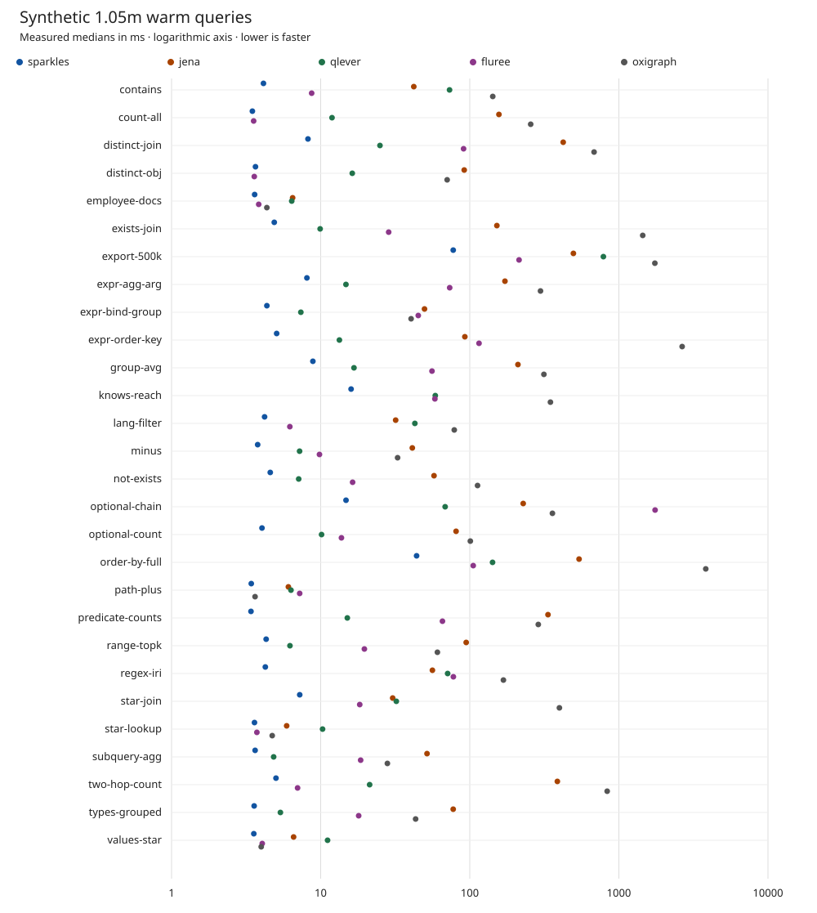
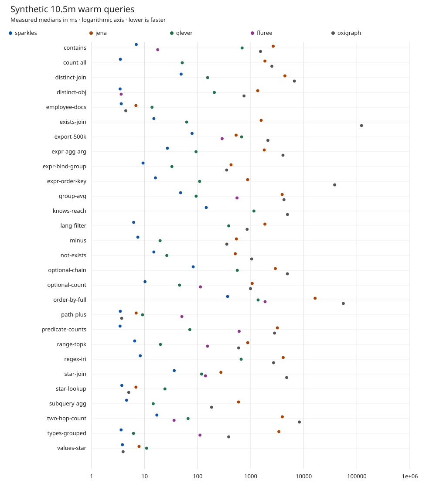

# Synthetic query records

This report and its charts are generated by `scripts/bench-docs.py` from the
explicit selections in [report.json](report.json). It supplements the imported
[manual results](RESULTS.md). It reports medians from retained samples, while the
manual report uses means and other statistics under its stated contracts.

Every table uses one record and one warm-query contract. No samples are pooled
across records, and these historical builds are not measurements of the current
checkout. Only successful results with an agreeing answer fingerprint are plotted.
Agreement is a majority screening rule, not an independent correctness proof.
Failed, missing and unqualified results remain visible without a latency value.
Untimed answer checks retain their status without becoming warm latency samples.
For `export-500k`, LIMIT without ORDER BY permits different rows, so agreement
checks only the row count. Other query checks use the retained value fingerprints.
No speedup, winner count or significance claim is inferred from these tables.

## 1.05m

Raw record: [2026-10-23-synthetic-1.05m-forge.json](../2026-10-23-synthetic-1.05m-forge.json).

Run ID: `sha256-ff48d84d4653c833e71917dfcde32c0e3ce4bfc6ffffb03d9783f259dfea5884`.

Host `forge`, 13th Gen Intel(R) Core(TM) i5-13500, kernel
`6.18.53`. Memory limit `12G`.
Sparkles binary revision `6699f27d`, harness revision
`e133a8069f69d64f75d6468dbcef46832a9d7389`. Timer `hyperfine+curl`,
2 warm-ups and 10 measured requests,
1 client, result cache off. The source manifest carries
the dataset checksums and full binary identities.

| Engine | Version | Measurement origin |
|---|---|---|
| sparkles | sparkles 0.1.0 | Measured from `2026-10-23T04:44:01Z` to `2026-10-23T05:50:18Z`. |
| jena | Apache Jena Fuseki version 5.1.0 | Carried over from `2026-10-18T19:37:09Z` to `2026-10-18T20:22:19Z`. |
| qlever | 0.5.48 | Carried over from `2026-10-18T19:37:09Z` to `2026-10-18T20:22:19Z`. |
| fluree | fluree 4.2.2 | Carried over from `2026-10-18T19:37:09Z` to `2026-10-18T20:22:19Z`. |
| oxigraph | oxigraph 0.5.11 | Carried over from `2026-10-18T19:37:09Z` to `2026-10-18T20:22:19Z`. |

The latency values below are recomputed medians in milliseconds. Warm read
results carry no write durability claim. Write comparisons require their own
synchronization contract.

| Query | sparkles | jena | qlever | fluree | oxigraph |
|---|---:|---:|---:|---:|---:|
| contains | 4.133 | 42.124 | 73.161 | 8.701 | 142.597 |
| count-all | 3.483 | 156.882 | 11.915 | 3.552 | 256.185 |
| distinct-join | 8.217 | 423.205 | 24.987 | 90.868 | 681.890 |
| distinct-obj | 3.654 | 91.774 | 16.288 | 3.587 | 70.517 |
| employee-docs | 3.607 | 6.485 | 6.395 | 3.841 | 4.356 |
| exists-join | 4.884 | 151.961 | 9.917 | 28.580 | 1445.279 |
| export-500k | 77.447 | 495.410 | 787.377 | 214.040 | 1743.359 |
| expr-agg-arg | 8.085 | 172.175 | 14.775 | 73.331 | 298.108 |
| expr-bind-group | 4.357 | 49.701 | 7.364 | 45.139 | 40.412 |
| expr-order-key | 5.067 | 92.685 | 13.352 | 115.347 | 2656.753 |
| group-avg | 8.866 | 210.411 | 16.724 | 55.802 | 314.171 |
| knows-reach | 15.997 | error | 58.710 | 58.338 | 347.518 |
| lang-filter | 4.205 | 31.834 | 42.829 | 6.212 | 78.705 |
| minus | 3.779 | 41.174 | 7.222 | 9.815 | 32.807 |
| not-exists | 4.591 | 57.564 | 7.122 | 16.375 | 112.752 |
| optional-chain | 14.791 | 228.178 | 68.363 | 1749.456 | 358.356 |
| optional-count | 4.041 | 80.935 | 10.138 | 13.782 | 100.870 |
| order-by-full | 43.989 | 540.795 | 142.144 | 105.483 | 3826.047 |
| path-plus | 3.424 | 6.074 | 6.322 | 7.232 | 3.631 |
| predicate-counts | 3.409 | 334.669 | 15.091 | 65.582 | 288.087 |
| range-topk | 4.308 | 94.596 | 6.223 | 19.640 | 60.662 |
| regex-iri | 4.254 | 56.162 | 71.048 | 77.635 | 168.125 |
| star-join | 7.236 | 30.405 | 32.161 | 18.281 | 399.171 |
| star-lookup | 3.598 | 5.914 | 10.296 | 3.734 | 4.732 |
| subquery-agg | 3.634 | 51.674 | 4.837 | 18.537 | 28.018 |
| two-hop-count | 5.015 | 386.714 | 21.298 | 7.000 | 834.739 |
| types-grouped | 3.580 | 77.413 | 5.369 | 17.983 | 43.335 |
| values-star | 3.561 | 6.582 | 11.123 | 4.056 | 3.992 |

## 10.5m

Raw record: [2026-10-23-synthetic-10.5m-forge.json](../2026-10-23-synthetic-10.5m-forge.json).

Run ID: `sha256-814597a4e8520ffa9ca5101f6e365135a8b2b3dd2d26199454d019802dbf3a18`.

Host `forge`, 13th Gen Intel(R) Core(TM) i5-13500, kernel
`6.18.53`. Memory limit `12G`.
Sparkles binary revision `6699f27d`, harness revision
`e133a8069f69d64f75d6468dbcef46832a9d7389`. Timer `hyperfine+curl`,
2 warm-ups and 10 measured requests,
1 client, result cache off. The source manifest carries
the dataset checksums and full binary identities.

| Engine | Version | Measurement origin |
|---|---|---|
| sparkles | sparkles 0.1.0 | Measured from `2026-10-23T04:45:37Z` to `2026-10-23T05:52:26Z`. |
| jena | Apache Jena Fuseki version 5.1.0 | Carried over from `2026-10-18T23:59:44Z` to `2026-10-19T05:23:43Z`. |
| qlever | 0.5.48 | Carried over from `2026-10-18T23:59:44Z` to `2026-10-19T05:23:43Z`. |
| fluree | fluree 4.2.2 | Carried over from `2026-10-18T23:59:44Z` to `2026-10-19T05:23:43Z`. |
| oxigraph | oxigraph 0.5.11 | Carried over from `2026-10-18T23:59:44Z` to `2026-10-19T05:23:43Z`. |

The latency values below are recomputed medians in milliseconds. Warm read
results carry no write durability claim. Write comparisons require their own
synchronization contract.

| Query | sparkles | jena | qlever | fluree | oxigraph |
|---|---:|---:|---:|---:|---:|
| contains | 6.946 | 2655.333 | 688.868 | 17.672 | 1530.649 |
| count-all | 3.492 | 1853.249 | 51.176 | error | 2507.657 |
| distinct-join | 48.804 | 4412.914 | 154.232 | answer unqualified | 6663.829 |
| distinct-obj | 3.448 | 1358.180 | 206.187 | 3.615 | 747.976 |
| employee-docs | 3.625 | 6.868 | 13.803 | answer unqualified | 4.420 |
| exists-join | 14.948 | 1576.053 | 62.025 | answer unqualified | 122804.524 |
| export-500k | 78.344 | 530.702 | 673.768 | 289.175 | 2110.887 |
| expr-agg-arg | 26.869 | 1799.763 | 93.143 | answer unqualified | 4057.375 |
| expr-bind-group | 9.335 | 426.003 | 32.684 | answer unqualified | 352.084 |
| expr-order-key | 15.989 | 874.854 | 108.829 | answer unqualified | 38246.607 |
| group-avg | 47.688 | 3915.762 | 93.462 | 551.711 | 4237.172 |
| knows-reach | 145.219 | error | 1150.348 | answer unqualified | 4940.412 |
| lang-filter | 6.221 | 1852.903 | 385.133 | answer unqualified | 855.585 |
| minus | 7.458 | 537.729 | 19.561 | answer unqualified | 354.445 |
| not-exists | 14.938 | 511.701 | 26.236 | answer unqualified | 1043.524 |
| optional-chain | 82.343 | 2910.042 | 558.856 | error | 4916.376 |
| optional-count | 10.184 | 1065.507 | 45.586 | 112.894 | 992.386 |
| order-by-full | 366.793 | 16346.286 | 1379.604 | 1865.403 | 55680.625 |
| path-plus | 3.479 | 6.921 | 9.145 | 50.407 | 3.708 |
| predicate-counts | 3.442 | 3178.941 | 71.125 | 605.588 | 2813.701 |
| range-topk | 6.496 | 880.721 | 19.887 | 153.106 | 593.423 |
| regex-iri | 8.277 | 4092.745 | 660.668 | answer unqualified | 2699.083 |
| star-join | 36.107 | 274.510 | 118.726 | 140.153 | 4770.218 |
| star-lookup | 3.718 | 6.862 | 24.166 | answer unqualified | 5.021 |
| subquery-agg | 4.566 | 589.865 | 14.527 | answer unqualified | 183.177 |
| two-hop-count | 17.008 | 3944.735 | 65.879 | 35.910 | 8282.131 |
| types-grouped | 3.606 | 3399.132 | 6.161 | 110.596 | 384.861 |
| values-star | 3.818 | 7.863 | 10.913 | answer unqualified | 3.929 |
