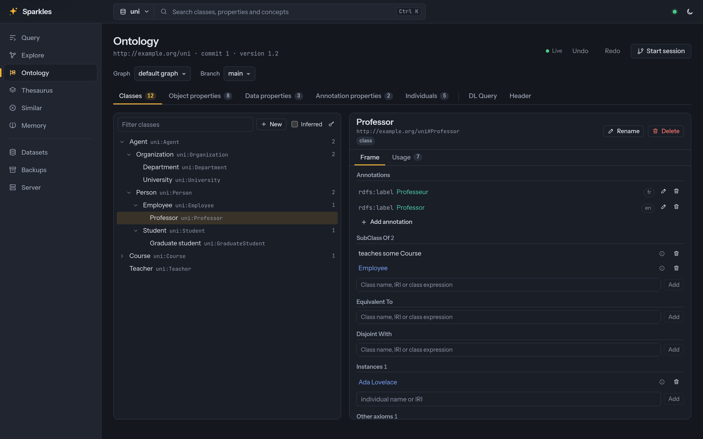
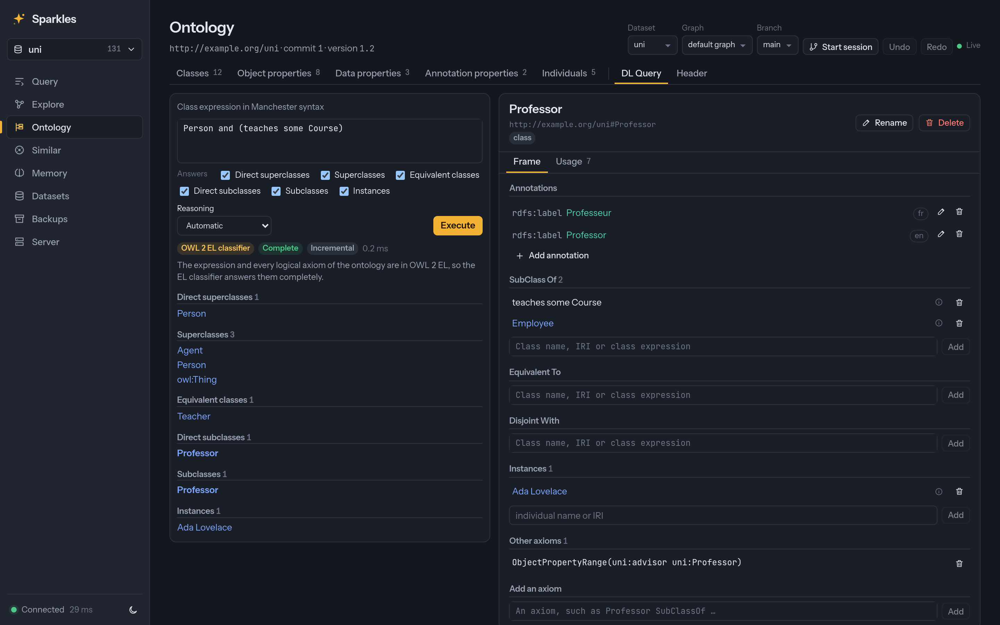
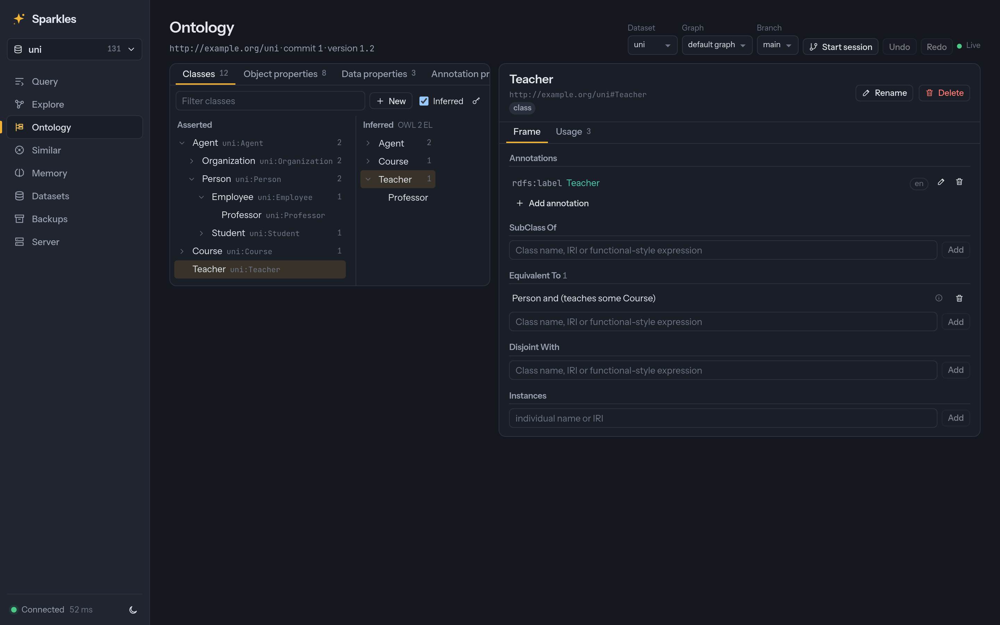
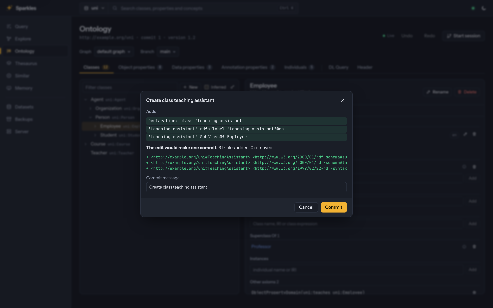

# Reasoning and validation capabilities

This page describes the available capabilities and their current limits. The
[capability matrix](../FEATURES.md#capability-status) records delivery status within
each stated scope.

## Reasoning, validation and schema

Inferences are materialized and kept current or derived on demand, shapes validate on
request or on every write, and the schema report counts what the data holds.

### Reasoning

* RDFS, OWL 2 RL and Jena rule syntax materialize through `sparkles-reasoner`,
  `/$/reason` and `sparkles infer`. The rules read their input graphs from the
  compressed indexes, so a run's memory follows the facts it derives. LUBM(1000) under
  RDFS, 138 million triples, materializes in 91 s at 15.2 GiB of RSS on 16 cores
  ([F16](../specs/F16-materialization-at-scale.md#outcome), [BENCHMARKS.md](../BENCHMARKS.md)).
* The `owl-rl` profile covers the rules of the OWL 2 RL/RDF tables of OWL 2 Profiles
  §4.3, and a test checks each one ([F23](../specs/F23-reasoner-core/SPEC.md#outcome)).
  Rules whose conclusion is `false` are reported by the inconsistency checks below
  rather than materialized. The profile leaves out four rules. `eq-ref` would make every
  term `owl:sameAs` itself, `dt-type2` would type every literal, and `dt-eq` and `dt-diff`
  would relate every pair of literals with equal values and with different values. Literal types are read where a rule needs them, as
  `owl:someValuesFrom` with a datatype does. Property chains have rules for 2 and 3
  properties and keys for 1 and 2, because each longer rule adds thousands of rules to
  the demand programs of query-time reasoning.
* The materialized closure is checked triple for triple against Nemo, a Datalog engine
  that runs the OWL 2 RL/RDF rules written from the recommendation. The closures are equal
  on LUBM, OWL2Bench and the W3C OWL 2 RL test cases, and the
  [reasoning benchmark](../benchmarks/reasoning/README.md#the-owl-2-rl-reference)
  describes the comparison.
* Materialization closes transitive relations, `rdfs:subClassOf`, `rdfs:subPropertyOf`
  and `owl:sameAs` with closure operators instead of joins. An operator condenses the
  relation's strongly connected components and works out each component's reachable
  set once, and `owl:sameAs` closes its classes with union-find. OWL2Bench with 5
  universities materializes under OWL 2 RL in 44 s at 9.5 GiB of RSS, and with 2 in 5 s
  instead of 53 s ([results](../benchmarks/reasoning/RESULTS.md#owl2bench)). The rules stay in the
  program, so explanations and incremental maintenance still name them, and a run
  derives the same facts as one that evaluates them as joins. A program with a rule that
  is not monotonic, or one that reads lists and builds them in a rule head, evaluates
  every rule as a join. A run whose rules read lists and derive list facts through a
  property, such as a subproperty of `rdf:first`, starts again without the operators.
* Each iteration merges its results in parallel on a reasoning pool, half the cores by
  default with `serve --reason-threads`, that admits runs in arrival order. A run stops at
  50 million derived triples by default, and `sparkles infer --max-inferred`,
  `serve --reason-max-inferred`, a request's `maxInferred` and the bindings change the
  limit. A run past the limit fails with the code `inferred-limit` and commits nothing.
  `ReasonOptions::max_memory` bounds the estimated heap of the whole run.
* Any later run, whether a re-run, an automatic run or `sparkles infer`, updates the
  previous materialization incrementally with the backward/forward algorithm and writes
  what a full run would. A run is full when rules are not monotonic or create blank nodes,
  when deletions are large, or when the set of input graphs changed. A deletion also runs
  in full when its maintenance passes an allowance set by the size of the closure, which
  approximates the cost of a full run. The allowance is four matched rule instances for
  each fact of the closure and as much memory beyond what the run held when the deletion
  started as the closure's own heap, with floors of about a million instances and 64 MiB.
  The maintenance compares its count and the run's charges with the allowance every 1,024
  instances, so it can pass the allowance by a few batches before it stops. The kept
  closure holds only the derived facts, which takes 41% to 47% of the memory of a closure
  with the explicit facts on LUBM-style data.
* A materialization reads the default graph unless data and ontology graphs are named,
  and follows `owl:imports` to graphs of the dataset through a Jena-style location
  mapping ([API.md](../API.md#input-graphs-and-imports)). With `imports: fetch`, missing
  imports are loaded into the graph of the import IRI, so later runs work offline.
* RDFS on read matches Fuseki's `--rdfs` and Jena's `ja:DatasetRDFS`
  ([API.md](../API.md#rdfs-on-read)). Queries see the RDFS closure of each graph against a
  schema graph by rewriting the query, and the answers equal Jena 6.2's on 55 fixture
  queries. `/$/rdfs/{ds}`, `serve --rdfs` and `query --rdfs` turn it on.
* Query-time reasoning with `reasoning=demand` derives the facts a query's patterns need
  as it runs, from RDFS, RDFS simple, OWL 2 RL or a Jena rule file, without the inferred
  graph ([API.md](../API.md#query-time-reasoning), [F17](../specs/F17-query-time-reasoning.md#outcome)).
  Jena backward rules answer this way. A demand transformation starts from the query's
  constants and bindings and specializes schema relations proven complete. Schema facts
  can follow from derived instance facts, including class and property declarations and
  equality between schema terms. Programs containing `makeTemp` run in one ordinary
  demand program with their normal lower stages. Derived tables are cached per snapshot
  and view, and `maxDerived`, the deadline and the memory budget bound them. Tables that
  contain generated blank nodes are not cached. A tiny positive feedback view whose
  schema expansion creates thousands of rules can use a bounded temporary closure of
  the original rules. This retains intermediate facts within the session and uses the
  same resource limits. EXPLAIN shows a `Derive` node per pattern.
* Demand tables share a process-wide retained-table estimate budget. The global
  `--derived-table-cache-mb` flag sets it to 256 MiB by default in both memory profiles,
  and zero disables retention. Library callers use `sparkles_reasoner::tables::set_capacity`
  and read a coherent report with `tables::snapshot`. Operators with the metrics
  permission see `derivedTableCache` in `/$/stats` and `caches.derivedTable` in
  `/$/server/memory`, with capacity, estimated bytes, table count, hits and misses.
  A shared chunk counts for each cached table retaining it. A query may keep a table
  alive after eviction, so retained-cache estimates are not allocator usage or RSS.
  The estimator counts 24 bytes per fact, 64 bytes per chunk, each local term's
  byte length plus 40 bytes, and 64 bytes per table. It omits spare vector capacity,
  cache-key strings, hash-table capacity and exact allocator metadata. Measuring and
  calibrating these allowances is planned. Roadmap item 757.
  Derivation and replay still use the query's own memory budget, and the host-derived
  query pool leaves out this configured cache beside the storage caches.
* The library names the reasoning of a query with `sparkles::reasoning::ReasoningMode`,
  which is `Off`, `Materialized`, `Demand` with a profile and a limit, or `Auto`.
  `Dataset::inference_view` turns a mode into an `InferenceView`, which gives the query
  options that read the selected data, the inferred data that incremental views read and
  the source of an explanation. A mode is read from the `reasoning` parameter of the HTTP
  endpoints, the `--reasoning` flag of `sparkles query` and the `reasoning` argument of
  the MCP tools. `Auto` is refused until a cost-based choice exists.
* `POST /$/reason/{ds}/explain` returns derivation trees from materialized inferences,
  RDFS on read or the demand engine ([API.md](../API.md#explanations),
  [F18](../specs/F18-explanations-and-entailment-diffs.md#outcome)). A tree has well-founded
  premises, the rule's variable bindings and passed builtins. Generalized intermediate
  facts and default geometries are explained, and a bounded partial tree marks premises
  that could not be expanded. RDFS-on-read trees can include materialized derivations.
  Schema builds honor cancellation and the deadline.
* The same explanation route accepts `mode: "whyNot"`. It lists candidate rules,
  conditions that block them and small sets of missing facts, with a verified derivation
  under each hypothesis. Fresh blank-node placeholders stand for missing resources.
  `complete` reports whether the bounded search exhausted its candidates. The CLI,
  library, MCP, Python and Node bindings expose both modes, and Explore has a Why-not
  form beside a resource's properties.
* Why-not hypotheses report whether their missing facts introduce a new inconsistency.
  An unfinished check remains unknown. Existing unrelated findings are excluded.
* Entailment diffs compare branch heads or retained commits under one program, with
  complete counts, bounded samples, predicate and class counts, and new findings.
  JSON write and merge previews can include reasoning changes over the complete
  candidate. Merge and review pages display them ([API.md](../API.md#entailment-diffs)).
* Minimal justifications list asserted facts and their schema or assertion role for
  inconsistency findings and unsatisfiable classes. Alternative supports share bounded
  oracle checks. Diagnostics can attach a first support to each finding, and the UI
  previews a selected support fact's removal on a new branch before explicit application
  ([API.md](../API.md#minimal-justifications)).
* A materialization can keep witnesses for each fact of its closure: up to a bound of
  sets of input quads, each of which derives the fact, and whether others may exist
  ([F18](../specs/F18-explanations-and-entailment-diffs.md#reasoner-witnesses-item-416)).
  `ReasonOptions::witnesses` sets the bound, and incremental runs maintain them, deletions
  included. A fact that is not truncated keeps exactly its minimal supports. They live
  with the closure kept in memory, where `Cache::witnesses` and
  `Cache::witness_dependents` read them, and they are off by default, so a run without
  them does no work for them. Turning them on costs memory and time. At a bound of 8,
LUBM with 10 universities took about ten times as long to materialize under RDFS and
about forty times as long under OWL 2 RL, and the witnesses held 574 MiB and 1.75 GiB
([results](../benchmarks/reasoning/RESULTS.md#reasoner-witnesses)).
* Sparkles records the commit at which inferences were made, and only a later change to a
  graph the run read makes them stale. Freshness is reported by `GET /$/reason/{ds}`,
  dataset info, `/$/stats` and the `Sparkles-Inferences` header. Automatic re-runs are
  opt-in with `serve --auto-reason` or `PUT /$/reason/{ds}/auto`.
* `GET /$/reason/{ds}/diagnostics` and `sparkles infer --check` run 17 inconsistency
  checks that cover every OWL 2 RL rule with a `false` conclusion, in JSON or Turtle.
  `literal-not-in-datatype` finds ill-typed literals for the datatypes whose value spaces
  it can decide. The checks never prove consistency.

### SHACL

* `sparkles-shacl` validates SHACL Core and SHACL-SPARQL in parallel over the indexes.
* Sparkles checks a shapes graph before it runs, through `sparkles lint`, `POST /$/lint`,
  the MCP `lint` tool and the shapes editor. It lints the SPARQL in `sh:select`, `sh:ask`,
  `sh:construct` and `sh:update` literals with the prefixes of `sh:prefixes` and
  `sh:declare` and with SHACL's pre-bound variables, such as `$this`, `$value` and
  `$currentShape`, counted as bound. A finding is placed inside the literal. Turtle,
  TriG, JSON-LD and SHACL Compact Syntax shapes are all linted, and the compact syntax
  has no syntax for these literals ([USAGE.md](../USAGE.md#linting)).
* SHACL 1.2 support covers `sh:targetWhere`, the list constraints `sh:memberShape`,
  `sh:minListLength`, `sh:maxListLength` and `sh:uniqueMembers` with `sh:detail` results,
  and node expressions in the Working Group's `shnex:` vocabulary. Node expressions work as
  targets, constraint parameters, `sh:deactivated`, `sh:values` and `sh:defaultValue`,
  and as constraints.
* Fuseki's `/{ds}/shacl` endpoint, with `graph=default|union|<iri>`, and `sparkles shacl`
  return the report as Turtle, N-Triples, JSON-LD or JSON. Validation covers the data and
  the inferences.
* The SHACL Compact Syntax, `text/shaclc`, works wherever shapes are read or drafted
  ([API.md](../API.md#shacl-compact-syntax-shaclc)). That includes `/{ds}/shacl`,
  write-time validation, the CLI, the MCP tools `validate_shacl` and `draft_shapes`, the
  Python bindings and the UI's shapes editor. `sparkles shacl parse` converts shapes files
  between SHACLC and the RDF syntaxes, and the writer refuses a graph that SHACLC cannot
  express and names the triples.

### ShEx

* `sparkles-shex` validates ShEx 2.2 with the `shex` cargo feature, which is on by default
  ([API.md](../API.md#shex-validation)). Schemas can be ShExC, ShExJ or ShExR, and ShExR can
  be in any RDF syntax Sparkles reads. `EXTENDS` and `ABSTRACT` are supported.
* Imports can be inline, files under `--load-dir`, or http(s) URLs fetched through the
  outbound policy. `EXTERNAL` shapes, annotations and the Test semantic-action extension
  are supported.
* Shape maps can be compact or JSON, with `{FOCUS p o}` selectors and
  `SPARQL """SELECT …"""` selectors that run within the query budgets and without
  SERVICE. Recursion and negation use stratified greatest-fixed-point typing without deep
  stacks.
* `POST /{ds}/shex` returns JSON, ShapeMap JSON, compact or text reports.
  `sparkles shex validate|parse` accepts Jena's flag names, and `parse --out shexr`
  writes Turtle.

### OWL 2 ontologies

* `sparkles-owl` holds the OWL 2 structural model of entities, class and property
  expressions, data ranges, axioms, annotations and the ontology header. It reads the
  model from triples by the reverse mapping of the OWL 2 Mapping to RDF Graphs and writes
  it back by the forward mapping. Its functional-style writer renders axioms and
  documents, and its functional-style reader reads them. The `ontology` cargo feature,
  which is on by default in the server, builds it into the library and the server.
* An OWL 2 functional-style document loads as the triples its axioms map to, one axiom
  at a time. A `.ofn` file, compressed or not, is read by `sparkles load`,
  `sparkles ontology check FILE`, the library's and the bindings' file loaders, SPARQL
  `LOAD` and the configuration's data files. Graph Store writes and uploads also read a
  body sent as `text/owl-functional`. The predefined prefixes `owl:`, `rdf:`, `rdfs:` and
  `xsd:` need no declaration, and a literal typed `rdf:PlainLiteral` reads as the plain or
  language-tagged literal it stands for. A syntax error names the file, the line and the
  column. The document is held in memory while it is read. Sparkles does not write the
  syntax as a dataset dump, and the axiom listings render it.
* A read takes the graphs a caller names, the default graph unless told otherwise, and
  follows `owl:imports` to graphs of the dataset that the caller can read. A strict read
  keeps every triple the mapping does not cover as unmapped and refuses shared list
  cells. A lenient read, the default, also types undeclared entities from their use and
  records each guess as a diagnostic. Triples that map to no axiom are counted and
  listed, never dropped silently.
* The profile checks test the OWL 2 DL structural restrictions and the grammars of
  OWL 2 EL, QL and RL. Each violation names its rule and section in the recommendations
  and the axiom it concerns. A report on a profile also lists the DL violations, since
  each profile is a subset of OWL 2 DL. The checks cover the assertions the store holds
  unless the caller leaves them out.
* The DL check, and so every profile report, also checks literals. A literal of a
  datatype in the OWL 2 datatype map needs a lexical form of that datatype, such as an
  `xsd:byte` from -128 to 127 or an `owl:rational` such as `1/3`, and no literal can be
  of type `owl:real` or of a datatype that a datatype definition introduces. XML
  literals require balanced content with QName components, scoped namespace bindings
  and unique expanded attribute names. Normalized namespace names must be URI
  references, with relative references accepted and their spelling preserved. The
  check retains noncanonical spellings. Full XML canonical lexical and value semantics
  are not implemented. Roadmap item 663. Namespace
  checking uses scratch proportional to active declarations, element depth and the
  current tag's attributes, including decoded namespace strings. The standalone
  lexical checker does not charge this scratch to a caller-provided memory budget.
  A datatype restriction can use only the facets its datatype supports, with values in the value
  space each facet takes, a pattern that parses as an XML Schema regular expression and
  a language range of RFC 4647. Annotation literals and the annotations of the headers
  of the ontology and its imports are checked as well. An edit can still write an ill-typed literal, and a check reports it.
* Entity accessors answer what an ontology says about an entity: its kinds, labels and
  annotations, the superclasses, subclasses, equivalent and disjoint classes and keys of
  a class, the domains, ranges, hierarchy, inverses and characteristics of a property,
  and the types and property assertions of an individual. The instances of a class and
  the assertions about an individual stream from the store, through its indexes, since a
  read keeps assertions out of memory. Rust has them as methods of the read ontology and
  of the open handle, and the HTTP routes and the bindings answer them as one entity
  report.
* An edit adds and removes axioms in one commit. Added axioms declare the entities they
  use unless the caller turns this off. A removal deletes the axiom's triples and the
  anonymous structures it alone uses, and keeps any structure that another axiom or
  triple still refers to. A removal deletes only the declarations it names, and
  `remove_entity` names an entity's declarations, its axioms and the assertions about it.
* A read with `inferences` also reads the materialized inferences while the dataset
  records a materialization, so that an axiom listing about an entity includes the
  materialized closure, such as the transitive superclasses of a class. The answer names
  the materialization's profile and says whether it is stale, as the
  `Sparkles-Inferences` header does for a query. Without a materialization the read
  covers the asserted axioms and says so, and it never runs the reasoner. The inferred
  graph holds the inferences of every input of the run, so such a read also includes
  what the run derived from other graphs. Edits and diffs read the asserted axioms only.
* A materialization under `owl-rl` warns when its input graphs hold axioms outside the
  OWL 2 RL grammar, with their count and the first of them, since the OWL 2 RL rules are
  complete only for ontologies in the profile. It also warns about axioms in OWL 2 RL
  whose rule the rule set covers only up to a size, property chains of more than three
  properties and keys of more than two, which
  `crates/sparkles-reasoner/rules/owl-rl.gaps` lists beside the rules. The warnings
  appear in the run's report, the reasoning record and the output of `sparkles infer`.
  The check reads the terminology of the inputs in the state the run reads, once the run
  holds the writer lock, with the imports that resolve to graphs of the dataset.
* `sparkles_owl::profiles::partition` splits an ontology's axioms by one profile's
  grammar, without the OWL 2 DL global restrictions. It is the OWL 2 QL check that
  query-time OWL 2 QL rewriting is to use, and the RL warning uses it too.
* `sparkles_owl::classify` classifies an ontology by OWL 2 EL with a consequence-based
  calculus in the manner of ELK. It reads the axiom model only, saturates its contexts
  on several threads and computes the class taxonomy: the classes grouped into
  equivalence classes, their direct superclasses and the unsatisfiable classes. It
  covers OWL 2 EL, with intersections, existential restrictions, `owl:Thing` and
  `owl:Nothing`, individuals in class expressions and assertions, the property
  hierarchy with the top and bottom properties, property chains, transitive and
  reflexive properties, domains, ranges, disjointness, `ObjectHasSelf`, the datatypes,
  literals and data ranges of the profile, functional data properties, datatype
  definitions, keys and negative property assertions. A class whose instances reach an
  individual through a context that holds only where the class has an instance is
  classified again in a world of its own. An ontology where only an individual's own
  context derives the individual, and that has no keys or universal roles, skips that
  step, and so does every ontology without individuals. In an ontology without
  individuals, functional data properties or top properties, the Horn rules of Kazakov's
  calculus for Horn-SHIQ take the Horn axioms outside OWL 2 EL: inverse properties,
  universal restrictions, at-most-one and at-least restrictions, functional and
  inverse-functional properties, disjoint, asymmetric and irreflexive properties and
  complements that move to the other side as their duals. Universal and at-most
  restrictions create contexts for conjunctions of classes, which OWL 2 RL and QL
  ontologies never need, so these stay polynomial. A run with the Horn rules has a
  memory budget of 64 times its index and axioms, at least 1 GiB and no more than the
  caller's. A run that passes it classifies again by the EL rules alone, leaves the Horn
  axioms out and reports them, and sets `Stats::horn_over_budget`. No ontology measured
  reaches it, since a run composes only the property chains that a negative existential
  restriction needs and unfolds the others by their automata. In an ontology
  without individuals, data properties, self restrictions, reflexive properties or top
  properties, axioms that need case analysis, such as unions, complements and universal
  restrictions on the left, take the disjunctive rules of the consequence-based calculus
  for ALCHI, with transitive properties and chains through the same automata. Each
  context keeps clauses under one total order of literals, and a named subsumer that only
  a case analysis gives is found by a test context for the class with the candidate's
  complement. `Limits::expansion` chooses the cautious or the eager successor strategy,
  which give the same answers. These runs share the Horn rules' memory budget, and a run
  that passes it classifies again by the Horn rules, leaves the disjunctive axioms out and
  reports them, and sets `Stats::dl_over_budget`. With `Limits::partial`, a run of the
  disjunctive rules that its deadline, cancellation or memory budget stops returns the
  subsumptions it proved, with `Classification::complete` false, the classes it may have
  left incomplete in `incomplete`, and a consistency of consistent, inconsistent or
  unknown, which leaves every class incomplete when unknown. The same rules can count, but
  counting is off by default, since it finishes on none of the ORE 2015 DL development
  files and only delays their answer. `Limits::counting` turns it on. Roadmap item 894.
  Number restrictions, functional and inverse functional properties, disjoint properties
  and asymmetric properties then take equalities of successors, and a run that counts has
  a bound of 262,144 derived conclusions, `Limits::dl_work`. Without it those axioms are
  left out and reported. A run that passes it classifies
  again without counting, leaves the axioms that need counting out and reports them, and
  sets `Stats::dl_counting_over` and `Stats::dl_over_budget`. Near the bound the thread
  schedule can decide whether a run answers in full or falls back, and the fallback is
  always reported and never a different complete answer. Roadmap item 727. In an
  ontology with individuals or nominals, `Limits::rooted` lets the disjunctive rules take
  nominals, class and property assertions, equalities and inequalities of individuals and
  negative assertions through a root context where the individuals' facts meet, with the
  four departures from the published calculus that F24 records. It is off by default,
  since the completeness of the departed calculus is not proved, and every answer it gives
  is entailed. A rooted run without counting has a bound of 524,288 derived conclusions,
  `Limits::dl_work`, past which it classifies again without the rooted rules, gives the
  default answer and sets `Stats::dl_rooted_over` and `Stats::dl_over_budget`. It refuses
  an ontology with keys, a top property or a functional data property, which take the
  default paths. Roadmap items 805, 822 and 823. Without the option, any other axiom
  outside OWL 2 EL that needs case analysis, such as a union, is left out and reported
  with its rule, while the Horn axioms run with the individuals. An axiom with a literal
  or datatype that the classifier cannot compare, such as an XML literal, an ill-typed
  literal or a datatype outside the OWL 2 datatype map, or with a property chain through
  the top object property, is used as far as the calculus goes and reported as partial.
  Every answer is entailed, and it is complete for named classes when nothing is reported.
  For eligible EL additions and removals, the classifier keeps its contexts and saturates
  again only those the changes can reach. Horn and disjunctive classifications rebuild
  after edits. Their incremental maintenance is planned. Roadmap item 753 under item 603.
  A change to the property hierarchy, chains, reflexivity or ranges, to an axiom
  with an individual, a data property, a datatype or a key, and any change after a run
  that took that step or an axiom outside OWL 2 EL, saturates everything again. A run stops at its deadline, its
  memory budget or a cancellation, which it checks while it indexes, builds the property
  closure, saturates and builds the taxonomy. Integer, decimal and rational literals
  use exact arbitrary-precision values, so equal reduced fractions and equivalent
  spellings compare equally beyond 128 bits. Numeric construction polls these controls
  and admits scratch and overlapping copies before growth. Large values share immutable
  storage that remains counted until the last alias drops. A numeric memory,
  cancellation or deadline refusal is returned as a typed error through the Horn and
  DL paths, rather than making the value opaque or reporting a completed fallback.
  XML namespace validation retains lexical spellings and does not establish canonical
  XML value equality. Its standalone scratch is not charged by the numeric budget.
  Full XML semantics and shared hierarchical ownership remain open. Roadmap items 663
  and 675.
  `Stats::memory` recounts retained index
  and context storage when saturation ends, using the same estimates for fresh and
  unchanged reused state. This adds a traversal of the retained tables. The final
  estimate can differ from the allowances charged as conclusions arrive, while the
  saturation peak remains in `Stats::peak_memory`. Any final growth past that peak
  must fit the hard budget and the pool before the run returns. These are heap
  estimates, not allocator measurements or RSS. A run of 16,384 axioms or more on several
  threads normalizes chunks of the axioms in parallel, with the same ids and taxonomy as
  on one thread. The chunks hold the names they meet until they merge and count against
  the memory budget, and a run whose chunks would pass it normalizes on one thread. This
  and the saturation's message buffers raise the peak resident set on eight threads by
  up to 13% on some ontologies in exchange for the speed. On the benchmark host GO
  classifies in 91 ms and ChEBI lite in 0.39 seconds on eight threads, and the
  classifier is 3.1 to 20 times as fast as ELK on GO, ChEBI lite and the largest ORE
  2015 EL ontologies on one and eight threads. GO's `InverseObjectProperties(part_of
  has_part)` takes the Horn rules, which add the 14 subsumptions that Konclude and HermiT
  entail and ELK misses and make GO 12% slower to classify on one thread than with the EL
  rules alone. Roadmap item 693. The classifier's direct hierarchy of GO is the one GO's
  release publishes with those 7 direct edges added, and its taxonomy of ChEBI entails
  every subsumption ChEBI asserts and gives no direct subsumption that ChEBI does not
  assert ([results](../benchmarks/el-classification/RESULTS.md)).
* `ds.ontology().classify()`, `POST /$/ontology/{ds}/classify`, `sparkles ontology
  classify` and the bindings' `classify` run it on an open ontology. The answer says
  whether the ontology is consistent and complete and lists the unsatisfiable classes,
  the excluded axioms, one class's place in the hierarchy and the taxonomy's nodes. A
  run with `target` writes the taxonomy to a named graph in one commit, replaces the
  taxonomy that graph held, and records PROV-O provenance on the graph's ontology
  header. The dataset keeps its last classification of an ontology for callers who read
  every graph, so a compatible same-commit call can reuse a retained result. At a later
  commit, eligible EL additions and removals reuse affected contexts. Horn and
  disjunctive runs rebuild after edits, and affected-module reuse is planned. Roadmap
  item 753 under item 603. Finer invalidation for EL individual, merge, key and world
  changes is open. Roadmap item 664. Same-commit reuse is separate from incremental
  reclassification. That kept state holds the classifier's contexts, index
  and taxonomy in memory while the dataset is open and reads the axioms of the open
  ontology in place. It is about 74 MB for GO by the estimate, which a counted heap
  matches, and it trades that memory for fast reclassification. `sparkles ontology classify FILE` classifies a file without a
  database and exits with status 1 when the ontology is inconsistent or has an
  unsatisfiable class.
* A kept classification has an immutable source and completed taxonomy separate from
  the saturation a later DL query can change. `GET /$/ontology/{ds}/classification`,
  Rust `kept_classification`, Python `kept_classification`, Node.js `keptClassification`
  and JVM `keptClassification` read availability and bounded named-class direct parents,
  equivalents and unsatisfiability without classifying on a miss. They preserve the exact
  branch, commit, input/options and producer metadata, distinguish running, mismatch and
  absence, and expose every captured source/import warning through typed pages. Continue
  with the result ID and exact commit. Restricted views and synthetic snapshots do not
  share this cache, and a retained result cannot resurrect pruned history.
  The new JVM read and frame-projection conveniences refuse pinned dataset wrappers
  and active transactions before native work. Use a live dataset with `OntologyRead.at`
  for retained committed history. Wrapper-source integration is open. Roadmap item 588.
* An explicit classify request with `projection: "frame"` returns bounded clause and
  diagnostic samples with totals, outcome and actual source identity. Missing/null
  projection keeps legacy output. False nodes, zero/null offset and null target defaults
  are harmless, while effective nodes, offset, target or OFN output are incompatible.
  An isolated restricted result remains useful but advertises no shared continuation.
  General entity/axiom reads with classification, property/individual entailments and
  justifications are not available. Roadmap items 588, 622 and 609, and F24's later
  phases.
* Retention counts auxiliary source/exclusion metadata and a published taxonomy alongside
  a DL query's newer saturation. Readers and an active replacement can keep an older
  publication alive. This memory tradeoff means the between-run one-gigabyte estimate
  does not cap combined live RSS. Bounded pages limit output/name buffers, not server
  scans or arbitrary scalar sizes. See [API.md](../API.md#ontology) for the read states,
  typed sources, pins and projection selectors.
* Every classification answer gives `tier`, the rules the axioms need, and `consistency`,
  which is `consistent`, `inconsistent` or `unknown`. `partial` on the request, `--partial`
  on the command line and the bindings' `partial` option ask a run of the disjunctive rules
  that its deadline or cancellation stops to answer what it proved. Such an answer has
  `partial` true and `complete` false, lists the classes whose superclasses it may miss
  under `incomplete` and gives every other class its full answer. Its consistency is
  `unknown` when the run stopped before deciding it, and then every class is incomplete.
  After a stopped run, immutable source hashing and response serialization finish over
  its already produced partial result without resuming classification or resetting shared
  cancellation flags. This read-only work can extend the response beyond the compute
  deadline. Completed results and subsequent GET reads retain their cancellation controls.
  The dataset never keeps a partial answer, and a classification that writes its taxonomy
  to a graph, the functional-style answer and the ROBOT-compatible commands refuse or
  ignore `partial`, since none of them can say that the taxonomy is partial. `sparkles
  ontology classify` takes `--timeout SECONDS` for the deadline, prints a note on stderr
  for a partial answer and exits with status 2 when the answer is partial and otherwise
  clean. A usage error also exits with status 2, so a script tells a partial answer apart
  by that note or by `partial: true` in the JSON output. `expansion` picks the cautious
  or the eager strategy of the disjunctive rules, which give the same answer.
* `sparkles ontology classify FILE` and `sparkles ontology check FILE` read a file of one
  graph straight into memory, with no store, and give the answers of a store that loaded
  the file. RDF/XML, Turtle, N-Triples and N3 parse on several threads, and so does a
  functional-style document, whose axioms the read keeps as written. A file that holds
  named graphs, a strict read of a functional-style document and a file whose answer
  depends on what only a store reproduces, such as its own blank node labels, go through
  a store in memory, and so does a file that fails to parse, with the loader's
  error. A functional-style document goes through the store when it has an anonymous
  individual, an undeclared entity or an `ObjectInverseOf` outside a plain property
  assertion, among the other cases that the
  [F24 Outcome](../specs/F24-owl-classification/SPEC.md#outcome) lists. ChEBI lite
  classifies from its functional-style file in 1.13 s on the benchmark host, and the
  reverse mapping of the triples bounds a read of RDF/XML
  ([results](../benchmarks/el-classification/RESULTS.md#file-classification)).
* The Rust handle `ds.ontology()` opens a snapshot's ontology, checks it and edits it,
  and keeps the last four reads of up to two million triples each, keyed by commit, for
  callers who read every graph. `/$/ontology/{ds}` serves the summary, the axioms, the
  checks and edits over HTTP with the caller's grants
  ([API.md](../API.md#ontology)). `sparkles ontology summary|axioms|check|edit` does the
  same for a database directory or a server, and `sparkles ontology check FILE` checks
  an ontology file without a database. The check exits with status 1 when the ontology
  is outside a profile it names.
* `sparkles ontology reason`, `reduce` and `relax` do what ROBOT 1.9.11's commands of the
  same names do in OBO release pipelines, with ROBOT's options, values and defaults.
  `reason` writes the whole ontology with the inferred axioms and, by default, without the
  asserted subclass axioms that are not direct. `reduce` removes the subclass axioms that
  other subclass axioms entail, between named classes and existential restrictions alike,
  and `relax` adds the subclass axioms that equivalences with intersections and
  existential restrictions imply. They read a file with `--input` and no database, as
  `sparkles ontology classify FILE` does, or a database with `--loc`, and write the
  ontology with `--output` as functional-style syntax (`.ofn`), RDF/XML (`.owl`), Turtle
  (`.ttl`) or N-Triples (`.nt`), each optionally gzipped. They chain in one process as
  ROBOT's commands do, as in
  `sparkles ontology reason --input x.owl relax reduce --output y.owl`. `classify` and
  `check` can join a chain to classify or check the ontology at that point, and a chain
  can start from `classify FILE` or `check FILE`, which answer as they do alone. A chain
  from a database starts with `reason`, `reduce`, `relax` or `materialize` and `--loc`.
  Without `--reasoner`, `reason` and `reduce` also take the Horn axioms outside OWL 2 EL,
  such as GO's inverse properties, so `reason` adds the subsumptions they entail.
  `--reasoner ELK`, which `materialize` takes by default as ROBOT's does, and `emr`, which
  ROBOT builds on ELK, run the OWL 2 EL rules alone and leave those axioms out, as ELK
  does, so the output is ROBOT's with ELK. `hermit`, `jfact`, `whelk` and `structural` run
  the default classifier with a warning. The library has the same switch as
  `ClassifyRequest::el_only` and `Limits::el_only`. The queries ELK does not answer, such
  as the disjoint classes and the property hierarchy, add no axioms, as they add none in
  ROBOT. Errors and the exit status 1 follow ROBOT's, and a malformed command line exits
  with status 2, as every `sparkles` command does. With `--reasoner ELK` the outputs equal
  ROBOT's axiom for axiom on GO and ChEBI lite
  ([ROBOT comparison](../benchmarks/el-classification/RESULTS.md#robot)). The commands
  read no `--server`. Roadmap item 685. They write no OWL/XML, Manchester, OBO or OBO
  Graphs JSON. Roadmap item 686. They refuse `--prevent-invalid-references true`. Roadmap
  item 687.
* `sparkles ontology materialize` does what `robot materialize` does. It asserts each
  class's direct superclasses of the form `ObjectSomeValuesFrom(p C)` for the properties
  of `--term` and `--term-file`, together with the direct named superclasses that are not
  asserted, and with no term it takes every object property of the ontology. A term is a
  full IRI or a CURIE with one of the OBO prefixes of ROBOT's default context, such as
  `BFO:0000050`, and a term file holds one a line with `#` comments. A term that is
  neither a URN nor a URL that Java's URL parser accepts, such as an IRI with a malformed
  port, is left out with a warning, as ROBOT leaves it out. A superclass is
  direct in the taxonomy that has a class for each such restriction, so a superclass is
  left out when another superclass of the class, named or a restriction, lies below it.
  The command validates the ontology first, as `reason` does, and takes `--reasoner` as
  `reduce` does, with ELK by default, so it runs the OWL 2 EL rules alone unless another
  reasoner is named. `--create-new-ontology true` adds nothing, because ROBOT's command saves
  the ontology without the axioms it found, and `--remove-redundant-subclass-axioms` and
  `--annotate-inferred-axioms` are accepted and ignored, as ROBOT ignores them. It runs
  from a file or a database and joins a chain, as in
  `sparkles ontology reason --input go.owl materialize --term BFO:0000050 reduce --output y.owl`.
  On GO with part of and ChEBI lite with has role its output equals ROBOT's axiom for
  axiom. The classifier names each restriction by a fresh class equivalent to it, as
  ROBOT's expression materializing reasoner does, but only for the classes that can be
  fillers, so one property takes about as long as `reason`. Each further property holds
  more memory, about 280 MiB on ChEBI lite, where all nine properties take 5,084 MiB of
  peak resident memory against 2,506 MiB for `reason`
  ([materialize results](../benchmarks/el-classification/RESULTS.md#materialize)).
* `sparkles ontology check FILE` reports the profile and the axioms outside it, and
  `sparkles ontology axioms` lists the axioms of a database or a server.
* Python's `Dataset.ontology`, Node.js's `dataset.ontology` and the JVM's
  `DatasetGraphSparkles.ontology()` and `SparklesOnt` run the summary, listing, check,
  edit, entity removal and diff in the JSON forms of the routes
  ([integrations](../integrations/README.md#libraries-and-bindings)). Python's `Axiom`
  is a frozen axiom with structural equality, and Node.js lists axioms as an async
  iterable in batches. `SparklesOnt.model` runs Jena's `jena-ontapi` over a Sparkles
  graph that one native read copies into memory, with writes sent to the graph in the
  caller's transaction.
* `GET /$/ontology/{ds}/search?q=` finds entities by label, synonym, short form and
  definition with typos tolerated, ranked for a typeahead, and the bindings' ontology
  handles call it as `search`. See [entity search](../search/README.md#entity-search) for
  its matching, ranking and index.
* `GET /$/ontology/{ds}/diff?from=&to=` lists the axioms that differ between two
  commits, with the graph of each, as JSON or as `+` and `-` lines. The terminology of
  each state is read as the summary reads it and the two axiom sets are compared. With
  `assertions=true`, the assertions that the triples changed between the commits carry
  are listed too, so an unchanged assertion costs nothing to diff. A diff of two states
  whose graphs did not change opens neither. The diff needs the commits in the dataset's
  retained history and the `diff` endpoint for a caller whose grants limit endpoints.
* The MCP tool `ontology_axioms` lists axioms in functional-style syntax. On a server
  that allows updates it also adds and removes axioms, given in functional-style syntax
  or as JSON, with the preview, `ifHead` precondition and commit message of
  `sparql_update`. Each added axiom is annotated with PROV-O provenance:
  `prov:wasGeneratedBy` the call's activity, `prov:generatedAtTime` and
  `prov:wasDerivedFrom` the source the call names. Annotation assertions describe the
  activity, its principal, its message and the software agent. The PROV-O properties are
  declared as annotation properties, so the ontology stays in OWL 2 DL, and an ontology
  that types them as object or data properties refuses the provenance. Removals are
  recorded by the activity and the commit, since an annotation cannot describe an axiom
  that is gone.
* `sparkles_owl::manchester` reads OWL 2 Manchester syntax against an ontology's
  prefixes, local names and labels. `POST /$/ontology/{ds}/parse` and the bindings'
  `parse` read a class expression, data range, individual, literal or one-line axiom
  with the caller's grants, and a name that several entities share is an error that
  lists them, with the span of the name ([API.md](../API.md#ontology)).
* A DL query answers a class expression's equivalent classes, direct and inferred
  superclasses and subclasses, and instances, as Protégé's DL Query tab does.
  `ds.ontology().dl_query()`, `POST /$/ontology/{ds}/dl-query` and the bindings'
  `dl_query` or `dlQuery` run it. Inside OWL 2 EL it adds the expression as a fresh
  class to the dataset's kept classification, saturates only what that class reaches and
  removes it again, so the answers are complete and the kept taxonomy is unchanged.
  Outside EL the OWL 2 RL rules answer it by demand reasoning over a copy of the
  ontology in memory. Their instances are complete for an ontology in OWL 2 RL, and
  their class answers can miss entailed subsumptions. Every answer names the engine,
  why it was chosen, whether it is complete and the axioms outside the profile. The
  instances come from a classification with the assertions, which the dataset does not
  keep, so an instance query classifies the ontology again.
* The web UI's **Ontology** page, `/ui/workbench/ontology`, edits an ontology graph over these
  routes ([U12](../specs/U12-ontology-workbench/SPEC.md#outcome)). It has trees of
  classes, object, data and annotation properties and individuals, an entity frame with
  the entity's axioms in Manchester syntax, an annotation editor with language tags and
  annotations of axioms, a header editor and an axiom-level usage view. The **Inferred**
  switch shows the EL classifier's class taxonomy beside the asserted tree. The page
  creates entities with IRIs from a per-dataset IRI policy, renames and deletes them,
  and runs every edit as a previewed dry run before it commits with `If-Match`, so a
  commit by another writer in between refuses the edit. **Start session** edits on a
  branch of its own, an undo stack for the browser session undoes and redoes commits by
  reverting them, which restores exactly the triples each commit changed, and the change
  feed reloads the views after another writer's commit. The frame's add fields take
  Manchester syntax with completion of names and labels, and the **DL Query** tab runs
  DL queries with the reasoning label beside the answers.

  

  

  

  

* The W3C OWL 2 test cases run as `mise run test:owl`, with the known differences and
  their reasons in `crates/sparkles-owl/tests/w3c_owl_known.txt`. The 78
  functional-style ontologies of the cases all parse, read back from the writer's
  output unchanged, and give the axioms of the cases' RDF/XML forms apart from five
  listed differences in the cases' data.

### Write-time validation

* SHACL and ShEx can validate the post-state of every commit before anything is written.
  In `reject` mode a failing write is refused with `422`, and in `warn` mode it is
  committed and the results are reported. Grandfather mode, in both languages, blocks only
  the results a write introduces.
* SHACL shapes come from dataset graphs, a file, or both. ShEx uses a schema, which can
  also live in ShExR graphs of the dataset, and a query shape map expanded per write.
  When a schema is set, its imports are resolved and copied into the database. A copied
  schema's digest is verified before installation or reuse in a settings change. A
  mismatch refuses the guard. Legacy ShEx configurations without a copy digest receive
  a full validation under the writer lock each time the dataset opens, and a validation
  that exceeds `timeoutSeconds` leaves writes refused. They gain the digest when their
  settings are saved, including from the UI's keep-source option.
* `/$/validation/{ds}`, `sparkles validation` and `serve --validate` configure it in
  `validation.json`. The CLI's `--no-validate` skips it, and writes that bypass
  validation are flagged `unvalidated` in the commit log. If a dataset's guard cannot be
  loaded, its writes are refused rather than accepted unvalidated.
* A write validates only the focus nodes or associations it can affect, against the
  exact result counts of the head kept in `validation-status.json`. It skips writes that
  touch no relevant graph or only predicates no shape reads, and falls back to a full
  validation when the head's state is unknown, the shapes change or too much is affected.
  SHACL-SPARQL constraints over ordinary stored predicates anchored at the focus node,
  `sh:targetWhere` targets and
  `rdfs:subClassOf` changes validate incrementally. For recursive ShEx schemas the guard
  keeps the head's typing and validates only where typings change. Computed SPARQL
  predicates use full validation when their actual graph reads cannot be localized,
  including list property functions and potentially rewritten spatial relations.
* Results show in `sparkles_validation_*` metrics, the `validation` and `validation_ms`
  access-log fields, CLI summaries and `sparkles stats`.

Editing forms also edit declared nested blank-node children, SHACL 1.2 lists and
`sh:or` or `sh:xone` value alternatives, and save each form's changes as one guarded
commit. See the [nested form model](../visualization/README.md#nested-form-read-models)
for its allowances and the editors.

### Schema discovery and drafted shapes

* `GET /$/schema/{ds}`, `sparkles schema` and `sparkles::schema` list classes and
  predicates with exact counts per graph ([API.md](../API.md#constraints-layer)). The counts
  cover triples, distinct subjects and objects, object kinds, datatypes, languages and the
  most objects per subject, kept apart from the RDFS and OWL declarations. The report
  also gives subClassOf roots and cycles, and `detail=subjectClasses` lists the classes of
  each predicate's subjects.
* Pagination uses cursors bound to one snapshot, and time and entry budgets make the
  report fail rather than truncate. An RDF `Accept` header or
  `sparkles schema --format void|turtle` returns a VoID description with class and
  property partitions.
* A constraints layer lists the SHACL constraints per class and says whether each is
  enforced on write, reported on write, or checked only on request. Anonymous
  superclasses, equivalent classes, domains and ranges are rendered in the OWL 2
  Manchester Syntax.
* After a write, the server updates its kept report from the changes instead of
  recounting. On stores above ten million quads, the schema that grounds an Ask comes
  from the index statistics ([API.md](../API.md#schema-reports-from-statistics)).
* Class profiles list, for each class, the predicates its instances use, with how many
  instances have a value, values per instance, object kinds, datatypes and value classes,
  and the predicates that point at its instances ([API.md](../API.md#class-profiles)).
  Schema diffs compare the reports of two commits, times or snapshots field by field.
  `/$/schema/{ds}/profiles`, `/$/schema/{ds}/diff`, `sparkles schema --profiles` and
  `--diff` and the MCP tools `describe_schema` and `diff_schema` serve them.
* Drafted shapes give each class a SHACL node shape, or a ShEx shape with a query shape
  map, computed from exact per-class profiles ([API.md](../API.md#drafted-shapes)). A draft
  can use cardinalities, node kinds, datatypes, `sh:class`, `sh:in`, language
  constraints, patterns, observed ranges, inverse property shapes, sequence paths through
  blank nodes and optionally `sh:closed`. A constraint is drafted when the share of
  instances that satisfy it reaches a support threshold, and at support 1 the current
  data conforms. `GET /$/schema/{ds}/shapes`, `sparkles schema --draft-shapes` and the MCP
  tool `draft_shapes` draft them, reading only the caller's visible graphs.

## Known gaps

These limits name the roadmap items that address them. Current priorities and
dependencies are recorded in the [central roadmap](../ROADMAP.md).

### Reasoning and validation

* The `owl-rl` profile has property chains of 2 and 3 properties and keys of 1 and 2.
  Roadmap item 517. It leaves out `eq-ref`, `dt-type2`, `dt-eq` and `dt-diff`. Roadmap
  item 518. Its rule tests follow the Profiles tables rather than the OWL 2 test cases.
  Roadmap item 520.
* Closure operators serve full materialization only. Incremental updates and query-time
  reasoning evaluate transitive and equivalence rules as joins. Roadmap item 521.
* A deletion in a large clique of a symmetric and transitive property, where every fact
  follows through every member, passes the bound on maintenance and runs in full. The
  bound leaves out the witness preparation of a deletion, which is roadmap item 815. A run
  that falls back reports the full run's peak memory and not the higher peak of the update
  it abandoned, which is roadmap item 816.
* Inference is forward materialization, RDFS on read and derivation on demand.
  Derivation on demand has no cost-based choice against a materialization, no OWL 2 QL
  rewriting, no reuse of tables across commits and no dataset setting, and Jena's hybrid
  rules are flattened. Roadmap item 19.
* Demand reasoning has per-query schema analysis and program setup costs. Schema
  completeness analysis can stream the visible inputs twice, including when schema
  tables are warm, and reserves a conservative workspace against the memory budget.
  Analysis caps keep memory bounded and leave unproven relations for ordinary demand.
  Programs containing `makeTemp` forgo schema specialization and reuse. Implicit fact
  replay can allocate a temporary generator term before refusing an old output.
  A bounded temporary closure can avoid evaluating the expanded schema program for a
  tiny positive feedback view, but can retain more intermediate facts than selective
  evaluation.
  Structural list terms, negation and term-generating rules exclude this route.
  The equality stages keep their facts, which do not depend on the query, once per view
  in the derived-table cache. This trades memory for time, since the table can hold
  many more facts than a selective query derives.
  On small views where `owl:sameAs` relates classes and properties, a demand can take
  much longer than materializing the view, because equality is read through the
  `eq-rep-*` rules rather than representatives. Roadmap items 9 and 190.
  Roadmap item 190 covers these costs and matched Forge measurement. The
  [recorded demand measurements](../specs/F17-query-time-reasoning.md#outcome) identify
  their source revision and do not establish current-head performance.
* DESCRIBE is refused under derivation on demand. Roadmap item 193. Hierarchical
  budgeting that links reasoning, incremental views and the query pool is not built.
  Roadmap item 675.
* Provenance-based inferred visibility, which reads the reasoner's witnesses, is not
  available. Roadmap item 18. Witness builds and updates take much longer than the
  closure. Roadmap item 555. Their memory and their rebuild after the closure is read back
  from the dataset are further costs. Roadmap item 556. Every fact of a program with
  `noValue`, `listNotContains`, default geometries, head actions or a list that is not
  plain is always truncated. Roadmap item 557. Query result cells do not offer a Why?
  action. Roadmap item 285. `why_empty` adds hypotheses for a grounded failing
  intensional pattern. Abduction for patterns with unbound target variables is not
  available. Roadmap item 286.
* Derived facts use the ordinary inferred graph. A separate derived-fact layer and
  canonical `owl:sameAs` representatives are not built. Roadmap item 9.
* Incremental maintenance does not cover rules with `noValue`, `now` or new blank nodes,
  or RDF lists that change under OWL 2 RL. Those runs, and the first run after a
  compaction without retained history, recompute everything. Diagnostic checks do not
  prove consistency, and datatype membership that cannot be decided remains unknown.
  Roadmap items 9 and 53.
* Because the kept closure holds only derived facts, changes of 100 triples at 16 threads
  over it take 1.6 to 2.3 times as long as with a closure that also holds the explicit
  facts, and undos at 1 thread take 1.3 to 1.8 times, on LUBM-style data. Roadmap
  item 113.
* Write-time validation validates recursive SHACL shapes, and SHACL-SPARQL constraints not
  anchored at the focus node, in full on every write. Roadmap item 78.
* ShEx keeps no typing when the process is killed or exits without closing the store, so
  the first writes afterwards to a recursive schema over a large connected graph may
  validate in full. Roadmap item 54.
* Validation endpoints refuse callers whose grants cover only some graphs or triples.
  Roadmap item 75.
* An ontology read does not fetch an `owl:imports` target that is not a graph of the
  dataset. Roadmap item 559.
* The MCP ontology tool and the CLI's ontology commands read the asserted axioms only,
  without the materialized inferences that the library, the bindings and the HTTP routes
  can include. Roadmap item 565.
* The CLI's ontology commands and the MCP ontology tool have no entity listing or entity
  report. Roadmap item 578.
* An ontology read has no size budget of its own beyond the query deadline, and its cost
  on large ontologies is not measured. Roadmap item 539.
* The EL classifier compares integer, decimal and rational values exactly at arbitrary
  precision under its resource controls. XML literals, ill-typed literals, datatypes
  outside the supported OWL 2 datatype map and chains through the top object property
  remain partial. XML namespace conformance preserves lexical spellings and does not
  provide canonical value equality. Roadmap item 663.
* An EL classification after a change to an axiom with an individual, a data property
  or a key saturates everything again, and so does any change after a run that merged
  a context with an individual.
  Roadmap item 664.
* In an ontology with individuals, the Horn rules leave out an at-least restriction
  above one and report it, since the unfolding they use elsewhere is argued for
  tree-shaped models. Roadmap item 867. Such an ontology may get a world for a class
  whose world finds nothing. Roadmap item 868.
* GO's inverse properties take the Horn rules, which classify it 12% slower than the EL
  rules on one thread and raise its peak resident set from 196 to 223 MiB. Two
  Uberon-based ontologies of the ORE 2015 DL sample classify with the Horn rules in 2.2
  and 4.0 seconds on one thread, against 0.7 and 0.8 for the EL rules alone. Roadmap
  item 693.
* The EL saturation of one ORE 2015 DL ontology with 2.5 million existential
  restrictions takes 28 s on four threads and peaks at 6.8 to 7.9 GiB, since many of its
  waiting messages repeat what their contexts hold and wait while another thread holds
  the context. Konclude 0.7.0 classifies it in 11 s. Its run on one thread peaks at 5.9
  GiB. Roadmap item 818.
* A small ontology's first classification in a process on several threads starts its
  helper threads after 0.5 ms of work, and later ones after as long as the last start of
  the helpers took. Warm runs of some small files on eight threads take up to 0.2 ms
  longer than a start at once would. Roadmap item 819.
* The ELK mode, which classifies by the OWL 2 EL rules alone, is an option of the Rust
  library and the ROBOT-compatible commands only, and HTTP, the other CLI commands and
  the bindings always take the Horn axioms. Roadmap item 694.
* By default, axioms outside OWL 2 EL that need nominals, and axioms that need case
  analysis or counting in an ontology with individuals, are left out, since the rooted run
  that takes them is an option whose completeness is not proved, and five of the 50
  nominal fixtures of its gate pass its work bound. Roadmap items 822 and 823. Axioms that
  need case analysis in an ontology with data properties are left out, and an external DL
  reasoner bridge is planned. Roadmap item 603. The disjunctive rules need a
  datatype checker with data cardinalities before they take data properties, and 10 of
  the 97 disjunctive development files of the ORE 2015 DL sample wait on it. Roadmap
  item 768.
* Counting is off by default. With it on, it passes its bound of derived conclusions on
  the five counting files of the ORE 2015 DL development set that the disjunctive rules
  take, so those files get the answer without counting. On one thread on `atlas`,
  ore_ont_6485 spends 190 ms on the attempt against 11 ms for the run without it, where
  Konclude takes 18 ms on four threads, and the two versions of the Protein Ontology,
  ore_ont_6952 and ore_ont_10140, spend 1.1 s against 0.9 s. Roadmap items 894 and 729.
* BioTop, ore_ont_12141 of the ORE 2015 DL sample, classifies in 23 ms on four threads,
  the time Konclude takes, which is short of the classifier's aim of three times
  Konclude's speed. Roadmap item 712.
* ore_ont_3215 of the ORE 2015 DL sample passes the disjunctive rules' memory budget and
  gets the Horn rules' answer without its 18,323 unions. Roadmap item 713.
* `partial` applies only to runs of the disjunctive rules, and runs of the EL and Horn
  rules still fail at a deadline on every surface. Roadmap item 714.
* The Workbench does not ask for a partial classification, so it shows no partial answers
  or incomplete classes. Roadmap item 719.
* Cold retained-snapshot preparation polls primary cancellation and deadlines. Additional
  composed cancellation is checked around preparation, and during strict materialization
  freshness queries and later index/hash work. Propagation through all cold resolution,
  cache, decoding and replay work and its request/server admission is planned. Roadmap
  item 539. Historical reads remain available, with this interruption limitation.
* No MCP tool classifies. Roadmap item 586. Bounded kept reads supply named-class
  roots, direct parents and children, equivalence and unsatisfiability. General entity
  accessors, inferred axiom listings and subclasses of a class expression are not
  available. Roadmap item 588. Browser materialized views are separate recorded-profile
  facts and do not answer from the class-only classifier or establish arbitrary-axiom
  proofs.
* A classification runs within one request's deadline and is not kept up to date as
  commits land. Roadmap item 589.
* Native Horn and disjunctive classifications rebuild after axiom insertions and
  deletions. Incremental maintenance with safe full fallback and measured edit latency
  and retained memory is planned. Roadmap [item 753](../ROADMAP.md) under item 603.
* A classification with the assertions saturates everything on each run, since the
  dataset keeps only classifications of the terminology. Roadmap item 590.

## Configuration and usage

The following guides describe configuration and supported UI, command-line, HTTP
or library workflows. Exact HTTP contracts remain in the API reference.

* Read [Input graphs and imports](../API.md#input-graphs-and-imports).
* Read [RDFS on read](../API.md#rdfs-on-read).
* Read [Query-time reasoning](../API.md#query-time-reasoning).
* Read [Explanations](../API.md#explanations).
* Read [Entailment diffs](../API.md#entailment-diffs).
* Read [Minimal justifications](../API.md#minimal-justifications).
* Read [SHACL Compact Syntax (SHACLC)](../API.md#shacl-compact-syntax-shaclc).
* Read [ShEx validation](../API.md#shex-validation).
* Read [Ontology](../API.md#ontology).
* Read [Constraints layer](../API.md#constraints-layer).
* Read [Schema reports from statistics](../API.md#schema-reports-from-statistics).

## Roadmap

The remaining work described above refers to [item 9](../ROADMAP.md), [item 18](../ROADMAP.md), [item 19](../ROADMAP.md), [item 48](../ROADMAP.md), [item 53](../ROADMAP.md), [item 54](../ROADMAP.md), [item 75](../ROADMAP.md), [item 78](../ROADMAP.md), [item 113](../ROADMAP.md), [item 190](../ROADMAP.md), [item 192](../ROADMAP.md), [item 193](../ROADMAP.md), [item 285](../ROADMAP.md), [item 286](../ROADMAP.md), [item 539](../ROADMAP.md), [item 559](../ROADMAP.md), [item 565](../ROADMAP.md), [item 578](../ROADMAP.md).
The central roadmap owns priority and dependencies. Its
[completion paths](../ROADMAP.md#completion-paths-for-partially-complete-specs)
link partially complete specs to their remaining work and acceptance criteria.
