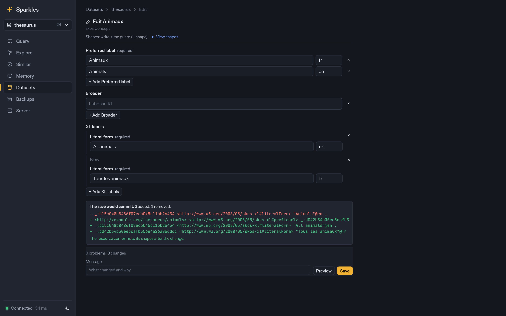
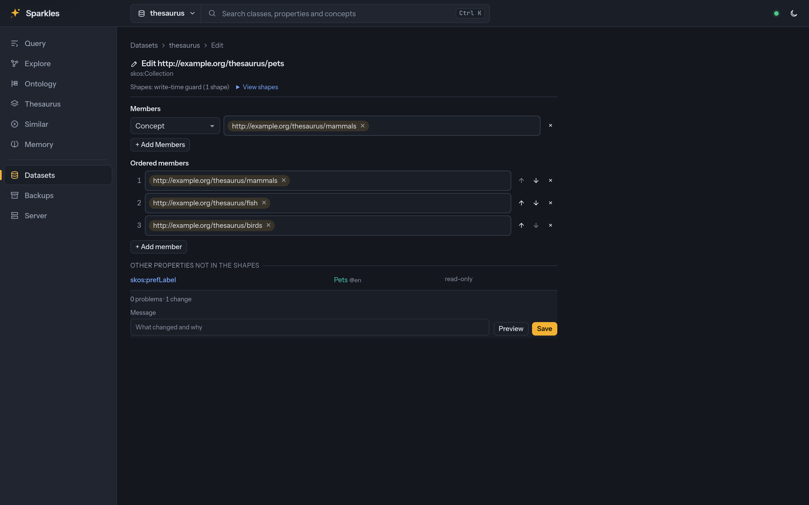

# Visualization and editing capabilities

This page describes the available capabilities and their current limits. The
[capability matrix](../FEATURES.md#capability-status) records delivery status within
each stated scope.

## Web UI

The SvelteKit UI is embedded in the server binary.

### App shell

* Every page sits in one shell. A top bar holds the brand, a search field whose first
  segment switches the dataset and names the branch a page has open, the connection
  status, the theme and the account. The search field stays in the middle of the
  viewport on large and medium screens. A rail beside the page lists the working pages and,
  below a rule, the administration pages, in this order: Query, Explore, Browse,
  Workbench, Similar and Memory, then Datasets and Admin. Workbench, Similar and Admin are
  groups whose pages show under them while one of their pages is open or when the chevron
  opens them. Workbench holds the Ontology, Thesaurus and SHACL shapes editors, Similar holds Search and
  Map, and Admin holds Server, Backups and Tokens. The rail shows Workbench only to a caller
  who may write the open dataset, so a reader's rail has Browse alone. A page has at most one
  row of tabs, and a further choice inside a page, such as the editor's entity kind, is a
  select or a segmented control. From 1200 pixels the rail shows labels, below
  that it shows icons with their names as tooltips, and from 760 pixels down it moves into
  a drawer that the menu button opens, together with the dataset switcher, the status,
  the theme and the account. Choosing a dataset on a page that names one in its address
  reopens that page on the new dataset. A **Prefixed** or **Full IRIs** switch beside the theme
  button, also in the palette, chooses how every page writes IRIs. Prefixed names come from
  the dataset's prefix map together with the conventional prefixes such as `rdf`, `owl`,
  `skos` and `dcterms`, and the choice is kept per viewer in the browser.
* The search field is also the command palette. `Ctrl+K` or `Cmd+K` opens it from
  anywhere, including the query editor, and pressing it again closes it. `/` opens it
  outside a text field, except on a page with a search of its own, where `/` focuses that
  search instead, such as the class tree filter of the ontology editor, the label search
  of the thesaurus editor and the field of Explore's text-search tab. Escape gives the focus back to where it was, and a
  command that runs in place returns the focus there before it runs. On a phone the bar
  shows a search button, and the button or the keys expand the field over the whole bar
  with a back button ([screenshot](../images/palette-phone.png)).
* With nothing typed, the palette lists the viewer's recent picks, the commands of the
  open page and the pages of the shell ([screenshot](../images/palette.png)). A typed
  query also searches the open dataset's classes, properties, individuals and SKOS
  concepts through the [entity search](../search/README.md#entity-search), the shell's
  commands, the datasets, the open dataset's saved queries and, on the Query, Ontology,
  Thesaurus and dataset pages, the dataset's branches. Enter opens an entity's page in
  Browse and a saved query in a new tab of the Query page
  ([screenshot](../images/shell-search.png)). On Explore the field is also the resource
  finder. Its placeholder says so, and its first group lists the dataset's resources by
  label or IRI, an **Open** row for a typed IRI or prefixed name and **Ask a question…**
  when the dataset answers questions. A pick focuses the resource in the graph.
* A prefix shows one kind of item. `>` lists commands and pages, `@` entities, `#`
  datasets and branches, and `?` saved queries, and a row of chips above the results sets
  the same prefixes by touch. Escape on a prefix with nothing after it returns to every
  kind before a second Escape closes the palette ([screenshot](../images/palette-commands.png)). Commands,
  pages, datasets, branches and saved queries are ranked in the browser by an exact
  match, a prefix, a word start, every word at a word start, initials such as `fq` for
  Format query, and one typo in a query of five or more letters. A command's keywords
  match only at the start of a word. Entities keep the server's typo-tolerant ranking.
* The shell's commands switch the dataset or branch, open a saved query, set the theme,
  open the dataset settings, the server status, the access tokens and the backups, and
  create a dataset. The Query page adds running, formatting, explaining and saving the
  query, a new tab, history and the pattern pane. The Ontology page adds starting a
  session, creating a class, property or individual, undo, redo and the DL query tab,
  and the Thesaurus page adds a session, new concepts, schemes and collections, the
  checks, undo and redo. The Datasets page refreshes its list and the dataset page opens
  its tabs. Each row shows its keyboard shortcut where it has one.
* The recent picks are kept per viewer in the browser's local storage, newest first, and
  the palette works without them when storage is blocked. A recent command shows only
  while its page offers it, and a recent entity or saved query only on its dataset.
* A page or feature extends the palette through `ui/src/lib/launcher.svelte.ts`.
  `useCommands` registers the page's commands, each with a label, an optional shortcut,
  keywords, an `active` predicate and a run function, for as long as the page is
  mounted. `useProvider` and `launcher.register` add a group of items, and
  `usePageSearch` gives `/` to the page's own search field.
* One set of design tokens in `ui/src/app.css` gives the colours of the light and dark
  themes, a type scale, a 4-pixel spacing scale, the page gutter of 24, 20 and 16
  pixels at large, medium and phone widths, control heights, radii and shadows. Every text
  colour is at least 4.5:1 against the page and panel backgrounds in both themes, which
  a unit test checks. Pages share the panel, button, count badge, table, tab, form row,
  page head and context row styles, and a list beside its detail ends both panes on the
  same line ([medium width](../images/shell-medium.png),
  [phone](../images/shell-phone.png)).
* Every page's content starts at the gutter. A workspace page's tools are one
  `.toolbar` row with the primary action at its end, and where the row does not fit the
  end group takes a row of its own, flush right. On a phone, buttons in a toolbar or a
  page head keep their icons and drop their labels, which stay their accessible names.
  The Query toolbar does the same for **History**, **Pattern** and **Format** below
  1,200 pixels, and Explore's graph tools do it whenever the canvas is narrower than
  860 pixels, such as beside the details panel, where a still narrower canvas wraps
  the tools to more rows.
  Panels side by side in a `.panel-grid` are as tall as the tallest in their row,
  headline numbers share one `.figures` grid, a choice of two to four values is one
  `.segmented` control, and the menus under a button share `.dropdown-menu`. At 760
  pixels and below a dialog docks at the bottom of the screen as a sheet whose body
  scrolls under a fixed head and footer.
* A data table wider than its box scrolls inside the box with its actions column pinned to
  the right edge. On a phone such a table shows each row as a card, with the first cell as
  the card's title, the other cells under their column names and the actions in a row at
  the bottom. A row of filters that no longer fits beside its search folds into a
  **Filters** button that counts the active filters, and the search stays in view. A page's
  own search, such as Browse's and Memory's, is one tall field across the content width.
  A page head is a grid from 640 pixels, with the title and what describes it on the left and
  the page's buttons level with the title on the right. Buttons marked primary stay in view
  and the others fold into a **More** menu once the buttons would take more than two fifths of
  the head. A page's headline counts are one row of chips.

### Query page

* The query page has an editor with completion of declared prefixes, linting and
  formatting in the browser, and results as a table, graph or plan.
* The toolbar holds the query's kind and endpoint, **Examples**, **Saved** and
  **Options**, then the pattern pane, **Format**, **Explain** and **Run** at its end.
  **Options** holds the branch, the past state to read, the history slider, the row
  limit and the inferences toggle, and its button names any of them that differ from
  the default, including inferences left out on a dataset that reasons.
* The **Saved** menu lists the dataset's stored queries, shows a form for a query's
  parameters and runs it. An admin can save the editor's query with parameters picked from
  its variables, or delete one.
* The Ask bar has **Preview first** and **Run, then show**, a step indicator, summaries
  whose `[n]` markers select table rows, clarification choices, follow-up questions and
  **Summarize again** ([USAGE.md](../USAGE.md#the-ask-bar)). The page keeps a local history
  of questions, saves a question and its query as a stored example, and takes suggested
  examples from readers.
* The explanation of a plan shows beside the plan tree, with links that select
  operators, and a stopped query offers **Explain why**.
* The Pattern pane, opened with `Alt+P`, draws the query's graph pattern beside the editor
  and edits it ([U08](../specs/U08-visual-query-builder.md),
  [USAGE.md](../USAGE.md#the-pattern-pane)). Classes show as subtitles, filters as chips,
  `OPTIONAL` parts as hulls, and the rest as locked blocks that keep their text. Edits on
  the canvas are splices of the text that one undo reverts. Pickers fed by the schema
  supply nodes and edges, and forms chosen by datatype supply filters. See the
  [pane beside a query](../images/pattern.png) and the
  [predicate picker](../images/pattern-edit.png).
* **Plan on pattern** draws the plan of the query that ran on its pattern, with estimated
  and actual rows on each edge, misestimates marked, the rows that passed each filter and
  join badges in run order ([U04](../specs/U04-live-query-profiling.md),
  [screenshot](../images/plan-pattern.png)).
* Graph results above 2,000 nodes draw with the WebGL view, up to 100,000 nodes.
* The path finder also works over a result graph and adds the nodes a path needs
  ([USAGE.md](../USAGE.md#finding-paths-on-the-query-page),
  [screenshot](../images/query-paths.png)).

### Explore

* The explorer shows an entity's properties, its nearest vector neighbours, ranked
  `text:query` search and a map card with Nearby. The Similar page searches from an entity
  or a pasted vector. The top bar's search finds the resource to start from, and the
  graph toolbar's **View** menu shows literals and hides `rdf:type` edges.
* Explore opens on an overview of the dataset's classes and the predicates between them,
  drawn with sigma.js on WebGL and laid out with ForceAtlas2 in a web worker
  ([U06](../specs/U06-large-graph-rendering.md), [USAGE.md](../USAGE.md#the-explore-overview),
  [API.md](../API.md#graph-overview)). A class opens into its members, or above 5,000
  instances into communities or groups by its best splitting property. **Group by** can
  draw the GraphRAG communities instead, with a community's report beside the picture
  ([screenshot](../images/explore-communities.png)). A list view (`L`) is the accessible
  companion, and without WebGL the overview falls back to Cytoscape.
* The drawn graph of a resource holds what the person has explored, up to 100,000 nodes, and
  draws up to a budget of 5,000 of them. Past 1,000 visible nodes the canvas changes from
  Cytoscape to the WebGL view that the overview uses, and it changes back under 700. Click,
  double click to expand, a right click or a long press for the node menu, a click on an
  edge for its derivation, the selection's highlight, the lenses and the path overlay work
  in both. New nodes are placed beside their neighbours and stay where they are put until
  **Re-run layout**. The WebGL view does not draw the time slider's fades, which colour
  added and removed nodes instead, and its validation badges are drawn but not clickable.
  It draws one line for all the predicates between two nodes, and a click on the line explains
  an inferred edge or names the predicates, and it does not draw an edge from a node to itself.
  A node with a large fan-out is expanded into one **N via predicate** group node for each
  predicate that has more than 25 edges in a direction. The group's panel reads 100 members
  at a time, filters them by name, splits them by class and draws the members or the page
  that the person chooses, so the graph holds only what was drawn.
  The **Filters** panel (`Shift+G`) chooses what is drawn and never reads from the server.
  It toggles each edge type and each class, with the counts of the explored graph, sets a
  minimum degree, hides leaves and sets the budget of drawn nodes. With communities from the
  memory store, **Group by communities** colours nodes by community and the legend's entries
  hide a community. The graph holds every node however it is filtered, and a chip in the
  toolbar says how many the filters and the budget leave out. Holding the explored graph
  costs memory in the page for each node, in exchange for filters and budgets that change the
  picture at once, and drawing at most the budget bounds the cost of a frame
  ([measurements](../benchmarks/web-ui-scale/RESULTS.md)).
* The **Paths** panel (`Shift+P`) finds the shortest path, every shortest path or the k
  shortest paths between two entities, with filters for length, direction, predicates and
  hubs and an optional weight from reifier properties
  ([U09](../specs/U09-path-finder.md), [USAGE.md](../USAGE.md#finding-paths-in-explore),
  [screenshot](../images/path-finder.png)). A path opens as a query or joins the drawn graph.
* The **Lenses** menu (`Shift+L`) sets a node's size, colour and badge and an edge channel
  on the canvas and the WebGL view ([U10](../specs/U10-canvas-lenses.md),
  [USAGE.md](../USAGE.md#lenses-on-the-graph), [screenshot](../images/explore-lenses.png)).
  Size follows degree or a numeric property, colour follows class, graph or a property's
  values, and the edge lens draws inferred edges dashed. Each lens has a legend whose
  entries select their nodes.
* Algorithm lenses size nodes by PageRank, betweenness, BFS depth, k-core or triangles,
  and colour them by WCC, label propagation, Louvain, Leiden or GraphRAG communities
  ([USAGE.md](../USAGE.md#algorithm-lenses), [API.md](../API.md#view-only-runs),
  [screenshot](../images/explore-algo-lenses.png)). A lens runs over the drawn graph or over
  a projection of the dataset, in the background with progress and **Cancel**.
* A click on a dashed edge, a **Why?** button or `W` opens the derivation tree of an
  inferred triple beside the graph ([USAGE.md](../USAGE.md#why-is-this-inferred),
  [screenshot](../images/explore-why.png)). **Show on graph** draws and highlights the
  premises, **Next** shows up to five derivations with other top rules, and a note says
  when the inferences are stale ([screenshot](../images/explore-why-stale.png)).
* **Facets** (`Shift+F`), in Explore and as a tab of `SELECT` results, count a set's
  values by numeric or year ranges or by the 12 most frequent values
  ([U11](../specs/U11-linked-views.md#outcome), [USAGE.md](../USAGE.md#facets-and-use-in-query),
  [API.md](../API.md#facets), [screenshot](../images/explore-facets.png)). Brushing a histogram
  dims the entities outside it, **Apply to query** writes the matching triple and
  `FILTER`, and **Use in query** writes up to 1,000 selected entities as a `VALUES` block.
* Explore's **Map** (`Shift+M`) and a result's **Arcs** draw relations between located
  entities as great-circle arcs coloured by predicate
  ([USAGE.md](../USAGE.md#arcs-on-the-map)). Close markers and parallel arcs merge, and a
  list of markers and arcs serves keyboards and screen readers. A selection is shared by
  the maps and the graph canvases.
* `/ui/similar/map` draws a vector index's entities on a plane, placed by PCA or a force
  layout of the neighbour graph and coloured by class or a predicate's values
  ([USAGE.md](../USAGE.md#the-embedding-map), [API.md](../API.md#embedding-map),
  [screenshot](../images/embedding-map.png)). An index above 50,000 entities is sampled, a
  lasso selects entities, and **Open as graph** draws them in Explore. A kept projection
  costs about 24 bytes of server memory per entity, with at most four and 1 GiB in all.
* The validation overlay badges the SHACL and ShEx results of the drawn nodes as a lens,
  from the write-time guard, a shapes graph or the Validate panel's shapes
  ([USAGE.md](../USAGE.md#the-validation-overlay),
  [U07](../specs/U07-data-quality-and-schema-diagram.md#outcome),
  [screenshot](../images/validation-overlay.png)). **Show triples** marks the triples
  involved, and **Suggest fix** writes an update, previews it as a dry run and runs it only
  after that preview.

### Maps

* Results with geometry literals get a Map tab with a popup per row. The browser reads
  CRS84, EPSG:4326 and Web Mercator, and other CRSs go through `POST /$/geo/convert`.
* The dataset page's Spatial index panel shows the index's status, CRSs and memory,
  configures or rebuilds it, and maps the indexed geometries in view.
* The maps use MapLibre GL JS over a bundled Natural Earth basemap, and fetch nothing from
  elsewhere unless `serve --map-style-url URL` names a MapLibre style.

### History and time travel

* The UI shows commit history, write receipts, the changes of each commit, named
  snapshots, and query results of a past state.
* A time slider moves the query results, an entity's properties, the Explore graph, the
  schema tab and the Memory tab through the commits, compares two commits or two branch
  heads with changes marked, plays through the commits and follows new ones
  ([USAGE.md](../USAGE.md#the-time-slider)).
* The changes between two commits can be drawn as a graph, grouped by class when they are
  many, and played as a time-lapse of one commit's diff per step
  ([USAGE.md](../USAGE.md#commit-diffs-on-the-graph)). See the screenshots of
  [a diff graph](../images/diff-graph.png) and [a time-lapse](../images/diff-lapse.png).
* The History panel draws every branch as a commit graph, and the Branches panel and merge
  page manage branches.

### Datasets, validation and editing

* The dataset page has cards for the full-text, vector and spatial indexes, with create,
  edit, rebuild, drop and a recall measurement for vector indexes. It uploads documents
  for ingestion, edits settings with each field's source, and shows quotas and compaction.
* The schema browser reads `/$/schema`, with graph selection, an inference toggle, and
  observed counts and object kinds beside the declarations and SHACL constraints. Its
  class panel shows profiles, **Compare** shows a schema diff, and **Draft shapes** drafts
  SHACL or ShEx shapes and installs them as a guard in `warn` mode.
* The Validate panel switches between SHACL, in Turtle or SHACLC, and ShEx with a shape
  map, lists each failure, and downloads ShapeMap JSON. The Write-time validation panel
  configures the guard and shows the head's results, the last validated write and recent
  rejections. The query editor shows the results of a rejected write.
* Editing forms generated from SHACL shapes open from Explore's **Edit** or
  `/datasets/{name}/edit?iri=…` ([U02](../specs/U02-shape-driven-forms/SPEC.md#outcome),
  [USAGE.md](../USAGE.md#editing-forms), [API.md](../API.md#editing-forms),
  [screenshot](../images/forms.png)). Fields merge every applying shape and follow
  `sh:group`, `sh:order`, `sh:name` and known DASH editors. The browser checks values as
  the person types, **Preview** runs a dry run, and **Save** commits one update, to `main`
  or to a session branch when `main` is protected. A concurrent change to a field shows a
  conflict view. Checks follow shape dependencies beyond a fixed graph radius and
  report all current violations on the affected targets. Incomplete discovery refuses
  the check, and a failed recheck invalidates earlier browser approval.
  Blank-node values of `sh:node` fields are nested forms, SHACL 1.2 list fields are
  ordered list editors, and `sh:or` or `sh:xone` value alternatives offer a choice for
  each value (screenshots of [nested forms](../images/forms-nested.png) and
  [lists](../images/forms-list.png)).
  `Dataset::forms()` and Python's `Dataset.forms` expose the same forms.
* Memory shows what agents recorded as cards. On Explore, a resource's Memory tab gives one
  card for each predicate, with the values it holds, each with its review status, the
  confidence the agent gave it and a line naming the agent, the source and the start of the
  quote it cited. A value that several facts state shows a marker for each, a conflict marks the card it
  belongs to, and a citation marker opens the graph, time and every other detail. The
  history of facts that were superseded or retracted is a timeline, newest first, that pairs
  each old value, struck through, with the value that replaced it and says when and by what
  it was replaced ([screenshot](../images/memory-facts.png)). The Memory page heads its
  overview with counts of facts, agents, sources, review branches and open inbox items. It
  lists the agents and sources as tables, recent activity as a timeline, and the review
  branches and settings, and a search across the page recalls facts as the same cards
  ([screenshot](../images/memory.png)). Its Inbox tab reviews facts, with **Accept all that pass** to select them,
  and **Promote selected** and **Reject selected** to act on the selection.
* The Communities tab of a dataset shows the GraphRAG hierarchy as a tree or, with **Map**, as
  a treemap in which each community is a box sized by its members and a parent holds its
  sub-communities under its title ([screenshot](../images/communities-map.png)). A box is
  tinted by its report's status, and says the status in words wherever it is large
  enough to hold them. Choosing a box opens the community's members and report below the map,
  and the choice of view is kept in the browser. A parent whose children would be too small
  to read shows as one box that opens its own report.
* The server page shows readiness, requests, caches, backups and a Models section for
  providers, the model configuration and write-only keys
  ([USAGE.md](../USAGE.md#changing-models-and-keys-at-runtime),
  screenshots of the [form](../images/models-settings.png) and its
  [errors](../images/models-settings-errors.png)). The model configuration is a form built from
  the `ModelsSettings` schema of the OpenAPI description. Its fields are typed and
  bounded, allowed models are a list that can be reordered, per-model options have a card
  per model, and role lists have a row per entry. Each field is checked as it is edited,
  a refusal from the server shows under the field it names, and the JSON view under
  **Advanced** shares the form's unsaved change.

### Nested forms, lists and alternatives

A field whose property shape names `sh:node` shows each blank-node value as a nested form,
built from every `sh:node` declaration that reaches the child. The form reads them from the
nested model, which keeps each child's RDF identity, the visible edges it hangs from and
the graphs of its values. Shared children appear once, and a cycle refers to the child
already shown. **Add** starts a new child from the empty form of the field's shapes.
Removing a child deletes its edge and, when nothing else refers to it, its visible triples
and those of the blank nodes under it. One save commits the changes to the resource and
to every child, after the same guard, access and conflict checks as a flat form. Under the
writer lock the save checks that each stored child still hangs from its parent, and a
child removed meanwhile shows a conflict on the parent's field.

A field with SHACL 1.2 list constraints edits its `rdf:List` in order, with buttons that
move, remove and add members, and checks `sh:minListLength`, `sh:maxListLength`,
`sh:uniqueMembers` and the member shape in the browser. A save replaces the stored list.
A field whose `sh:or` or `sh:xone` names value shapes without paths offers a **Kind of**
select for each value. The choice selects the alternative's widget and constraints, and
the browser reports a value that matches none of the alternatives, or for `sh:xone` more
than one.

The Rust library exposes the same model as `dataset.forms().nested_model(&request,
&options)`, with the ordinary root form, a `nested_nodes` pool and `templates`. HTTP
takes `nested=true` on the model route and `nested` entries in check and save bodies, and
Python takes `nested=True`. One request admits at most 64 nested identities, 512
generated field views, 512 parent anchors and 16 levels of first discovery. A shared
preparation allowance refuses a larger or unfinished model, and the form then falls back
to the flat model with nested values read-only. Complex nested paths, visible
blank-named graph contexts and matching composite range bounds also refuse until their
representation or producers have controlled admission. The allowance covers adapter
preparation and retention, while physical reader and mask preparation depend on
[item 395](../ROADMAP.md). The
[specification](../specs/U02-shape-driven-forms/SPEC.md#231-nested-read-models-in-the-rust-library)
explains the unit calculation.

### Browse and the Workbench

Reading and authoring are separate places. **Browse** is the reader, with a page for each
term and the edit mode of its pages. The **Workbench** holds the editors that work on a
whole ontology or thesaurus, a tree beside the selected entity, and it is where further
authoring tools such as SHACL shapes and forms go. A Browse term page has **Open in
Ontology** or **Open in Thesaurus**, which lands on the same IRI selected in the editor's
tree with its path open, and an editor's entity panel has **Open page**, which goes back to
the term's page. The palette offers both, and Explore's details panel has **Open page** for
a resource that is a class, a property or a concept.

Every tab and control of these pages is part of the address, so a link, a reload and the
Back button return to the same view. The `routes` module in `ui/src/lib/routes.ts` builds
these addresses for the rail, the palette and the links.

| Address | View |
|---|---|
| `/ui/browse?ds=NAME&iri=IRI` | The term page of an entity. `edit=1` opens edit mode and `view=graph` the term's graph. |
| `/ui/workbench/ontology?ds=NAME` | The Ontology editor's tree. `kind=ObjectProperty`, `DataProperty`, `AnnotationProperty` or `NamedIndividual` picks the tree, `iri` the selected entity and `view=usage` its usage. |
| `/ui/workbench/ontology?ds=NAME&tab=dlquery` | DL Query, with the query in `dl`. `tab=header` opens the header and `tab=history` the history. |
| `/ui/workbench/thesaurus?ds=NAME` | The Thesaurus editor's tree. `kind=collections` lists collections, `scheme` picks the scheme and `view` the resource's labels, relations, members or notes. |
| `/ui/workbench/thesaurus?ds=NAME&tab=history` | The thesaurus's history. `tab=validation` opens the validation report. |
| `/ui/similar?ds=NAME` and `/ui/similar/map?ds=NAME` | Similar's Search and Map pages. |
| `/ui/admin/server`, `/ui/admin/backups` and `/ui/admin/tokens` | The Admin pages. `tab=repositories`, `policies` or `activity` picks a Backups tab. |

A caller who may read a dataset but not write it can still follow a link to the Workbench.
The editor then says that it is read-only and hides its editing controls, while the tree,
DL Query, the header, the history and the validation report still read.

The trees of both editors keep a deep hierarchy readable. Indentation is 14 pixels a level
for the first four levels and 6 pixels a level below them, with a guide line under each open
node of the first levels. A row gives its label the room first, hides the entity's short
form when the row is narrow and then shortens the label, and the selected row shows its
whole label and short form. When the tree scrolls, the ancestors of the first visible row
stay at its top, in the manner of an editor's sticky scroll, and clicking one scrolls back to
it. A breadcrumb above the entity panel gives the selected entity's path from a root of the
tree. A level with more than 1,000 children shows its
first 1,000 with a **Show more** row that reads the next 1,000 from the hierarchy route.

A tree draws only the rows in view, with a few above and below them, however many nodes are
open, so a level of thousands of children and an ontology of millions of classes scroll as
smoothly as a short list. The tree is one tab stop, and the arrow keys move a cursor over
the whole tree, including the rows that are not in the page. Up and Down move a row, Right
opens a node or enters it, Left closes a node or goes to its parent, Home, End, Page Up and
Page Down move further, typing a name jumps to the next row that starts with it, and Enter
selects the row or reads the next page of a **Show more** row, which is an item of the tree. Each row tells assistive
technology its level and its place among its siblings. Keeping the rows out of the page costs
a little memory for the list of rows, about the size of the open nodes' ids, in exchange for a
page whose size does not grow with the tree.

A change set is drawn the same way wherever the pages show one, in the edit previews and in
the history tabs. Each subject is a block named by its `rdfs:label` or `skos:prefLabel`,
or by its `sh:name` when it has neither, so a shape in the shape editor's preview carries
the name the form shows. Every added or removed property and value is on a line of its own
with a sign beside it, and the plain N-Quads are one tab away.

### Rendering preferences

The top bar's **Rendering preferences** button and the phone menu choose how entities
appear in the editors, Browse and query results. Choose **Label**, **Prefixed name** or
**Full IRI**, and enter language tags separated by commas in preference order. An empty
list uses the browser's languages. Regional tags fall back to their primary language,
then labels fall back to untagged values, English and another available language. A
missing label uses a prefixed name, and an unknown namespace uses the complete IRI.
The browser saves these preferences locally. The thesaurus editor's **Label language**
field can override the language order for that page.

Changing these preferences preserves unsubmitted edits and the selected scheme in an open
concept picker. A failed name refresh keeps the current editor and its drafts available.

Query tables read labels for visible rows in batches from the result's branch and commit.
Graph results use label literals present in their triples. When a caption shows an IRI,
its label statements remain visible unless **Hide literals** is selected. Expanded Browse
graphs retain the names supplied by each expansion. A failed label lookup leaves
the IRI visible. Copying and navigation always keep the original IRI.

### Visual SHACL shape editor

**SHACL shapes** in the Workbench opens `/ui/workbench/shapes`, which the
[editor screenshot](../images/shape-editor.png) shows. The dataset's Validate panel also
links to it. Choose a branch and one shapes graph, or enter a new graph IRI.
The source line identifies the dataset, branch, stored graph and commit. The unnamed
shapes graph is the stored default graph even when queries use a union default graph.
Leave the graph field empty to edit it. Reserved default and union query selectors
cannot be used as named authoring graphs.

The tree contains node and property shapes, including anonymous and nested shapes.
Shared and recursive references appear as link leaves. The tree displays at most 5,000
repeated reference leaves and reports omitted links. Every shape and its complete
reference and list forms remain available. The forms edit the four Core
target predicates, implicit class targets, severity, deactivation, names, descriptions,
messages, groups, order and default values. They cover the SHACL Recommendation's Core
constraints and the engine's four SHACL 1.2 draft list constraints. Logical constraints
and nested shapes use references and ordered lists. A path editor composes predicates,
inverse paths, sequences, alternatives, repetitions and optional paths recursively.
Custom severities use an IRI, and literals retain their datatype, language and direction.

Apply a field or path to the local draft before opening another shape or previewing.
**Undo draft** and **Redo draft** move through up to 30 local draft states. **Preview
commit** shows the exact RDF additions and removals, with at most 50 changed triples in
the displayed diff, as the [preview screenshot](../images/shape-editor-preview.png)
shows. Commit uses the same source UUID, commit and precondition. Another writer's
commit refuses the write and retains the draft until explicit discard and reload.
While a preview is open, refreshes from the change feed wait until it closes, so the
answer of a slow commit is still recorded for undo.
**Undo commit** and **Redo commit** use the branch's revert operation and preserve stored
blank-node identities. Protected branches offer **Start session**. The server applies
the caller's graph, endpoint and write grants to every request.

Sample validation checks up to 100 explicit focus nodes, or all declared targets in a
selected sample graph, against the draft at its source commit. The latter mode also
checks literal target nodes. It debounces changes, cancels superseded work and
shows at most 100 result rows. The check has a five-second server deadline and a
ten-second client deadline. A conforming sample does not establish whole-dataset
conformance, and canceled or failed checks clear earlier results. Stored blank-node
constants retain their identities through the validation route's explicit draft option.
A sample report must confirm the captured source UUID and commit before it can be
shown as a result. Missing or changed identities clear earlier approval.

The editor reads a complete graph of at most 5,000 triples. It caps the decoded response
at 2 MiB before parsing JSON and refuses incomplete or oversized reads. Triple-filtered
views cannot establish a complete definition and do not enable editing. On a different
branch, the editor first confirms unrestricted visibility through the SHACL route when
the caller's branch grants are unknown. A refused confirmation leaves the source closed.
Paths nest at most 64 levels, and a path that reuses shared operands may expand to at
most 1,000 steps. Unrecognized RDF stays intact and is visible in
**Additional RDF** and **View Turtle**. A malformed path or list requires explicit
replacement. Shared or annotated structures are retained when another field changes.

**Use in text validator** explicitly replaces the dataset's saved text draft with a
Turtle copy. Turtle and SHACLC text drafts remain independent of stored shape commits.
Installing a write-time guard remains a separate action on the dataset page.

### Ontology editor

The Header view and the ontology browser landing page have an **Ontology metrics**
panel. **Read metrics** counts mapped axioms by type and distinct signature entities,
streams instance assertions and checks all four OWL 2 profiles. The panel names its
commit and graphs. Header metrics include dataset-local imports and pin the displayed
commit. Browser metrics cover its selected graph and revision without imports.
Terminology axioms count once and streamed assertions count occurrences, including
repeats across graphs. Entities include undeclared references and built-ins and count
once per kind and IRI.

The expressivity label is a conservative containing DL, with EL for the simple fragment
and extensions of ALC through SROIQ(D) for other constructors. It does not claim minimum
expressivity. Unknown expressivity includes its reason and any supported observed
fragment bound. Unresolved imports prevent a conclusion about the complete ontology.
The panel lists up to 100 violations of each profile after checking the selected scope.
Metrics retain a distinct entity signature set and refuse more than one million mapped
axioms and assertion triples or signature entities. A limit or deadline reports an error
rather than partial counts. Ordinary page opening does not request metrics. The
[metrics screenshot](../images/ontology-metrics.png) shows the Header panel at its pinned
revision.

The **Ontology** editor, `/ui/workbench/ontology`, browses and edits the OWL ontology of one graph
and its imports
([U12](../specs/U12-ontology-workbench/SPEC.md#outcome),
[reasoning guide](../reasoning/README.md#owl-2-ontologies),
[screenshot](../images/ontology-editor.png)). Trees of classes, object, data and
annotation properties and individuals sit beside the selected entity's frame, which
lists its annotations, characteristics and axioms and adds and removes them. The frame's
add fields take class expressions and whole axioms in Manchester syntax, with
completion of entity names and labels and an underline under the part the server could
not read, or in functional-style syntax. The page's tabs are **Tree**, **DL Query**,
**Header** and **History**. A select at the top of the tree picks the classes, object,
data or annotation properties or individuals, and a segmented control on the entity panel
switches between its frame and its usage.

The editor reads what its views show. Opening it reads the ontology's summary and the first
level of the tree on screen, and the other trees read their levels when their tab opens.
Names come from the labels of the hierarchy answers and from one query for the labels of the
IRIs a panel names for the first time, so no read lists every label of the ontology. The
entity lists behind the add fields' pickers and the new-entity checks are read once an entity,
the header, the DL Query tab or the new-entity dialog needs them, for each kind of up to 5,000
entities. A longer kind is completed by the entity search as a name is typed and is resolved by
the server's Manchester reader. The Individuals tab opens on a page of asserted named-type
buckets. Expanding a type reads up to 100 named members, and **Show more** reads its next
page at the displayed summary commit. Untyped holds named individuals without an asserted named class.
An individual with several types appears once under each. Anonymous individuals are
outside this named-entity tree. A selected individual is located directly even when its
row is outside the loaded pages. Labels and type badges follow the shared rendering and
language preferences. The [Individuals screenshot](../images/ontology-individuals.png)
shows the type groups and a selected member.

The Individuals filter searches names at the current branch head and reads each candidate's
memberships at the displayed commit. It skips candidates absent from that revision, keeps
valid matches and displays hard read failures. Historical name search remains under item
658.

The same read is available through `Dataset.ontology.individuals` in Python and Node.js
and `SparklesOnt.individuals` or the ontology handle on the JVM. Their cursors and
revision selectors follow the HTTP contract.

The paged HTTP response does not imply bounded server work. The individuals route reuses
the ontology's terminology mapping, and discovers buckets and Untyped members by scanning
the authorized graph scope. A typed member page scans that type's membership. The cold
terminology mapping cost remains under roadmap item 736. Repeated bucket discovery,
lexical-page selection and exact-total scans remain under item 749, with grants, pinned
views and bounded memory preserved. The first-member wait includes these scans even
when the browser receives only a small page.

Typed pages read complete type lists for the members they return and reject a returned
individual with more than 1,000 named types. An individual before the cursor or outside
that page does not trigger this type-list limit. Root discovery and Untyped reads check
all candidates, and direct lookup checks its individual, with the same limit and an
explicit failure rather than truncated types. Root discovery also refuses more than
100,000 type buckets.

The **DL Query** tab answers a Manchester class expression with its equivalent classes,
its direct and inferred superclasses and subclasses, and its instances
([screenshot](../images/ontology-dl-query.png)). Each answer opens the entity's frame
beside the query, and the query is kept in the page's address. A label above the
answers names the reasoning that found them, the EL classifier inside OWL 2 EL or the
OWL 2 RL rules outside it, says whether they are complete, and lists the axioms outside
the profile that can leave them incomplete. The
header tab edits the ontology IRI, version IRI, imports and header annotations, and the
usage view lists every axiom that mentions the entity. The **History** tab lists the
branch's commits newest first in the manner of WebProtégé's changes. Each commit opens to
what it changed in the graph as a change set, one block a subject named by its label with
each added or removed property and value on a line, and links to the commit's full diff. Every other view of a commit's, a merge's or a preview's changes shows the same change
set, with the signed N-Quads lines behind a **N-Quads** switch.

The entity frame's **History** view lists the commits of the branch that changed a
triple naming the entity as subject, predicate or object in the editor's graph, newest
first, with each commit's message, author, time and counts of those triples
([screenshot](../images/entity-history.png)). The list reads the change log 200 changes at
a time for each position and offers older commits in further pages. A commit opens to the
axioms and assertions that mention the entity which it added and removed, read through
`GET /$/ontology/{ds}/diff?entity=`, and links to its full diff. A caller who can edit
the branch, with grants that cover every graph, reverts a commit from there, and the revert is previewed and committed like an
undo. A revert takes back everything the commit changed on the branch, and it needs
write access to the whole branch. Commits from bulk loads and commits older than the change
log are named at the end of the list, since the log cannot say what they changed. A commit
that changed only the blank nodes of a restriction or an annotated axiom, without a triple
that names the entity, is not listed.

The entity frame's **Discussion** view holds comment threads on the entity and on its
axioms, in the manner of WebProtégé's discussions
([screenshot](../images/ontology-discussions.png)). A caller who can write the branch
starts a thread on the entity or on one of the axioms its frame lists, replies to a
thread, and resolves or reopens it. Writing `@name` in a comment mentions that principal,
and the mention is highlighted and recorded with the comment. The view shows open
threads, resolved threads or both, with each comment's author and time, and the
ontology's **Discussions** tab lists every thread of the ontology graph with a link to
its entity. A read lists at most 1,000 comments and replies, oldest first, and says when
it stopped there, since later comments and replies are then not listed.

The threads are W3C Web Annotation RDF in an ordinary named graph beside the ontology
graph on the branch. Its IRI is the ontology graph's IRI under
`urn:x-sparkles:discussions:`, with `%`, `[` and `]` percent-encoded, so the threads of `http://example.org/uni` are in
`urn:x-sparkles:discussions:http://example.org/uni` and those of the default graph are in
`urn:x-sparkles:discussions:default`. Each ontology graph has its own discussion graph,
and none can be an ontology graph's own IRI. A thread is an `oa:Annotation` motivated by
`oa:commenting` whose `oa:hasTarget` is the entity, or an `oa:SpecificResource` with the
entity as `oa:hasSource` and the axiom's functional-style syntax as an
`oa:TextQuoteSelector`. A reply is an `oa:replying` annotation that targets the thread.
Each body is an `oa:TextualBody`, the author and time are `dcterms:creator` and
`dcterms:created`, mentions are `schema:mentions`, and the resolved state is
`urn:x-sparkles:discussion#resolved` with the resolver in `#resolvedBy`. Comments never
use `rdfs:comment`, and the editor never reads the discussion graph as an ontology, so
its frames, trees and graph list leave it out.

Each comment, reply, resolve and reopen is one ordinary commit of the branch. Comments
therefore appear in the branch's history and in exports of the dataset like any other
graph, a protected branch refuses them as it refuses every write, and writing one needs
`write` on the dataset. Readers and visitors of a protected branch see the threads with
no composer, reply, resolve or reopen. A caller whose grants cover only some graphs needs
a grant on the discussion graph, or the server refuses the comment. Item 769 covers an
optional discussion store outside versioning.

The **Bulk edits** tab changes many entities in one commit
([screenshot](../images/ontology-bulk.png)). **Find and replace** searches the plain and
language-tagged string values of the labels, of every annotation or of one annotation
property, as literal text or as a JavaScript regular expression whose replacement may use
groups such as `$1`, with or without matching case. A language filter keeps to untagged
values or to one tag, and a tag such as `en` also matches `en-GB`. The scope is the whole
graph or the entity list. A replacement keeps each value's language and its axiom
annotations, and a value it would leave empty is left out and counted. **Set annotation**
adds an annotation to every entity of the list and can replace the values the entities
hold for that property in the same language, or every value when the new one is an IRI.
**Remove annotation** removes a property's values from the entities of the list, every
value, those in one language or one exact value. **Move classes** puts the classes of the
list under a new parent or at the top. Each class loses the named superclasses that the
graph's `SubClassOf` axioms state, with those axioms' annotations, unless **Keep the old
parents** is checked, and its restrictions and other superclass expressions stay. A
parent that is one of the classes or below one of them is refused, since the move would
make a cycle.

The entity list takes entities from the entity search, a class with its subclasses, or
pasted IRIs and prefixed names, and holds at most 1,000 entities. Each edit reads the
graph's own axioms without its imports at the commit the editor shows, lists every change
with its old and new value, and opens the editor's preview of one `axioms` edit, so the
dry run shows the changed triples and the commit is one entry of the undo stack. An edit
of more than 1,000 changes is refused with its count, and so is a graph that holds more
than 100,000 annotation assertions or `SubClassOf` axioms, since a partial read could miss
matches. A move also refuses more than 10,000 changed axioms in all. A pattern that matches
empty text, such as a lookahead, is refused. A value removed as an IRI removes only that IRI,
and language tags compare without case, so setting a value an entity already holds leaves it
and its axiom annotations alone. A commit that lands after the changes were listed clears
them. Readers and
protected branches can list changes but get no preview. An annotation property that the
ontology does not declare is declared with the edit, and a property of another kind, such as a
data property, is refused. A move's new parent must be a class of the ontology or its imports,
each moved entity that the graphs type as something else is refused, and the move declares
nothing. The cycle check follows only the graph's own named `SubClassOf` axioms.
Item 770 covers bulk edits of larger ontologies.

The **Imports** tab shows where the selected graph's `owl:imports` lead
([screenshot](../images/ontology-imports.png)). It draws the imports closure as a tree, with
each import's graphs and the source that resolved it, and marks the edges that close a cycle
and the imports that resolve to no graph the caller can read. An import resolves first to the
graph that the dataset's import map names for it, then to the graph its IRI names, and then
to the graphs of a resource catalog vocabulary whose namespace matches it. The map is
dataset-wide, so every branch shares it, and the tab lists each entry's source, file,
location, ETag, digest and fetch time.

An administrator of the dataset adds and removes map entries, loads an OASIS XML catalog
with the files it names, and fetches or refreshes an import. A catalog load replaces the
graph of each `uri` entry whose file is chosen with it, in one commit, and maps an entry
whose `uri` is an absolute IRI to that graph. It lists the entries it skipped, such as
`rewriteURI`, `nextCatalog`, an entry under an `xml:base` and a file that was not chosen.
Choosing the catalog's folder instead of single files keeps each file's path below the
folder, which an entry such as `sub/lib.ttl` needs.
**Fetch into graph** downloads an `http` or `https` import through the server's outbound
policy into the graph its IRI names, in one commit, and **Refresh** downloads it again. A
refreshed document without blank nodes that equals the graph makes no commit. Readers and
protected branches see the closure and the map without the actions, and other writers see
only the entries whose graph they can read.

The **Imported axioms** switch beside the graph picker includes or excludes the axioms of
the imported graphs in every view of the editor, and the page keeps the choice in its URL.
Edits write to the selected graph either way. Turning the switch or changing the map reads
the trees, the filtered trees and the frame again. Reads never fetch, and item 559 covers
fetching during a read. Reasoning runs keep their own location mapping, which item 772
connects to the import map.

**Inferred** reveals the
kept hierarchy beside the asserted class tree. It reads roots and expanded levels from
an existing result, with the classifier's actual tier and outcome
([screenshot](../images/ontology-inferred.png)). **Classify tree** remains a deliberate
action that computes and displays a full taxonomy through bounded POST pages. Every edit is previewed as a dry run and
committed with the commit it was previewed against
([screenshot](../images/ontology-preview.png)), on the current branch or on a session
branch that **Start session** creates. Undo and redo are previewed commits too, and
another writer's commit reloads the page through the change feed.

A frame draft belongs to the target, graph, entity and commit it displayed when editing
began. A newer or failed frame refresh keeps its text but blocks preview and submission.
If the new frame arrives while a draft is open, the editor keeps the older asserted
frame beside an explicit stale-draft notice until the caller discards that draft and
loads the current frame. This can retain both capped asserted frames temporarily.
Asynchronous parsing cannot move an old draft to the new source. An accepted preview
and its commit keep the original `If-Match` condition even if the summary refreshes.

### Ontology browser

The **Browse** page, `/ui/browse`, is a reference to the ontologies and thesauri of a
dataset, with a page for each entity in the manner of the term pages of OLS and
Ontobee ([U12](../specs/U12-ontology-workbench/SPEC.md#ontology-browser),
[screenshot](../images/browse-term.png)). The top bar's search opens an entity's page,
and every name on a page links to the page of that entity. `/ui/browse?ds=NAME` is the
landing page of the default graph's ontology, and `&iri=IRI` opens an entity. `graph`,
`branch` and `at` choose what the pages read, as on the other pages.

An entity's page leads with its label, short form, kind and IRI, and a line of counts under
them as text links, its parents, children, incoming links, synonyms and the other datasets
that mention it, each leading to its section. The IRI follows the **Prefixed** or **Full IRIs**
switch with the dataset's prefixes, shows in full where no prefix fits, keeps the full IRI as its
title and is always copied in full. The short form does not show beside a prefixed name that already
ends in it. A count of zero does not show, and with none left
the line does not render. The buttons that act on the page sit level with the title.
**Open in Explore**, **Open in Ontology** or **Open in Thesaurus**, **Ask about this** and
**Edit** show while they fit, and the rest fold into a **More** menu, so the title never
shares a row with a wrapped column of buttons. A deprecated entity says so under its title and
links its replacement. The rest of the page has two columns. The left holds the term's own
sections on the page background, and the right is a rail of cards with its facts.

One text leads directly under the counts, with no heading. It is the entity's first definition
by `obo:IAO_0000115` or `skos:definition`, or else its first description by `dcterms:description`,
`dc:description` or `schema:description`, its first `rdfs:comment`, its first `skos:scopeNote` or
its first `skos:note`. An entity with none of these shows no lead and generates no text. Every value
ends with a small chip of the property that states it, such as `rdfs:comment`, which stays with
the last word of its text, follows the **Prefixed** or **Full IRIs** switch, links to the
property's page when it has one and shows the full IRI as its title. The same text under two
predicates is one entry with two chips, and blank lines in a text are paragraphs. A typed literal
anywhere on the page shows its exact lexical form with a small chip of its datatype, such as
`xsd:date`, before any property chip, and strings and language-tagged texts have none. **Copy**
still gives Manchester syntax, with `^^` where it needs it.

Under the lead, one wrapping row of quiet disclosures holds what remains, one for each kind that
has any, with its count and closed at first, such as "In 1 other language", "1 more definition",
"1 description", "3 comments" and "6 notes". They open independently, and what they open falls
below the row, so that the row keeps its place. **Notes** holds the scope, history, editorial and
change notes, the plain notes and the examples, where the chip tells them apart and each row names
its kind to a screen reader. A lone lead has no disclosures. Edit mode opens them all, so that
every value can be reached. The sections after it are all headings of one size. A
**Logical definition** and the **Synonyms** by kind stay in view
under the row, each synonym with its languages, sources and its synonym type as a chip.
**Axioms** gives the entity's frame in Manchester syntax, with the names linked to their pages and
a **Copy** button beside its heading. Its named-class inference region reads the kept
classification on load, at the displayed branch and commit, without computing. It stays
visible for empty frames and distinguishes unavailable, running, mismatch, missing class,
unsatisfiable, inconsistent, excluded and partial outcomes. A deliberate **Classify** click
requests one bounded frame projection when no matching result is available, including
useful authorized clauses for restricted views. Such isolated output has no implicit
reclassification continuation. Property and individual pages also read materialized frames and hierarchies from an
existing fresh RDFS or OWL RL producer. These views require complete readable inputs
matching the producer scope. They retain an exact source/revision pin, label actual
inferred-graph provenance and distinguish facts also asserted. Disabled or incomplete
change logs and reverted input changes are conservatively refused when freshness cannot
be proved. Counts and direct-edge reduction can inspect more facts than the bounded
output, and no new latency guarantee follows from the page size. The
[materialized property view](../images/ontology-materialized-properties.png) shows a
direct property hierarchy beside its read-only inferred axioms. The
[individual page](../images/browse-materialized-individual.png) shows indirect named
types and the recorded producer's scope and revision. A SKOS concept has no
Axioms section, since SKOS statements are not axioms. **See also**, **Mappings**, **What links here** and **In other datasets** follow as
sections of their own, and **All other statements** folds away every statement the other sections
do not show.

The rail has the width of the side column on a dataset's page. **Metadata** lists the kind,
status, ontology and subsets, then **Identifiers**, the entity's cross-references by database,
with a database's ids on one line and the first eight databases shown and the rest on request.
The downloads in Turtle, RDF/XML, OWL functional syntax or JSON-LD end the card. **Hierarchy**
follows it. The rail stays in view as the page scrolls when it is the shorter column, and one
taller than the window scrolls with the page until its bottom edge is in view and stays there,
so all of it can be reached.

The Hierarchy card keeps its place in both of its views. **Tree** scrolls on its own within
half the window's height with the entity in view. It shows the lineage from a root to the
entity on one line, the entity's other direct parents under it, its children with their
counts and its siblings behind one row, and it reads each further level when it opens.
**Graph** draws the entity's parents and first six children in the card on the Explore canvas
with Explore's lenses, and **Expand** opens the whole neighbourhood in a large dialog. The
dialog's graph, and the graph that an entity outside any hierarchy shows in place of the sections
through **Graph** beside its title, hold its parents, its first children, the entities its
axioms relate it to and those whose axioms hold it, with each edge named by its property.
Double-clicking a node there adds that entity's neighbourhood, and **Open in Explore** opens
the entity there. **Ask about this** opens the Ask drawer with the entity as its
context.

A SKOS concept gets its **Labels** as rows in the style of the synonyms, Preferred and Alternative,
with every value in every language and its language tag, and its related concepts and mappings. Its
hidden labels stay behind a **Show them** toggle that adds a Hidden row, and neither Synonyms nor the
count of synonyms includes them. Identifiers in well-known databases such as Wikipedia, PubMed and DOI are links. An identifier says
the label this dataset gives its target, or else its short id exactly, or for an IRI a prefixed name
or its readable last part, and Wikipedia's names read as titles. Its title holds the exact value, and
the page reads nothing from another host to name it. A class that is defined by an expression shows it as a **Logical definition**
under its texts, and only class expressions count, never the other axioms.
**What links here** lists the axioms of other entities that mention it, grouped under smaller
headings by the restriction that holds it as in "part of some mitochondrion", then the other
statements that point at it by property, such as Replaces, with their counts and further pages.
**In other datasets** asks every other dataset the caller can read, up to 20, whether it mentions
the IRI, and links its page there or says that none does. It shows once the answers are in, and a
server with no other dataset has no such section. **Similar terms** lists the entity's nearest neighbours in the dataset's
first ready vector index, through the same search as Similar's Search page, and links to
that page for more. A dataset without a vector index or a term without a vector shows no
such section. Below 1,100 pixels the page is one column, in the order of the texts, Axioms,
Metadata, Hierarchy and the sections of links. On a phone the order is the texts with the Logical
definition and Synonyms, Metadata, Hierarchy, Axioms and the sections of links, and the Hierarchy
card opens on request or when a view is chosen ([screenshot](../images/browse-phone.png)).

A caller who can write to the dataset gets an **Edit** button beside the title, and `E`
or the palette's **Edit this page** does the same. Edit mode changes the page in place
([screenshot](../images/browse-edit.png)). A bar under the top bar names the branch the
edits go to and holds **Undo**, **Redo**, **Start session**, a link to the term in the
Workbench's Ontology or Thesaurus editor and **Done**. The definition becomes a text field with its language
and its sources as chips, and each synonym, annotation and parent gets edit and remove
buttons with an add row below them. On an OWL page the parents are picked through the
entity search and the axioms are added in Manchester syntax with completion and the
server's parse errors underlined. On a SKOS page the broader, narrower,
related and mapping concepts are picked the same way, and the labels are edited by language.

Each change is one commit through the editors' write path. It is previewed as a dry run
against the commit the page shows ([screenshot](../images/browse-edit-preview.png)),
and the preview names the axioms or triples it removes and adds. A definition or synonym
keeps its sources and other axiom annotations through an edit. Undo and redo are
previewed commits that share the editors' history for the dataset and graph. When the
branch is protected the fields are disabled and **Start session** creates a session
branch, as in the editors. A write the caller's grants refuse names the dataset and
graph in the preview, and a commit by another writer makes the preview stale until
**Reload** reads the page again. Statements that another graph states are shown without
buttons. `Mod+S` previews the field that has focus, `Esc` leaves edit mode and asks
first when a field holds an unsaved change, and `S`, `P` and `A` focus the add rows of
synonyms, parents and axioms when focus is outside a text field. On a phone the bar
moves to the bottom of the screen with **Undo**, **Redo**, a menu and **Done**, and the
hierarchy comes before the article ([screenshot](../images/browse-edit-phone.png)).

The landing page shows the ontology or scheme header with its title, version, license and
description, a graph picker when named graphs hold ontologies or schemes, a search field
and its results across the full width of the content, with kind filters, the top classes or
concepts with their definitions and child counts, and the counts of each kind of entity
beside them ([screenshot](../images/browse-landing.png)). The ontology's own annotations
are listed under **About this ontology** by their labels, with long names wrapped. The top classes are the root terms the
ontology names with `IAO_0000700` when it names them, and the classes without a named
parent otherwise.

The pages read two routes of the [API reference](../API.md#ontology), `hierarchy` and
`term`, which read the store's indexes around one entity, so a page costs the same on
GO or ChEBI as on a small ontology. The landing page search takes `/`,
which opens the command palette on the other browser pages. The components of the page
live in `ui/src/lib/components/browse` and take their data as properties, so other pages
can reuse them.

### Thesaurus editor

The **Thesaurus** editor, `/ui/workbench/thesaurus`, edits the SKOS concept schemes, concepts and
collections of one graph, with their SKOS-XL labels
([U12](../specs/U12-ontology-workbench/SPEC.md#thesaurus-editor),
[screenshot](../images/thesaurus-editor.png)). The concept tree of the chosen scheme
starts at its top concepts and reads one level of `skos:broader` and `skos:narrower` at a
time, in both directions. A concept with several broader concepts appears under each of
them with a count of its broader concepts, and a concept of the scheme without a broader
one is marked when it is not a top concept. The search finds concepts by any preferred,
alternative or hidden label, SKOS-XL labels included, in every language or in one, and the
tree can show its labels in a chosen language. The page's tabs are **Tree**, **History**
and **Validation**, and a select at the top of the tree switches it between concepts and
collections. The history is the Ontology editor's, a change set for each commit.

Dragging a concept onto another moves it there, and holding Ctrl or Alt adds the new
broader concept and keeps the old one. Each move writes both directions of the hierarchy
and is previewed as a commit before it is written
([screenshot](../images/thesaurus-move.png)). Dropping a concept on the top zone makes it a
top concept of the scheme. The page refuses a move under one of the concept's own
narrower concepts.

The **Labels** view lists a resource's preferred, alternative and hidden labels by language,
marks the SKOS-XL ones and converts a label between its plain and SKOS-XL forms. It
refuses a second preferred label in one language and a label that is both preferred and
alternative, and it lists the clashes the data already has. The **Relations** view edits
broader, narrower, related and mapping links, with a picker that searches concepts by
label in another scheme or another dataset. A link written in one direction only is
marked, and its repair adds the other direction. The **Members** view edits a collection's members and an
ordered collection's `skos:memberList` with the list editor of the
[editing forms](#nested-forms-lists-and-alternatives), and the **Notes** view edits notes
and documentation through a form of the built-in SKOS shapes.

A segmented control on the resource panel chooses among these views. The **Validation**
tab runs the built-in SKOS shapes, which check the integrity conditions of the SKOS
Reference, over the graph ([screenshot](../images/thesaurus-checks.png)). Each result opens
its resource beside the report, and an administrator can install them as the dataset's write guard. The
page shares the session model of the [ontology editor](#ontology-editor). Every edit of
the tree, labels and links is a dry run with `If-Match` before it commits, undo and redo
revert commits, **Start session** creates a `skos.<user>.<date>` branch, another writer's
commit reloads the page, and a protected branch is read-only. The page is also read-only
when it cannot read the commit its graph is at. The notes and members forms save through
the editing forms, which check the stored values of each field they change instead of the
commit. They are editable only when the dataset keeps no graph but the one the page edits
and their target is that graph, since a form's save could otherwise change another graph,
and they are read-only for a caller whose grants cover only some graphs. With
authentication on, they are also read-only on branches other than main, whose grants the
page cannot read, for every caller but a server administrator. The [API reference](../API.md#skos-shapes) lists the shapes'
conditions.

## Known gaps

These limits name the roadmap items that address them. Current priorities and
dependencies are recorded in the [central roadmap](../ROADMAP.md).

### Web UI

* Forms edit predicate and inverse paths with literal and IRI values, nested blank-node
  children, lists and value alternatives. Node-level `sh:or` and `sh:xone` alternatives
  with their own properties are not offered as sub-forms (612), nested values
  reached through complex paths are read-only (613), and blank-named graph
  contexts refuse the nested model (614). List members are IRIs or literals, so a
  list of blank nodes is read-only. ShEx schemas do not drive forms. Checks admit up to 500
  additional distinct affected targets beyond the directly touched resources, shared
  across shapes and snapshots. They refuse a larger or unfinished discovery instead of
  returning partial conformance. Forms admit graph-free target-node expressions made
  from constants, lists, focus variables, basic list operators, conditionals and simple
  aggregates. Target filters that inspect only their input node are admitted. Graph-reading
  target filters and other target-node expression producers are refused before evaluation and
  remain under roadmap item 615. Directly anchored SPARQL triple and path dependencies are
  admitted. Property functions, computed predicates and indirect query-dependency producers
  refuse an incomplete check until bounded
  localization is available, while genuinely global queries enumerate bounded targets.
  Ordinary SHACL validation retains its separate language
  support. Discovery work bounds do not establish a total SHACL heap limit. Controlled
  cold-reader admission waits for item 395.
* The Pattern pane builds and edits basic graph patterns, filters, one level of
  `OPTIONAL`, simple paths, the projection and the modifiers. `UNION`, `GRAPH`, inline
  `VALUES`, `MINUS` and `FILTER NOT EXISTS` are not editable on the canvas, a waiting node
  is not kept across a reload, and the pane needs the formatter's browser module with no
  server fallback. Roadmap item 101.
* The plan drawn on the pattern shows the numbers of a plan after it ran or was
  explained, and does not update while a query runs. Roadmap item 27.
* Layouts are not computed or cached on the server and there is no binary transfer
  format, so a WebGL view lays out every result in the browser. Frame-rate and main-thread
  targets have no automated test on a GPU runner, and the overview opens one path below
  one class at a time, with no grouping by named graph. Roadmap item 29.
* The embedding map cannot colour by a kept Leiden run, `Shift+M` does not open it, date
  facets count whole years only, and at phone width the facets sit below the graph. The
  Explore map and facets read one dataset on its main branch. The `VALUES` block of
  **Use in query** is a locked block on the Pattern canvas. Roadmap item 140.
* The frame rate of arcs and of the embedding map has been measured only in software
  rendering, roadmap item 141. Projections are kept in memory only and are not offered to
  callers with partial access, item 142.
* The validation overlay validates the drawn nodes instead of reading a recorded result,
  roadmap item 120. Under an incremental guard with other results in the dataset, a
  preview cannot say whether a fix resolves its result, item 121. Callers whose grants
  cover only some graphs get no overlay, item 75.
* The ontology editor pages class and property levels and individuals by asserted type.
  Its inferred class tree reads kept roots and expanded levels. Fresh recorded RDFS or
  OWL RL materializations supply object/data-property groups and indirect named
  individual types beside asserted data. Classifier-backed property and individual
  entailments remain under item 609 and F24. The IRI policy is kept in the browser per
  dataset, 610. Rename covers the graph the
  page reads and not IRIs inside triple terms, under item 457's refactoring phase. The
  editable schema diagram is a further U12 phase of item 457.
* The DL Query tab's instances come from a classification with the assertions, which
  the dataset does not keep, so each instance query classifies the ontology again, and
  a query outside OWL 2 EL copies the ontology into memory for the RL rules, item
  662. Class answers under the RL rules can miss entailed subsumptions, and the
  label marks them as possibly incomplete.
* Named-class frames in Browse and the ontology editor read bounded direct-parent and
  equivalent clauses from kept state, with inferred badges and exact source/outcome.
  Parent groups have one representative and an equivalence count. **Show more** and
  **Read again** only read, preserve a result/commit pin and report errors or replacement
  without presenting incomplete pages as an empty success. Each part displays at most
  1,000 rows, and isolated projections report their smaller fixed samples and totals.
  Property and individual frames separately show materialized facts with actual
  inferred-graph provenance, including duplicates also asserted. The displayed tree and
  frame share an exact producer/revision pin. Restricted, missing, stale or replaced
  sources fail visibly and never run reasoning. Producer completeness and consistency
  are unknown, and explanations are unavailable. General classifier-backed inferred
  axiom listings and explanation links remain in items 588, 622, 609 and F24. The full class-tree **Classify tree** action is explicit
  and reads legacy POST pages; a toggle or `inferred=1` URL never starts it. Its later
  pages and labels stay pinned to the original commit, and changed input/content refuses
  assembly. The legacy transfer can include a large equivalence node and is distinct
  from the bounded frame API.
* The thesaurus editor reads at most 2,000 narrower concepts of a concept and 5,000 roots
  of a scheme, and the label search scans the labels for a substring and answers
  its first 100 matches, 638. A mapping's target in another dataset is named by its
  IRI, and the page lists only the mappings a concept states itself, 639.
  `skosxl:labelRelation` links between SKOS-XL labels are not edited, 640. The
  SKOS rules become a write guard only by replacing the dataset's guard, so a dataset
  cannot keep its own shapes and the SKOS shapes together, 641. Editing forms
  read every graph and have no graph or commit precondition of a request's own, so the
  thesaurus editor's notes and members forms are read-only in a dataset with more than one
  graph and their saves do not name the commit the page shows. A form finds a resource's
  shapes through the default graph, so a resource kept only in a named graph gets no
  editable form, 642. Blank-node SKOS-XL labels of
  one kind with the same literal form cannot be told apart by an update and are shown
  without edit buttons.
* The ontology editor decides whether the caller can write from the caller's level on the
  dataset, so a caller whose grants allow writes on a branch only sees the branch
  read-only, 611. For the same reason the thesaurus editor's notes and members forms are
  read-only on branches other than main when authentication is on. Undo and redo revert commits, which needs write access to the
  whole branch, so a caller whose grants cover some graphs only can edit but not undo.
  A revert from the entity frame's History view has the same requirement. The view reads
  graph restrictions from the main branch's grants, so on another branch it offers a
  revert that the preview's dry run refuses when that branch's grants cover only some
  graphs, 611.
* The entity frame's History view lists the commits that changed a triple naming the
  entity, so a commit that changed only the blank nodes of a restriction or an annotated
  axiom is not listed, 765. Each opened commit reads the editor's graph twice to compare
  its axioms, so opening a commit of a large ontology takes as long as two reads of it.
* The ontology browser's edit mode changes definitions, synonyms, annotations, parents,
  axioms and SKOS labels and links. SKOS-XL labels and collection members are edited in
  the thesaurus editor, and property assertions, keys and chains have no form of their
  own and are added as an axiom, 706. Its first preview on a large
  ontology waits for the axioms route to open the whole ontology, 707. Its
  hierarchy shows asserted axioms alongside bounded kept class groups or strict
  materialization-backed property/individual groups. Derived frames remain read only,
  and general classifier-backed inferred frames remain in item 622. Its search reads
  the head of a branch, so a page at a past state has no search box, item 658. It shows
  entities using the shared rendering preferences. Reuse is looked up in the other datasets of the same server,
  and other servers' term pages are item 461. The landing page offers axiom counts and
  conservative expressivity through its on-demand metrics panel.
* The ontology editor's tree filter uses entity search. The thesaurus label search and
  DL Query's completion still use separate name lookups, item 660.
* Deleting the selected entity can leave an outstanding tree reveal with an unhandled
  not-found rejection. Item 751 covers this navigation case while preserving selection,
  revision pins and normal tree reveals.

## Configuration and usage

The following guides describe configuration and supported UI, command-line, HTTP
or library workflows. Exact HTTP contracts remain in the API reference.

* Read [The Ask bar](../USAGE.md#the-ask-bar).
* Read [The Pattern pane](../USAGE.md#the-pattern-pane).
* Read [Finding paths on the query page](../USAGE.md#finding-paths-on-the-query-page).
* Read [The Explore overview](../USAGE.md#the-explore-overview).
* Read [Finding paths in Explore](../USAGE.md#finding-paths-in-explore).
* Read [Lenses on the graph](../USAGE.md#lenses-on-the-graph).
* Read [Algorithm lenses](../USAGE.md#algorithm-lenses).
* Read [Why is this inferred?](../USAGE.md#why-is-this-inferred).
* Read [Facets and Use in query](../USAGE.md#facets-and-use-in-query).
* Read [Arcs on the map](../USAGE.md#arcs-on-the-map).

## Roadmap

A standalone desktop application is planned under [item 746](../ROADMAP.md), with
its framework comparison and parity requirements in [U13](../specs/U13-desktop-application/README.md).
The current interface is served by the Sparkles server.

The remaining work described above refers to [item 622](../ROADMAP.md), [item 630](../ROADMAP.md), [item 658](../ROADMAP.md), [item 461](../ROADMAP.md), [item 612](../ROADMAP.md), [item 613](../ROADMAP.md), [item 614](../ROADMAP.md), [item 615](../ROADMAP.md), [item 27](../ROADMAP.md), [item 29](../ROADMAP.md), [item 75](../ROADMAP.md), [item 101](../ROADMAP.md), [item 120](../ROADMAP.md), [item 121](../ROADMAP.md), [item 140](../ROADMAP.md), [item 141](../ROADMAP.md), [item 142](../ROADMAP.md).
The central roadmap owns priority and dependencies. Its
[completion paths](../ROADMAP.md#completion-paths-for-partially-complete-specs)
link partially complete specs to their remaining work and acceptance criteria.
